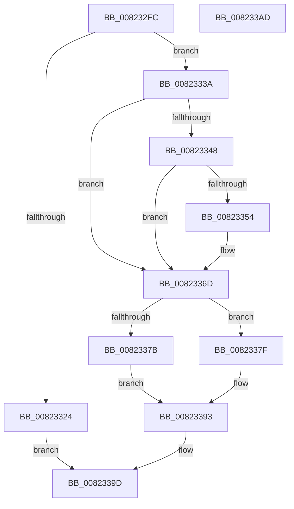

# BcdForciblyUnloadStore

- RVA: `0x008232FC`–`0x008233AE` (길이 `178` bytes)
- VA: `0x00000001408232FC`
- 실행 섹션: `PAGE`
- PDB 이름 있음: `예`; PDB Function 태그: `아니요`
- unwind 정보 RVA: `0x00060BC4`
- 디코드: `52`개 명령, `178/178` bytes 표시
- 미해석 바이트: `0` (있으면 어셈블리에 `.byte`로 보존)

> 이 문서는 커널 이미지의 기계어와 PDB 기호를 분석해 생성했습니다. 4번과 5번은 함수 원형과 자료형을 바이너리 사용 방식에서 추정한 C 해석이며 원본 소스 복구 결과는 아닙니다.

## 1. Dependencies

- 직접 호출 지점: **10**; 고유 호출 대상: **8**
- 직접 호출자로 확인된 함수: **2**
- RIP 상대 이미지 참조: **3**

### Outgoing calls
- `0x0082330E` → [BiIsOfflineHandle](../../text/4B/BiIsOfflineHandle_function_004B4FA0.md) (function, `0x004B4FA0`)
- `0x00823318` → [BiAcquireBcdSyncMutant](../91/BiAcquireBcdSyncMutant_function_00916898.md) (function, `0x00916898`)
- `0x00823330` → [BiLogMessage](../A3/BiLogMessage_function_00A3D3A8.md) (function, `0x00A3D3A8`)
- `0x0082333F` → [BiIsSystemStore](../A3/BiIsSystemStore_function_00A3DF84.md) (function, `0x00A3DF84`)
- `0x0082334B` → [BiIsSynchFirmwareEntries](../../text/69/BiIsSynchFirmwareEntries_function_0069E090.md) (function, `0x0069E090`)
- `0x0082335E` → [BiLogMessage](../A3/BiLogMessage_function_00A3D3A8.md) (function, `0x00A3D3A8`)
- `0x00823366` → [BiExportStoreAlterationsToFirmware](BiExportStoreAlterationsToFirmware_function_00826038.md) (function, `0x00826038`)
- `0x00823372` → [BiUnloadHiveByHandle](../A4/BiUnloadHiveByHandle_function_00A4105C.md) (function, `0x00A4105C`)
- `0x0082338E` → [BiLogMessage](../A3/BiLogMessage_function_00A3D3A8.md) (function, `0x00A3D3A8`)
- `0x00823396` → [BiReleaseBcdSyncMutant](../91/BiReleaseBcdSyncMutant_function_0091695C.md) (function, `0x0091695C`)

### Direct callers
- [PopAllocateHiberContext](../AD/PopAllocateHiberContext_function_00ADC05C.md) at `0x00ADC356`
- [sub_00B3A892](../B3/Unknown_function_00B3A892.md) at `0x00B3A8EE`

### Static image references
- `0x00823324` → RVA `0x00B0A8F0` (` ?? ::NNGAKEGL::`string'`; read)
- `0x00823354` → RVA `0x00B0A980` (` ?? ::NNGAKEGL::`string'`; read)
- `0x00823382` → RVA `0x00B0A9D0` (` ?? ::NNGAKEGL::`string'`; read)

## 2. Other-region calls and transfers

- 다른 실행 섹션으로 향하는 call: **2**
  - `0x0082330E` → [BiIsOfflineHandle](../../text/4B/BiIsOfflineHandle_function_004B4FA0.md) (`PAGE` → `.text`)
  - `0x0082334B` → [BiIsSynchFirmwareEntries](../../text/69/BiIsSynchFirmwareEntries_function_0069E090.md) (`PAGE` → `.text`)
- 별도 외부 분기/꼬리 이동을 확인하지 못했습니다.

## 3. Assembly (complete function range)

```asm
008232FC  48 89 5C 24 08                  mov qword ptr [rsp + 8], rbx
00823301  48 89 74 24 10                  mov qword ptr [rsp + 0x10], rsi
00823306  57                              push rdi
00823307  48 83 EC 20                     sub rsp, 0x20
0082330B  48 8B F9                        mov rdi, rcx
0082330E  E8 8D 1C C9 FF                  call 0x1404b4fa0
00823313  8A C8                           mov cl, al
00823315  40 8A F0                        mov sil, al
00823318  E8 7B 35 0F 00                  call 0x140916898
0082331D  44 8B C0                        mov r8d, eax
00823320  85 C0                           test eax, eax
00823322  79 16                           jns 0x14082333a
00823324  48 8D 15 C5 75 2E 00            lea rdx, [rip + 0x2e75c5]
0082332B  B9 04 00 00 00                  mov ecx, 4
00823330  E8 73 A0 21 00                  call 0x140a3d3a8
00823335  41 8B C0                        mov eax, r8d
00823338  EB 63                           jmp 0x14082339d
0082333A  48 8B CF                        mov rcx, rdi
0082333D  33 DB                           xor ebx, ebx
0082333F  E8 40 AC 21 00                  call 0x140a3df84
00823344  84 C0                           test al, al
00823346  74 25                           je 0x14082336d
00823348  48 8B CF                        mov rcx, rdi
0082334B  E8 40 AD E7 FF                  call 0x14069e090
00823350  84 C0                           test al, al
00823352  74 19                           je 0x14082336d
00823354  48 8D 15 25 76 2E 00            lea rdx, [rip + 0x2e7625]
0082335B  8D 4B 02                        lea ecx, [rbx + 2]
0082335E  E8 45 A0 21 00                  call 0x140a3d3a8
00823363  48 8B CF                        mov rcx, rdi
00823366  E8 CD 2C 00 00                  call 0x140826038
0082336B  8B D8                           mov ebx, eax
0082336D  B2 01                           mov dl, 1
0082336F  48 8B CF                        mov rcx, rdi
00823372  E8 E5 DC 21 00                  call 0x140a4105c
00823377  85 DB                           test ebx, ebx
00823379  78 04                           js 0x14082337f
0082337B  8B D8                           mov ebx, eax
0082337D  EB 14                           jmp 0x140823393
0082337F  44 8B C3                        mov r8d, ebx
00823382  48 8D 15 47 76 2E 00            lea rdx, [rip + 0x2e7647]
00823389  B9 04 00 00 00                  mov ecx, 4
0082338E  E8 15 A0 21 00                  call 0x140a3d3a8
00823393  40 8A CE                        mov cl, sil
00823396  E8 C1 35 0F 00                  call 0x14091695c
0082339B  8B C3                           mov eax, ebx
0082339D  48 8B 5C 24 30                  mov rbx, qword ptr [rsp + 0x30]
008233A2  48 8B 74 24 38                  mov rsi, qword ptr [rsp + 0x38]
008233A7  48 83 C4 20                     add rsp, 0x20
008233AB  5F                              pop rdi
008233AC  C3                              ret
008233AD  CC                              int3
```

## 4. C-style interpretation (structured pseudocode)

```c
__int64 __fastcall BcdForciblyUnloadStore(__int64 a1)
{
    __int64 result;
    __int64 v_rbx;
    __int64 v_rsp;
    unsigned __int64 v_stack_p10;
    unsigned __int64 v_stack_p8;

    v_stack_p8 = v_rbx;
    v_stack_p10 = v_rsi;
    v_rsp = (v_rsp) - (32);
    result = BiIsOfflineHandle(a1, a2, a3, a4);
    result = BiAcquireBcdSyncMutant((unsigned __int8)(result), a2, a3, a4);
    if (!sign_flag) goto loc_0082333A;
    result = BiLogMessage(4, v_rip + 3044805, (unsigned int)((unsigned int)(result)), a4);
    goto loc_0082339D;
loc_0082333A:
    v_rbx = 0;
    result = BiIsSystemStore(a1, v_rip + 3044805, (unsigned int)((unsigned int)(result)), a4);
    if ((unsigned __int8)(result) == 0) goto loc_0082336D;
    result = BiIsSynchFirmwareEntries(a1, v_rip + 3044805, (unsigned int)((unsigned int)(result)), a4);
    if ((unsigned __int8)(result) != 0) {
        a2 = v_rip + 3044901;
        a1 = v_rbx + 2;
        result = BiLogMessage(a1, a2, (unsigned int)((unsigned int)(result)), a4);
        a1 = a1;
        result = BiExportStoreAlterationsToFirmware(a1, a2, (unsigned int)((unsigned int)(result)), a4);
        v_rbx = (unsigned int)(result);
    }
    result = BiUnloadHiveByHandle(a1, 1, (unsigned int)((unsigned int)(result)), a4);
    if (sign_flag) goto loc_0082337F;
    goto loc_00823393;
loc_0082337F:
    result = BiLogMessage(4, v_rip + 3044935, (unsigned int)((unsigned int)((unsigned int)((unsigned int)(result)))), a4);
loc_00823393:
    result = BiReleaseBcdSyncMutant((unsigned __int8)((unsigned __int8)(result)), v_rip + 3044935, (unsigned int)((unsigned int)((unsigned int)((unsigned int)(result)))), a4);
loc_0082339D:
    v_rsp = (v_rsp) + (32);
    return (unsigned int)((unsigned int)((unsigned int)((unsigned int)(result))));
}
```

## 5. (Beta) C Style

```c
int64_t BcdForciblyUnloadStore(int64_t Arg1)
{
    int64_t result;
    int64_t local_rbx;
    int64_t local_rsp;
    uint64_t v_stack_p10;
    uint64_t v_stack_p8;

    v_stack_p8 = local_rbx;
    v_stack_p10 = local_rsi;
    local_rsp = (local_rsp) - (32);
    result = BiIsOfflineHandle(Arg1, a2, a3, a4);
    result = BiAcquireBcdSyncMutant((uint8_t)(result), a2, a3, a4);
    if (!sign_flag) goto loc_0082333A;
    result = BiLogMessage(4, v_rip + 3044805, (uint32_t)((uint32_t)(result)), a4);
    goto loc_0082339D;
loc_0082333A:
    local_rbx = 0;
    result = BiIsSystemStore(Arg1, v_rip + 3044805, (uint32_t)((uint32_t)(result)), a4);
    if ((uint8_t)(result) == 0) goto loc_0082336D;
    result = BiIsSynchFirmwareEntries(Arg1, v_rip + 3044805, (uint32_t)((uint32_t)(result)), a4);
    if ((uint8_t)(result) != 0) {
        a2 = v_rip + 3044901;
        Arg1 = local_rbx + 2;
        result = BiLogMessage(Arg1, a2, (uint32_t)((uint32_t)(result)), a4);
        Arg1 = Arg1;
        result = BiExportStoreAlterationsToFirmware(Arg1, a2, (uint32_t)((uint32_t)(result)), a4);
        local_rbx = (uint32_t)(result);
    }
    result = BiUnloadHiveByHandle(Arg1, 1, (uint32_t)((uint32_t)(result)), a4);
    if (sign_flag) goto loc_0082337F;
    goto loc_00823393;
loc_0082337F:
    result = BiLogMessage(4, v_rip + 3044935, (uint32_t)((uint32_t)((uint32_t)((uint32_t)(result)))), a4);
loc_00823393:
    result = BiReleaseBcdSyncMutant((uint8_t)((uint8_t)(result)), v_rip + 3044935, (uint32_t)((uint32_t)((uint32_t)((uint32_t)(result)))), a4);
loc_0082339D:
    local_rsp = (local_rsp) + (32);
    return (uint32_t)((uint32_t)((uint32_t)((uint32_t)(result))));
}
```

## 6. Execution-region graph

[열기: 2D/3D 그래프와 함수 탐색 컨트롤 패널](../../../control-panel.html?section=page&rva=0x008232FC&view=graph)

- 2D 그래프는 위에서 아래로 흐르고, 3D 그래프는 빈 공간을 드래그해 회전합니다. Shift+드래그는 이동, 휠은 확대·축소, 함수 노드 선택은 대상 보고서 이동입니다.

### Static fallback


