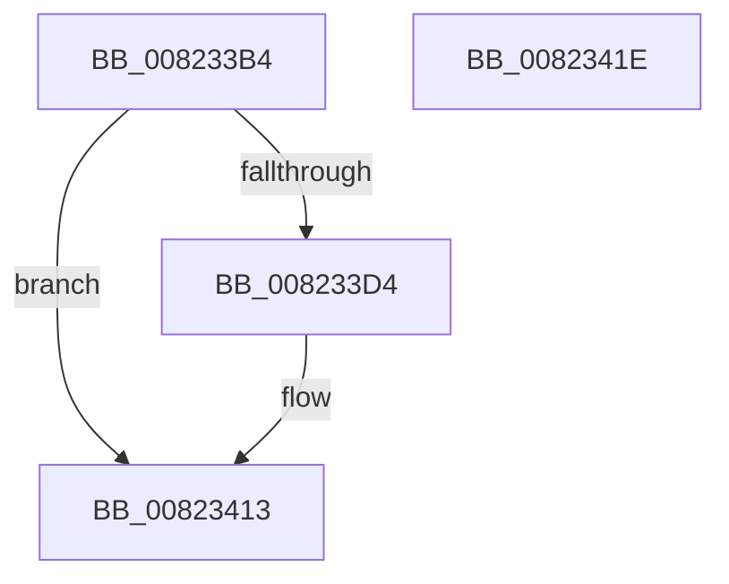

# BcdMarkAsSystemStore

- RVA: `0x008233B4`–`0x0082341F` (길이 `107` bytes)
- VA: `0x00000001408233B4`
- 실행 섹션: `PAGE`
- PDB 이름 있음: `예`; PDB Function 태그: `아니요`
- unwind 정보 RVA: `0x0006E5F8`
- 디코드: `28`개 명령, `107/107` bytes 표시
- 미해석 바이트: `0` (있으면 어셈블리에 `.byte`로 보존)

> 이 문서는 커널 이미지의 기계어와 PDB 기호를 분석해 생성했습니다. 4번과 5번은 함수 원형과 자료형을 바이너리 사용 방식에서 추정한 C 해석이며 원본 소스 복구 결과는 아닙니다.

## 1. Dependencies

- 직접 호출 지점: **4**; 고유 호출 대상: **4**
- 직접 호출자로 확인된 함수: **1**
- RIP 상대 이미지 참조: **2**

### Outgoing calls
- `0x008233C1` → [BiIsOfflineHandle](../../text/4B/BiIsOfflineHandle_function_004B4FA0.md) (function, `0x004B4FA0`)
- `0x008233CB` → [BiAcquireBcdSyncMutant](../91/BiAcquireBcdSyncMutant_function_00916898.md) (function, `0x00916898`)
- `0x00823402` → [BiSetRegistryValue](../A3/BiSetRegistryValue_function_00A3E3B0.md) (function, `0x00A3E3B0`)
- `0x0082340C` → [BiReleaseBcdSyncMutant](../91/BiReleaseBcdSyncMutant_function_0091695C.md) (function, `0x0091695C`)

### Direct callers
- [BcdSetSystemStore](BcdSetSystemStore_function_00823478.md) at `0x00823481`

### Static image references
- `0x008233EC` → RVA `0x00AFF1D0` (` ?? ::NNGAKEGL::`string'`; read)
- `0x008233F8` → RVA `0x00AFC8A0` (` ?? ::NNGAKEGL::`string'`; read)

## 2. Other-region calls and transfers

- 다른 실행 섹션으로 향하는 call: **1**
  - `0x008233C1` → [BiIsOfflineHandle](../../text/4B/BiIsOfflineHandle_function_004B4FA0.md) (`PAGE` → `.text`)
- 별도 외부 분기/꼬리 이동을 확인하지 못했습니다.

## 3. Assembly (complete function range)

```asm
008233B4  48 89 5C 24 08                  mov qword ptr [rsp + 8], rbx
008233B9  57                              push rdi
008233BA  48 83 EC 30                     sub rsp, 0x30
008233BE  48 8B D9                        mov rbx, rcx
008233C1  E8 DA 1B C9 FF                  call 0x1404b4fa0
008233C6  8A C8                           mov cl, al
008233C8  40 8A F8                        mov dil, al
008233CB  E8 C8 34 0F 00                  call 0x140916898
008233D0  85 C0                           test eax, eax
008233D2  78 3F                           js 0x140823413
008233D4  41 B9 04 00 00 00               mov r9d, 4
008233DA  C7 44 24 48 01 00 00 00         mov dword ptr [rsp + 0x48], 1
008233E2  48 8D 44 24 48                  lea rax, [rsp + 0x48]
008233E7  44 89 4C 24 28                  mov dword ptr [rsp + 0x28], r9d
008233EC  4C 8D 05 DD BD 2D 00            lea r8, [rip + 0x2dbddd]
008233F3  48 89 44 24 20                  mov qword ptr [rsp + 0x20], rax
008233F8  48 8D 15 A1 94 2D 00            lea rdx, [rip + 0x2d94a1]
008233FF  48 8B CB                        mov rcx, rbx
00823402  E8 A9 AF 21 00                  call 0x140a3e3b0
00823407  40 8A CF                        mov cl, dil
0082340A  8B D8                           mov ebx, eax
0082340C  E8 4B 35 0F 00                  call 0x14091695c
00823411  8B C3                           mov eax, ebx
00823413  48 8B 5C 24 40                  mov rbx, qword ptr [rsp + 0x40]
00823418  48 83 C4 30                     add rsp, 0x30
0082341C  5F                              pop rdi
0082341D  C3                              ret
0082341E  CC                              int3
```

## 4. C-style interpretation (structured pseudocode)

```c
__int64 __fastcall BcdMarkAsSystemStore(__int64 a1)
{
    __int64 result;
    __int64 v_rbx;
    __int64 v_rsp;
    unsigned int v_stack_m10;
    unsigned __int64 v_stack_m18;
    unsigned int v_stack_p10;
    unsigned __int64 v_stack_p8;

    v_stack_p8 = v_rbx;
    v_rsp = (v_rsp) - (48);
    result = BiIsOfflineHandle(a1, a2, a3, a4);
    result = BiAcquireBcdSyncMutant((unsigned __int8)(result), a2, a3, a4);
    v_rbx = a1;
    if (!(sign_flag)) {
        a4 = 4;
        v_stack_p10 = 1;
        result = v_stack_p10;
        v_stack_m10 = (unsigned int)(a4);
        a3 = v_rip + 2997725;
        v_stack_m18 = result;
        a2 = v_rip + 2987169;
        a1 = a1;
        result = BiSetRegistryValue(a1, a2, a3, a4);
        a1 = (unsigned __int8)((unsigned __int8)(result));
        v_rbx = (unsigned int)(result);
        result = BiReleaseBcdSyncMutant(a1, a2, a3, a4);
        result = (unsigned int)(v_rbx);
    }
    v_rsp = (v_rsp) + (48);
    return result;
}
```

## 5. (Beta) C Style

```c
int64_t BcdMarkAsSystemStore(int64_t Arg1)
{
    int64_t result;
    int64_t local_rbx;
    int64_t local_rsp;
    uint32_t v_stack_m10;
    uint64_t v_stack_m18;
    uint32_t v_stack_p10;
    uint64_t v_stack_p8;

    v_stack_p8 = local_rbx;
    local_rsp = (local_rsp) - (48);
    result = BiIsOfflineHandle(Arg1, a2, a3, a4);
    result = BiAcquireBcdSyncMutant((uint8_t)(result), a2, a3, a4);
    local_rbx = Arg1;
    if (!(sign_flag)) {
        a4 = 4;
        v_stack_p10 = 1;
        result = v_stack_p10;
        v_stack_m10 = (uint32_t)(a4);
        a3 = v_rip + 2997725;
        v_stack_m18 = result;
        a2 = v_rip + 2987169;
        Arg1 = Arg1;
        result = BiSetRegistryValue(Arg1, a2, a3, a4);
        Arg1 = (uint8_t)((uint8_t)(result));
        local_rbx = (uint32_t)(result);
        result = BiReleaseBcdSyncMutant(Arg1, a2, a3, a4);
        result = (uint32_t)(local_rbx);
    }
    local_rsp = (local_rsp) + (48);
    return result;
}
```

## 6. Execution-region graph

[열기: 2D/3D 그래프와 함수 탐색 컨트롤 패널](../../../control-panel.html?section=page&rva=0x008233B4&view=graph)

- 2D 그래프는 위에서 아래로 흐르고, 3D 그래프는 빈 공간을 드래그해 회전합니다. Shift+드래그는 이동, 휠은 확대·축소, 함수 노드 선택은 대상 보고서 이동입니다.

### Static fallback


