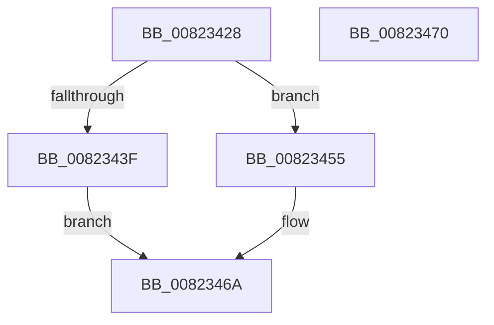

# BcdOpenSystemStore

- RVA: `0x00823428`–`0x00823471` (길이 `73` bytes)
- VA: `0x0000000140823428`
- 실행 섹션: `PAGE`
- PDB 이름 있음: `예`; PDB Function 태그: `아니요`
- unwind 정보 RVA: `0x0005CF00`
- 디코드: `24`개 명령, `73/73` bytes 표시
- 미해석 바이트: `0` (있으면 어셈블리에 `.byte`로 보존)

> 이 문서는 커널 이미지의 기계어와 PDB 기호를 분석해 생성했습니다. 4번과 5번은 함수 원형과 자료형을 바이너리 사용 방식에서 추정한 C 해석이며 원본 소스 복구 결과는 아닙니다.

## 1. Dependencies

- 직접 호출 지점: **4**; 고유 호출 대상: **4**
- 직접 호출자로 확인된 함수: **1**
- RIP 상대 이미지 참조: **1**

### Outgoing calls
- `0x00823433` → [BiAcquireBcdSyncMutant](../91/BiAcquireBcdSyncMutant_function_00916898.md) (function, `0x00916898`)
- `0x0082344B` → [BiLogMessage](../A3/BiLogMessage_function_00A3D3A8.md) (function, `0x00A3D3A8`)
- `0x0082345A` → [BiOpenSystemStore](../A4/BiOpenSystemStore_function_00A40844.md) (function, `0x00A40844`)
- `0x00823463` → [BiReleaseBcdSyncMutant](../91/BiReleaseBcdSyncMutant_function_0091695C.md) (function, `0x0091695C`)

### Direct callers
- [SepSecureBootCorrectBcd](../7A/SepSecureBootCorrectBcd_function_007A2174.md) at `0x007A21E6`

### Static image references
- `0x0082343F` → RVA `0x00B0A0E0` (` ?? ::NNGAKEGL::`string'`; read)

## 2. Other-region calls and transfers

- 다른 실행 섹션으로 향하는 call: **0**
- 별도 외부 분기/꼬리 이동을 확인하지 못했습니다.

## 3. Assembly (complete function range)

```asm
00823428  40 53                           push rbx
0082342A  48 83 EC 20                     sub rsp, 0x20
0082342E  48 8B D9                        mov rbx, rcx
00823431  33 C9                           xor ecx, ecx
00823433  E8 60 34 0F 00                  call 0x140916898
00823438  44 8B C0                        mov r8d, eax
0082343B  85 C0                           test eax, eax
0082343D  79 16                           jns 0x140823455
0082343F  48 8D 15 9A 6C 2E 00            lea rdx, [rip + 0x2e6c9a]
00823446  B9 04 00 00 00                  mov ecx, 4
0082344B  E8 58 9F 21 00                  call 0x140a3d3a8
00823450  41 8B C0                        mov eax, r8d
00823453  EB 15                           jmp 0x14082346a
00823455  33 D2                           xor edx, edx
00823457  48 8B CB                        mov rcx, rbx
0082345A  E8 E5 D3 21 00                  call 0x140a40844
0082345F  33 C9                           xor ecx, ecx
00823461  8B D8                           mov ebx, eax
00823463  E8 F4 34 0F 00                  call 0x14091695c
00823468  8B C3                           mov eax, ebx
0082346A  48 83 C4 20                     add rsp, 0x20
0082346E  5B                              pop rbx
0082346F  C3                              ret
00823470  CC                              int3
```

## 4. C-style interpretation (structured pseudocode)

```c
__int64 __fastcall BcdOpenSystemStore(__int64 a1)
{
    __int64 result;
    __int64 v_rsp;

    v_rsp = (v_rsp) - (32);
    a1 = 0;
    result = BiAcquireBcdSyncMutant(a1, a2, a3, a4);
    if (!sign_flag) goto loc_00823455;
    result = BiLogMessage(4, v_rip + 3042458, (unsigned int)((unsigned int)(result)), a4);
    goto loc_0082346A;
loc_00823455:
    a2 = 0;
    result = BiOpenSystemStore(0, a2, (unsigned int)((unsigned int)(result)), a4);
    a1 = 0;
    result = BiReleaseBcdSyncMutant(a1, a2, (unsigned int)((unsigned int)(result)), a4);
loc_0082346A:
    v_rsp = (v_rsp) + (32);
    return (unsigned int)((unsigned int)((unsigned int)((unsigned int)(result))));
}
```

## 5. (Beta) C Style

```c
int64_t BcdOpenSystemStore(int64_t Arg1)
{
    int64_t result;
    int64_t local_rsp;

    local_rsp = (local_rsp) - (32);
    Arg1 = 0;
    result = BiAcquireBcdSyncMutant(Arg1, a2, a3, a4);
    if (!sign_flag) goto loc_00823455;
    result = BiLogMessage(4, v_rip + 3042458, (uint32_t)((uint32_t)(result)), a4);
    goto loc_0082346A;
loc_00823455:
    a2 = 0;
    result = BiOpenSystemStore(0, a2, (uint32_t)((uint32_t)(result)), a4);
    Arg1 = 0;
    result = BiReleaseBcdSyncMutant(Arg1, a2, (uint32_t)((uint32_t)(result)), a4);
loc_0082346A:
    local_rsp = (local_rsp) + (32);
    return (uint32_t)((uint32_t)((uint32_t)((uint32_t)(result))));
}
```

## 6. Execution-region graph

[열기: 2D/3D 그래프와 함수 탐색 컨트롤 패널](../../../control-panel.html?section=page&rva=0x00823428&view=graph)

- 2D 그래프는 위에서 아래로 흐르고, 3D 그래프는 빈 공간을 드래그해 회전합니다. Shift+드래그는 이동, 휠은 확대·축소, 함수 노드 선택은 대상 보고서 이동입니다.

### Static fallback


