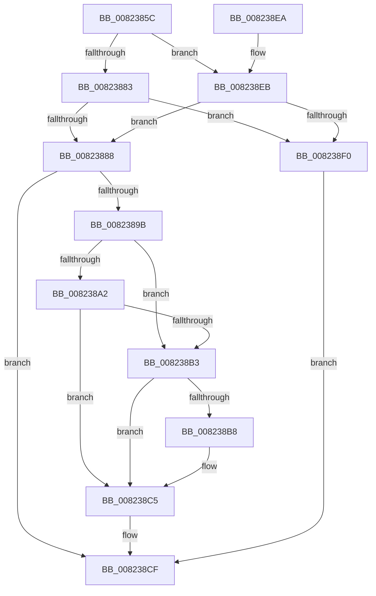

# BcdQueryObject

- RVA: `0x0082385C`–`0x008238F7` (길이 `155` bytes)
- VA: `0x000000014082385C`
- 실행 섹션: `PAGE`
- PDB 이름 있음: `예`; PDB Function 태그: `아니요`
- unwind 정보 RVA: `0x000AD2A0`
- 디코드: `50`개 명령, `155/155` bytes 표시
- 미해석 바이트: `0` (있으면 어셈블리에 `.byte`로 보존)

> 이 문서는 커널 이미지의 기계어와 PDB 기호를 분석해 생성했습니다. 4번과 5번은 함수 원형과 자료형을 바이너리 사용 방식에서 추정한 C 해석이며 원본 소스 복구 결과는 아닙니다.

## 1. Dependencies

- 직접 호출 지점: **5**; 고유 호출 대상: **5**
- 직접 호출자로 확인된 함수: **5**
- RIP 상대 이미지 참조: **0**

### Outgoing calls
- `0x00823888` → [BiIsOfflineHandle](../../text/4B/BiIsOfflineHandle_function_004B4FA0.md) (function, `0x004B4FA0`)
- `0x00823892` → [BiAcquireBcdSyncMutant](../91/BiAcquireBcdSyncMutant_function_00916898.md) (function, `0x00916898`)
- `0x008238A8` → [BiGetObjectDescription](../A3/BiGetObjectDescription_function_00A3F2FC.md) (function, `0x00A3F2FC`)
- `0x008238BE` → [BiGetObjectIdentifier](../A3/BiGetObjectIdentifier_function_00A3EEA0.md) (function, `0x00A3EEA0`)
- `0x008238C8` → [BiReleaseBcdSyncMutant](../91/BiReleaseBcdSyncMutant_function_0091695C.md) (function, `0x0091695C`)

### Direct callers
- [PopBcdEstablishResumeObject](../77/PopBcdEstablishResumeObject_function_007700E4.md) at `0x00770198`
- [PopBcdGetApplicationPathFromResumeObject](../77/PopBcdGetApplicationPathFromResumeObject_function_007702AC.md) at `0x00770381`
- [PopBcdRegenerateResumeObject](../77/PopBcdRegenerateResumeObject_function_007704BC.md) at `0x00770643`
- [PopBcdSetPendingResume](../77/PopBcdSetPendingResume_function_007706F8.md) at `0x0077077F`
- [BiUpdateObjectReferenceInEfiEntry](BiUpdateObjectReferenceInEfiEntry_function_0082745C.md) at `0x008274B6`

### Static image references
- 디코드된 RIP-relative 메모리 참조가 없습니다.

## 2. Other-region calls and transfers

- 다른 실행 섹션으로 향하는 call: **1**
  - `0x00823888` → [BiIsOfflineHandle](../../text/4B/BiIsOfflineHandle_function_004B4FA0.md) (`PAGE` → `.text`)
- 별도 외부 분기/꼬리 이동을 확인하지 못했습니다.

## 3. Assembly (complete function range)

```asm
0082385C  48 8B C4                        mov rax, rsp
0082385F  48 89 58 08                     mov qword ptr [rax + 8], rbx
00823863  48 89 68 10                     mov qword ptr [rax + 0x10], rbp
00823867  48 89 70 18                     mov qword ptr [rax + 0x18], rsi
0082386B  48 89 78 20                     mov qword ptr [rax + 0x20], rdi
0082386F  41 56                           push r14
00823871  48 83 EC 20                     sub rsp, 0x20
00823875  49 8B F9                        mov rdi, r9
00823878  49 8B F0                        mov rsi, r8
0082387B  48 8B E9                        mov rbp, rcx
0082387E  4D 85 C0                        test r8, r8
00823881  75 68                           jne 0x1408238eb
00823883  4D 85 C9                        test r9, r9
00823886  74 68                           je 0x1408238f0
00823888  E8 13 17 C9 FF                  call 0x1404b4fa0
0082388D  8A C8                           mov cl, al
0082388F  44 8A F0                        mov r14b, al
00823892  E8 01 30 0F 00                  call 0x140916898
00823897  85 C0                           test eax, eax
00823899  78 34                           js 0x1408238cf
0082389B  33 DB                           xor ebx, ebx
0082389D  48 85 F6                        test rsi, rsi
008238A0  74 11                           je 0x1408238b3
008238A2  48 8B D6                        mov rdx, rsi
008238A5  48 8B CD                        mov rcx, rbp
008238A8  E8 4F BA 21 00                  call 0x140a3f2fc
008238AD  8B D8                           mov ebx, eax
008238AF  85 C0                           test eax, eax
008238B1  78 12                           js 0x1408238c5
008238B3  48 85 FF                        test rdi, rdi
008238B6  74 0D                           je 0x1408238c5
008238B8  48 8B D7                        mov rdx, rdi
008238BB  48 8B CD                        mov rcx, rbp
008238BE  E8 DD B5 21 00                  call 0x140a3eea0
008238C3  8B D8                           mov ebx, eax
008238C5  41 8A CE                        mov cl, r14b
008238C8  E8 8F 30 0F 00                  call 0x14091695c
008238CD  8B C3                           mov eax, ebx
008238CF  48 8B 5C 24 30                  mov rbx, qword ptr [rsp + 0x30]
008238D4  48 8B 6C 24 38                  mov rbp, qword ptr [rsp + 0x38]
008238D9  48 8B 74 24 40                  mov rsi, qword ptr [rsp + 0x40]
008238DE  48 8B 7C 24 48                  mov rdi, qword ptr [rsp + 0x48]
008238E3  48 83 C4 20                     add rsp, 0x20
008238E7  41 5E                           pop r14
008238E9  C3                              ret
008238EA  CC                              int3
008238EB  83 FA 01                        cmp edx, 1
008238EE  74 98                           je 0x140823888
008238F0  B8 0D 00 00 C0                  mov eax, 0xc000000d
008238F5  EB D8                           jmp 0x1408238cf
```

## 4. C-style interpretation (structured pseudocode)

```c
__int64 __fastcall BcdQueryObject(__int64 a1, __int64 a2, __int64 a3, __int64 a4)
{
    __int64 result;
    __int64 v_rbx;
    __int64 v_rsp;
    unsigned __int64 v_stack_p10;
    unsigned __int64 v_stack_p18;
    unsigned __int64 v_stack_p20;
    unsigned __int64 v_stack_p8;

    *(unsigned __int64 *)(v_rsp + 8) = v_rbx;
    *(unsigned __int64 *)(v_rsp + 16) = v_rbp;
    *(unsigned __int64 *)(v_rsp + 24) = v_rsi;
    *(unsigned __int64 *)(v_rsp + 32) = v_rdi;
    v_rsp = (v_rsp) - (32);
    if (a3 != 0) goto loc_008238EB;
    if (a4 == 0) goto loc_008238F0;
loc_00823888:
    result = BiIsOfflineHandle(a1, a2, a3, a4);
    result = BiAcquireBcdSyncMutant((unsigned __int8)(result), a2, a3, a4);
    if (sign_flag) goto loc_008238CF;
    v_rbx = 0;
    if (a3 == 0) goto loc_008238B3;
    result = BiGetObjectDescription(a1, a3, a3, a4);
    if (sign_flag) goto loc_008238C5;
loc_008238B3:
    v_rbx = (unsigned int)((unsigned int)(result));
    if (a4 != 0) {
        a2 = a4;
        a1 = a1;
        result = BiGetObjectIdentifier(a1, a2, a3, a4);
        v_rbx = (unsigned int)(result);
    }
    result = BiReleaseBcdSyncMutant((unsigned __int8)((unsigned __int8)(result)), a2, a3, a4);
loc_008238CF:
    v_rsp = (v_rsp) + (32);
    return (unsigned int)((unsigned int)(v_rbx));
loc_008238EB:
    if (((unsigned int)(a2)) == 1) goto loc_00823888;
loc_008238F0:
    goto loc_008238CF;
}
```

## 5. (Beta) C Style

```c
int64_t BcdQueryObject(int64_t Arg1, int64_t Arg2, int64_t Arg3, int64_t Arg4)
{
    int64_t result;
    int64_t local_rbx;
    int64_t local_rsp;
    uint64_t v_stack_p10;
    uint64_t v_stack_p18;
    uint64_t v_stack_p20;
    uint64_t v_stack_p8;

    *(uint64_t *)(local_rsp + 0x8) = local_rbx;
    *(uint64_t *)(local_rsp + 0x10) = local_rbp;
    *(uint64_t *)(local_rsp + 0x18) = local_rsi;
    *(uint64_t *)(local_rsp + 0x20) = local_rdi;
    local_rsp = (local_rsp) - (32);
    if (Arg3 != 0) goto loc_008238EB;
    if (Arg4 == 0) goto loc_008238F0;
loc_00823888:
    result = BiIsOfflineHandle(Arg1, Arg2, Arg3, Arg4);
    result = BiAcquireBcdSyncMutant((uint8_t)(result), Arg2, Arg3, Arg4);
    if (sign_flag) goto loc_008238CF;
    local_rbx = 0;
    if (Arg3 == 0) goto loc_008238B3;
    result = BiGetObjectDescription(Arg1, Arg3, Arg3, Arg4);
    if (sign_flag) goto loc_008238C5;
loc_008238B3:
    local_rbx = (uint32_t)((uint32_t)(result));
    if (Arg4 != 0) {
        Arg2 = Arg4;
        Arg1 = Arg1;
        result = BiGetObjectIdentifier(Arg1, Arg2, Arg3, Arg4);
        local_rbx = (uint32_t)(result);
    }
    result = BiReleaseBcdSyncMutant((uint8_t)((uint8_t)(result)), Arg2, Arg3, Arg4);
loc_008238CF:
    local_rsp = (local_rsp) + (32);
    return (uint32_t)((uint32_t)(local_rbx));
loc_008238EB:
    if (((uint32_t)(Arg2)) == 1) goto loc_00823888;
loc_008238F0:
    goto loc_008238CF;
}
```

## 6. Execution-region graph

[열기: 2D/3D 그래프와 함수 탐색 컨트롤 패널](../../../control-panel.html?section=page&rva=0x0082385C&view=graph)

- 2D 그래프는 위에서 아래로 흐르고, 3D 그래프는 빈 공간을 드래그해 회전합니다. Shift+드래그는 이동, 휠은 확대·축소, 함수 노드 선택은 대상 보고서 이동입니다.

### Static fallback


