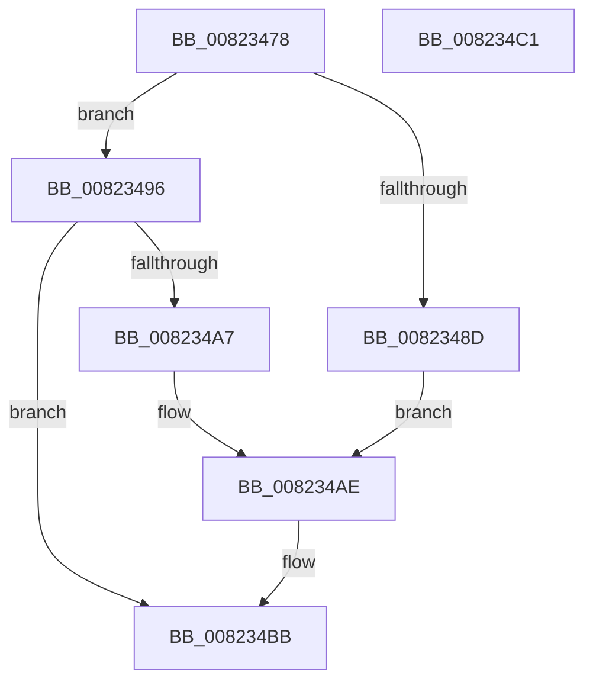

# BcdSetSystemStore

- RVA: `0x00823478`–`0x008234C2` (길이 `74` bytes)
- VA: `0x0000000140823478`
- 실행 섹션: `PAGE`
- PDB 이름 있음: `예`; PDB Function 태그: `아니요`
- unwind 정보 RVA: `0x0005CF00`
- 디코드: `23`개 명령, `74/74` bytes 표시
- 미해석 바이트: `0` (있으면 어셈블리에 `.byte`로 보존)

> 이 문서는 커널 이미지의 기계어와 PDB 기호를 분석해 생성했습니다. 4번과 5번은 함수 원형과 자료형을 바이너리 사용 방식에서 추정한 C 해석이며 원본 소스 복구 결과는 아닙니다.

## 1. Dependencies

- 직접 호출 지점: **3**; 고유 호출 대상: **3**
- 직접 호출자로 확인된 함수: **1**
- RIP 상대 이미지 참조: **2**

### Outgoing calls
- `0x00823481` → [BcdMarkAsSystemStore](BcdMarkAsSystemStore_function_008233B4.md) (function, `0x008233B4`)
- `0x0082349B` → [BiMarkTreatAsSystemStore](BiMarkTreatAsSystemStore_function_008234C8.md) (function, `0x008234C8`)
- `0x008234B3` → [BiLogMessage](../A3/BiLogMessage_function_00A3D3A8.md) (function, `0x00A3D3A8`)

### Direct callers
- [BcdSetBootBcdAsSystemStore](../../init/C6/BcdSetBootBcdAsSystemStore_function_00C6D214.md) at `0x00C6D2A0`

### Static image references
- `0x0082348D` → RVA `0x00B0AA50` (` ?? ::NNGAKEGL::`string'`; read)
- `0x008234A7` → RVA `0x00B0AAE0` (` ?? ::NNGAKEGL::`string'`; read)

## 2. Other-region calls and transfers

- 다른 실행 섹션으로 향하는 call: **0**
- 별도 외부 분기/꼬리 이동을 확인하지 못했습니다.

## 3. Assembly (complete function range)

```asm
00823478  40 53                           push rbx
0082347A  48 83 EC 20                     sub rsp, 0x20
0082347E  48 8B D9                        mov rbx, rcx
00823481  E8 2E FF FF FF                  call 0x1408233b4
00823486  44 8B C0                        mov r8d, eax
00823489  85 C0                           test eax, eax
0082348B  79 09                           jns 0x140823496
0082348D  48 8D 15 BC 75 2E 00            lea rdx, [rip + 0x2e75bc]
00823494  EB 18                           jmp 0x1408234ae
00823496  B2 01                           mov dl, 1
00823498  48 8B CB                        mov rcx, rbx
0082349B  E8 28 00 00 00                  call 0x1408234c8
008234A0  44 8B C0                        mov r8d, eax
008234A3  85 C0                           test eax, eax
008234A5  79 14                           jns 0x1408234bb
008234A7  48 8D 15 32 76 2E 00            lea rdx, [rip + 0x2e7632]
008234AE  B9 04 00 00 00                  mov ecx, 4
008234B3  E8 F0 9E 21 00                  call 0x140a3d3a8
008234B8  41 8B C0                        mov eax, r8d
008234BB  48 83 C4 20                     add rsp, 0x20
008234BF  5B                              pop rbx
008234C0  C3                              ret
008234C1  CC                              int3
```

## 4. C-style interpretation (structured pseudocode)

```c
__int64 __fastcall BcdSetSystemStore(__int64 a1)
{
    __int64 result;
    __int64 v_rsp;

    v_rsp = (v_rsp) - (32);
    result = BcdMarkAsSystemStore(a1, a2, a3, a4);
    if (!sign_flag) goto loc_00823496;
    goto loc_008234AE;
loc_00823496:
    result = BiMarkTreatAsSystemStore(a1, 1, (unsigned int)((unsigned int)(result)), a4);
    if (!sign_flag) goto loc_008234BB;
loc_008234AE:
    result = BiLogMessage(4, v_rip + 3044914, (unsigned int)((unsigned int)(result)), a4);
loc_008234BB:
    v_rsp = (v_rsp) + (32);
    return (unsigned int)((unsigned int)((unsigned int)((unsigned int)(result))));
}
```

## 5. (Beta) C Style

```c
int64_t BcdSetSystemStore(int64_t Arg1)
{
    int64_t result;
    int64_t local_rsp;

    local_rsp = (local_rsp) - (32);
    result = BcdMarkAsSystemStore(Arg1, a2, a3, a4);
    if (!sign_flag) goto loc_00823496;
    goto loc_008234AE;
loc_00823496:
    result = BiMarkTreatAsSystemStore(Arg1, 1, (uint32_t)((uint32_t)(result)), a4);
    if (!sign_flag) goto loc_008234BB;
loc_008234AE:
    result = BiLogMessage(4, v_rip + 3044914, (uint32_t)((uint32_t)(result)), a4);
loc_008234BB:
    local_rsp = (local_rsp) + (32);
    return (uint32_t)((uint32_t)((uint32_t)((uint32_t)(result))));
}
```

## 6. Execution-region graph

[열기: 2D/3D 그래프와 함수 탐색 컨트롤 패널](../../../control-panel.html?section=page&rva=0x00823478&view=graph)

- 2D 그래프는 위에서 아래로 흐르고, 3D 그래프는 빈 공간을 드래그해 회전합니다. Shift+드래그는 이동, 휠은 확대·축소, 함수 노드 선택은 대상 보고서 이동입니다.

### Static fallback


