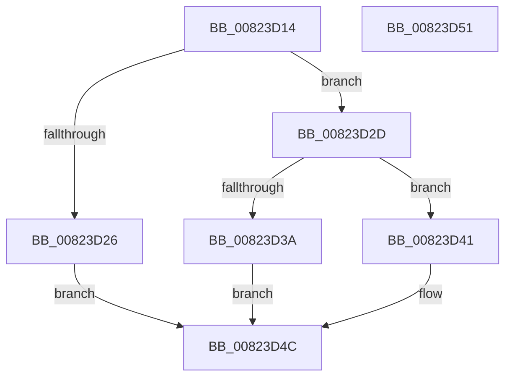

# BcdUtilGetBootOptionBoolean

- RVA: `0x00823D14`–`0x00823D52` (길이 `62` bytes)
- VA: `0x0000000140823D14`
- 실행 섹션: `PAGE`
- PDB 이름 있음: `예`; PDB Function 태그: `아니요`
- unwind 정보 RVA: `0x0005C788`
- 디코드: `20`개 명령, `62/62` bytes 표시
- 미해석 바이트: `0` (있으면 어셈블리에 `.byte`로 보존)

> 이 문서는 커널 이미지의 기계어와 PDB 기호를 분석해 생성했습니다. 4번과 5번은 함수 원형과 자료형을 바이너리 사용 방식에서 추정한 C 해석이며 원본 소스 복구 결과는 아닙니다.

## 1. Dependencies

- 직접 호출 지점: **1**; 고유 호출 대상: **1**
- 직접 호출자로 확인된 함수: **1**
- RIP 상대 이미지 참조: **0**

### Outgoing calls
- `0x00823D2D` → [BcdUtilGetBootOption](BcdUtilGetBootOption_function_00823CAC.md) (function, `0x00823CAC`)

### Direct callers
- [SeAuditBootConfiguration](../79/SeAuditBootConfiguration_function_0079E374.md) at `0x0079E4FB`
- [SeAuditBootConfiguration](../79/SeAuditBootConfiguration_function_0079E374.md) at `0x0079E578`
- [SeAuditBootConfiguration](../79/SeAuditBootConfiguration_function_0079E374.md) at `0x0079E5AC`
- [SeAuditBootConfiguration](../79/SeAuditBootConfiguration_function_0079E374.md) at `0x0079E626`
- [SeAuditBootConfiguration](../79/SeAuditBootConfiguration_function_0079E374.md) at `0x0079E663`
- [SeAuditBootConfiguration](../79/SeAuditBootConfiguration_function_0079E374.md) at `0x0079E6A0`
- [SeAuditBootConfiguration](../79/SeAuditBootConfiguration_function_0079E374.md) at `0x0079E797`

### Static image references
- 디코드된 RIP-relative 메모리 참조가 없습니다.

## 2. Other-region calls and transfers

- 다른 실행 섹션으로 향하는 call: **0**
- 별도 외부 분기/꼬리 이동을 확인하지 못했습니다.

## 3. Assembly (complete function range)

```asm
00823D14  48 83 EC 28                     sub rsp, 0x28
00823D18  8B C2                           mov eax, edx
00823D1A  25 00 00 00 0F                  and eax, 0xf000000
00823D1F  3D 00 00 00 06                  cmp eax, 0x6000000
00823D24  74 07                           je 0x140823d2d
00823D26  B8 0D 00 00 C0                  mov eax, 0xc000000d
00823D2B  EB 1F                           jmp 0x140823d4c
00823D2D  E8 7A FF FF FF                  call 0x140823cac
00823D32  48 8B C8                        mov rcx, rax
00823D35  48 85 C0                        test rax, rax
00823D38  75 07                           jne 0x140823d41
00823D3A  B8 25 02 00 C0                  mov eax, 0xc0000225
00823D3F  EB 0B                           jmp 0x140823d4c
00823D41  8B 40 04                        mov eax, dword ptr [rax + 4]
00823D44  8A 0C 08                        mov cl, byte ptr [rax + rcx]
00823D47  33 C0                           xor eax, eax
00823D49  41 88 08                        mov byte ptr [r8], cl
00823D4C  48 83 C4 28                     add rsp, 0x28
00823D50  C3                              ret
00823D51  CC                              int3
```

## 4. C-style interpretation (structured pseudocode)

```c
__int64 __fastcall BcdUtilGetBootOptionBoolean(__int64 a1, int a2, __int64 a3)
{
    __int64 result;
    __int64 v_rsp;

    v_rsp = (v_rsp) - (40);
    result = (unsigned int)(((unsigned int)(a2)) & (0xF000000ULL));
    if (((unsigned int)(result)) == 0x6000000ULL) goto loc_00823D2D;
    goto loc_00823D4C;
loc_00823D2D:
    result = BcdUtilGetBootOption(a1, a2, a3, a4);
    if (result != 0) goto loc_00823D41;
    goto loc_00823D4C;
loc_00823D41:
    result = 0;
    *(unsigned __int8 *)(a3) = (unsigned __int8)(*(unsigned __int8 *)((unsigned int)(*(unsigned int *)((unsigned int)(0xC0000225ULL) + 4)) + result * 1));
loc_00823D4C:
    v_rsp = (v_rsp) + (40);
    return result;
}
```

## 5. (Beta) C Style

```c
int64_t BcdUtilGetBootOptionBoolean(int64_t Arg1, int32_t Arg2, int64_t Arg3)
{
    int64_t result;
    int64_t local_rsp;

    local_rsp = (local_rsp) - (40);
    result = (uint32_t)(((uint32_t)(Arg2)) & (0xF000000ULL));
    if (((uint32_t)(result)) == 0x6000000ULL) goto loc_00823D2D;
    goto loc_00823D4C;
loc_00823D2D:
    result = BcdUtilGetBootOption(Arg1, Arg2, Arg3, a4);
    if (result != 0) goto loc_00823D41;
    goto loc_00823D4C;
loc_00823D41:
    result = 0;
    *(uint8_t *)(Arg3) = (uint8_t)(*(uint8_t *)((uint32_t)(*(uint32_t *)((uint32_t)(0xC0000225ULL) + 0x4)) + result * 1));
loc_00823D4C:
    local_rsp = (local_rsp) + (40);
    return result;
}
```

## 6. Execution-region graph

[열기: 2D/3D 그래프와 함수 탐색 컨트롤 패널](../../../control-panel.html?section=page&rva=0x00823D14&view=graph)

- 2D 그래프는 위에서 아래로 흐르고, 3D 그래프는 빈 공간을 드래그해 회전합니다. Shift+드래그는 이동, 휠은 확대·축소, 함수 노드 선택은 대상 보고서 이동입니다.

### Static fallback


