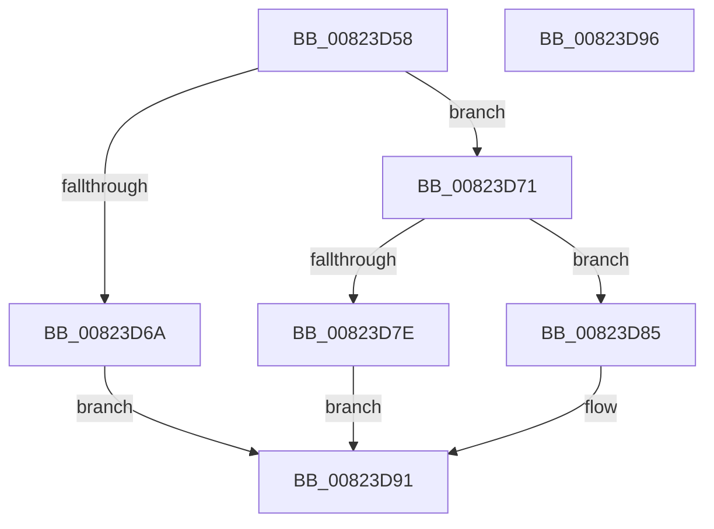

# BcdUtilGetBootOptionInteger

- RVA: `0x00823D58`–`0x00823D97` (길이 `63` bytes)
- VA: `0x0000000140823D58`
- 실행 섹션: `PAGE`
- PDB 이름 있음: `예`; PDB Function 태그: `아니요`
- unwind 정보 RVA: `0x0005C788`
- 디코드: `20`개 명령, `63/63` bytes 표시
- 미해석 바이트: `0` (있으면 어셈블리에 `.byte`로 보존)

> 이 문서는 커널 이미지의 기계어와 PDB 기호를 분석해 생성했습니다. 4번과 5번은 함수 원형과 자료형을 바이너리 사용 방식에서 추정한 C 해석이며 원본 소스 복구 결과는 아닙니다.

## 1. Dependencies

- 직접 호출 지점: **1**; 고유 호출 대상: **1**
- 직접 호출자로 확인된 함수: **1**
- RIP 상대 이미지 참조: **0**

### Outgoing calls
- `0x00823D71` → [BcdUtilGetBootOption](BcdUtilGetBootOption_function_00823CAC.md) (function, `0x00823CAC`)

### Direct callers
- [SeAuditBootConfiguration](../79/SeAuditBootConfiguration_function_0079E374.md) at `0x0079E53B`
- [SeAuditBootConfiguration](../79/SeAuditBootConfiguration_function_0079E374.md) at `0x0079E5E0`
- [SeAuditBootConfiguration](../79/SeAuditBootConfiguration_function_0079E374.md) at `0x0079E744`

### Static image references
- 디코드된 RIP-relative 메모리 참조가 없습니다.

## 2. Other-region calls and transfers

- 다른 실행 섹션으로 향하는 call: **0**
- 별도 외부 분기/꼬리 이동을 확인하지 못했습니다.

## 3. Assembly (complete function range)

```asm
00823D58  48 83 EC 28                     sub rsp, 0x28
00823D5C  8B C2                           mov eax, edx
00823D5E  25 00 00 00 0F                  and eax, 0xf000000
00823D63  3D 00 00 00 05                  cmp eax, 0x5000000
00823D68  74 07                           je 0x140823d71
00823D6A  B8 0D 00 00 C0                  mov eax, 0xc000000d
00823D6F  EB 20                           jmp 0x140823d91
00823D71  E8 36 FF FF FF                  call 0x140823cac
00823D76  48 8B C8                        mov rcx, rax
00823D79  48 85 C0                        test rax, rax
00823D7C  75 07                           jne 0x140823d85
00823D7E  B8 25 02 00 C0                  mov eax, 0xc0000225
00823D83  EB 0C                           jmp 0x140823d91
00823D85  8B 40 04                        mov eax, dword ptr [rax + 4]
00823D88  48 8B 0C 08                     mov rcx, qword ptr [rax + rcx]
00823D8C  33 C0                           xor eax, eax
00823D8E  49 89 08                        mov qword ptr [r8], rcx
00823D91  48 83 C4 28                     add rsp, 0x28
00823D95  C3                              ret
00823D96  CC                              int3
```

## 4. C-style interpretation (structured pseudocode)

```c
__int64 __fastcall BcdUtilGetBootOptionInteger(__int64 a1, int a2, __int64 a3)
{
    __int64 result;
    __int64 v_rsp;

    v_rsp = (v_rsp) - (40);
    result = (unsigned int)(((unsigned int)(a2)) & (0xF000000ULL));
    if (((unsigned int)(result)) == 0x5000000ULL) goto loc_00823D71;
    goto loc_00823D91;
loc_00823D71:
    result = BcdUtilGetBootOption(a1, a2, a3, a4);
    if (result != 0) goto loc_00823D85;
    goto loc_00823D91;
loc_00823D85:
    result = 0;
    *(unsigned __int64 *)(a3) = *(unsigned __int64 *)((unsigned int)(*(unsigned int *)((unsigned int)(0xC0000225ULL) + 4)) + result * 1);
loc_00823D91:
    v_rsp = (v_rsp) + (40);
    return result;
}
```

## 5. (Beta) C Style

```c
int64_t BcdUtilGetBootOptionInteger(int64_t Arg1, int32_t Arg2, int64_t Arg3)
{
    int64_t result;
    int64_t local_rsp;

    local_rsp = (local_rsp) - (40);
    result = (uint32_t)(((uint32_t)(Arg2)) & (0xF000000ULL));
    if (((uint32_t)(result)) == 0x5000000ULL) goto loc_00823D71;
    goto loc_00823D91;
loc_00823D71:
    result = BcdUtilGetBootOption(Arg1, Arg2, Arg3, a4);
    if (result != 0) goto loc_00823D85;
    goto loc_00823D91;
loc_00823D85:
    result = 0;
    *(uint64_t *)(Arg3) = *(uint64_t *)((uint32_t)(*(uint32_t *)((uint32_t)(0xC0000225ULL) + 0x4)) + result * 1);
loc_00823D91:
    local_rsp = (local_rsp) + (40);
    return result;
}
```

## 6. Execution-region graph

[열기: 2D/3D 그래프와 함수 탐색 컨트롤 패널](../../../control-panel.html?section=page&rva=0x00823D58&view=graph)

- 2D 그래프는 위에서 아래로 흐르고, 3D 그래프는 빈 공간을 드래그해 회전합니다. Shift+드래그는 이동, 휠은 확대·축소, 함수 노드 선택은 대상 보고서 이동입니다.

### Static fallback


