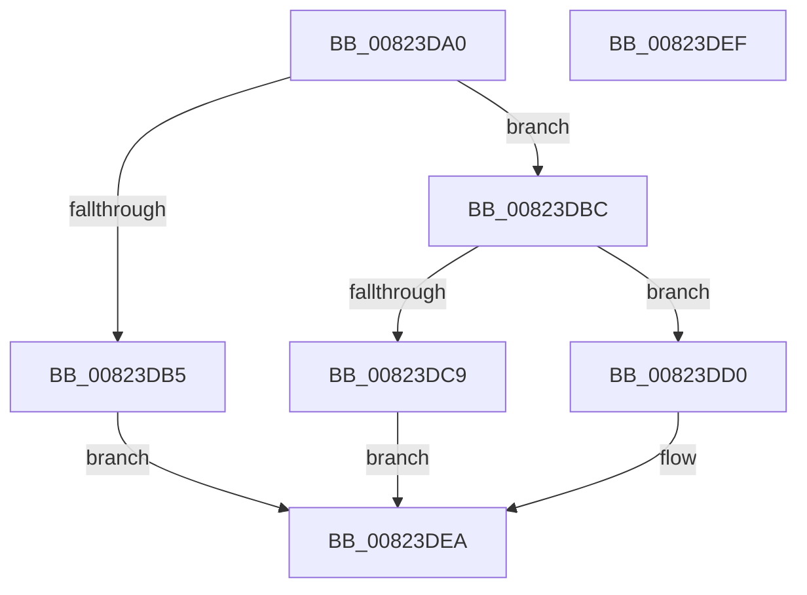

# BcdUtilGetBootOptionString

- RVA: `0x00823DA0`–`0x00823DF0` (길이 `80` bytes)
- VA: `0x0000000140823DA0`
- 실행 섹션: `PAGE`
- PDB 이름 있음: `예`; PDB Function 태그: `아니요`
- unwind 정보 RVA: `0x0005C788`
- 디코드: `24`개 명령, `80/80` bytes 표시
- 미해석 바이트: `0` (있으면 어셈블리에 `.byte`로 보존)

> 이 문서는 커널 이미지의 기계어와 PDB 기호를 분석해 생성했습니다. 4번과 5번은 함수 원형과 자료형을 바이너리 사용 방식에서 추정한 C 해석이며 원본 소스 복구 결과는 아닙니다.

## 1. Dependencies

- 직접 호출 지점: **1**; 고유 호출 대상: **1**
- 직접 호출자로 확인된 함수: **1**
- RIP 상대 이미지 참조: **0**

### Outgoing calls
- `0x00823DBC` → [BcdUtilGetBootOption](BcdUtilGetBootOption_function_00823CAC.md) (function, `0x00823CAC`)

### Direct callers
- [SeAuditBootConfiguration](../79/SeAuditBootConfiguration_function_0079E374.md) at `0x0079E491`
- [SeAuditBootConfiguration](../79/SeAuditBootConfiguration_function_0079E374.md) at `0x0079E6DC`

### Static image references
- 디코드된 RIP-relative 메모리 참조가 없습니다.

## 2. Other-region calls and transfers

- 다른 실행 섹션으로 향하는 call: **0**
- 별도 외부 분기/꼬리 이동을 확인하지 못했습니다.

## 3. Assembly (complete function range)

```asm
00823DA0  48 83 EC 28                     sub rsp, 0x28
00823DA4  8B C2                           mov eax, edx
00823DA6  4D 8B C8                        mov r9, r8
00823DA9  25 00 00 00 0F                  and eax, 0xf000000
00823DAE  3D 00 00 00 02                  cmp eax, 0x2000000
00823DB3  74 07                           je 0x140823dbc
00823DB5  B8 0D 00 00 C0                  mov eax, 0xc000000d
00823DBA  EB 2E                           jmp 0x140823dea
00823DBC  E8 EB FE FF FF                  call 0x140823cac
00823DC1  4C 8B C0                        mov r8, rax
00823DC4  48 85 C0                        test rax, rax
00823DC7  75 07                           jne 0x140823dd0
00823DC9  B8 25 02 00 C0                  mov eax, 0xc0000225
00823DCE  EB 1A                           jmp 0x140823dea
00823DD0  8B 40 04                        mov eax, dword ptr [rax + 4]
00823DD3  49 03 C0                        add rax, r8
00823DD6  49 89 41 08                     mov qword ptr [r9 + 8], rax
00823DDA  41 0F B7 40 08                  movzx eax, word ptr [r8 + 8]
00823DDF  66 41 89 01                     mov word ptr [r9], ax
00823DE3  66 41 89 41 02                  mov word ptr [r9 + 2], ax
00823DE8  33 C0                           xor eax, eax
00823DEA  48 83 C4 28                     add rsp, 0x28
00823DEE  C3                              ret
00823DEF  CC                              int3
```

## 4. C-style interpretation (structured pseudocode)

```c
__int64 __fastcall BcdUtilGetBootOptionString(__int64 a1, int a2, __int64 a3)
{
    __int64 result;
    __int64 v_rsp;

    v_rsp = (v_rsp) - (40);
    result = (unsigned int)(((unsigned int)(a2)) & (0xF000000ULL));
    if (((unsigned int)(result)) == 0x2000000ULL) goto loc_00823DBC;
    goto loc_00823DEA;
loc_00823DBC:
    result = BcdUtilGetBootOption(a1, a2, a3, a3);
    if (result != 0) goto loc_00823DD0;
    goto loc_00823DEA;
loc_00823DD0:
    result = ((unsigned int)(*(unsigned int *)((unsigned int)(0xC0000225ULL) + 4))) + (result);
    *(unsigned __int64 *)(a3 + 8) = result;
    *(unsigned __int16 *)(a3) = (unsigned __int16)(*(unsigned __int16 *)(result + 8));
    *(unsigned __int16 *)(a3 + 2) = (unsigned __int16)(*(unsigned __int16 *)(result + 8));
    result = 0;
loc_00823DEA:
    v_rsp = (v_rsp) + (40);
    return result;
}
```

## 5. (Beta) C Style

```c
int64_t BcdUtilGetBootOptionString(int64_t Arg1, int32_t Arg2, int64_t Arg3)
{
    int64_t result;
    int64_t local_rsp;

    local_rsp = (local_rsp) - (40);
    result = (uint32_t)(((uint32_t)(Arg2)) & (0xF000000ULL));
    if (((uint32_t)(result)) == 0x2000000ULL) goto loc_00823DBC;
    goto loc_00823DEA;
loc_00823DBC:
    result = BcdUtilGetBootOption(Arg1, Arg2, Arg3, Arg3);
    if (result != 0) goto loc_00823DD0;
    goto loc_00823DEA;
loc_00823DD0:
    result = ((uint32_t)(*(uint32_t *)((uint32_t)(0xC0000225ULL) + 0x4))) + (result);
    *(uint64_t *)(Arg3 + 0x8) = result;
    *(uint16_t *)(Arg3) = (uint16_t)(*(uint16_t *)(result + 0x8));
    *(uint16_t *)(Arg3 + 0x2) = (uint16_t)(*(uint16_t *)(result + 0x8));
    result = 0;
loc_00823DEA:
    local_rsp = (local_rsp) + (40);
    return result;
}
```

## 6. Execution-region graph

[열기: 2D/3D 그래프와 함수 탐색 컨트롤 패널](../../../control-panel.html?section=page&rva=0x00823DA0&view=graph)

- 2D 그래프는 위에서 아래로 흐르고, 3D 그래프는 빈 공간을 드래그해 회전합니다. Shift+드래그는 이동, 휠은 확대·축소, 함수 노드 선택은 대상 보고서 이동입니다.

### Static fallback


