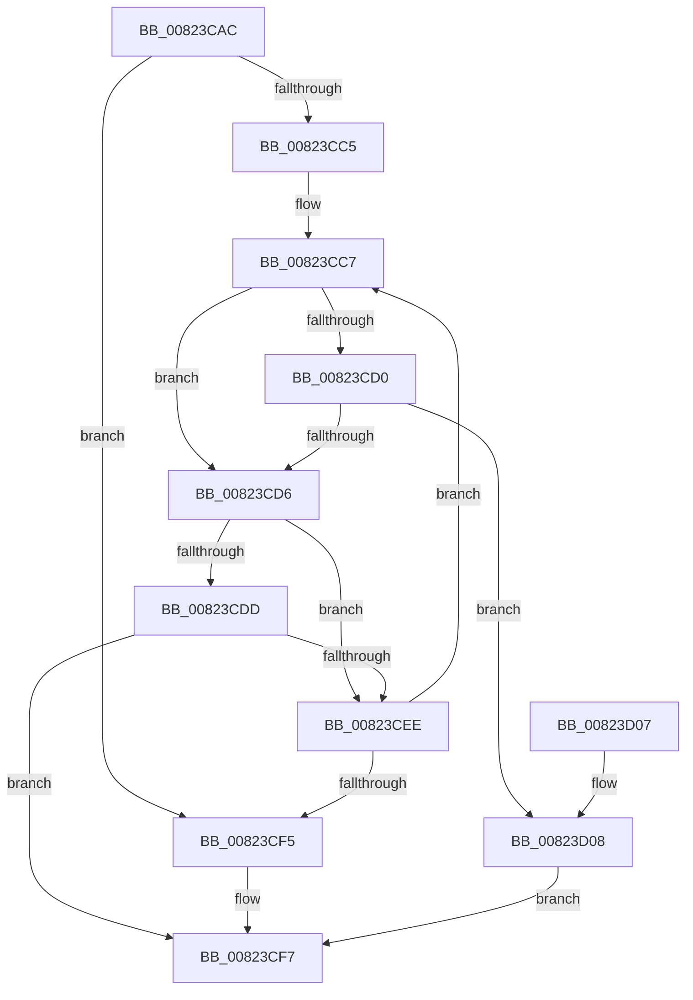

# BcdUtilGetBootOption

- RVA: `0x00823CAC`–`0x00823D0D` (길이 `97` bytes)
- VA: `0x0000000140823CAC`
- 실행 섹션: `PAGE`
- PDB 이름 있음: `예`; PDB Function 태그: `아니요`
- unwind 정보 RVA: `0x00095A44`
- 디코드: `36`개 명령, `97/97` bytes 표시
- 미해석 바이트: `0` (있으면 어셈블리에 `.byte`로 보존)

> 이 문서는 커널 이미지의 기계어와 PDB 기호를 분석해 생성했습니다. 4번과 5번은 함수 원형과 자료형을 바이너리 사용 방식에서 추정한 C 해석이며 원본 소스 복구 결과는 아닙니다.

## 1. Dependencies

- 직접 호출 지점: **1**; 고유 호출 대상: **1**
- 직접 호출자로 확인된 함수: **4**
- RIP 상대 이미지 참조: **0**

### Outgoing calls
- `0x00823CE4` → [BcdUtilGetBootOption](BcdUtilGetBootOption_function_00823CAC.md) (function, `0x00823CAC`)

### Direct callers
- [BcdUtilGetBootOption](BcdUtilGetBootOption_function_00823CAC.md) at `0x00823CE4`
- [BcdUtilGetBootOptionBoolean](BcdUtilGetBootOptionBoolean_function_00823D14.md) at `0x00823D2D`
- [BcdUtilGetBootOptionInteger](BcdUtilGetBootOptionInteger_function_00823D58.md) at `0x00823D71`
- [BcdUtilGetBootOptionString](BcdUtilGetBootOptionString_function_00823DA0.md) at `0x00823DBC`

### Static image references
- 디코드된 RIP-relative 메모리 참조가 없습니다.

## 2. Other-region calls and transfers

- 다른 실행 섹션으로 향하는 call: **0**
- 별도 외부 분기/꼬리 이동을 확인하지 못했습니다.

## 3. Assembly (complete function range)

```asm
00823CAC  48 89 5C 24 08                  mov qword ptr [rsp + 8], rbx
00823CB1  48 89 74 24 10                  mov qword ptr [rsp + 0x10], rsi
00823CB6  57                              push rdi
00823CB7  48 83 EC 20                     sub rsp, 0x20
00823CBB  8B F2                           mov esi, edx
00823CBD  48 8B F9                        mov rdi, rcx
00823CC0  48 85 C9                        test rcx, rcx
00823CC3  74 30                           je 0x140823cf5
00823CC5  33 C0                           xor eax, eax
00823CC7  8B D8                           mov ebx, eax
00823CC9  48 03 DF                        add rbx, rdi
00823CCC  39 33                           cmp dword ptr [rbx], esi
00823CCE  75 06                           jne 0x140823cd6
00823CD0  80 7B 14 00                     cmp byte ptr [rbx + 0x14], 0
00823CD4  74 32                           je 0x140823d08
00823CD6  8B 4B 0C                        mov ecx, dword ptr [rbx + 0xc]
00823CD9  85 C9                           test ecx, ecx
00823CDB  74 11                           je 0x140823cee
00823CDD  03 C8                           add ecx, eax
00823CDF  8B D6                           mov edx, esi
00823CE1  48 03 CF                        add rcx, rdi
00823CE4  E8 C3 FF FF FF                  call 0x140823cac
00823CE9  48 85 C0                        test rax, rax
00823CEC  75 09                           jne 0x140823cf7
00823CEE  8B 43 10                        mov eax, dword ptr [rbx + 0x10]
00823CF1  85 C0                           test eax, eax
00823CF3  75 D2                           jne 0x140823cc7
00823CF5  33 C0                           xor eax, eax
00823CF7  48 8B 5C 24 30                  mov rbx, qword ptr [rsp + 0x30]
00823CFC  48 8B 74 24 38                  mov rsi, qword ptr [rsp + 0x38]
00823D01  48 83 C4 20                     add rsp, 0x20
00823D05  5F                              pop rdi
00823D06  C3                              ret
00823D07  CC                              int3
00823D08  48 8B C3                        mov rax, rbx
00823D0B  EB EA                           jmp 0x140823cf7
```

## 4. C-style interpretation (structured pseudocode)

```c
__int64 __fastcall BcdUtilGetBootOption(__int64 a1, int a2)
{
    __int64 result;
    __int64 v_rbx;
    __int64 v_rsp;
    unsigned __int64 v_stack_p10;
    unsigned __int64 v_stack_p8;

    v_stack_p8 = v_rbx;
    v_stack_p10 = v_rsi;
    v_rsp = (v_rsp) - (32);
    if (a1 == 0) goto loc_00823CF5;
    result = 0;
loc_00823CC7:
    v_rbx = (0) + (a1);
    if ((*(unsigned int *)(v_rbx)) != ((unsigned int)((unsigned int)(a2)))) goto loc_00823CD6;
    if ((*(unsigned __int8 *)(v_rbx + 20)) == 0) goto loc_00823D08;
loc_00823CD6:
    if ((unsigned int)((unsigned int)(*(unsigned int *)(v_rbx + 12))) == 0) goto loc_00823CEE;
    a1 = (unsigned int)(((unsigned int)(*(unsigned int *)(v_rbx + 12))) + (0));
    a1 = (a1) + (a1);
    result = BcdUtilGetBootOption(a1, (unsigned int)((unsigned int)((unsigned int)(a2))), a3, a4);
    if (result != 0) goto loc_00823CF7;
loc_00823CEE:
    if ((unsigned int)((unsigned int)(*(unsigned int *)(v_rbx + 16))) != 0) goto loc_00823CC7;
loc_00823CF5:
    result = 0;
loc_00823CF7:
    v_rsp = (v_rsp) + (32);
    return result;
loc_00823D08:
    goto loc_00823CF7;
}
```

## 5. (Beta) C Style

```c
int64_t BcdUtilGetBootOption(int64_t Arg1, int32_t Arg2)
{
    int64_t result;
    int64_t local_rbx;
    int64_t local_rsp;
    uint64_t v_stack_p10;
    uint64_t v_stack_p8;

    v_stack_p8 = local_rbx;
    v_stack_p10 = local_rsi;
    local_rsp = (local_rsp) - (32);
    if (Arg1 == 0) goto loc_00823CF5;
    result = 0;
loc_00823CC7:
    local_rbx = (0) + (Arg1);
    if ((*(uint32_t *)(local_rbx)) != ((uint32_t)((uint32_t)(Arg2)))) goto loc_00823CD6;
    if ((*(uint8_t *)(local_rbx + 0x14)) == 0) goto loc_00823D08;
loc_00823CD6:
    if ((uint32_t)((uint32_t)(*(uint32_t *)(local_rbx + 0xC))) == 0) goto loc_00823CEE;
    Arg1 = (uint32_t)(((uint32_t)(*(uint32_t *)(local_rbx + 0xC))) + (0));
    Arg1 = (Arg1) + (Arg1);
    result = BcdUtilGetBootOption(Arg1, (uint32_t)((uint32_t)((uint32_t)(Arg2))), a3, a4);
    if (result != 0) goto loc_00823CF7;
loc_00823CEE:
    if ((uint32_t)((uint32_t)(*(uint32_t *)(local_rbx + 0x10))) != 0) goto loc_00823CC7;
loc_00823CF5:
    result = 0;
loc_00823CF7:
    local_rsp = (local_rsp) + (32);
    return result;
loc_00823D08:
    goto loc_00823CF7;
}
```

## 6. Execution-region graph

[열기: 2D/3D 그래프와 함수 탐색 컨트롤 패널](../../../control-panel.html?section=page&rva=0x00823CAC&view=graph)

- 2D 그래프는 위에서 아래로 흐르고, 3D 그래프는 빈 공간을 드래그해 회전합니다. Shift+드래그는 이동, 휠은 확대·축소, 함수 노드 선택은 대상 보고서 이동입니다.

### Static fallback


