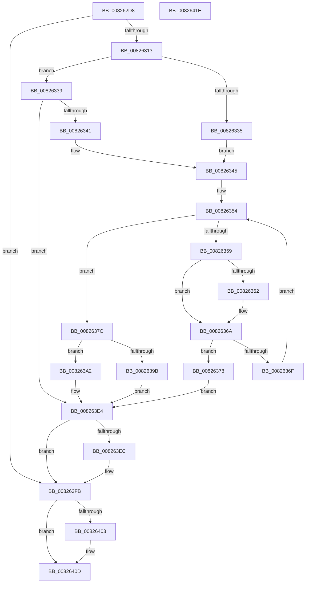

# BiAddBootEntryToEfiBootManagerDisplayOrder

- RVA: `0x008262D8`–`0x0082641F` (길이 `327` bytes)
- VA: `0x00000001408262D8`
- 실행 섹션: `PAGE`
- PDB 이름 있음: `예`; PDB Function 태그: `아니요`
- unwind 정보 RVA: `0x000DA3DC`
- 디코드: `90`개 명령, `327/327` bytes 표시
- 미해석 바이트: `0` (있으면 어셈블리에 `.byte`로 보존)

> 이 문서는 커널 이미지의 기계어와 PDB 기호를 분석해 생성했습니다. 4번과 5번은 함수 원형과 자료형을 바이너리 사용 방식에서 추정한 C 해석이며 원본 소스 복구 결과는 아닙니다.

## 1. Dependencies

- 직접 호출 지점: **8**; 고유 호출 대상: **7**
- 직접 호출자로 확인된 함수: **1**
- RIP 상대 이미지 참조: **1**

### Outgoing calls
- `0x00826304` → [BcdOpenObject](../91/BcdOpenObject_function_00916704.md) (function, `0x00916704`)
- `0x00826327` → [BiGetElement](../A3/BiGetElement_function_00A3E2B4.md) (function, `0x00A3E2B4`)
- `0x0082638E` → [ExAllocatePool2](../../poolcode/B8/ExAllocatePool2_function_00B820F0.md) (function, `0x00B820F0`)
- `0x008263B7` → [memcpy](../../text/6C/memcpy_function_006C6840.md) (function, `0x006C6840`)
- `0x008263D0` → [BcdSetElementDataWithFlags](../A3/BcdSetElementDataWithFlags_function_00A3F080.md) (function, `0x00A3F080`)
- `0x008263DF` → [ExFreePoolWithTag](../../poolcode/B8/ExFreePoolWithTag_function_00B82870.md) (function, `0x00B82870`)
- `0x008263F6` → [ExFreePoolWithTag](../../poolcode/B8/ExFreePoolWithTag_function_00B82870.md) (function, `0x00B82870`)
- `0x00826408` → [BcdCloseObject](../A3/BcdCloseObject_function_00A3FB08.md) (function, `0x00A3FB08`)

### Direct callers
- [BiExportBcdObjects](BiExportBcdObjects_function_00826B30.md) at `0x00826BE0`

### Static image references
- `0x008262FD` → RVA `0x0001A4C0` (`.rdata`; read)

## 2. Other-region calls and transfers

- 다른 실행 섹션으로 향하는 call: **4**
  - `0x0082638E` → [ExAllocatePool2](../../poolcode/B8/ExAllocatePool2_function_00B820F0.md) (`PAGE` → `POOLCODE`)
  - `0x008263B7` → [memcpy](../../text/6C/memcpy_function_006C6840.md) (`PAGE` → `.text`)
  - `0x008263DF` → [ExFreePoolWithTag](../../poolcode/B8/ExFreePoolWithTag_function_00B82870.md) (`PAGE` → `POOLCODE`)
  - `0x008263F6` → [ExFreePoolWithTag](../../poolcode/B8/ExFreePoolWithTag_function_00B82870.md) (`PAGE` → `POOLCODE`)
- 별도 외부 분기/꼬리 이동을 확인하지 못했습니다.

## 3. Assembly (complete function range)

```asm
008262D8  48 8B C4                        mov rax, rsp
008262DB  48 89 58 08                     mov qword ptr [rax + 8], rbx
008262DF  55                              push rbp
008262E0  41 56                           push r14
008262E2  41 57                           push r15
008262E4  48 83 EC 40                     sub rsp, 0x40
008262E8  83 60 18 00                     and dword ptr [rax + 0x18], 0
008262EC  4C 8D 40 D8                     lea r8, [rax - 0x28]
008262F0  48 83 60 20 00                  and qword ptr [rax + 0x20], 0
008262F5  4C 8B FA                        mov r15, rdx
008262F8  48 83 60 D8 00                  and qword ptr [rax - 0x28], 0
008262FD  48 8D 15 BC 41 7F FF            lea rdx, [rip - 0x80be44]
00826304  E8 FB 03 0F 00                  call 0x140916704
00826309  8B D8                           mov ebx, eax
0082630B  85 C0                           test eax, eax
0082630D  0F 88 E8 00 00 00               js 0x1408263fb
00826313  48 8B 4C 24 30                  mov rcx, qword ptr [rsp + 0x30]
00826318  4C 8D 4C 24 70                  lea r9, [rsp + 0x70]
0082631D  4C 8D 44 24 78                  lea r8, [rsp + 0x78]
00826322  BA 01 00 00 24                  mov edx, 0x24000001
00826327  E8 88 7F 21 00                  call 0x140a3e2b4
0082632C  8B D8                           mov ebx, eax
0082632E  3D 25 02 00 C0                  cmp eax, 0xc0000225
00826333  75 04                           jne 0x140826339
00826335  33 DB                           xor ebx, ebx
00826337  EB 0C                           jmp 0x140826345
00826339  85 C0                           test eax, eax
0082633B  0F 88 A3 00 00 00               js 0x1408263e4
00826341  8B 5C 24 70                     mov ebx, dword ptr [rsp + 0x70]
00826345  48 8B 54 24 78                  mov rdx, qword ptr [rsp + 0x78]
0082634A  45 33 C0                        xor r8d, r8d
0082634D  44 8B CB                        mov r9d, ebx
00826350  41 C1 E9 04                     shr r9d, 4
00826354  45 3B C1                        cmp r8d, r9d
00826357  73 23                           jae 0x14082637c
00826359  49 8B 4F 10                     mov rcx, qword ptr [r15 + 0x10]
0082635D  48 2B 0A                        sub rcx, qword ptr [rdx]
00826360  75 08                           jne 0x14082636a
00826362  49 8B 4F 18                     mov rcx, qword ptr [r15 + 0x18]
00826366  48 2B 4A 08                     sub rcx, qword ptr [rdx + 8]
0082636A  48 85 C9                        test rcx, rcx
0082636D  74 09                           je 0x140826378
0082636F  48 83 C2 10                     add rdx, 0x10
00826373  41 FF C0                        inc r8d
00826376  EB DC                           jmp 0x140826354
00826378  33 DB                           xor ebx, ebx
0082637A  EB 68                           jmp 0x1408263e4
0082637C  44 8B F3                        mov r14d, ebx
0082637F  B9 02 01 00 00                  mov ecx, 0x102
00826384  41 B8 42 43 44 4B               mov r8d, 0x4b444342
0082638A  49 8D 56 10                     lea rdx, [r14 + 0x10]
0082638E  E8 5D BD 35 00                  call 0x140b820f0
00826393  48 8B E8                        mov rbp, rax
00826396  48 85 C0                        test rax, rax
00826399  75 07                           jne 0x1408263a2
0082639B  BB 17 00 00 C0                  mov ebx, 0xc0000017
008263A0  EB 42                           jmp 0x1408263e4
008263A2  41 0F 10 47 10                  movups xmm0, xmmword ptr [r15 + 0x10]
008263A7  48 8B 54 24 78                  mov rdx, qword ptr [rsp + 0x78]
008263AC  48 8D 48 10                     lea rcx, [rax + 0x10]
008263B0  4D 8B C6                        mov r8, r14
008263B3  F3 0F 7F 00                     movdqu xmmword ptr [rax], xmm0
008263B7  E8 84 04 EA FF                  call 0x1406c6840
008263BC  48 8B 4C 24 30                  mov rcx, qword ptr [rsp + 0x30]
008263C1  8D 43 10                        lea eax, [rbx + 0x10]
008263C4  4C 8B CD                        mov r9, rbp
008263C7  89 44 24 20                     mov dword ptr [rsp + 0x20], eax
008263CB  BA 01 00 00 24                  mov edx, 0x24000001
008263D0  E8 AB 8C 21 00                  call 0x140a3f080
008263D5  8B D8                           mov ebx, eax
008263D7  BA 42 43 44 4B                  mov edx, 0x4b444342
008263DC  48 8B CD                        mov rcx, rbp
008263DF  E8 8C C4 35 00                  call 0x140b82870
008263E4  48 83 7C 24 78 00               cmp qword ptr [rsp + 0x78], 0
008263EA  74 0F                           je 0x1408263fb
008263EC  48 8B 4C 24 78                  mov rcx, qword ptr [rsp + 0x78]
008263F1  BA 42 43 44 4B                  mov edx, 0x4b444342
008263F6  E8 75 C4 35 00                  call 0x140b82870
008263FB  48 83 7C 24 30 00               cmp qword ptr [rsp + 0x30], 0
00826401  74 0A                           je 0x14082640d
00826403  48 8B 4C 24 30                  mov rcx, qword ptr [rsp + 0x30]
00826408  E8 FB 96 21 00                  call 0x140a3fb08
0082640D  8B C3                           mov eax, ebx
0082640F  48 8B 5C 24 60                  mov rbx, qword ptr [rsp + 0x60]
00826414  48 83 C4 40                     add rsp, 0x40
00826418  41 5F                           pop r15
0082641A  41 5E                           pop r14
0082641C  5D                              pop rbp
0082641D  C3                              ret
0082641E  CC                              int3
```

## 4. C-style interpretation (structured pseudocode)

```c
__int64 __fastcall BiAddBootEntryToEfiBootManagerDisplayOrder(__int64 a1, __int64 a2)
{
    __int64 result;
    __int64 v_rbx;
    __int64 v_rsp;
    unsigned __int64 v_stack_m28;
    unsigned int v_stack_m38;
    unsigned __int64 v_stack_p18;
    unsigned __int64 v_stack_p20;
    unsigned __int64 v_stack_p8;

    *(unsigned __int64 *)(v_rsp + 8) = v_rbx;
    v_rsp = (v_rsp) - (64);
    result = BcdOpenObject(a1, v_rip - 8437316, v_rsp - 40, a4);
    if (sign_flag) goto loc_008263FB;
    result = BiGetElement(v_stack_m28, (unsigned int)(0x24000001ULL), v_stack_p20, v_stack_p18);
    if (((unsigned int)(result)) != 0xC0000225ULL) goto loc_00826339;
    v_rbx = 0;
    goto loc_00826345;
loc_00826339:
    if (sign_flag) goto loc_008263E4;
loc_00826345:
    a3 = 0;
    a4 = (unsigned int)(((unsigned int)((unsigned int)((unsigned int)(v_stack_p18)))) >> (4));
loc_00826354:
    if (0 >= ((unsigned int)(a4))) goto loc_0082637C;
    a1 = (*(unsigned __int64 *)(a2 + 16)) - (*(unsigned __int64 *)(v_stack_p20));
    if (!(condition_is_not_equal)) {
        a1 = *(unsigned __int64 *)(a2 + 24);
        a1 = (a1) - (*(unsigned __int64 *)(v_stack_p20 + 8));
    }
    if (a1 == 0) goto loc_00826378;
    a2 = (v_stack_p20) + (16);
    a3 = (unsigned int)((a3) + 1);
    goto loc_00826354;
loc_00826378:
    v_rbx = 0;
    goto loc_008263E4;
loc_0082637C:
    result = ExAllocatePool2(258, 0 + 16, (unsigned int)(0x4B444342ULL), a4);
    if (result != 0) goto loc_008263A2;
    goto loc_008263E4;
loc_008263A2:
    *(unsigned __int64 *)(result) = v_xmm0;
    result = memcpy(result + 16, v_stack_p20, 0, a4);
    v_stack_m38 = (unsigned int)((unsigned int)(0xC0000017ULL) + 16);
    result = BcdSetElementDataWithFlags(v_stack_m28, (unsigned int)(0x24000001ULL), 0, result);
    result = ExFreePoolWithTag(result, (unsigned int)(0x4B444342ULL), 0, result);
loc_008263E4:
    if (v_stack_p20 != 0) {
        a1 = v_stack_p20;
        a2 = 0x4B444342ULL;
        result = ExFreePoolWithTag(a1, a2, 0, result);
    }
    if (v_stack_m28 != 0) {
        a1 = v_stack_m28;
        result = BcdCloseObject(a1, a2, 0, result);
    }
    v_rsp = (v_rsp) + (64);
    return (unsigned int)((unsigned int)((unsigned int)((unsigned int)(result))));
}
```

## 5. (Beta) C Style

```c
int64_t BiAddBootEntryToEfiBootManagerDisplayOrder(int64_t Arg1, void *Arg2)
{
    uint8_t *arg2 = (uint8_t *)Arg2;

    int64_t result;
    int64_t local_rbx;
    int64_t local_rsp;
    uint64_t v_stack_m28;
    uint32_t v_stack_m38;
    uint64_t v_stack_p18;
    uint64_t v_stack_p20;
    uint64_t v_stack_p8;

    *(uint64_t *)(local_rsp + 0x8) = local_rbx;
    local_rsp = (local_rsp) - (64);
    result = BcdOpenObject(Arg1, v_rip - 8437316, local_rsp - 40, a4);
    if (sign_flag) goto loc_008263FB;
    result = BiGetElement(v_stack_m28, (uint32_t)(0x24000001ULL), v_stack_p20, v_stack_p18);
    if (((uint32_t)(result)) != 0xC0000225ULL) goto loc_00826339;
    local_rbx = 0;
    goto loc_00826345;
loc_00826339:
    if (sign_flag) goto loc_008263E4;
loc_00826345:
    a3 = 0;
    a4 = (uint32_t)(((uint32_t)((uint32_t)((uint32_t)(v_stack_p18)))) >> (4));
loc_00826354:
    if (0 >= ((uint32_t)(a4))) goto loc_0082637C;
    Arg1 = (*(uint64_t *)(arg2 + 0x10)) - (*(uint64_t *)(v_stack_p20));
    if (!(condition_is_not_equal)) {
        Arg1 = *(uint64_t *)(arg2 + 0x18);
        Arg1 = (Arg1) - (*(uint64_t *)(v_stack_p20 + 0x8));
    }
    if (Arg1 == 0) goto loc_00826378;
    Arg2 = (v_stack_p20) + (16);
    a3 = (uint32_t)((a3) + 1);
    goto loc_00826354;
loc_00826378:
    local_rbx = 0;
    goto loc_008263E4;
loc_0082637C:
    result = ExAllocatePool2(258, 0 + 16, (uint32_t)(0x4B444342ULL), a4);
    if (result != 0) goto loc_008263A2;
    goto loc_008263E4;
loc_008263A2:
    *(uint64_t *)(result) = v_xmm0;
    result = memcpy(result + 16, v_stack_p20, 0, a4);
    v_stack_m38 = (uint32_t)((uint32_t)(0xC0000017ULL) + 16);
    result = BcdSetElementDataWithFlags(v_stack_m28, (uint32_t)(0x24000001ULL), 0, result);
    result = ExFreePoolWithTag(result, (uint32_t)(0x4B444342ULL), 0, result);
loc_008263E4:
    if (v_stack_p20 != 0) {
        Arg1 = v_stack_p20;
        Arg2 = 0x4B444342ULL;
        result = ExFreePoolWithTag(Arg1, Arg2, 0, result);
    }
    if (v_stack_m28 != 0) {
        Arg1 = v_stack_m28;
        result = BcdCloseObject(Arg1, Arg2, 0, result);
    }
    local_rsp = (local_rsp) + (64);
    return (uint32_t)((uint32_t)((uint32_t)((uint32_t)(result))));
}
```

### 관측된 메모리 오프셋

구조체 형식이 확인되지 않은 접근은 인자 기준의 오프셋으로만 기록했습니다.

| 기준 인자 | 오프셋 표현 | 폭 (bit) | 접근 |
|---|---:|---:|---|
| `Arg2` | `+ 0x10` | `64` | `R` |
| `Arg2` | `+ 0x10` | `128` | `R` |
| `Arg2` | `+ 0x18` | `64` | `R` |

## 6. Execution-region graph

[열기: 2D/3D 그래프와 함수 탐색 컨트롤 패널](../../../control-panel.html?section=page&rva=0x008262D8&view=graph)

- 2D 그래프는 위에서 아래로 흐르고, 3D 그래프는 빈 공간을 드래그해 회전합니다. Shift+드래그는 이동, 휠은 확대·축소, 함수 노드 선택은 대상 보고서 이동입니다.

### Static fallback


