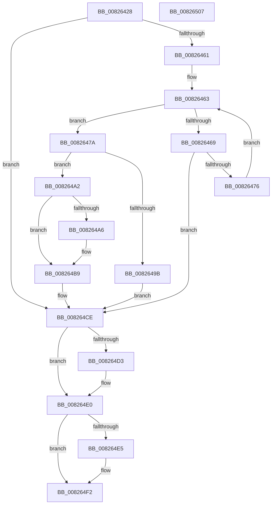

# BiAddBootEntryToNvramDisplayOrder

- RVA: `0x00826428`–`0x00826508` (길이 `224` bytes)
- VA: `0x0000000140826428`
- 실행 섹션: `PAGE`
- PDB 이름 있음: `예`; PDB Function 태그: `아니요`
- unwind 정보 RVA: `0x000BF738`
- 디코드: `71`개 명령, `224/224` bytes 표시
- 미해석 바이트: `0` (있으면 어셈블리에 `.byte`로 보존)

> 이 문서는 커널 이미지의 기계어와 PDB 기호를 분석해 생성했습니다. 4번과 5번은 함수 원형과 자료형을 바이너리 사용 방식에서 추정한 C 해석이며 원본 소스 복구 결과는 아닙니다.

## 1. Dependencies

- 직접 호출 지점: **6**; 고유 호출 대상: **5**
- 직접 호출자로 확인된 함수: **1**
- RIP 상대 이미지 참조: **0**

### Outgoing calls
- `0x00826451` → [BiQueryBootEntryOrder](../A3/BiQueryBootEntryOrder_function_00A3DBD4.md) (function, `0x00A3DBD4`)
- `0x0082648E` → [ExAllocatePool2](../../poolcode/B8/ExAllocatePool2_function_00B820F0.md) (function, `0x00B820F0`)
- `0x008264B4` → [memcpy](../../text/6C/memcpy_function_006C6840.md) (function, `0x006C6840`)
- `0x008264C7` → [BiSetBootEntryOrder](../A3/BiSetBootEntryOrder_function_00A3CC48.md) (function, `0x00A3CC48`)
- `0x008264DB` → [ExFreePoolWithTag](../../poolcode/B8/ExFreePoolWithTag_function_00B82870.md) (function, `0x00B82870`)
- `0x008264ED` → [ExFreePoolWithTag](../../poolcode/B8/ExFreePoolWithTag_function_00B82870.md) (function, `0x00B82870`)

### Direct callers
- [BiBindEfiEntries](../AB/BiBindEfiEntries_function_00AB09C4.md) at `0x00AB0A92`

### Static image references
- 디코드된 RIP-relative 메모리 참조가 없습니다.

## 2. Other-region calls and transfers

- 다른 실행 섹션으로 향하는 call: **4**
  - `0x0082648E` → [ExAllocatePool2](../../poolcode/B8/ExAllocatePool2_function_00B820F0.md) (`PAGE` → `POOLCODE`)
  - `0x008264B4` → [memcpy](../../text/6C/memcpy_function_006C6840.md) (`PAGE` → `.text`)
  - `0x008264DB` → [ExFreePoolWithTag](../../poolcode/B8/ExFreePoolWithTag_function_00B82870.md) (`PAGE` → `POOLCODE`)
  - `0x008264ED` → [ExFreePoolWithTag](../../poolcode/B8/ExFreePoolWithTag_function_00B82870.md) (`PAGE` → `POOLCODE`)
- 별도 외부 분기/꼬리 이동을 확인하지 못했습니다.

## 3. Assembly (complete function range)

```asm
00826428  48 8B C4                        mov rax, rsp
0082642B  48 89 58 08                     mov qword ptr [rax + 8], rbx
0082642F  48 89 68 20                     mov qword ptr [rax + 0x20], rbp
00826433  56                              push rsi
00826434  57                              push rdi
00826435  41 56                           push r14
00826437  48 83 EC 20                     sub rsp, 0x20
0082643B  83 60 10 00                     and dword ptr [rax + 0x10], 0
0082643F  48 8D 50 10                     lea rdx, [rax + 0x10]
00826443  48 83 60 18 00                  and qword ptr [rax + 0x18], 0
00826448  4C 8B F1                        mov r14, rcx
0082644B  48 8D 48 18                     lea rcx, [rax + 0x18]
0082644F  33 FF                           xor edi, edi
00826451  E8 7E 77 21 00                  call 0x140a3dbd4
00826456  48 8B 6C 24 50                  mov rbp, qword ptr [rsp + 0x50]
0082645B  8B F0                           mov esi, eax
0082645D  85 C0                           test eax, eax
0082645F  78 6D                           js 0x1408264ce
00826461  33 DB                           xor ebx, ebx
00826463  3B 5C 24 48                     cmp ebx, dword ptr [rsp + 0x48]
00826467  73 11                           jae 0x14082647a
00826469  49 8B 46 28                     mov rax, qword ptr [r14 + 0x28]
0082646D  8B 48 08                        mov ecx, dword ptr [rax + 8]
00826470  39 4C 9D 00                     cmp dword ptr [rbp + rbx*4], ecx
00826474  74 58                           je 0x1408264ce
00826476  FF C3                           inc ebx
00826478  EB E9                           jmp 0x140826463
0082647A  8D 73 01                        lea esi, [rbx + 1]
0082647D  B9 02 01 00 00                  mov ecx, 0x102
00826482  8B D6                           mov edx, esi
00826484  41 B8 42 43 44 4B               mov r8d, 0x4b444342
0082648A  48 C1 E2 02                     shl rdx, 2
0082648E  E8 5D BC 35 00                  call 0x140b820f0
00826493  48 8B F8                        mov rdi, rax
00826496  48 85 C0                        test rax, rax
00826499  75 07                           jne 0x1408264a2
0082649B  BE 17 00 00 C0                  mov esi, 0xc0000017
008264A0  EB 2C                           jmp 0x1408264ce
008264A2  85 DB                           test ebx, ebx
008264A4  74 13                           je 0x1408264b9
008264A6  44 8B C3                        mov r8d, ebx
008264A9  48 8D 48 04                     lea rcx, [rax + 4]
008264AD  49 C1 E0 02                     shl r8, 2
008264B1  48 8B D5                        mov rdx, rbp
008264B4  E8 87 03 EA FF                  call 0x1406c6840
008264B9  49 8B 46 28                     mov rax, qword ptr [r14 + 0x28]
008264BD  48 8B CF                        mov rcx, rdi
008264C0  8B 50 08                        mov edx, dword ptr [rax + 8]
008264C3  89 17                           mov dword ptr [rdi], edx
008264C5  8B D6                           mov edx, esi
008264C7  E8 7C 67 21 00                  call 0x140a3cc48
008264CC  8B F0                           mov esi, eax
008264CE  48 85 ED                        test rbp, rbp
008264D1  74 0D                           je 0x1408264e0
008264D3  BA 42 43 44 4B                  mov edx, 0x4b444342
008264D8  48 8B CD                        mov rcx, rbp
008264DB  E8 90 C3 35 00                  call 0x140b82870
008264E0  48 85 FF                        test rdi, rdi
008264E3  74 0D                           je 0x1408264f2
008264E5  BA 42 43 44 4B                  mov edx, 0x4b444342
008264EA  48 8B CF                        mov rcx, rdi
008264ED  E8 7E C3 35 00                  call 0x140b82870
008264F2  48 8B 5C 24 40                  mov rbx, qword ptr [rsp + 0x40]
008264F7  8B C6                           mov eax, esi
008264F9  48 8B 6C 24 58                  mov rbp, qword ptr [rsp + 0x58]
008264FE  48 83 C4 20                     add rsp, 0x20
00826502  41 5E                           pop r14
00826504  5F                              pop rdi
00826505  5E                              pop rsi
00826506  C3                              ret
00826507  CC                              int3
```

## 4. C-style interpretation (structured pseudocode)

```c
__int64 __fastcall BiAddBootEntryToNvramDisplayOrder(__int64 a1)
{
    __int64 result;
    __int64 v_rbx;
    __int64 v_rdi;
    __int64 v_rsp;
    unsigned int v_stack_p10;
    unsigned __int64 v_stack_p18;
    unsigned __int64 v_stack_p20;
    unsigned __int64 v_stack_p8;

    *(unsigned __int64 *)(v_rsp + 8) = v_rbx;
    *(unsigned __int64 *)(v_rsp + 32) = v_rbp;
    v_rsp = (v_rsp) - (32);
    v_rdi = 0;
    result = BiQueryBootEntryOrder(v_rsp + 24, v_rsp + 16, a3, a4);
    if (sign_flag) goto loc_008264CE;
    v_rbx = 0;
loc_00826463:
    if (0 >= v_stack_p10) goto loc_0082647A;
    if ((*(unsigned int *)(v_stack_p18 + v_rbx * 4)) == ((unsigned int)((unsigned int)(*(unsigned int *)(*(unsigned __int64 *)(a1 + 40) + 8))))) goto loc_008264CE;
    v_rbx = (unsigned int)((v_rbx) + 1);
    goto loc_00826463;
loc_0082647A:
    a2 = ((unsigned int)((unsigned int)(v_rbx + 1))) << (2);
    result = ExAllocatePool2(258, a2, (unsigned int)(0x4B444342ULL), a4);
    if (result != 0) goto loc_008264A2;
    goto loc_008264CE;
loc_008264A2:
    if ((unsigned int)(v_rbx) != 0) {
        a3 = (unsigned int)(v_rbx);
        a1 = result + 4;
        a3 = (a3) << (2);
        a2 = v_stack_p18;
        result = memcpy(a1, a2, a3, a4);
    }
    *(unsigned int *)(result) = (unsigned int)((unsigned int)(*(unsigned int *)(*(unsigned __int64 *)(a1 + 40) + 8)));
    result = BiSetBootEntryOrder(result, (unsigned int)((unsigned int)((unsigned int)(0xC0000017ULL))), a3, a4);
loc_008264CE:
    if (v_stack_p18 != 0) {
        a2 = 0x4B444342ULL;
        a1 = v_stack_p18;
        result = ExFreePoolWithTag(a1, a2, a3, a4);
    }
    if (result != 0) {
        a2 = 0x4B444342ULL;
        a1 = result;
        result = ExFreePoolWithTag(a1, a2, a3, a4);
    }
    v_rsp = (v_rsp) + (32);
    return (unsigned int)((unsigned int)((unsigned int)((unsigned int)(result))));
}
```

## 5. (Beta) C Style

```c
int64_t BiAddBootEntryToNvramDisplayOrder(void *Arg1)
{
    uint8_t *arg1 = (uint8_t *)Arg1;

    int64_t result;
    int64_t local_rbx;
    int64_t local_rdi;
    int64_t local_rsp;
    uint32_t v_stack_p10;
    uint64_t v_stack_p18;
    uint64_t v_stack_p20;
    uint64_t v_stack_p8;

    *(uint64_t *)(local_rsp + 0x8) = local_rbx;
    *(uint64_t *)(local_rsp + 0x20) = local_rbp;
    local_rsp = (local_rsp) - (32);
    local_rdi = 0;
    result = BiQueryBootEntryOrder(local_rsp + 24, local_rsp + 16, a3, a4);
    if (sign_flag) goto loc_008264CE;
    local_rbx = 0;
loc_00826463:
    if (0 >= v_stack_p10) goto loc_0082647A;
    if ((*(uint32_t *)(v_stack_p18 + local_rbx * 4)) == ((uint32_t)((uint32_t)(*(uint32_t *)(*(uint64_t *)(arg1 + 0x28) + 0x8))))) goto loc_008264CE;
    local_rbx = (uint32_t)((local_rbx) + 1);
    goto loc_00826463;
loc_0082647A:
    a2 = ((uint32_t)((uint32_t)(local_rbx + 1))) << (2);
    result = ExAllocatePool2(258, a2, (uint32_t)(0x4B444342ULL), a4);
    if (result != 0) goto loc_008264A2;
    goto loc_008264CE;
loc_008264A2:
    if ((uint32_t)(local_rbx) != 0) {
        a3 = (uint32_t)(local_rbx);
        Arg1 = result + 4;
        a3 = (a3) << (2);
        a2 = v_stack_p18;
        result = memcpy(Arg1, a2, a3, a4);
    }
    *(uint32_t *)(result) = (uint32_t)((uint32_t)(*(uint32_t *)(*(uint64_t *)(arg1 + 0x28) + 0x8)));
    result = BiSetBootEntryOrder(result, (uint32_t)((uint32_t)((uint32_t)(0xC0000017ULL))), a3, a4);
loc_008264CE:
    if (v_stack_p18 != 0) {
        a2 = 0x4B444342ULL;
        Arg1 = v_stack_p18;
        result = ExFreePoolWithTag(Arg1, a2, a3, a4);
    }
    if (result != 0) {
        a2 = 0x4B444342ULL;
        Arg1 = result;
        result = ExFreePoolWithTag(Arg1, a2, a3, a4);
    }
    local_rsp = (local_rsp) + (32);
    return (uint32_t)((uint32_t)((uint32_t)((uint32_t)(result))));
}
```

### 관측된 메모리 오프셋

구조체 형식이 확인되지 않은 접근은 인자 기준의 오프셋으로만 기록했습니다.

| 기준 인자 | 오프셋 표현 | 폭 (bit) | 접근 |
|---|---:|---:|---|
| `Arg1` | `+ 0x28` | `64` | `R` |

## 6. Execution-region graph

[열기: 2D/3D 그래프와 함수 탐색 컨트롤 패널](../../../control-panel.html?section=page&rva=0x00826428&view=graph)

- 2D 그래프는 위에서 아래로 흐르고, 3D 그래프는 빈 공간을 드래그해 회전합니다. Shift+드래그는 이동, 휠은 확대·축소, 함수 노드 선택은 대상 보고서 이동입니다.

### Static fallback


