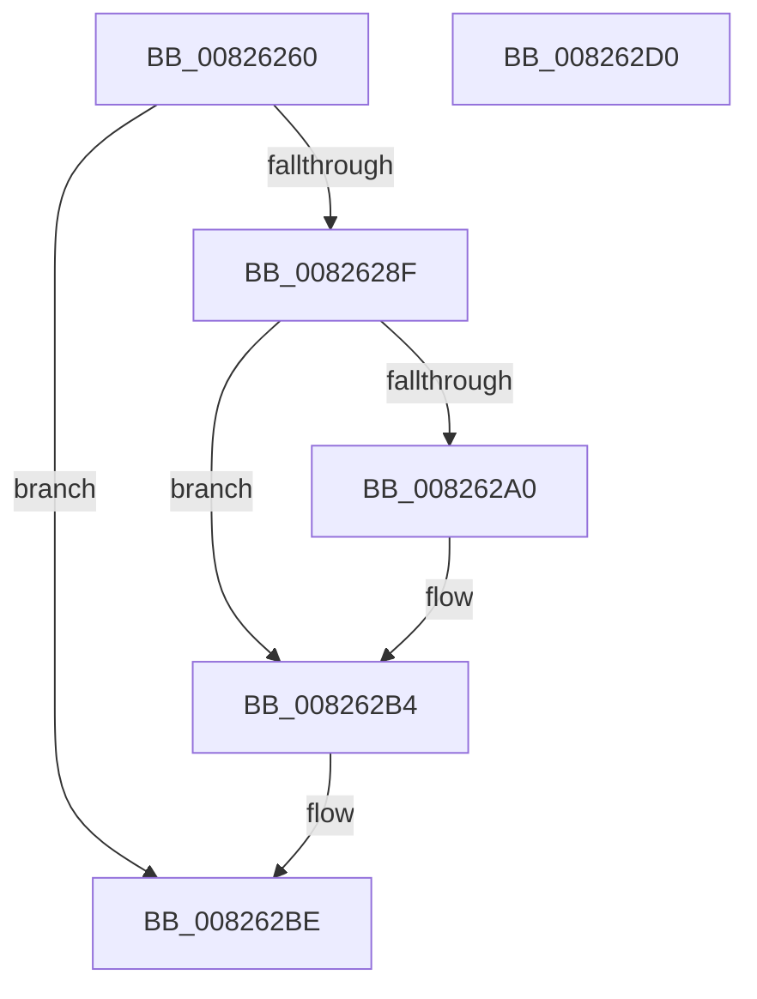

# BiAddBootEntry

- RVA: `0x00826260`–`0x008262D1` (길이 `113` bytes)
- VA: `0x0000000140826260`
- 실행 섹션: `PAGE`
- PDB 이름 있음: `예`; PDB Function 태그: `아니요`
- unwind 정보 RVA: `0x000BC3A0`
- 디코드: `33`개 명령, `113/113` bytes 표시
- 미해석 바이트: `0` (있으면 어셈블리에 `.byte`로 보존)

> 이 문서는 커널 이미지의 기계어와 PDB 기호를 분석해 생성했습니다. 4번과 5번은 함수 원형과 자료형을 바이너리 사용 방식에서 추정한 C 해석이며 원본 소스 복구 결과는 아닙니다.

## 1. Dependencies

- 직접 호출 지점: **4**; 고유 호출 대상: **4**
- 직접 호출자로 확인된 함수: **1**
- RIP 상대 이미지 참조: **1**

### Outgoing calls
- `0x00826284` → [BiAcquirePrivilege](../A3/BiAcquirePrivilege_function_00A3D658.md) (function, `0x00A3D658`)
- `0x00826295` → [ZwAddBootEntry](../../text/6A/ZwAddBootEntry_function_006ADE10.md) (function, `0x006ADE10`)
- `0x008262AF` → [BiLogMessage](../A3/BiLogMessage_function_00A3D3A8.md) (function, `0x00A3D3A8`)
- `0x008262B9` → [BiReleasePrivilege](../A3/BiReleasePrivilege_function_00A3D600.md) (function, `0x00A3D600`)

### Direct callers
- [BiCreateEfiEntry](BiCreateEfiEntry_function_008268C4.md) at `0x00826953`
- [BiCreateEfiEntry](BiCreateEfiEntry_function_008268C4.md) at `0x008269ED`

### Static image references
- `0x008262A3` → RVA `0x00B0C7D0` (` ?? ::NNGAKEGL::`string'`; read)

## 2. Other-region calls and transfers

- 다른 실행 섹션으로 향하는 call: **1**
  - `0x00826295` → [ZwAddBootEntry](../../text/6A/ZwAddBootEntry_function_006ADE10.md) (`PAGE` → `.text`)
- 별도 외부 분기/꼬리 이동을 확인하지 못했습니다.

## 3. Assembly (complete function range)

```asm
00826260  48 8B C4                        mov rax, rsp
00826263  48 89 58 08                     mov qword ptr [rax + 8], rbx
00826267  48 89 70 10                     mov qword ptr [rax + 0x10], rsi
0082626B  57                              push rdi
0082626C  48 83 EC 20                     sub rsp, 0x20
00826270  48 83 60 18 00                  and qword ptr [rax + 0x18], 0
00826275  48 8B FA                        mov rdi, rdx
00826278  48 8B F1                        mov rsi, rcx
0082627B  48 8D 50 18                     lea rdx, [rax + 0x18]
0082627F  B9 16 00 00 00                  mov ecx, 0x16
00826284  E8 CF 73 21 00                  call 0x140a3d658
00826289  8B D8                           mov ebx, eax
0082628B  85 C0                           test eax, eax
0082628D  78 2F                           js 0x1408262be
0082628F  48 8B D7                        mov rdx, rdi
00826292  48 8B CE                        mov rcx, rsi
00826295  E8 76 7B E8 FF                  call 0x1406ade10
0082629A  8B D8                           mov ebx, eax
0082629C  85 C0                           test eax, eax
0082629E  79 14                           jns 0x1408262b4
008262A0  44 8B C0                        mov r8d, eax
008262A3  48 8D 15 26 65 2E 00            lea rdx, [rip + 0x2e6526]
008262AA  B9 04 00 00 00                  mov ecx, 4
008262AF  E8 F4 70 21 00                  call 0x140a3d3a8
008262B4  48 8D 4C 24 40                  lea rcx, [rsp + 0x40]
008262B9  E8 42 73 21 00                  call 0x140a3d600
008262BE  48 8B 74 24 38                  mov rsi, qword ptr [rsp + 0x38]
008262C3  8B C3                           mov eax, ebx
008262C5  48 8B 5C 24 30                  mov rbx, qword ptr [rsp + 0x30]
008262CA  48 83 C4 20                     add rsp, 0x20
008262CE  5F                              pop rdi
008262CF  C3                              ret
008262D0  CC                              int3
```

## 4. C-style interpretation (structured pseudocode)

```c
__int64 __fastcall BiAddBootEntry(__int64 a1, __int64 a2)
{
    __int64 result;
    __int64 v_rsp;
    unsigned __int64 v_stack_p10;
    unsigned __int64 v_stack_p18;
    unsigned __int64 v_stack_p8;

    *(unsigned __int64 *)(v_rsp + 8) = v_rbx;
    *(unsigned __int64 *)(v_rsp + 16) = v_rsi;
    v_rsp = (v_rsp) - (32);
    result = BiAcquirePrivilege(22, v_rsp + 24, a3, a4);
    if (sign_flag) goto loc_008262BE;
    result = ZwAddBootEntry(a1, a2, a3, a4);
    if (sign_flag) {
        a3 = (unsigned int)(result);
        a2 = v_rip + 3040550;
        a1 = 4;
        result = BiLogMessage(a1, a2, a3, a4);
    }
    result = BiReleasePrivilege(v_stack_p18, a2, a3, a4);
loc_008262BE:
    v_rsp = (v_rsp) + (32);
    return (unsigned int)((unsigned int)((unsigned int)((unsigned int)(result))));
}
```

## 5. (Beta) C Style

```c
int64_t BiAddBootEntry(int64_t Arg1, int64_t Arg2)
{
    int64_t result;
    int64_t local_rsp;
    uint64_t v_stack_p10;
    uint64_t v_stack_p18;
    uint64_t v_stack_p8;

    *(uint64_t *)(local_rsp + 0x8) = local_rbx;
    *(uint64_t *)(local_rsp + 0x10) = local_rsi;
    local_rsp = (local_rsp) - (32);
    result = BiAcquirePrivilege(22, local_rsp + 24, a3, a4);
    if (sign_flag) goto loc_008262BE;
    result = ZwAddBootEntry(Arg1, Arg2, a3, a4);
    if (sign_flag) {
        a3 = (uint32_t)(result);
        Arg2 = v_rip + 3040550;
        Arg1 = 4;
        result = BiLogMessage(Arg1, Arg2, a3, a4);
    }
    result = BiReleasePrivilege(v_stack_p18, Arg2, a3, a4);
loc_008262BE:
    local_rsp = (local_rsp) + (32);
    return (uint32_t)((uint32_t)((uint32_t)((uint32_t)(result))));
}
```

## 6. Execution-region graph

[열기: 2D/3D 그래프와 함수 탐색 컨트롤 패널](../../../control-panel.html?section=page&rva=0x00826260&view=graph)

- 2D 그래프는 위에서 아래로 흐르고, 3D 그래프는 빈 공간을 드래그해 회전합니다. Shift+드래그는 이동, 휠은 확대·축소, 함수 노드 선택은 대상 보고서 이동입니다.

### Static fallback


