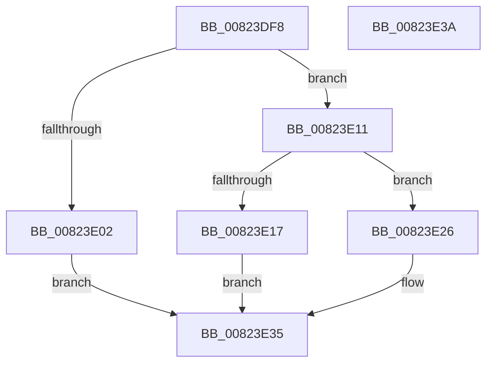

# BiConvertBootEnvironmentDeviceToElement

- RVA: `0x00823DF8`–`0x00823E3B` (길이 `67` bytes)
- VA: `0x0000000140823DF8`
- 실행 섹션: `PAGE`
- PDB 이름 있음: `예`; PDB Function 태그: `아니요`
- unwind 정보 RVA: `0x0005D2F4`
- 디코드: `19`개 명령, `67/67` bytes 표시
- 미해석 바이트: `0` (있으면 어셈블리에 `.byte`로 보존)

> 이 문서는 커널 이미지의 기계어와 PDB 기호를 분석해 생성했습니다. 4번과 5번은 함수 원형과 자료형을 바이너리 사용 방식에서 추정한 C 해석이며 원본 소스 복구 결과는 아닙니다.

## 1. Dependencies

- 직접 호출 지점: **3**; 고유 호출 대상: **3**
- 직접 호출자로 확인된 함수: **1**
- RIP 상대 이미지 참조: **0**

### Outgoing calls
- `0x00823E0A` → [BiConvertBootEnvironmentDeviceToQualifiedPartition](BiConvertBootEnvironmentDeviceToQualifiedPartition_function_008248D4.md) (function, `0x008248D4`)
- `0x00823E1F` → [BiConvertBootEnvironmentDeviceToUnknown](BiConvertBootEnvironmentDeviceToUnknown_function_008249C0.md) (function, `0x008249C0`)
- `0x00823E30` → [BiConvertBootEnvironmentDeviceToNt](BiConvertBootEnvironmentDeviceToNt_function_00823E44.md) (function, `0x00823E44`)

### Direct callers
- [sub_00B3A622](../B3/Unknown_function_00B3A622.md) at `0x00B3A721`

### Static image references
- 디코드된 RIP-relative 메모리 참조가 없습니다.

## 2. Other-region calls and transfers

- 다른 실행 섹션으로 향하는 call: **0**
- 별도 외부 분기/꼬리 이동을 확인하지 못했습니다.

## 3. Assembly (complete function range)

```asm
00823DF8  48 83 EC 38                     sub rsp, 0x38
00823DFC  41 F6 C0 01                     test r8b, 1
00823E00  74 0F                           je 0x140823e11
00823E02  4C 8B 44 24 60                  mov r8, qword ptr [rsp + 0x60]
00823E07  49 8B D1                        mov rdx, r9
00823E0A  E8 C5 0A 00 00                  call 0x1408248d4
00823E0F  EB 24                           jmp 0x140823e35
00823E11  41 F6 C0 02                     test r8b, 2
00823E15  74 0F                           je 0x140823e26
00823E17  4C 8B 44 24 60                  mov r8, qword ptr [rsp + 0x60]
00823E1C  49 8B D1                        mov rdx, r9
00823E1F  E8 9C 0B 00 00                  call 0x1408249c0
00823E24  EB 0F                           jmp 0x140823e35
00823E26  48 8B 44 24 60                  mov rax, qword ptr [rsp + 0x60]
00823E2B  48 89 44 24 20                  mov qword ptr [rsp + 0x20], rax
00823E30  E8 0F 00 00 00                  call 0x140823e44
00823E35  48 83 C4 38                     add rsp, 0x38
00823E39  C3                              ret
00823E3A  CC                              int3
```

## 4. C-style interpretation (structured pseudocode)

```c
__int64 __fastcall BiConvertBootEnvironmentDeviceToElement(__int64 a1, __int64 a2, unsigned __int8 a3, __int64 a4, __int64 a5)
{
    __int64 result;
    __int64 v_rsp;
    unsigned __int64 v_stack_m18;

    v_rsp = (v_rsp) - (56);
    if (((a3) & (1)) == 0) goto loc_00823E11;
    result = BiConvertBootEnvironmentDeviceToQualifiedPartition(a1, a4, a5, a4);
    goto loc_00823E35;
loc_00823E11:
    if ((((unsigned __int8)(a5)) & (2)) == 0) goto loc_00823E26;
    result = BiConvertBootEnvironmentDeviceToUnknown(a1, a4, a5, a4);
    goto loc_00823E35;
loc_00823E26:
    v_stack_m18 = a5;
    result = BiConvertBootEnvironmentDeviceToNt(a1, a4, a5, a4);
loc_00823E35:
    v_rsp = (v_rsp) + (56);
    return result;
}
```

## 5. (Beta) C Style

```c
int64_t BiConvertBootEnvironmentDeviceToElement(int64_t Arg1, int64_t Arg2, uint8_t Arg3, int64_t Arg4, int64_t Arg5)
{
    int64_t result;
    int64_t local_rsp;
    uint64_t v_stack_m18;

    local_rsp = (local_rsp) - (56);
    if (((Arg3) & (1)) == 0) goto loc_00823E11;
    result = BiConvertBootEnvironmentDeviceToQualifiedPartition(Arg1, Arg4, Arg5, Arg4);
    goto loc_00823E35;
loc_00823E11:
    if ((((uint8_t)(Arg5)) & (2)) == 0) goto loc_00823E26;
    result = BiConvertBootEnvironmentDeviceToUnknown(Arg1, Arg4, Arg5, Arg4);
    goto loc_00823E35;
loc_00823E26:
    v_stack_m18 = Arg5;
    result = BiConvertBootEnvironmentDeviceToNt(Arg1, Arg4, Arg5, Arg4);
loc_00823E35:
    local_rsp = (local_rsp) + (56);
    return result;
}
```

## 6. Execution-region graph

[열기: 2D/3D 그래프와 함수 탐색 컨트롤 패널](../../../control-panel.html?section=page&rva=0x00823DF8&view=graph)

- 2D 그래프는 위에서 아래로 흐르고, 3D 그래프는 빈 공간을 드래그해 회전합니다. Shift+드래그는 이동, 휠은 확대·축소, 함수 노드 선택은 대상 보고서 이동입니다.

### Static fallback


