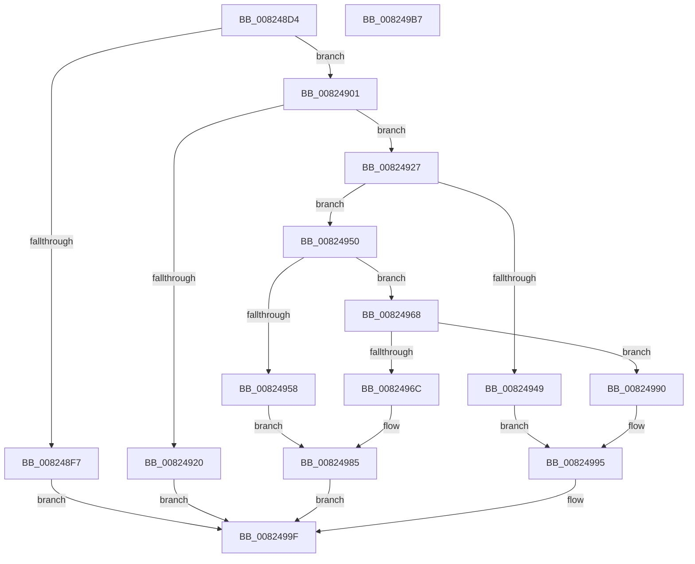

# BiConvertBootEnvironmentDeviceToQualifiedPartition

- RVA: `0x008248D4`–`0x008249B8` (길이 `228` bytes)
- VA: `0x00000001408248D4`
- 실행 섹션: `PAGE`
- PDB 이름 있음: `예`; PDB Function 태그: `아니요`
- unwind 정보 RVA: `0x0006F978`
- 디코드: `63`개 명령, `228/228` bytes 표시
- 미해석 바이트: `0` (있으면 어셈블리에 `.byte`로 보존)

> 이 문서는 커널 이미지의 기계어와 PDB 기호를 분석해 생성했습니다. 4번과 5번은 함수 원형과 자료형을 바이너리 사용 방식에서 추정한 C 해석이며 원본 소스 복구 결과는 아닙니다.

## 1. Dependencies

- 직접 호출 지점: **2**; 고유 호출 대상: **2**
- 직접 호출자로 확인된 함수: **1**
- RIP 상대 이미지 참조: **0**

### Outgoing calls
- `0x00824911` → [ExAllocatePool2](../../poolcode/B8/ExAllocatePool2_function_00B820F0.md) (function, `0x00B820F0`)
- `0x0082499A` → [ExFreePoolWithTag](../../poolcode/B8/ExFreePoolWithTag_function_00B82870.md) (function, `0x00B82870`)

### Direct callers
- [BiConvertBootEnvironmentDeviceToElement](BiConvertBootEnvironmentDeviceToElement_function_00823DF8.md) at `0x00823E0A`

### Static image references
- 디코드된 RIP-relative 메모리 참조가 없습니다.

## 2. Other-region calls and transfers

- 다른 실행 섹션으로 향하는 call: **2**
  - `0x00824911` → [ExAllocatePool2](../../poolcode/B8/ExAllocatePool2_function_00B820F0.md) (`PAGE` → `POOLCODE`)
  - `0x0082499A` → [ExFreePoolWithTag](../../poolcode/B8/ExFreePoolWithTag_function_00B82870.md) (`PAGE` → `POOLCODE`)
- 별도 외부 분기/꼬리 이동을 확인하지 못했습니다.

## 3. Assembly (complete function range)

```asm
008248D4  48 89 5C 24 08                  mov qword ptr [rsp + 8], rbx
008248D9  48 89 74 24 10                  mov qword ptr [rsp + 0x10], rsi
008248DE  48 89 7C 24 18                  mov qword ptr [rsp + 0x18], rdi
008248E3  41 56                           push r14
008248E5  48 83 EC 20                     sub rsp, 0x20
008248E9  83 39 06                        cmp dword ptr [rcx], 6
008248EC  49 8B F0                        mov rsi, r8
008248EF  4C 8B F2                        mov r14, rdx
008248F2  48 8B F9                        mov rdi, rcx
008248F5  74 0A                           je 0x140824901
008248F7  BB 0D 00 00 C0                  mov ebx, 0xc000000d
008248FC  E9 9E 00 00 00                  jmp 0x14082499f
00824901  BA 3C 00 00 00                  mov edx, 0x3c
00824906  B9 02 01 00 00                  mov ecx, 0x102
0082490B  41 B8 42 43 44 4B               mov r8d, 0x4b444342
00824911  E8 DA D7 35 00                  call 0x140b820f0
00824916  33 DB                           xor ebx, ebx
00824918  48 8B C8                        mov rcx, rax
0082491B  48 85 C0                        test rax, rax
0082491E  75 07                           jne 0x140824927
00824920  BB 9A 00 00 C0                  mov ebx, 0xc000009a
00824925  EB 78                           jmp 0x14082499f
00824927  0F 57 C0                        xorps xmm0, xmm0
0082492A  33 C0                           xor eax, eax
0082492C  0F 11 01                        movups xmmword ptr [rcx], xmm0
0082492F  0F 11 41 10                     movups xmmword ptr [rcx + 0x10], xmm0
00824933  0F 11 41 20                     movups xmmword ptr [rcx + 0x20], xmm0
00824937  48 89 41 30                     mov qword ptr [rcx + 0x30], rax
0082493B  89 41 38                        mov dword ptr [rcx + 0x38], eax
0082493E  C7 01 06 00 00 00               mov dword ptr [rcx], 6
00824944  39 5F 20                        cmp dword ptr [rdi + 0x20], ebx
00824947  74 07                           je 0x140824950
00824949  BB BB 00 00 C0                  mov ebx, 0xc00000bb
0082494E  EB 45                           jmp 0x140824995
00824950  8B 47 24                        mov eax, dword ptr [rdi + 0x24]
00824953  83 F8 01                        cmp eax, 1
00824956  75 10                           jne 0x140824968
00824958  8B 47 28                        mov eax, dword ptr [rdi + 0x28]
0082495B  89 41 1C                        mov dword ptr [rcx + 0x1c], eax
0082495E  48 8B 47 10                     mov rax, qword ptr [rdi + 0x10]
00824962  48 89 41 20                     mov qword ptr [rcx + 0x20], rax
00824966  EB 1D                           jmp 0x140824985
00824968  85 C0                           test eax, eax
0082496A  75 24                           jne 0x140824990
0082496C  C7 41 14 01 00 00 00            mov dword ptr [rcx + 0x14], 1
00824973  0F 10 47 28                     movups xmm0, xmmword ptr [rdi + 0x28]
00824977  F3 0F 7F 41 1C                  movdqu xmmword ptr [rcx + 0x1c], xmm0
0082497C  0F 10 4F 10                     movups xmm1, xmmword ptr [rdi + 0x10]
00824980  F3 0F 7F 49 2C                  movdqu xmmword ptr [rcx + 0x2c], xmm1
00824985  49 89 0E                        mov qword ptr [r14], rcx
00824988  C7 06 3C 00 00 00               mov dword ptr [rsi], 0x3c
0082498E  EB 0F                           jmp 0x14082499f
00824990  BB 0D 00 00 C0                  mov ebx, 0xc000000d
00824995  BA 42 43 44 4B                  mov edx, 0x4b444342
0082499A  E8 D1 DE 35 00                  call 0x140b82870
0082499F  48 8B 74 24 38                  mov rsi, qword ptr [rsp + 0x38]
008249A4  8B C3                           mov eax, ebx
008249A6  48 8B 5C 24 30                  mov rbx, qword ptr [rsp + 0x30]
008249AB  48 8B 7C 24 40                  mov rdi, qword ptr [rsp + 0x40]
008249B0  48 83 C4 20                     add rsp, 0x20
008249B4  41 5E                           pop r14
008249B6  C3                              ret
008249B7  CC                              int3
```

## 4. C-style interpretation (structured pseudocode)

```c
__int64 __fastcall BiConvertBootEnvironmentDeviceToQualifiedPartition(__int64 a1, __int64 a2, __int64 a3)
{
    __int64 result;
    __int64 v_rbx;
    __int64 v_rsp;
    unsigned __int64 v_stack_p10;
    unsigned __int64 v_stack_p18;
    unsigned __int64 v_stack_p8;

    v_stack_p8 = v_rbx;
    v_stack_p10 = v_rsi;
    v_stack_p18 = v_rdi;
    v_rsp = (v_rsp) - (32);
    if ((*(unsigned int *)(a1)) == 6) goto loc_00824901;
    goto loc_0082499F;
loc_00824901:
    result = ExAllocatePool2(258, 60, (unsigned int)(0x4B444342ULL), a4);
    v_rbx = 0;
    if (result != 0) goto loc_00824927;
    goto loc_0082499F;
loc_00824927:
    result = 0;
    *(unsigned __int64 *)(result) = v_xmm0;
    *(unsigned __int64 *)(result + 16) = v_xmm0;
    *(unsigned __int64 *)(result + 32) = v_xmm0;
    *(unsigned __int64 *)(result + 48) = 0;
    *(unsigned int *)(result + 56) = 0;
    *(unsigned int *)(result) = 6;
    if ((*(unsigned int *)(a1 + 32)) == ((unsigned int)((unsigned int)(0xC000009AULL)))) goto loc_00824950;
    goto loc_00824995;
loc_00824950:
    if (((unsigned int)((unsigned int)(*(unsigned int *)(a1 + 36)))) != 1) goto loc_00824968;
    *(unsigned int *)(result + 28) = (unsigned int)((unsigned int)(*(unsigned int *)(a1 + 40)));
    *(unsigned __int64 *)(result + 32) = *(unsigned __int64 *)(a1 + 16);
    goto loc_00824985;
loc_00824968:
    if ((unsigned int)(*(unsigned __int64 *)(a1 + 16)) != 0) goto loc_00824990;
    *(unsigned int *)(result + 20) = 1;
    *(unsigned __int64 *)(result + 28) = v_xmm0;
    *(unsigned __int64 *)(result + 44) = v_xmm1;
loc_00824985:
    *(unsigned __int64 *)(a2) = 0;
    *(unsigned int *)(a3) = 60;
    goto loc_0082499F;
loc_00824990:
loc_00824995:
    result = ExFreePoolWithTag(result, (unsigned int)(0x4B444342ULL), (unsigned int)(0x4B444342ULL), a4);
loc_0082499F:
    v_rsp = (v_rsp) + (32);
    return (unsigned int)((unsigned int)((unsigned int)(0xC000000DULL)));
}
```

## 5. (Beta) C Style

```c
int64_t BiConvertBootEnvironmentDeviceToQualifiedPartition(void *Arg1, void *Arg2, void *Arg3)
{
    uint8_t *arg1 = (uint8_t *)Arg1;
    uint8_t *arg2 = (uint8_t *)Arg2;
    uint8_t *arg3 = (uint8_t *)Arg3;

    int64_t result;
    int64_t local_rbx;
    int64_t local_rsp;
    uint64_t v_stack_p10;
    uint64_t v_stack_p18;
    uint64_t v_stack_p8;

    v_stack_p8 = local_rbx;
    v_stack_p10 = local_rsi;
    v_stack_p18 = local_rdi;
    local_rsp = (local_rsp) - (32);
    if ((*(uint32_t *)(arg1)) == 6) goto loc_00824901;
    goto loc_0082499F;
loc_00824901:
    result = ExAllocatePool2(258, 60, (uint32_t)(0x4B444342ULL), a4);
    local_rbx = 0;
    if (result != 0) goto loc_00824927;
    goto loc_0082499F;
loc_00824927:
    result = 0;
    *(uint64_t *)(result) = v_xmm0;
    *(uint64_t *)(result + 0x10) = v_xmm0;
    *(uint64_t *)(result + 0x20) = v_xmm0;
    *(uint64_t *)(result + 0x30) = 0;
    *(uint32_t *)(result + 0x38) = 0;
    *(uint32_t *)(result) = 6;
    if ((*(uint32_t *)(arg1 + 0x20)) == ((uint32_t)((uint32_t)(0xC000009AULL)))) goto loc_00824950;
    goto loc_00824995;
loc_00824950:
    if (((uint32_t)((uint32_t)(*(uint32_t *)(arg1 + 0x24)))) != 1) goto loc_00824968;
    *(uint32_t *)(result + 0x1C) = (uint32_t)((uint32_t)(*(uint32_t *)(arg1 + 0x28)));
    *(uint64_t *)(result + 0x20) = *(uint64_t *)(arg1 + 0x10);
    goto loc_00824985;
loc_00824968:
    if ((uint32_t)(*(uint64_t *)(arg1 + 0x10)) != 0) goto loc_00824990;
    *(uint32_t *)(result + 0x14) = 1;
    *(uint64_t *)(result + 0x1C) = v_xmm0;
    *(uint64_t *)(result + 0x2C) = v_xmm1;
loc_00824985:
    *(uint64_t *)(arg2) = 0;
    *(uint32_t *)(arg3) = 60;
    goto loc_0082499F;
loc_00824990:
loc_00824995:
    result = ExFreePoolWithTag(result, (uint32_t)(0x4B444342ULL), (uint32_t)(0x4B444342ULL), a4);
loc_0082499F:
    local_rsp = (local_rsp) + (32);
    return (uint32_t)((uint32_t)((uint32_t)(0xC000000DULL)));
}
```

### 관측된 메모리 오프셋

구조체 형식이 확인되지 않은 접근은 인자 기준의 오프셋으로만 기록했습니다.

| 기준 인자 | 오프셋 표현 | 폭 (bit) | 접근 |
|---|---:|---:|---|
| `Arg1` | `+ 0x0` | `32` | `R` |
| `Arg1` | `+ 0x10` | `64` | `R` |
| `Arg1` | `+ 0x10` | `128` | `R` |
| `Arg1` | `+ 0x20` | `32` | `R` |
| `Arg1` | `+ 0x24` | `32` | `R` |
| `Arg1` | `+ 0x28` | `32` | `R` |
| `Arg1` | `+ 0x28` | `128` | `R` |
| `Arg2` | `+ 0x0` | `64` | `W` |
| `Arg3` | `+ 0x0` | `32` | `W` |

## 6. Execution-region graph

[열기: 2D/3D 그래프와 함수 탐색 컨트롤 패널](../../../control-panel.html?section=page&rva=0x008248D4&view=graph)

- 2D 그래프는 위에서 아래로 흐르고, 3D 그래프는 빈 공간을 드래그해 회전합니다. Shift+드래그는 이동, 휠은 확대·축소, 함수 노드 선택은 대상 보고서 이동입니다.

### Static fallback


