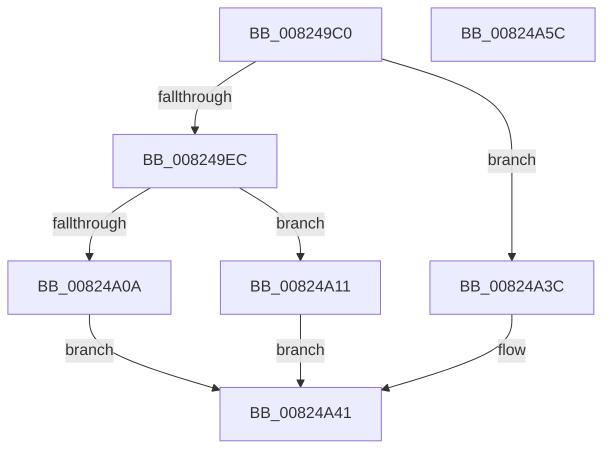

# BiConvertBootEnvironmentDeviceToUnknown

- RVA: `0x008249C0`–`0x00824A5D` (길이 `157` bytes)
- VA: `0x00000001408249C0`
- 실행 섹션: `PAGE`
- PDB 이름 있음: `예`; PDB Function 태그: `아니요`
- unwind 정보 RVA: `0x00060300`
- 디코드: `48`개 명령, `157/157` bytes 표시
- 미해석 바이트: `0` (있으면 어셈블리에 `.byte`로 보존)

> 이 문서는 커널 이미지의 기계어와 PDB 기호를 분석해 생성했습니다. 4번과 5번은 함수 원형과 자료형을 바이너리 사용 방식에서 추정한 C 해석이며 원본 소스 복구 결과는 아닙니다.

## 1. Dependencies

- 직접 호출 지점: **3**; 고유 호출 대상: **3**
- 직접 호출자로 확인된 함수: **2**
- RIP 상대 이미지 참조: **0**

### Outgoing calls
- `0x008249FB` → [ExAllocatePool2](../../poolcode/B8/ExAllocatePool2_function_00B820F0.md) (function, `0x00B820F0`)
- `0x00824A19` → [memset](../../text/6C/memset_function_006C6C40.md) (function, `0x006C6C40`)
- `0x00824A2F` → [memcpy](../../text/6C/memcpy_function_006C6840.md) (function, `0x006C6840`)

### Direct callers
- [BiConvertBootEnvironmentDeviceToElement](BiConvertBootEnvironmentDeviceToElement_function_00823DF8.md) at `0x00823E1F`
- [BiConvertBootEnvironmentDeviceToNt](BiConvertBootEnvironmentDeviceToNt_function_00823E44.md) at `0x0082462B`

### Static image references
- 디코드된 RIP-relative 메모리 참조가 없습니다.

## 2. Other-region calls and transfers

- 다른 실행 섹션으로 향하는 call: **3**
  - `0x008249FB` → [ExAllocatePool2](../../poolcode/B8/ExAllocatePool2_function_00B820F0.md) (`PAGE` → `POOLCODE`)
  - `0x00824A19` → [memset](../../text/6C/memset_function_006C6C40.md) (`PAGE` → `.text`)
  - `0x00824A2F` → [memcpy](../../text/6C/memcpy_function_006C6840.md) (`PAGE` → `.text`)
- 별도 외부 분기/꼬리 이동을 확인하지 못했습니다.

## 3. Assembly (complete function range)

```asm
008249C0  48 89 5C 24 08                  mov qword ptr [rsp + 8], rbx
008249C5  48 89 6C 24 10                  mov qword ptr [rsp + 0x10], rbp
008249CA  48 89 74 24 18                  mov qword ptr [rsp + 0x18], rsi
008249CF  57                              push rdi
008249D0  41 56                           push r14
008249D2  41 57                           push r15
008249D4  48 83 EC 20                     sub rsp, 0x20
008249D8  8B 41 08                        mov eax, dword ptr [rcx + 8]
008249DB  4D 8B F0                        mov r14, r8
008249DE  83 C0 14                        add eax, 0x14
008249E1  4C 8B FA                        mov r15, rdx
008249E4  48 8B F1                        mov rsi, rcx
008249E7  83 F8 14                        cmp eax, 0x14
008249EA  72 50                           jb 0x140824a3c
008249EC  41 B8 42 43 44 4B               mov r8d, 0x4b444342
008249F2  8B D0                           mov edx, eax
008249F4  B9 02 01 00 00                  mov ecx, 0x102
008249F9  8B E8                           mov ebp, eax
008249FB  E8 F0 D6 35 00                  call 0x140b820f0
00824A00  33 DB                           xor ebx, ebx
00824A02  48 8B F8                        mov rdi, rax
00824A05  48 85 C0                        test rax, rax
00824A08  75 07                           jne 0x140824a11
00824A0A  BB 9A 00 00 C0                  mov ebx, 0xc000009a
00824A0F  EB 30                           jmp 0x140824a41
00824A11  4C 8B C5                        mov r8, rbp
00824A14  33 D2                           xor edx, edx
00824A16  48 8B CF                        mov rcx, rdi
00824A19  E8 22 22 EA FF                  call 0x1406c6c40
00824A1E  C7 07 05 00 00 00               mov dword ptr [rdi], 5
00824A24  48 8D 4F 14                     lea rcx, [rdi + 0x14]
00824A28  44 8B 46 08                     mov r8d, dword ptr [rsi + 8]
00824A2C  48 8B D6                        mov rdx, rsi
00824A2F  E8 0C 1E EA FF                  call 0x1406c6840
00824A34  49 89 3F                        mov qword ptr [r15], rdi
00824A37  41 89 2E                        mov dword ptr [r14], ebp
00824A3A  EB 05                           jmp 0x140824a41
00824A3C  BB 95 00 00 C0                  mov ebx, 0xc0000095
00824A41  48 8B 6C 24 48                  mov rbp, qword ptr [rsp + 0x48]
00824A46  8B C3                           mov eax, ebx
00824A48  48 8B 5C 24 40                  mov rbx, qword ptr [rsp + 0x40]
00824A4D  48 8B 74 24 50                  mov rsi, qword ptr [rsp + 0x50]
00824A52  48 83 C4 20                     add rsp, 0x20
00824A56  41 5F                           pop r15
00824A58  41 5E                           pop r14
00824A5A  5F                              pop rdi
00824A5B  C3                              ret
00824A5C  CC                              int3
```

## 4. C-style interpretation (structured pseudocode)

```c
__int64 __fastcall BiConvertBootEnvironmentDeviceToUnknown(__int64 a1, __int64 a2, __int64 a3)
{
    __int64 result;
    __int64 v_rbx;
    __int64 v_rsp;
    unsigned __int64 v_stack_p10;
    unsigned __int64 v_stack_p18;
    unsigned __int64 v_stack_p8;

    v_stack_p8 = v_rbx;
    v_stack_p10 = v_rbp;
    v_stack_p18 = v_rsi;
    v_rsp = (v_rsp) - (32);
    result = (unsigned int)(((unsigned int)(*(unsigned int *)(a1 + 8))) + (20));
    if (((unsigned int)(result)) < 20) goto loc_00824A3C;
    result = ExAllocatePool2(258, (unsigned int)((unsigned int)(result)), (unsigned int)(0x4B444342ULL), a4);
    v_rbx = 0;
    if (result != 0) goto loc_00824A11;
    goto loc_00824A41;
loc_00824A11:
    a2 = 0;
    result = memset(result, a2, (unsigned int)((unsigned int)(result)), a4);
    *(unsigned int *)(result) = 5;
    result = memcpy(result + 20, a1, (unsigned int)(*(unsigned int *)(a1 + 8)), a4);
    *(unsigned __int64 *)(a2) = result;
    *(unsigned int *)(a3) = (unsigned int)((unsigned int)((unsigned int)(result)));
    goto loc_00824A41;
loc_00824A3C:
loc_00824A41:
    v_rsp = (v_rsp) + (32);
    return (unsigned int)((unsigned int)((unsigned int)(0xC0000095ULL)));
}
```

## 5. (Beta) C Style

```c
int64_t BiConvertBootEnvironmentDeviceToUnknown(void *Arg1, void *Arg2, void *Arg3)
{
    uint8_t *arg1 = (uint8_t *)Arg1;
    uint8_t *arg2 = (uint8_t *)Arg2;
    uint8_t *arg3 = (uint8_t *)Arg3;

    int64_t result;
    int64_t local_rbx;
    int64_t local_rsp;
    uint64_t v_stack_p10;
    uint64_t v_stack_p18;
    uint64_t v_stack_p8;

    v_stack_p8 = local_rbx;
    v_stack_p10 = local_rbp;
    v_stack_p18 = local_rsi;
    local_rsp = (local_rsp) - (32);
    result = (uint32_t)(((uint32_t)(*(uint32_t *)(arg1 + 0x8))) + (20));
    if (((uint32_t)(result)) < 20) goto loc_00824A3C;
    result = ExAllocatePool2(258, (uint32_t)((uint32_t)(result)), (uint32_t)(0x4B444342ULL), a4);
    local_rbx = 0;
    if (result != 0) goto loc_00824A11;
    goto loc_00824A41;
loc_00824A11:
    Arg2 = 0;
    result = memset(result, Arg2, (uint32_t)((uint32_t)(result)), a4);
    *(uint32_t *)(result) = 5;
    result = memcpy(result + 20, Arg1, (uint32_t)(*(uint32_t *)(arg1 + 0x8)), a4);
    *(uint64_t *)(arg2) = result;
    *(uint32_t *)(arg3) = (uint32_t)((uint32_t)((uint32_t)(result)));
    goto loc_00824A41;
loc_00824A3C:
loc_00824A41:
    local_rsp = (local_rsp) + (32);
    return (uint32_t)((uint32_t)((uint32_t)(0xC0000095ULL)));
}
```

### 관측된 메모리 오프셋

구조체 형식이 확인되지 않은 접근은 인자 기준의 오프셋으로만 기록했습니다.

| 기준 인자 | 오프셋 표현 | 폭 (bit) | 접근 |
|---|---:|---:|---|
| `Arg1` | `+ 0x8` | `32` | `R` |
| `Arg2` | `+ 0x0` | `64` | `W` |
| `Arg3` | `+ 0x0` | `32` | `W` |

## 6. Execution-region graph

[열기: 2D/3D 그래프와 함수 탐색 컨트롤 패널](../../../control-panel.html?section=page&rva=0x008249C0&view=graph)

- 2D 그래프는 위에서 아래로 흐르고, 3D 그래프는 빈 공간을 드래그해 회전합니다. Shift+드래그는 이동, 휠은 확대·축소, 함수 노드 선택은 대상 보고서 이동입니다.

### Static fallback


