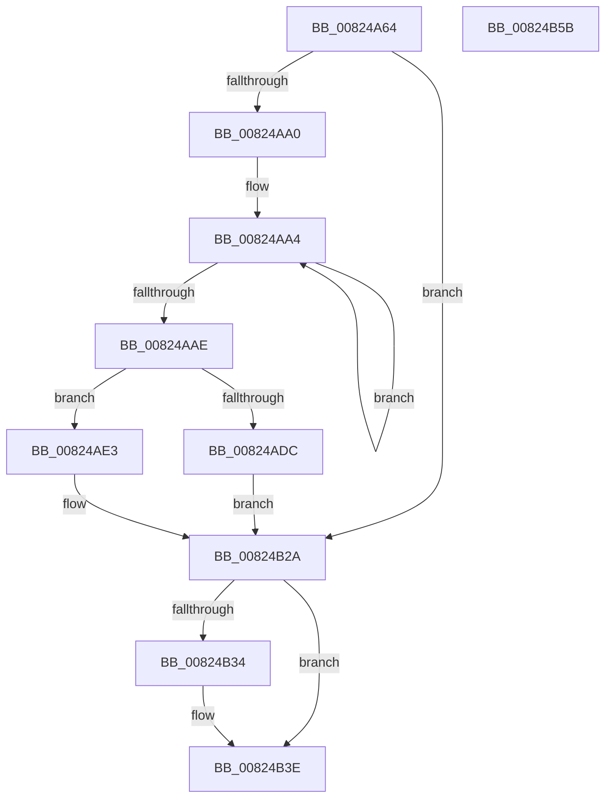

# BiConvertNtFilePathToBootEnvironment

- RVA: `0x00824A64`–`0x00824B5C` (길이 `248` bytes)
- VA: `0x0000000140824A64`
- 실행 섹션: `PAGE`
- PDB 이름 있음: `예`; PDB Function 태그: `아니요`
- unwind 정보 RVA: `0x0005D7BC`
- 디코드: `66`개 명령, `248/248` bytes 표시
- 미해석 바이트: `0` (있으면 어셈블리에 `.byte`로 보존)

> 이 문서는 커널 이미지의 기계어와 PDB 기호를 분석해 생성했습니다. 4번과 5번은 함수 원형과 자료형을 바이너리 사용 방식에서 추정한 C 해석이며 원본 소스 복구 결과는 아닙니다.

## 1. Dependencies

- 직접 호출 지점: **5**; 고유 호출 대상: **4**
- 직접 호출자로 확인된 함수: **1**
- RIP 상대 이미지 참조: **0**

### Outgoing calls
- `0x00824A91` → [BiConvertNtDeviceToBootEnvironment](../A4/BiConvertNtDeviceToBootEnvironment_function_00A41760.md) (function, `0x00A41760`)
- `0x00824ACF` → [ExAllocatePool2](../../poolcode/B8/ExAllocatePool2_function_00B820F0.md) (function, `0x00B820F0`)
- `0x00824B00` → [memcpy](../../text/6C/memcpy_function_006C6840.md) (function, `0x006C6840`)
- `0x00824B1A` → [memcpy](../../text/6C/memcpy_function_006C6840.md) (function, `0x006C6840`)
- `0x00824B39` → [ExFreePoolWithTag](../../poolcode/B8/ExFreePoolWithTag_function_00B82870.md) (function, `0x00B82870`)

### Direct callers
- [BiConvertNtDeviceToBootEnvironment](../A4/BiConvertNtDeviceToBootEnvironment_function_00A41760.md) at `0x00A4184F`
- [BiConvertNtDeviceToBootEnvironment](../A4/BiConvertNtDeviceToBootEnvironment_function_00A41760.md) at `0x00A418EB`

### Static image references
- 디코드된 RIP-relative 메모리 참조가 없습니다.

## 2. Other-region calls and transfers

- 다른 실행 섹션으로 향하는 call: **4**
  - `0x00824ACF` → [ExAllocatePool2](../../poolcode/B8/ExAllocatePool2_function_00B820F0.md) (`PAGE` → `POOLCODE`)
  - `0x00824B00` → [memcpy](../../text/6C/memcpy_function_006C6840.md) (`PAGE` → `.text`)
  - `0x00824B1A` → [memcpy](../../text/6C/memcpy_function_006C6840.md) (`PAGE` → `.text`)
  - `0x00824B39` → [ExFreePoolWithTag](../../poolcode/B8/ExFreePoolWithTag_function_00B82870.md) (`PAGE` → `POOLCODE`)
- 별도 외부 분기/꼬리 이동을 확인하지 못했습니다.

## 3. Assembly (complete function range)

```asm
00824A64  4C 8B DC                        mov r11, rsp
00824A67  49 89 5B 08                     mov qword ptr [r11 + 8], rbx
00824A6B  49 89 6B 10                     mov qword ptr [r11 + 0x10], rbp
00824A6F  49 89 73 18                     mov qword ptr [r11 + 0x18], rsi
00824A73  49 89 7B 20                     mov qword ptr [r11 + 0x20], rdi
00824A77  41 56                           push r14
00824A79  48 83 EC 30                     sub rsp, 0x30
00824A7D  41 8B C1                        mov eax, r9d
00824A80  49 8B F8                        mov rdi, r8
00824A83  45 33 F6                        xor r14d, r14d
00824A86  4D 8D 4B E8                     lea r9, [r11 - 0x18]
00824A8A  44 8B C0                        mov r8d, eax
00824A8D  4D 89 73 E8                     mov qword ptr [r11 - 0x18], r14
00824A91  E8 CA CC 21 00                  call 0x140a41760
00824A96  8B D8                           mov ebx, eax
00824A98  85 C0                           test eax, eax
00824A9A  0F 88 8A 00 00 00               js 0x140824b2a
00824AA0  48 83 C8 FF                     or rax, 0xffffffffffffffff
00824AA4  48 FF C0                        inc rax
00824AA7  66 44 39 34 47                  cmp word ptr [rdi + rax*2], r14w
00824AAC  75 F6                           jne 0x140824aa4
00824AAE  8D 34 45 02 00 00 00            lea esi, [rax*2 + 2]
00824AB5  B9 02 01 00 00                  mov ecx, 0x102
00824ABA  48 8B 44 24 20                  mov rax, qword ptr [rsp + 0x20]
00824ABF  41 B8 42 43 44 4B               mov r8d, 0x4b444342
00824AC5  8B 68 08                        mov ebp, dword ptr [rax + 8]
00824AC8  83 C5 0C                        add ebp, 0xc
00824ACB  03 EE                           add ebp, esi
00824ACD  8B D5                           mov edx, ebp
00824ACF  E8 1C D6 35 00                  call 0x140b820f0
00824AD4  48 8B D8                        mov rbx, rax
00824AD7  48 85 C0                        test rax, rax
00824ADA  75 07                           jne 0x140824ae3
00824ADC  BB 9A 00 00 C0                  mov ebx, 0xc000009a
00824AE1  EB 47                           jmp 0x140824b2a
00824AE3  C7 00 01 00 00 00               mov dword ptr [rax], 1
00824AE9  48 8D 48 0C                     lea rcx, [rax + 0xc]
00824AED  C7 40 08 05 00 00 00            mov dword ptr [rax + 8], 5
00824AF4  89 68 04                        mov dword ptr [rax + 4], ebp
00824AF7  48 8B 54 24 20                  mov rdx, qword ptr [rsp + 0x20]
00824AFC  44 8B 42 08                     mov r8d, dword ptr [rdx + 8]
00824B00  E8 3B 1D EA FF                  call 0x1406c6840
00824B05  48 8B 44 24 20                  mov rax, qword ptr [rsp + 0x20]
00824B0A  48 8B D7                        mov rdx, rdi
00824B0D  44 8B C6                        mov r8d, esi
00824B10  8B 48 08                        mov ecx, dword ptr [rax + 8]
00824B13  48 83 C1 0C                     add rcx, 0xc
00824B17  48 03 CB                        add rcx, rbx
00824B1A  E8 21 1D EA FF                  call 0x1406c6840
00824B1F  48 8B 44 24 60                  mov rax, qword ptr [rsp + 0x60]
00824B24  48 89 18                        mov qword ptr [rax], rbx
00824B27  41 8B DE                        mov ebx, r14d
00824B2A  48 8B 4C 24 20                  mov rcx, qword ptr [rsp + 0x20]
00824B2F  48 85 C9                        test rcx, rcx
00824B32  74 0A                           je 0x140824b3e
00824B34  BA 42 43 44 4B                  mov edx, 0x4b444342
00824B39  E8 32 DD 35 00                  call 0x140b82870
00824B3E  48 8B 6C 24 48                  mov rbp, qword ptr [rsp + 0x48]
00824B43  8B C3                           mov eax, ebx
00824B45  48 8B 5C 24 40                  mov rbx, qword ptr [rsp + 0x40]
00824B4A  48 8B 74 24 50                  mov rsi, qword ptr [rsp + 0x50]
00824B4F  48 8B 7C 24 58                  mov rdi, qword ptr [rsp + 0x58]
00824B54  48 83 C4 30                     add rsp, 0x30
00824B58  41 5E                           pop r14
00824B5A  C3                              ret
00824B5B  CC                              int3
```

## 4. C-style interpretation (structured pseudocode)

```c
__int64 __fastcall BiConvertNtFilePathToBootEnvironment(__int64 a1, __int64 a2, __int64 a3, int a4, __int64 a5)
{
    __int64 result;
    __int64 v_r14;
    __int64 v_rbp;
    __int64 v_rsp;
    unsigned __int64 v_stack_m18;
    unsigned __int64 v_stack_p10;
    unsigned __int64 v_stack_p18;
    unsigned __int64 v_stack_p20;
    unsigned __int64 v_stack_p8;

    *(unsigned __int64 *)(v_rsp + 8) = v_rbx;
    *(unsigned __int64 *)(v_rsp + 16) = v_rbp;
    *(unsigned __int64 *)(v_rsp + 24) = v_rsi;
    *(unsigned __int64 *)(v_rsp + 32) = v_rdi;
    v_rsp = (v_rsp) - (48);
    v_r14 = 0;
    *(unsigned __int64 *)(v_rsp - 24) = 0;
    result = BiConvertNtDeviceToBootEnvironment(a1, a2, (unsigned int)((unsigned int)((unsigned int)(a4))), v_rsp - 24);
    if (sign_flag) goto loc_00824B2A;
    result = (result) | (-1);
loc_00824AA4:
    result = (result) + 1;
    if ((*(unsigned __int16 *)(a3 + result * 2)) != 0) goto loc_00824AA4;
    v_rbp = (unsigned int)(((unsigned int)(*(unsigned int *)(v_stack_m18 + 8))) + (12));
    v_rbp = (unsigned int)((v_rbp) + ((unsigned int)(result * 2 + 2)));
    result = ExAllocatePool2(258, (unsigned int)((unsigned int)(v_rbp)), (unsigned int)(0x4B444342ULL), v_rsp - 24);
    if (result != 0) goto loc_00824AE3;
    goto loc_00824B2A;
loc_00824AE3:
    *(unsigned int *)(result) = 1;
    *(unsigned int *)(result + 8) = 5;
    *(unsigned int *)(result + 4) = (unsigned int)(v_rbp);
    result = memcpy(result + 12, v_stack_m18, (unsigned int)(*(unsigned int *)(v_stack_m18 + 8)), v_rsp - 24);
    a1 = ((unsigned int)(*(unsigned int *)(v_stack_m18 + 8))) + (12);
    a1 = (a1) + ((unsigned int)(0xC000009AULL));
    result = memcpy(a1, a3, (unsigned int)((unsigned int)(result * 2 + 2)), v_rsp - 24);
    *(unsigned __int64 *)(a5) = (unsigned int)(0xC000009AULL);
loc_00824B2A:
    result = a5;
    if (v_stack_m18 != 0) {
        a2 = 0x4B444342ULL;
        result = ExFreePoolWithTag(v_stack_m18, a2, (unsigned int)((unsigned int)(result * 2 + 2)), v_rsp - 24);
    }
    v_rsp = (v_rsp) + (48);
    return 0;
}
```

## 5. (Beta) C Style

```c
int64_t BiConvertNtFilePathToBootEnvironment(int64_t Arg1, int64_t Arg2, void *Arg3, int32_t Arg4, void *Arg5)
{
    uint8_t *arg3 = (uint8_t *)Arg3;
    uint8_t *arg5 = (uint8_t *)Arg5;

    int64_t result;
    int64_t local_r14;
    int64_t local_rbp;
    int64_t local_rsp;
    uint64_t v_stack_m18;
    uint64_t v_stack_p10;
    uint64_t v_stack_p18;
    uint64_t v_stack_p20;
    uint64_t v_stack_p8;

    *(uint64_t *)(local_rsp + 0x8) = local_rbx;
    *(uint64_t *)(local_rsp + 0x10) = local_rbp;
    *(uint64_t *)(local_rsp + 0x18) = local_rsi;
    *(uint64_t *)(local_rsp + 0x20) = local_rdi;
    local_rsp = (local_rsp) - (48);
    local_r14 = 0;
    *(uint64_t *)(local_rsp - 0x18) = 0;
    result = BiConvertNtDeviceToBootEnvironment(Arg1, Arg2, (uint32_t)((uint32_t)((uint32_t)(Arg4))), local_rsp - 24);
    if (sign_flag) goto loc_00824B2A;
    result = (result) | (-1);
loc_00824AA4:
    result = (result) + 1;
    if ((*(uint16_t *)(arg3 + result * 2)) != 0) goto loc_00824AA4;
    local_rbp = (uint32_t)(((uint32_t)(*(uint32_t *)(v_stack_m18 + 0x8))) + (12));
    local_rbp = (uint32_t)((local_rbp) + ((uint32_t)(result * 2 + 2)));
    result = ExAllocatePool2(258, (uint32_t)((uint32_t)(local_rbp)), (uint32_t)(0x4B444342ULL), local_rsp - 24);
    if (result != 0) goto loc_00824AE3;
    goto loc_00824B2A;
loc_00824AE3:
    *(uint32_t *)(result) = 1;
    *(uint32_t *)(result + 0x8) = 5;
    *(uint32_t *)(result + 0x4) = (uint32_t)(local_rbp);
    result = memcpy(result + 12, v_stack_m18, (uint32_t)(*(uint32_t *)(v_stack_m18 + 0x8)), local_rsp - 24);
    Arg1 = ((uint32_t)(*(uint32_t *)(v_stack_m18 + 0x8))) + (12);
    Arg1 = (Arg1) + ((uint32_t)(0xC000009AULL));
    result = memcpy(Arg1, Arg3, (uint32_t)((uint32_t)(result * 2 + 2)), local_rsp - 24);
    *(uint64_t *)(arg5) = (uint32_t)(0xC000009AULL);
loc_00824B2A:
    result = Arg5;
    if (v_stack_m18 != 0) {
        Arg2 = 0x4B444342ULL;
        result = ExFreePoolWithTag(v_stack_m18, Arg2, (uint32_t)((uint32_t)(result * 2 + 2)), local_rsp - 24);
    }
    local_rsp = (local_rsp) + (48);
    return 0;
}
```

### 관측된 메모리 오프셋

구조체 형식이 확인되지 않은 접근은 인자 기준의 오프셋으로만 기록했습니다.

| 기준 인자 | 오프셋 표현 | 폭 (bit) | 접근 |
|---|---:|---:|---|
| `Arg3` | `+ 0x0 + rax*2` | `16` | `R` |
| `Arg5` | `+ 0x0` | `64` | `W` |

## 6. Execution-region graph

[열기: 2D/3D 그래프와 함수 탐색 컨트롤 패널](../../../control-panel.html?section=page&rva=0x00824A64&view=graph)

- 2D 그래프는 위에서 아래로 흐르고, 3D 그래프는 빈 공간을 드래그해 회전합니다. Shift+드래그는 이동, 휠은 확대·축소, 함수 노드 선택은 대상 보고서 이동입니다.

### Static fallback


