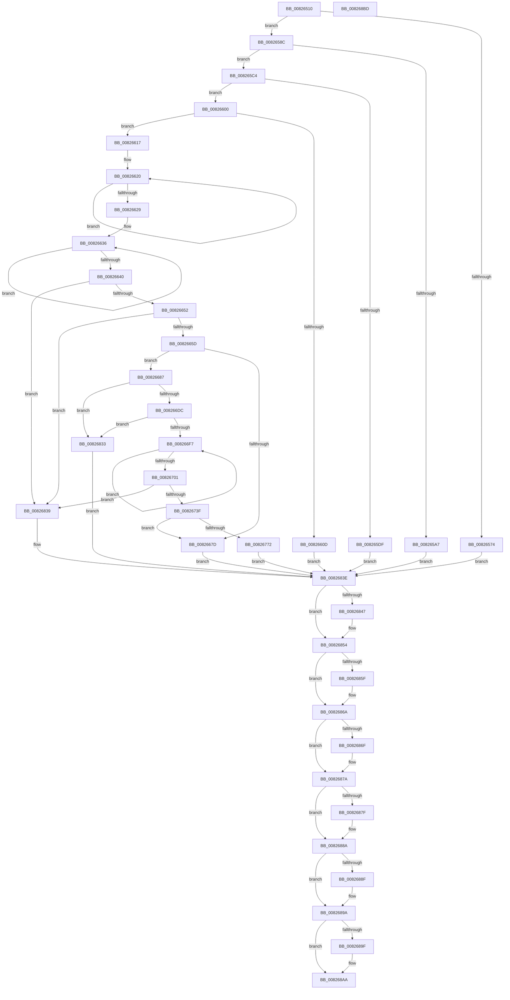

# BiCreateBootEntry

- RVA: `0x00826510`–`0x008268BE` (길이 `942` bytes)
- VA: `0x0000000140826510`
- 실행 섹션: `PAGE`
- PDB 이름 있음: `예`; PDB Function 태그: `아니요`
- unwind 정보 RVA: `0x000D2E28`
- 디코드: `259`개 명령, `942/942` bytes 표시
- 미해석 바이트: `0` (있으면 어셈블리에 `.byte`로 보존)

> 이 문서는 커널 이미지의 기계어와 PDB 기호를 분석해 생성했습니다. 4번과 5번은 함수 원형과 자료형을 바이너리 사용 방식에서 추정한 C 해석이며 원본 소스 복구 결과는 아닙니다.

## 1. Dependencies

- 직접 호출 지점: **21**; 고유 호출 대상: **8**
- 직접 호출자로 확인된 함수: **1**
- RIP 상대 이미지 참조: **5**

### Outgoing calls
- `0x00826569` → [BiGetElement](../A3/BiGetElement_function_00A3E2B4.md) (function, `0x00A3E2B4`)
- `0x00826582` → [BiLogMessage](../A3/BiLogMessage_function_00A3D3A8.md) (function, `0x00A3D3A8`)
- `0x0082659C` → [BiGetElement](../A3/BiGetElement_function_00A3E2B4.md) (function, `0x00A3E2B4`)
- `0x008265B6` → [BiLogMessage](../A3/BiLogMessage_function_00A3D3A8.md) (function, `0x00A3D3A8`)
- `0x008265D4` → [BiGetElement](../A3/BiGetElement_function_00A3E2B4.md) (function, `0x00A3E2B4`)
- `0x008265EE` → [BiLogMessage](../A3/BiLogMessage_function_00A3D3A8.md) (function, `0x00A3D3A8`)
- `0x00826670` → [ExAllocatePool2](../../poolcode/B8/ExAllocatePool2_function_00B820F0.md) (function, `0x00B820F0`)
- `0x008266A9` → [memcpy](../../text/6C/memcpy_function_006C6840.md) (function, `0x006C6840`)
- `0x008266BC` → [memcpy](../../text/6C/memcpy_function_006C6840.md) (function, `0x006C6840`)
- `0x008266CD` → [BiTranslateFilePath](../A3/BiTranslateFilePath_function_00A3D534.md) (function, `0x00A3D534`)
- `0x008266E4` → [BiGetKeyName](../A3/BiGetKeyName_function_00A3EF04.md) (function, `0x00A3EF04`)
- `0x0082675D` → [ExAllocatePool2](../../poolcode/B8/ExAllocatePool2_function_00B820F0.md) (function, `0x00B820F0`)
- `0x008267A1` → [memcpy](../../text/6C/memcpy_function_006C6840.md) (function, `0x006C6840`)
- `0x008267B7` → [memcpy](../../text/6C/memcpy_function_006C6840.md) (function, `0x006C6840`)
- `0x008267FE` → [swprintf_s](../../text/50/swprintf_s_function_00504B20.md) (function, `0x00504B20`)
- `0x0082684F` → [ExFreePoolWithTag](../../poolcode/B8/ExFreePoolWithTag_function_00B82870.md) (function, `0x00B82870`)
- `0x00826865` → [ExFreePoolWithTag](../../poolcode/B8/ExFreePoolWithTag_function_00B82870.md) (function, `0x00B82870`)
- `0x00826875` → [ExFreePoolWithTag](../../poolcode/B8/ExFreePoolWithTag_function_00B82870.md) (function, `0x00B82870`)
- `0x00826885` → [ExFreePoolWithTag](../../poolcode/B8/ExFreePoolWithTag_function_00B82870.md) (function, `0x00B82870`)
- `0x00826895` → [ExFreePoolWithTag](../../poolcode/B8/ExFreePoolWithTag_function_00B82870.md) (function, `0x00B82870`)
- `0x008268A5` → [ExFreePoolWithTag](../../poolcode/B8/ExFreePoolWithTag_function_00B82870.md) (function, `0x00B82870`)

### Direct callers
- [BiCreateEfiEntry](BiCreateEfiEntry_function_008268C4.md) at `0x008269D7`

### Static image references
- `0x00826577` → RVA `0x00B0C5D0` (` ?? ::NNGAKEGL::`string'`; read)
- `0x008265AA` → RVA `0x00B0C680` (` ?? ::NNGAKEGL::`string'`; read)
- `0x008265E2` → RVA `0x00B0C720` (` ?? ::NNGAKEGL::`string'`; read)
- `0x008267D6` → RVA `0x00B0C500` (` ?? ::NNGAKEGL::`string'`; read)
- `0x008267DD` → RVA `0x00B0C7C0` (` ?? ::NNGAKEGL::`string'`; read)

## 2. Other-region calls and transfers

- 다른 실행 섹션으로 향하는 call: **13**
  - `0x00826670` → [ExAllocatePool2](../../poolcode/B8/ExAllocatePool2_function_00B820F0.md) (`PAGE` → `POOLCODE`)
  - `0x008266A9` → [memcpy](../../text/6C/memcpy_function_006C6840.md) (`PAGE` → `.text`)
  - `0x008266BC` → [memcpy](../../text/6C/memcpy_function_006C6840.md) (`PAGE` → `.text`)
  - `0x0082675D` → [ExAllocatePool2](../../poolcode/B8/ExAllocatePool2_function_00B820F0.md) (`PAGE` → `POOLCODE`)
  - `0x008267A1` → [memcpy](../../text/6C/memcpy_function_006C6840.md) (`PAGE` → `.text`)
  - `0x008267B7` → [memcpy](../../text/6C/memcpy_function_006C6840.md) (`PAGE` → `.text`)
  - `0x008267FE` → [swprintf_s](../../text/50/swprintf_s_function_00504B20.md) (`PAGE` → `.text`)
  - `0x0082684F` → [ExFreePoolWithTag](../../poolcode/B8/ExFreePoolWithTag_function_00B82870.md) (`PAGE` → `POOLCODE`)
  - `0x00826865` → [ExFreePoolWithTag](../../poolcode/B8/ExFreePoolWithTag_function_00B82870.md) (`PAGE` → `POOLCODE`)
  - `0x00826875` → [ExFreePoolWithTag](../../poolcode/B8/ExFreePoolWithTag_function_00B82870.md) (`PAGE` → `POOLCODE`)
  - `0x00826885` → [ExFreePoolWithTag](../../poolcode/B8/ExFreePoolWithTag_function_00B82870.md) (`PAGE` → `POOLCODE`)
  - `0x00826895` → [ExFreePoolWithTag](../../poolcode/B8/ExFreePoolWithTag_function_00B82870.md) (`PAGE` → `POOLCODE`)
  - `0x008268A5` → [ExFreePoolWithTag](../../poolcode/B8/ExFreePoolWithTag_function_00B82870.md) (`PAGE` → `POOLCODE`)
- 별도 외부 분기/꼬리 이동을 확인하지 못했습니다.

## 3. Assembly (complete function range)

```asm
00826510  48 89 54 24 10                  mov qword ptr [rsp + 0x10], rdx
00826515  48 89 4C 24 08                  mov qword ptr [rsp + 8], rcx
0082651A  55                              push rbp
0082651B  53                              push rbx
0082651C  56                              push rsi
0082651D  57                              push rdi
0082651E  41 54                           push r12
00826520  41 55                           push r13
00826522  41 56                           push r14
00826524  41 57                           push r15
00826526  48 8B EC                        mov rbp, rsp
00826529  48 83 EC 68                     sub rsp, 0x68
0082652D  33 C0                           xor eax, eax
0082652F  4C 8D 4D 58                     lea r9, [rbp + 0x58]
00826533  4C 8D 45 F0                     lea r8, [rbp - 0x10]
00826537  89 45 58                        mov dword ptr [rbp + 0x58], eax
0082653A  BA 04 00 00 12                  mov edx, 0x12000004
0082653F  89 45 60                        mov dword ptr [rbp + 0x60], eax
00826542  89 45 D0                        mov dword ptr [rbp - 0x30], eax
00826545  8B F8                           mov edi, eax
00826547  48 89 45 F0                     mov qword ptr [rbp - 0x10], rax
0082654B  8B F0                           mov esi, eax
0082654D  48 89 45 C8                     mov qword ptr [rbp - 0x38], rax
00826551  44 8B F0                        mov r14d, eax
00826554  48 89 45 E0                     mov qword ptr [rbp - 0x20], rax
00826558  44 8B E0                        mov r12d, eax
0082655B  48 89 45 D8                     mov qword ptr [rbp - 0x28], rax
0082655F  44 8B F8                        mov r15d, eax
00826562  48 89 45 E8                     mov qword ptr [rbp - 0x18], rax
00826566  4C 8B E9                        mov r13, rcx
00826569  E8 46 7D 21 00                  call 0x140a3e2b4
0082656E  8B D8                           mov ebx, eax
00826570  85 C0                           test eax, eax
00826572  79 18                           jns 0x14082658c
00826574  44 8B C0                        mov r8d, eax
00826577  48 8D 15 52 60 2E 00            lea rdx, [rip + 0x2e6052]
0082657E  41 8D 4F 04                     lea ecx, [r15 + 4]
00826582  E8 21 6E 21 00                  call 0x140a3d3a8
00826587  E9 B2 02 00 00                  jmp 0x14082683e
0082658C  4C 8D 4D 60                     lea r9, [rbp + 0x60]
00826590  BA 01 00 00 11                  mov edx, 0x11000001
00826595  4C 8D 45 C8                     lea r8, [rbp - 0x38]
00826599  49 8B CD                        mov rcx, r13
0082659C  E8 13 7D 21 00                  call 0x140a3e2b4
008265A1  8B D8                           mov ebx, eax
008265A3  85 C0                           test eax, eax
008265A5  79 1D                           jns 0x1408265c4
008265A7  44 8B C0                        mov r8d, eax
008265AA  48 8D 15 CF 60 2E 00            lea rdx, [rip + 0x2e60cf]
008265B1  B9 04 00 00 00                  mov ecx, 4
008265B6  E8 ED 6D 21 00                  call 0x140a3d3a8
008265BB  48 8B 7D C8                     mov rdi, qword ptr [rbp - 0x38]
008265BF  E9 7A 02 00 00                  jmp 0x14082683e
008265C4  4C 8D 4D D0                     lea r9, [rbp - 0x30]
008265C8  BA 02 00 00 12                  mov edx, 0x12000002
008265CD  4C 8D 45 E0                     lea r8, [rbp - 0x20]
008265D1  49 8B CD                        mov rcx, r13
008265D4  E8 DB 7C 21 00                  call 0x140a3e2b4
008265D9  8B D8                           mov ebx, eax
008265DB  85 C0                           test eax, eax
008265DD  79 21                           jns 0x140826600
008265DF  44 8B C0                        mov r8d, eax
008265E2  48 8D 15 37 61 2E 00            lea rdx, [rip + 0x2e6137]
008265E9  B9 04 00 00 00                  mov ecx, 4
008265EE  E8 B5 6D 21 00                  call 0x140a3d3a8
008265F3  48 8B 7D C8                     mov rdi, qword ptr [rbp - 0x38]
008265F7  48 8B 75 E0                     mov rsi, qword ptr [rbp - 0x20]
008265FB  E9 3E 02 00 00                  jmp 0x14082683e
00826600  48 8B 7D C8                     mov rdi, qword ptr [rbp - 0x38]
00826604  48 8B 75 E0                     mov rsi, qword ptr [rbp - 0x20]
00826608  83 3F 02                        cmp dword ptr [rdi], 2
0082660B  74 0A                           je 0x140826617
0082660D  BB BB 00 00 C0                  mov ebx, 0xc00000bb
00826612  E9 27 02 00 00                  jmp 0x14082683e
00826617  49 83 CD FF                     or r13, 0xffffffffffffffff
0082661B  49 8B C5                        mov rax, r13
0082661E  33 DB                           xor ebx, ebx
00826620  48 FF C0                        inc rax
00826623  66 39 1C 46                     cmp word ptr [rsi + rax*2], bx
00826627  75 F7                           jne 0x140826620
00826629  8D 14 45 02 00 00 00            lea edx, [rax*2 + 2]
00826630  49 8B C5                        mov rax, r13
00826633  89 55 60                        mov dword ptr [rbp + 0x60], edx
00826636  48 FF C0                        inc rax
00826639  66 39 5C 47 14                  cmp word ptr [rdi + rax*2 + 0x14], bx
0082663E  75 F6                           jne 0x140826636
00826640  8D 1C 45 02 00 00 00            lea ebx, [rax*2 + 2]
00826647  8D 04 1A                        lea eax, [rdx + rbx]
0082664A  3B C3                           cmp eax, ebx
0082664C  0F 82 E7 01 00 00               jb 0x140826839
00826652  8D 48 0C                        lea ecx, [rax + 0xc]
00826655  3B C8                           cmp ecx, eax
00826657  0F 82 DC 01 00 00               jb 0x140826839
0082665D  8B C1                           mov eax, ecx
0082665F  41 B8 42 43 44 4B               mov r8d, 0x4b444342
00826665  8B D1                           mov edx, ecx
00826667  B9 02 01 00 00                  mov ecx, 0x102
0082666C  48 89 45 C8                     mov qword ptr [rbp - 0x38], rax
00826670  E8 7B BA 35 00                  call 0x140b820f0
00826675  4C 8B F8                        mov r15, rax
00826678  48 85 C0                        test rax, rax
0082667B  75 0A                           jne 0x140826687
0082667D  BB 9A 00 00 C0                  mov ebx, 0xc000009a
00826682  E9 B7 01 00 00                  jmp 0x14082683e
00826687  48 8B 45 C8                     mov rax, qword ptr [rbp - 0x38]
0082668B  49 8D 4F 0C                     lea rcx, [r15 + 0xc]
0082668F  4C 8B C3                        mov r8, rbx
00826692  41 89 47 04                     mov dword ptr [r15 + 4], eax
00826696  48 8D 57 14                     lea rdx, [rdi + 0x14]
0082669A  41 C7 07 01 00 00 00            mov dword ptr [r15], 1
008266A1  41 C7 47 08 03 00 00 00         mov dword ptr [r15 + 8], 3
008266A9  E8 92 01 EA FF                  call 0x1406c6840
008266AE  44 8B 45 60                     mov r8d, dword ptr [rbp + 0x60]
008266B2  49 8D 4F 0C                     lea rcx, [r15 + 0xc]
008266B6  48 03 CB                        add rcx, rbx
008266B9  48 8B D6                        mov rdx, rsi
008266BC  E8 7F 01 EA FF                  call 0x1406c6840
008266C1  4C 8D 45 D8                     lea r8, [rbp - 0x28]
008266C5  BA 04 00 00 00                  mov edx, 4
008266CA  49 8B CF                        mov rcx, r15
008266CD  E8 62 6E 21 00                  call 0x140a3d534
008266D2  8B D8                           mov ebx, eax
008266D4  85 C0                           test eax, eax
008266D6  0F 88 57 01 00 00               js 0x140826833
008266DC  48 8B 4D 48                     mov rcx, qword ptr [rbp + 0x48]
008266E0  48 8D 55 E8                     lea rdx, [rbp - 0x18]
008266E4  E8 1B 88 21 00                  call 0x140a3ef04
008266E9  4C 8B 65 E8                     mov r12, qword ptr [rbp - 0x18]
008266ED  8B D8                           mov ebx, eax
008266EF  85 C0                           test eax, eax
008266F1  0F 88 3C 01 00 00               js 0x140826833
008266F7  49 FF C5                        inc r13
008266FA  66 47 39 34 6C                  cmp word ptr [r12 + r13*2], r14w
008266FF  75 F6                           jne 0x1408266f7
00826701  8B 55 58                        mov edx, dword ptr [rbp + 0x58]
00826704  42 8D 1C 6D 2D 00 00 00         lea ebx, [r13*2 + 0x2d]
0082670C  4C 8B 75 D8                     mov r14, qword ptr [rbp - 0x28]
00826710  41 B9 FC FF FF FF               mov r9d, 0xfffffffc
00826716  41 23 D9                        and ebx, r9d
00826719  89 5D C8                        mov dword ptr [rbp - 0x38], ebx
0082671C  83 C3 10                        add ebx, 0x10
0082671F  89 5D E0                        mov dword ptr [rbp - 0x20], ebx
00826722  45 8B 46 04                     mov r8d, dword ptr [r14 + 4]
00826726  8D 4B 1F                        lea ecx, [rbx + 0x1f]
00826729  41 23 C9                        and ecx, r9d
0082672C  41 8D 40 04                     lea eax, [r8 + 4]
00826730  89 4D E8                        mov dword ptr [rbp - 0x18], ecx
00826733  03 C1                           add eax, ecx
00826735  03 C2                           add eax, edx
00826737  3B C2                           cmp eax, edx
00826739  0F 82 FA 00 00 00               jb 0x140826839
0082673F  8D 42 03                        lea eax, [rdx + 3]
00826742  03 C1                           add eax, ecx
00826744  B9 02 01 00 00                  mov ecx, 0x102
00826749  41 23 C1                        and eax, r9d
0082674C  89 45 60                        mov dword ptr [rbp + 0x60], eax
0082674F  41 03 C0                        add eax, r8d
00826752  8B D0                           mov edx, eax
00826754  41 B8 42 43 44 4B               mov r8d, 0x4b444342
0082675A  89 45 D0                        mov dword ptr [rbp - 0x30], eax
0082675D  E8 8E B9 35 00                  call 0x140b820f0
00826762  48 89 45 D8                     mov qword ptr [rbp - 0x28], rax
00826766  48 8B D0                        mov rdx, rax
00826769  48 85 C0                        test rax, rax
0082676C  0F 84 0B FF FF FF               je 0x14082667d
00826772  83 4A 08 FF                     or dword ptr [rdx + 8], 0xffffffff
00826776  B9 01 00 00 00                  mov ecx, 1
0082677B  44 8B 45 58                     mov r8d, dword ptr [rbp + 0x58]
0082677F  89 08                           mov dword ptr [rax], ecx
00826781  8B 45 D0                        mov eax, dword ptr [rbp - 0x30]
00826784  89 4A 0C                        mov dword ptr [rdx + 0xc], ecx
00826787  8B 4D 60                        mov ecx, dword ptr [rbp + 0x60]
0082678A  89 42 04                        mov dword ptr [rdx + 4], eax
0082678D  8B 45 E8                        mov eax, dword ptr [rbp - 0x18]
00826790  89 4A 14                        mov dword ptr [rdx + 0x14], ecx
00826793  89 42 10                        mov dword ptr [rdx + 0x10], eax
00826796  89 5A 18                        mov dword ptr [rdx + 0x18], ebx
00826799  48 8D 0C 02                     lea rcx, [rdx + rax]
0082679D  48 8B 55 F0                     mov rdx, qword ptr [rbp - 0x10]
008267A1  E8 9A 00 EA FF                  call 0x1406c6840
008267A6  8B 4D 60                        mov ecx, dword ptr [rbp + 0x60]
008267A9  49 8B D6                        mov rdx, r14
008267AC  48 8B 5D D8                     mov rbx, qword ptr [rbp - 0x28]
008267B0  45 8B 46 04                     mov r8d, dword ptr [r14 + 4]
008267B4  48 03 CB                        add rcx, rbx
008267B7  E8 84 00 EA FF                  call 0x1406c6840
008267BC  48 83 C3 1C                     add rbx, 0x1c
008267C0  41 8B D5                        mov edx, r13d
008267C3  48 B8 57 49 4E 44 4F 57 53 00   movabs rax, 0x53574f444e4957
008267CD  4C 89 64 24 20                  mov qword ptr [rsp + 0x20], r12
008267D2  48 83 C2 0B                     add rdx, 0xb
008267D6  4C 8D 0D 23 5D 2E 00            lea r9, [rip + 0x2e5d23]
008267DD  4C 8D 05 DC 5F 2E 00            lea r8, [rip + 0x2e5fdc]
008267E4  48 89 03                        mov qword ptr [rbx], rax
008267E7  48 8D 4B 14                     lea rcx, [rbx + 0x14]
008267EB  8B 45 E0                        mov eax, dword ptr [rbp - 0x20]
008267EE  89 43 0C                        mov dword ptr [rbx + 0xc], eax
008267F1  8B 45 C8                        mov eax, dword ptr [rbp - 0x38]
008267F4  89 43 10                        mov dword ptr [rbx + 0x10], eax
008267F7  C7 43 08 01 00 00 00            mov dword ptr [rbx + 8], 1
008267FE  E8 1D E3 CD FF                  call 0x140504b20
00826803  8B 43 10                        mov eax, dword ptr [rbx + 0x10]
00826806  48 8B 4D 50                     mov rcx, qword ptr [rbp + 0x50]
0082680A  48 03 C3                        add rax, rbx
0082680D  33 DB                           xor ebx, ebx
0082680F  C7 00 01 00 00 00               mov dword ptr [rax], 1
00826815  C7 40 04 10 00 00 00            mov dword ptr [rax + 4], 0x10
0082681C  C7 40 08 04 00 00 00            mov dword ptr [rax + 8], 4
00826823  C7 40 0C 7F FF 04 00            mov dword ptr [rax + 0xc], 0x4ff7f
0082682A  48 8B 45 D8                     mov rax, qword ptr [rbp - 0x28]
0082682E  48 89 01                        mov qword ptr [rcx], rax
00826831  EB 0B                           jmp 0x14082683e
00826833  4C 8B 75 D8                     mov r14, qword ptr [rbp - 0x28]
00826837  EB 05                           jmp 0x14082683e
00826839  BB 95 00 00 C0                  mov ebx, 0xc0000095
0082683E  48 8B 45 F0                     mov rax, qword ptr [rbp - 0x10]
00826842  48 85 C0                        test rax, rax
00826845  74 0D                           je 0x140826854
00826847  BA 42 43 44 4B                  mov edx, 0x4b444342
0082684C  48 8B C8                        mov rcx, rax
0082684F  E8 1C C0 35 00                  call 0x140b82870
00826854  41 BD 42 43 44 4B               mov r13d, 0x4b444342
0082685A  48 85 FF                        test rdi, rdi
0082685D  74 0B                           je 0x14082686a
0082685F  41 8B D5                        mov edx, r13d
00826862  48 8B CF                        mov rcx, rdi
00826865  E8 06 C0 35 00                  call 0x140b82870
0082686A  48 85 F6                        test rsi, rsi
0082686D  74 0B                           je 0x14082687a
0082686F  41 8B D5                        mov edx, r13d
00826872  48 8B CE                        mov rcx, rsi
00826875  E8 F6 BF 35 00                  call 0x140b82870
0082687A  4D 85 F6                        test r14, r14
0082687D  74 0B                           je 0x14082688a
0082687F  41 8B D5                        mov edx, r13d
00826882  49 8B CE                        mov rcx, r14
00826885  E8 E6 BF 35 00                  call 0x140b82870
0082688A  4D 85 E4                        test r12, r12
0082688D  74 0B                           je 0x14082689a
0082688F  41 8B D5                        mov edx, r13d
00826892  49 8B CC                        mov rcx, r12
00826895  E8 D6 BF 35 00                  call 0x140b82870
0082689A  4D 85 FF                        test r15, r15
0082689D  74 0B                           je 0x1408268aa
0082689F  41 8B D5                        mov edx, r13d
008268A2  49 8B CF                        mov rcx, r15
008268A5  E8 C6 BF 35 00                  call 0x140b82870
008268AA  8B C3                           mov eax, ebx
008268AC  48 83 C4 68                     add rsp, 0x68
008268B0  41 5F                           pop r15
008268B2  41 5E                           pop r14
008268B4  41 5D                           pop r13
008268B6  41 5C                           pop r12
008268B8  5F                              pop rdi
008268B9  5E                              pop rsi
008268BA  5B                              pop rbx
008268BB  5D                              pop rbp
008268BC  C3                              ret
008268BD  CC                              int3
```

## 4. C-style interpretation (structured pseudocode)

```c
__int64 __fastcall BiCreateBootEntry(__int64 a1, __int64 a2)
{
    __int64 result;
    __int64 v_r13;
    __int64 v_rbx;
    __int64 v_rsp;
    unsigned __int64 v_stack_m50;
    unsigned __int64 v_stack_m58;
    unsigned __int64 v_stack_m60;
    unsigned __int64 v_stack_m68;
    unsigned int v_stack_m70;
    unsigned __int64 v_stack_m78;
    unsigned __int64 v_stack_m88;
    unsigned __int64 v_stack_p10;
    unsigned __int64 v_stack_p18;
    unsigned int v_stack_p20;
    unsigned __int64 v_stack_p8;

    v_stack_p10 = a2;
    v_stack_p8 = a1;
    v_rsp = (v_rsp) - (104);
    result = 0;
    v_stack_p18 = 0;
    v_stack_p20 = 0;
    v_stack_m70 = 0;
    v_stack_m50 = 0;
    v_stack_m78 = 0;
    v_stack_m60 = 0;
    v_stack_m68 = 0;
    v_stack_m58 = 0;
    result = BiGetElement(a1, (unsigned int)(0x12000004ULL), v_stack_m50, v_stack_p18);
    if (!sign_flag) goto loc_0082658C;
    result = BiLogMessage(0 + 4, v_rip + 3039314, (unsigned int)((unsigned int)(result)), v_stack_p18);
    goto loc_0082683E;
loc_0082658C:
    result = BiGetElement(a1, (unsigned int)(0x11000001ULL), v_stack_m78, v_stack_p20);
    if (!sign_flag) goto loc_008265C4;
    result = BiLogMessage(4, v_rip + 3039439, (unsigned int)((unsigned int)(result)), v_stack_p20);
    goto loc_0082683E;
loc_008265C4:
    result = BiGetElement(a1, (unsigned int)(0x12000002ULL), v_stack_m60, v_stack_m70);
    if (!sign_flag) goto loc_00826600;
    result = BiLogMessage(4, v_rip + 3039543, (unsigned int)((unsigned int)(result)), v_stack_m70);
    goto loc_0082683E;
loc_00826600:
    if ((*(unsigned int *)(v_stack_m78)) == 2) goto loc_00826617;
    goto loc_0082683E;
loc_00826617:
    v_r13 = (a1) | (-1);
    v_rbx = 0;
loc_00826620:
    result = (v_r13) + 1;
    if ((*(unsigned __int16 *)(v_stack_m60 + result * 2)) != 0) goto loc_00826620;
    v_stack_p20 = (unsigned int)(result * 2 + 2);
loc_00826636:
    result = (v_r13) + 1;
    if ((*(unsigned __int16 *)(v_stack_m78 + result * 2 + 20)) != 0) goto loc_00826636;
    if (((unsigned int)(result * 2 + 2 + result * 2 + 2 * 1)) < ((unsigned int)(result * 2 + 2))) goto loc_00826839;
    if (((unsigned int)(result * 2 + 2 + result * 2 + 2 * 1 + 12)) < ((unsigned int)(result * 2 + 2 + result * 2 + 2 * 1))) goto loc_00826839;
    v_stack_m78 = (unsigned int)((unsigned int)(result * 2 + 2 + result * 2 + 2 * 1 + 12));
    result = ExAllocatePool2(258, (unsigned int)((unsigned int)(result * 2 + 2 + result * 2 + 2 * 1 + 12)), (unsigned int)(0x4B444342ULL), v_stack_m70);
    if (result != 0) goto loc_00826687;
loc_0082667D:
    goto loc_0082683E;
loc_00826687:
    *(unsigned int *)(result + 4) = (unsigned int)(v_stack_m78);
    *(unsigned int *)(result) = 1;
    *(unsigned int *)(result + 8) = 3;
    result = memcpy(result + 12, v_stack_m78 + 20, (unsigned int)(0xC000009AULL), v_stack_m70);
    a1 = (result + 12) + ((unsigned int)(0xC000009AULL));
    result = memcpy(a1, v_stack_m60, (unsigned int)(v_stack_p20), v_stack_m70);
    result = BiTranslateFilePath(result, 4, v_stack_m68, v_stack_m70);
    if (sign_flag) goto loc_00826833;
    result = BiGetKeyName(v_stack_p8, v_stack_m58, v_stack_m68, v_stack_m70);
    if (sign_flag) goto loc_00826833;
loc_008266F7:
    v_r13 = (v_r13) + 1;
    if ((*(unsigned __int16 *)(v_stack_m58 + v_r13 * 2)) != 0) goto loc_008266F7;
    v_rbx = (unsigned int)((v_r13 * 2 + 45) & ((unsigned int)((unsigned int)(0xFFFFFFFCULL))));
    v_stack_m78 = (unsigned int)(v_rbx);
    v_rbx = (unsigned int)((v_rbx) + (16));
    v_stack_m60 = (unsigned int)(v_rbx);
    a1 = (unsigned int)((v_rbx + 31) & ((unsigned int)((unsigned int)(0xFFFFFFFCULL))));
    v_stack_m58 = (unsigned int)(a1);
    result = (unsigned int)(((unsigned int)(*(unsigned int *)(v_stack_m68 + 4)) + 4) + ((unsigned int)(a1)));
    result = (unsigned int)((result) + ((unsigned int)((unsigned int)(v_stack_p18))));
    if (((unsigned int)(result)) < ((unsigned int)((unsigned int)(v_stack_p18)))) goto loc_00826839;
    result = (unsigned int)(((unsigned int)(v_stack_p18) + 3) + ((unsigned int)(a1)));
    result = (unsigned int)((result) & ((unsigned int)((unsigned int)(0xFFFFFFFCULL))));
    v_stack_p20 = (unsigned int)(result);
    result = (unsigned int)((result) + ((unsigned int)((unsigned int)(*(unsigned int *)(v_stack_m68 + 4)))));
    v_stack_m70 = (unsigned int)(result);
    result = ExAllocatePool2(258, (unsigned int)((unsigned int)(result)), (unsigned int)(0x4B444342ULL), (unsigned int)(0xFFFFFFFCULL));
    v_stack_m68 = result;
    if (result == 0) goto loc_0082667D;
    *(unsigned int *)(result) = 1;
    *(unsigned int *)(result + 12) = 1;
    *(unsigned int *)(result + 4) = (unsigned int)((unsigned int)(v_stack_m70));
    *(unsigned int *)(result + 20) = (unsigned int)((unsigned int)(v_stack_p20));
    *(unsigned int *)(result + 16) = (unsigned int)((unsigned int)(v_stack_m58));
    *(unsigned int *)(result + 24) = (unsigned int)(v_rbx);
    result = memcpy(result + (unsigned int)(v_stack_m58) * 1, v_stack_m50, (unsigned int)(v_stack_p18), (unsigned int)(0xFFFFFFFCULL));
    a1 = ((unsigned int)(v_stack_p20)) + (v_stack_m68);
    result = memcpy(a1, v_stack_m68, (unsigned int)(*(unsigned int *)(v_stack_m68 + 4)), (unsigned int)(0xFFFFFFFCULL));
    v_rbx = (v_stack_m68) + (28);
    v_stack_m88 = v_stack_m58;
    a2 = ((unsigned int)((unsigned int)(v_r13))) + (11);
    *(unsigned __int64 *)(v_rbx) = result;
    *(unsigned int *)(v_rbx + 12) = (unsigned int)((unsigned int)(v_stack_m60));
    *(unsigned int *)(v_rbx + 16) = (unsigned int)((unsigned int)(v_stack_m78));
    *(unsigned int *)(v_rbx + 8) = 1;
    result = swprintf_s(v_rbx + 20, a2, v_rip + 3039196, v_rip + 3038499);
    result = ((unsigned int)(*(unsigned int *)(v_rbx + 16))) + (v_rbx);
    v_rbx = 0;
    *(unsigned int *)(result) = 1;
    *(unsigned int *)(result + 4) = 16;
    *(unsigned int *)(result + 8) = 4;
    *(unsigned int *)(result + 12) = 0x4FF7FULL;
    *(unsigned __int64 *)(v_stack_p10) = v_stack_m68;
    goto loc_0082683E;
loc_00826833:
    goto loc_0082683E;
loc_00826839:
loc_0082683E:
    result = v_stack_m50;
    if (v_stack_m50 != 0) {
        a2 = 0x4B444342ULL;
        a1 = v_stack_m50;
        result = ExFreePoolWithTag(a1, a2, v_rip + 3039196, v_rip + 3038499);
    }
    if (v_stack_m78 != 0) {
        a2 = (unsigned int)((unsigned int)(0x4B444342ULL));
        a1 = v_stack_m78;
        result = ExFreePoolWithTag(a1, a2, v_rip + 3039196, v_rip + 3038499);
    }
    if (v_stack_m60 != 0) {
        a2 = (unsigned int)((unsigned int)(0x4B444342ULL));
        a1 = v_stack_m60;
        result = ExFreePoolWithTag(a1, a2, v_rip + 3039196, v_rip + 3038499);
    }
    if (v_stack_m68 != 0) {
        a2 = (unsigned int)((unsigned int)(0x4B444342ULL));
        a1 = v_stack_m68;
        result = ExFreePoolWithTag(a1, a2, v_rip + 3039196, v_rip + 3038499);
    }
    if (v_stack_m58 != 0) {
        a2 = (unsigned int)((unsigned int)(0x4B444342ULL));
        a1 = v_stack_m58;
        result = ExFreePoolWithTag(a1, a2, v_rip + 3039196, v_rip + 3038499);
    }
    if (result != 0) {
        a2 = (unsigned int)((unsigned int)(0x4B444342ULL));
        a1 = result;
        result = ExFreePoolWithTag(a1, a2, v_rip + 3039196, v_rip + 3038499);
    }
    v_rsp = (v_rsp) + (104);
    return (unsigned int)((unsigned int)((unsigned int)(0xC0000095ULL)));
}
```

## 5. (Beta) C Style

```c
int64_t BiCreateBootEntry(int64_t Arg1, int64_t Arg2)
{
    int64_t result;
    int64_t local_r13;
    int64_t local_rbx;
    int64_t local_rsp;
    uint64_t v_stack_m50;
    uint64_t v_stack_m58;
    uint64_t v_stack_m60;
    uint64_t v_stack_m68;
    uint32_t v_stack_m70;
    uint64_t v_stack_m78;
    uint64_t v_stack_m88;
    uint64_t v_stack_p10;
    uint64_t v_stack_p18;
    uint32_t v_stack_p20;
    uint64_t v_stack_p8;

    v_stack_p10 = Arg2;
    v_stack_p8 = Arg1;
    local_rsp = (local_rsp) - (104);
    result = 0;
    v_stack_p18 = 0;
    v_stack_p20 = 0;
    v_stack_m70 = 0;
    v_stack_m50 = 0;
    v_stack_m78 = 0;
    v_stack_m60 = 0;
    v_stack_m68 = 0;
    v_stack_m58 = 0;
    result = BiGetElement(Arg1, (uint32_t)(0x12000004ULL), v_stack_m50, v_stack_p18);
    if (!sign_flag) goto loc_0082658C;
    result = BiLogMessage(0 + 4, v_rip + 3039314, (uint32_t)((uint32_t)(result)), v_stack_p18);
    goto loc_0082683E;
loc_0082658C:
    result = BiGetElement(Arg1, (uint32_t)(0x11000001ULL), v_stack_m78, v_stack_p20);
    if (!sign_flag) goto loc_008265C4;
    result = BiLogMessage(4, v_rip + 3039439, (uint32_t)((uint32_t)(result)), v_stack_p20);
    goto loc_0082683E;
loc_008265C4:
    result = BiGetElement(Arg1, (uint32_t)(0x12000002ULL), v_stack_m60, v_stack_m70);
    if (!sign_flag) goto loc_00826600;
    result = BiLogMessage(4, v_rip + 3039543, (uint32_t)((uint32_t)(result)), v_stack_m70);
    goto loc_0082683E;
loc_00826600:
    if ((*(uint32_t *)(v_stack_m78)) == 2) goto loc_00826617;
    goto loc_0082683E;
loc_00826617:
    local_r13 = (Arg1) | (-1);
    local_rbx = 0;
loc_00826620:
    result = (local_r13) + 1;
    if ((*(uint16_t *)(v_stack_m60 + result * 2)) != 0) goto loc_00826620;
    v_stack_p20 = (uint32_t)(result * 2 + 2);
loc_00826636:
    result = (local_r13) + 1;
    if ((*(uint16_t *)(v_stack_m78 + result * 2 + 0x14)) != 0) goto loc_00826636;
    if (((uint32_t)(result * 2 + 2 + result * 2 + 2 * 1)) < ((uint32_t)(result * 2 + 2))) goto loc_00826839;
    if (((uint32_t)(result * 2 + 2 + result * 2 + 2 * 1 + 12)) < ((uint32_t)(result * 2 + 2 + result * 2 + 2 * 1))) goto loc_00826839;
    v_stack_m78 = (uint32_t)((uint32_t)(result * 2 + 2 + result * 2 + 2 * 1 + 12));
    result = ExAllocatePool2(258, (uint32_t)((uint32_t)(result * 2 + 2 + result * 2 + 2 * 1 + 12)), (uint32_t)(0x4B444342ULL), v_stack_m70);
    if (result != 0) goto loc_00826687;
loc_0082667D:
    goto loc_0082683E;
loc_00826687:
    *(uint32_t *)(result + 0x4) = (uint32_t)(v_stack_m78);
    *(uint32_t *)(result) = 1;
    *(uint32_t *)(result + 0x8) = 3;
    result = memcpy(result + 12, v_stack_m78 + 20, (uint32_t)(0xC000009AULL), v_stack_m70);
    Arg1 = (result + 12) + ((uint32_t)(0xC000009AULL));
    result = memcpy(Arg1, v_stack_m60, (uint32_t)(v_stack_p20), v_stack_m70);
    result = BiTranslateFilePath(result, 4, v_stack_m68, v_stack_m70);
    if (sign_flag) goto loc_00826833;
    result = BiGetKeyName(v_stack_p8, v_stack_m58, v_stack_m68, v_stack_m70);
    if (sign_flag) goto loc_00826833;
loc_008266F7:
    local_r13 = (local_r13) + 1;
    if ((*(uint16_t *)(v_stack_m58 + local_r13 * 2)) != 0) goto loc_008266F7;
    local_rbx = (uint32_t)((local_r13 * 2 + 45) & ((uint32_t)((uint32_t)(0xFFFFFFFCULL))));
    v_stack_m78 = (uint32_t)(local_rbx);
    local_rbx = (uint32_t)((local_rbx) + (16));
    v_stack_m60 = (uint32_t)(local_rbx);
    Arg1 = (uint32_t)((local_rbx + 31) & ((uint32_t)((uint32_t)(0xFFFFFFFCULL))));
    v_stack_m58 = (uint32_t)(Arg1);
    result = (uint32_t)(((uint32_t)(*(uint32_t *)(v_stack_m68 + 0x4)) + 4) + ((uint32_t)(Arg1)));
    result = (uint32_t)((result) + ((uint32_t)((uint32_t)(v_stack_p18))));
    if (((uint32_t)(result)) < ((uint32_t)((uint32_t)(v_stack_p18)))) goto loc_00826839;
    result = (uint32_t)(((uint32_t)(v_stack_p18) + 3) + ((uint32_t)(Arg1)));
    result = (uint32_t)((result) & ((uint32_t)((uint32_t)(0xFFFFFFFCULL))));
    v_stack_p20 = (uint32_t)(result);
    result = (uint32_t)((result) + ((uint32_t)((uint32_t)(*(uint32_t *)(v_stack_m68 + 0x4)))));
    v_stack_m70 = (uint32_t)(result);
    result = ExAllocatePool2(258, (uint32_t)((uint32_t)(result)), (uint32_t)(0x4B444342ULL), (uint32_t)(0xFFFFFFFCULL));
    v_stack_m68 = result;
    if (result == 0) goto loc_0082667D;
    *(uint32_t *)(result) = 1;
    *(uint32_t *)(result + 0xC) = 1;
    *(uint32_t *)(result + 0x4) = (uint32_t)((uint32_t)(v_stack_m70));
    *(uint32_t *)(result + 0x14) = (uint32_t)((uint32_t)(v_stack_p20));
    *(uint32_t *)(result + 0x10) = (uint32_t)((uint32_t)(v_stack_m58));
    *(uint32_t *)(result + 0x18) = (uint32_t)(local_rbx);
    result = memcpy(result + (uint32_t)(v_stack_m58) * 1, v_stack_m50, (uint32_t)(v_stack_p18), (uint32_t)(0xFFFFFFFCULL));
    Arg1 = ((uint32_t)(v_stack_p20)) + (v_stack_m68);
    result = memcpy(Arg1, v_stack_m68, (uint32_t)(*(uint32_t *)(v_stack_m68 + 0x4)), (uint32_t)(0xFFFFFFFCULL));
    local_rbx = (v_stack_m68) + (28);
    v_stack_m88 = v_stack_m58;
    Arg2 = ((uint32_t)((uint32_t)(local_r13))) + (11);
    *(uint64_t *)(local_rbx) = result;
    *(uint32_t *)(local_rbx + 0xC) = (uint32_t)((uint32_t)(v_stack_m60));
    *(uint32_t *)(local_rbx + 0x10) = (uint32_t)((uint32_t)(v_stack_m78));
    *(uint32_t *)(local_rbx + 0x8) = 1;
    result = swprintf_s(local_rbx + 20, Arg2, v_rip + 3039196, v_rip + 3038499);
    result = ((uint32_t)(*(uint32_t *)(local_rbx + 0x10))) + (local_rbx);
    local_rbx = 0;
    *(uint32_t *)(result) = 1;
    *(uint32_t *)(result + 0x4) = 16;
    *(uint32_t *)(result + 0x8) = 4;
    *(uint32_t *)(result + 0xC) = 0x4FF7FULL;
    *(uint64_t *)(v_stack_p10) = v_stack_m68;
    goto loc_0082683E;
loc_00826833:
    goto loc_0082683E;
loc_00826839:
loc_0082683E:
    result = v_stack_m50;
    if (v_stack_m50 != 0) {
        Arg2 = 0x4B444342ULL;
        Arg1 = v_stack_m50;
        result = ExFreePoolWithTag(Arg1, Arg2, v_rip + 3039196, v_rip + 3038499);
    }
    if (v_stack_m78 != 0) {
        Arg2 = (uint32_t)((uint32_t)(0x4B444342ULL));
        Arg1 = v_stack_m78;
        result = ExFreePoolWithTag(Arg1, Arg2, v_rip + 3039196, v_rip + 3038499);
    }
    if (v_stack_m60 != 0) {
        Arg2 = (uint32_t)((uint32_t)(0x4B444342ULL));
        Arg1 = v_stack_m60;
        result = ExFreePoolWithTag(Arg1, Arg2, v_rip + 3039196, v_rip + 3038499);
    }
    if (v_stack_m68 != 0) {
        Arg2 = (uint32_t)((uint32_t)(0x4B444342ULL));
        Arg1 = v_stack_m68;
        result = ExFreePoolWithTag(Arg1, Arg2, v_rip + 3039196, v_rip + 3038499);
    }
    if (v_stack_m58 != 0) {
        Arg2 = (uint32_t)((uint32_t)(0x4B444342ULL));
        Arg1 = v_stack_m58;
        result = ExFreePoolWithTag(Arg1, Arg2, v_rip + 3039196, v_rip + 3038499);
    }
    if (result != 0) {
        Arg2 = (uint32_t)((uint32_t)(0x4B444342ULL));
        Arg1 = result;
        result = ExFreePoolWithTag(Arg1, Arg2, v_rip + 3039196, v_rip + 3038499);
    }
    local_rsp = (local_rsp) + (104);
    return (uint32_t)((uint32_t)((uint32_t)(0xC0000095ULL)));
}
```

## 6. Execution-region graph

[열기: 2D/3D 그래프와 함수 탐색 컨트롤 패널](../../../control-panel.html?section=page&rva=0x00826510&view=graph)

- 2D 그래프는 위에서 아래로 흐르고, 3D 그래프는 빈 공간을 드래그해 회전합니다. Shift+드래그는 이동, 휠은 확대·축소, 함수 노드 선택은 대상 보고서 이동입니다.

### Static fallback


