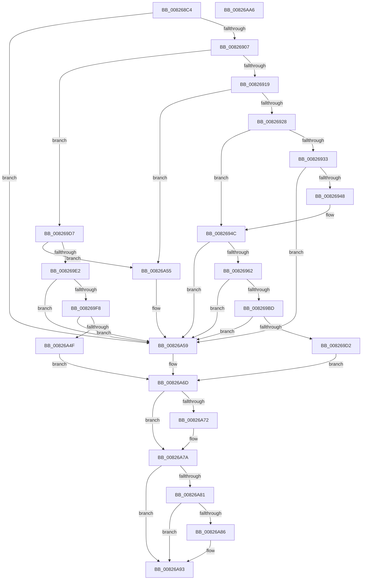

# BiCreateEfiEntry

- RVA: `0x008268C4`–`0x00826AA7` (길이 `483` bytes)
- VA: `0x00000001408268C4`
- 실행 섹션: `PAGE`
- PDB 이름 있음: `예`; PDB Function 태그: `아니요`
- unwind 정보 RVA: `0x000C8850`
- 디코드: `136`개 명령, `483/483` bytes 표시
- 미해석 바이트: `0` (있으면 어셈블리에 `.byte`로 보존)

> 이 문서는 커널 이미지의 기계어와 PDB 기호를 분석해 생성했습니다. 4번과 5번은 함수 원형과 자료형을 바이너리 사용 방식에서 추정한 C 해석이며 원본 소스 복구 결과는 아닙니다.

## 1. Dependencies

- 직접 호출 지점: **14**; 고유 호출 대상: **10**
- 직접 호출자로 확인된 함수: **2**
- RIP 상대 이미지 참조: **5**

### Outgoing calls
- `0x008268F4` → [BcdOpenObject](../91/BcdOpenObject_function_00916704.md) (function, `0x00916704`)
- `0x00826919` → [BiGetSavedBootEntry](../A4/BiGetSavedBootEntry_function_00A41248.md) (function, `0x00A41248`)
- `0x00826939` → [BiUpdateObjectReferenceInEfiEntry](BiUpdateObjectReferenceInEfiEntry_function_0082745C.md) (function, `0x0082745C`)
- `0x00826953` → [BiAddBootEntry](BiAddBootEntry_function_00826260.md) (function, `0x00826260`)
- `0x00826972` → [BiLogMessage](../A3/BiLogMessage_function_00A3D3A8.md) (function, `0x00A3D3A8`)
- `0x008269AE` → [BiSetRegistryValue](../A3/BiSetRegistryValue_function_00A3E3B0.md) (function, `0x00A3E3B0`)
- `0x008269C3` → [BiUpdateEfiEntry](../A3/BiUpdateEfiEntry_function_00A3CCC0.md) (function, `0x00A3CCC0`)
- `0x008269D7` → [BiCreateBootEntry](BiCreateBootEntry_function_00826510.md) (function, `0x00826510`)
- `0x008269ED` → [BiAddBootEntry](BiAddBootEntry_function_00826260.md) (function, `0x00826260`)
- `0x00826A08` → [BiLogMessage](../A3/BiLogMessage_function_00A3D3A8.md) (function, `0x00A3D3A8`)
- `0x00826A44` → [BiSetRegistryValue](../A3/BiSetRegistryValue_function_00A3E3B0.md) (function, `0x00A3E3B0`)
- `0x00826A68` → [BiLogMessage](../A3/BiLogMessage_function_00A3D3A8.md) (function, `0x00A3D3A8`)
- `0x00826A75` → [BcdCloseObject](../A3/BcdCloseObject_function_00A3FB08.md) (function, `0x00A3FB08`)
- `0x00826A8E` → [ExFreePoolWithTag](../../poolcode/B8/ExFreePoolWithTag_function_00B82870.md) (function, `0x00B82870`)

### Direct callers
- [BiExportBcdObjects](BiExportBcdObjects_function_00826B30.md) at `0x00826BC3`
- [BiBindEfiEntries](../AB/BiBindEfiEntries_function_00AB09C4.md) at `0x00AB0A86`

### Static image references
- `0x00826966` → RVA `0x00B0CB30` (` ?? ::NNGAKEGL::`string'`; read)
- `0x0082697A` → RVA `0x00AFF1D0` (` ?? ::NNGAKEGL::`string'`; read)
- `0x00826984` → RVA `0x00B0BF40` (` ?? ::NNGAKEGL::`string'`; read)
- `0x008269FC` → RVA `0x00B0CB90` (` ?? ::NNGAKEGL::`string'`; read)
- `0x00826A5C` → RVA `0x00B0CBD0` (` ?? ::NNGAKEGL::`string'`; read)

## 2. Other-region calls and transfers

- 다른 실행 섹션으로 향하는 call: **1**
  - `0x00826A8E` → [ExFreePoolWithTag](../../poolcode/B8/ExFreePoolWithTag_function_00B82870.md) (`PAGE` → `POOLCODE`)
- 별도 외부 분기/꼬리 이동을 확인하지 못했습니다.

## 3. Assembly (complete function range)

```asm
008268C4  48 89 5C 24 08                  mov qword ptr [rsp + 8], rbx
008268C9  55                              push rbp
008268CA  56                              push rsi
008268CB  57                              push rdi
008268CC  41 56                           push r14
008268CE  41 57                           push r15
008268D0  48 8B EC                        mov rbp, rsp
008268D3  48 83 EC 30                     sub rsp, 0x30
008268D7  83 65 38 00                     and dword ptr [rbp + 0x38], 0
008268DB  4C 8D 45 48                     lea r8, [rbp + 0x48]
008268DF  48 83 65 48 00                  and qword ptr [rbp + 0x48], 0
008268E4  48 8B F2                        mov rsi, rdx
008268E7  33 FF                           xor edi, edi
008268E9  48 83 C2 10                     add rdx, 0x10
008268ED  48 89 7D 40                     mov qword ptr [rbp + 0x40], rdi
008268F1  4C 8B F9                        mov r15, rcx
008268F4  E8 0B FE 0E 00                  call 0x140916704
008268F9  4C 8B 75 48                     mov r14, qword ptr [rbp + 0x48]
008268FD  8B D8                           mov ebx, eax
008268FF  85 C0                           test eax, eax
00826901  0F 88 52 01 00 00               js 0x140826a59
00826907  8B 46 30                        mov eax, dword ptr [rsi + 0x30]
0082690A  48 8D 55 40                     lea rdx, [rbp + 0x40]
0082690E  49 8B CE                        mov rcx, r14
00826911  A8 02                           test al, 2
00826913  0F 84 BE 00 00 00               je 0x1408269d7
00826919  E8 2A A9 21 00                  call 0x140a41248
0082691E  8B D8                           mov ebx, eax
00826920  85 C0                           test eax, eax
00826922  0F 88 2D 01 00 00               js 0x140826a55
00826928  8B 46 30                        mov eax, dword ptr [rsi + 0x30]
0082692B  48 8B 7D 40                     mov rdi, qword ptr [rbp + 0x40]
0082692F  A8 08                           test al, 8
00826931  75 19                           jne 0x14082694c
00826933  49 8B D6                        mov rdx, r14
00826936  48 8B CF                        mov rcx, rdi
00826939  E8 1E 0B 00 00                  call 0x14082745c
0082693E  8B D8                           mov ebx, eax
00826940  85 C0                           test eax, eax
00826942  0F 88 11 01 00 00               js 0x140826a59
00826948  83 4E 30 20                     or dword ptr [rsi + 0x30], 0x20
0082694C  48 8D 55 38                     lea rdx, [rbp + 0x38]
00826950  48 8B CF                        mov rcx, rdi
00826953  E8 08 F9 FF FF                  call 0x140826260
00826958  8B D8                           mov ebx, eax
0082695A  85 C0                           test eax, eax
0082695C  0F 88 F7 00 00 00               js 0x140826a59
00826962  44 8B 45 38                     mov r8d, dword ptr [rbp + 0x38]
00826966  48 8D 15 C3 61 2E 00            lea rdx, [rip + 0x2e61c3]
0082696D  B9 02 00 00 00                  mov ecx, 2
00826972  E8 31 6A 21 00                  call 0x140a3d3a8
00826977  8B 4D 38                        mov ecx, dword ptr [rbp + 0x38]
0082697A  4C 8D 05 4F 88 2D 00            lea r8, [rip + 0x2d884f]
00826981  89 4F 08                        mov dword ptr [rdi + 8], ecx
00826984  48 8D 15 B5 55 2E 00            lea rdx, [rip + 0x2e55b5]
0082698B  8B 45 38                        mov eax, dword ptr [rbp + 0x38]
0082698E  41 B9 03 00 00 00               mov r9d, 3
00826994  83 4E 30 01                     or dword ptr [rsi + 0x30], 1
00826998  49 8B CE                        mov rcx, r14
0082699B  89 46 20                        mov dword ptr [rsi + 0x20], eax
0082699E  48 89 7E 28                     mov qword ptr [rsi + 0x28], rdi
008269A2  8B 47 04                        mov eax, dword ptr [rdi + 4]
008269A5  89 44 24 28                     mov dword ptr [rsp + 0x28], eax
008269A9  48 89 7C 24 20                  mov qword ptr [rsp + 0x20], rdi
008269AE  E8 FD 79 21 00                  call 0x140a3e3b0
008269B3  8B D8                           mov ebx, eax
008269B5  85 C0                           test eax, eax
008269B7  0F 88 9C 00 00 00               js 0x140826a59
008269BD  48 8B D6                        mov rdx, rsi
008269C0  49 8B CF                        mov rcx, r15
008269C3  E8 F8 62 21 00                  call 0x140a3ccc0
008269C8  8B D8                           mov ebx, eax
008269CA  85 C0                           test eax, eax
008269CC  0F 88 87 00 00 00               js 0x140826a59
008269D2  E9 96 00 00 00                  jmp 0x140826a6d
008269D7  E8 34 FB FF FF                  call 0x140826510
008269DC  8B D8                           mov ebx, eax
008269DE  85 C0                           test eax, eax
008269E0  78 73                           js 0x140826a55
008269E2  48 8B 7D 40                     mov rdi, qword ptr [rbp + 0x40]
008269E6  48 8D 55 38                     lea rdx, [rbp + 0x38]
008269EA  48 8B CF                        mov rcx, rdi
008269ED  E8 6E F8 FF FF                  call 0x140826260
008269F2  8B D8                           mov ebx, eax
008269F4  85 C0                           test eax, eax
008269F6  78 61                           js 0x140826a59
008269F8  44 8B 45 38                     mov r8d, dword ptr [rbp + 0x38]
008269FC  48 8D 15 8D 61 2E 00            lea rdx, [rip + 0x2e618d]
00826A03  B9 02 00 00 00                  mov ecx, 2
00826A08  E8 9B 69 21 00                  call 0x140a3d3a8
00826A0D  8B 4D 38                        mov ecx, dword ptr [rbp + 0x38]
00826A10  4C 8D 05 B9 87 2D 00            lea r8, [rip + 0x2d87b9]
00826A17  89 4F 08                        mov dword ptr [rdi + 8], ecx
00826A1A  48 8D 15 1F 55 2E 00            lea rdx, [rip + 0x2e551f]
00826A21  8B 45 38                        mov eax, dword ptr [rbp + 0x38]
00826A24  41 B9 03 00 00 00               mov r9d, 3
00826A2A  83 4E 30 21                     or dword ptr [rsi + 0x30], 0x21
00826A2E  49 8B CE                        mov rcx, r14
00826A31  89 46 20                        mov dword ptr [rsi + 0x20], eax
00826A34  48 89 7E 28                     mov qword ptr [rsi + 0x28], rdi
00826A38  8B 47 04                        mov eax, dword ptr [rdi + 4]
00826A3B  89 44 24 28                     mov dword ptr [rsp + 0x28], eax
00826A3F  48 89 7C 24 20                  mov qword ptr [rsp + 0x20], rdi
00826A44  E8 67 79 21 00                  call 0x140a3e3b0
00826A49  8B D8                           mov ebx, eax
00826A4B  85 C0                           test eax, eax
00826A4D  78 0A                           js 0x140826a59
00826A4F  83 4E 30 02                     or dword ptr [rsi + 0x30], 2
00826A53  EB 18                           jmp 0x140826a6d
00826A55  48 8B 7D 40                     mov rdi, qword ptr [rbp + 0x40]
00826A59  44 8B C3                        mov r8d, ebx
00826A5C  48 8D 15 6D 61 2E 00            lea rdx, [rip + 0x2e616d]
00826A63  B9 04 00 00 00                  mov ecx, 4
00826A68  E8 3B 69 21 00                  call 0x140a3d3a8
00826A6D  4D 85 F6                        test r14, r14
00826A70  74 08                           je 0x140826a7a
00826A72  49 8B CE                        mov rcx, r14
00826A75  E8 8E 90 21 00                  call 0x140a3fb08
00826A7A  8B 46 30                        mov eax, dword ptr [rsi + 0x30]
00826A7D  A8 01                           test al, 1
00826A7F  75 12                           jne 0x140826a93
00826A81  48 85 FF                        test rdi, rdi
00826A84  74 0D                           je 0x140826a93
00826A86  BA 42 43 44 4B                  mov edx, 0x4b444342
00826A8B  48 8B CF                        mov rcx, rdi
00826A8E  E8 DD BD 35 00                  call 0x140b82870
00826A93  8B C3                           mov eax, ebx
00826A95  48 8B 5C 24 60                  mov rbx, qword ptr [rsp + 0x60]
00826A9A  48 83 C4 30                     add rsp, 0x30
00826A9E  41 5F                           pop r15
00826AA0  41 5E                           pop r14
00826AA2  5F                              pop rdi
00826AA3  5E                              pop rsi
00826AA4  5D                              pop rbp
00826AA5  C3                              ret
00826AA6  CC                              int3
```

## 4. C-style interpretation (structured pseudocode)

```c
__int64 __fastcall BiCreateEfiEntry(__int64 a1, __int64 a2)
{
    __int64 result;
    __int64 v_rdi;
    __int64 v_rsp;
    unsigned int v_stack_m30;
    unsigned __int64 v_stack_m38;
    unsigned int v_stack_p10;
    unsigned __int64 v_stack_p18;
    unsigned __int64 v_stack_p20;
    unsigned __int64 v_stack_p8;

    v_stack_p8 = v_rbx;
    v_rsp = (v_rsp) - (48);
    v_rdi = 0;
    a2 = (a2) + (16);
    v_stack_p18 = 0;
    result = BcdOpenObject(a1, a2, v_stack_p20, a4);
    if (sign_flag) goto loc_00826A59;
    if ((((unsigned __int8)((unsigned int)(*(unsigned int *)(a2 + 48)))) & (2)) == 0) goto loc_008269D7;
    result = BiGetSavedBootEntry(v_stack_p20, v_stack_p18, v_stack_p20, a4);
    if (sign_flag) goto loc_00826A55;
    if ((((unsigned __int8)((unsigned int)(*(unsigned int *)(a2 + 48)))) & (8)) != 0) goto loc_0082694C;
    result = BiUpdateObjectReferenceInEfiEntry(v_stack_p18, v_stack_p20, v_stack_p20, a4);
    if (sign_flag) goto loc_00826A59;
loc_0082694C:
    result = BiAddBootEntry(v_stack_p18, v_stack_p10, v_stack_p20, a4);
    if (sign_flag) goto loc_00826A59;
    result = BiLogMessage(2, v_rip + 3039683, (unsigned int)(v_stack_p10), a4);
    *(unsigned int *)(v_stack_p18 + 8) = (unsigned int)((unsigned int)(v_stack_p10));
    *(unsigned int *)(a2 + 32) = (unsigned int)((unsigned int)(v_stack_p10));
    *(unsigned __int64 *)(a2 + 40) = v_stack_p18;
    v_stack_m30 = (unsigned int)((unsigned int)(*(unsigned int *)(v_stack_p18 + 4)));
    v_stack_m38 = v_stack_p18;
    result = BiSetRegistryValue(v_stack_p20, v_rip + 3036597, v_rip + 2984015, 3);
    if (sign_flag) goto loc_00826A59;
    result = BiUpdateEfiEntry(a1, a2, v_rip + 2984015, 3);
    if (sign_flag) goto loc_00826A59;
    goto loc_00826A6D;
loc_008269D7:
    result = BiCreateBootEntry(a1, a2, v_rip + 2984015, 3);
    if (sign_flag) goto loc_00826A55;
    result = BiAddBootEntry(v_stack_p18, v_stack_p10, v_rip + 2984015, 3);
    if (sign_flag) goto loc_00826A59;
    result = BiLogMessage(2, v_rip + 3039629, (unsigned int)(v_stack_p10), 3);
    *(unsigned int *)(v_stack_p18 + 8) = (unsigned int)((unsigned int)(v_stack_p10));
    *(unsigned int *)(a2 + 32) = (unsigned int)((unsigned int)(v_stack_p10));
    *(unsigned __int64 *)(a2 + 40) = v_stack_p18;
    v_stack_m30 = (unsigned int)((unsigned int)(*(unsigned int *)(v_stack_p18 + 4)));
    v_stack_m38 = v_stack_p18;
    result = BiSetRegistryValue(v_stack_p20, v_rip + 3036447, v_rip + 2983865, 3);
    if (sign_flag) goto loc_00826A59;
    goto loc_00826A6D;
loc_00826A55:
loc_00826A59:
    result = BiLogMessage(4, v_rip + 3039597, (unsigned int)((unsigned int)((unsigned int)((unsigned int)(result)))), 3);
loc_00826A6D:
    if (v_stack_p20 != 0) {
        a1 = v_stack_p20;
        result = BcdCloseObject(a1, v_rip + 3039597, (unsigned int)((unsigned int)((unsigned int)((unsigned int)(result)))), 3);
    }
    if ((((unsigned __int8)((unsigned int)(*(unsigned int *)(a2 + 48)))) & (1)) != 0) goto loc_00826A93;
    result = (unsigned int)(*(unsigned int *)(a2 + 48));
    if (v_stack_p18 != 0) {
        a2 = 0x4B444342ULL;
        a1 = v_stack_p18;
        result = ExFreePoolWithTag(a1, a2, (unsigned int)((unsigned int)((unsigned int)((unsigned int)(result)))), 3);
    }
    v_rsp = (v_rsp) + (48);
    return (unsigned int)((unsigned int)((unsigned int)((unsigned int)(result))));
}
```

## 5. (Beta) C Style

```c
int64_t BiCreateEfiEntry(int64_t Arg1, void *Arg2)
{
    uint8_t *arg2 = (uint8_t *)Arg2;

    int64_t result;
    int64_t local_rdi;
    int64_t local_rsp;
    uint32_t v_stack_m30;
    uint64_t v_stack_m38;
    uint32_t v_stack_p10;
    uint64_t v_stack_p18;
    uint64_t v_stack_p20;
    uint64_t v_stack_p8;

    v_stack_p8 = local_rbx;
    local_rsp = (local_rsp) - (48);
    local_rdi = 0;
    Arg2 = (Arg2) + (16);
    v_stack_p18 = 0;
    result = BcdOpenObject(Arg1, Arg2, v_stack_p20, a4);
    if (sign_flag) goto loc_00826A59;
    if ((((uint8_t)((uint32_t)(*(uint32_t *)(arg2 + 0x30)))) & (2)) == 0) goto loc_008269D7;
    result = BiGetSavedBootEntry(v_stack_p20, v_stack_p18, v_stack_p20, a4);
    if (sign_flag) goto loc_00826A55;
    if ((((uint8_t)((uint32_t)(*(uint32_t *)(arg2 + 0x30)))) & (8)) != 0) goto loc_0082694C;
    result = BiUpdateObjectReferenceInEfiEntry(v_stack_p18, v_stack_p20, v_stack_p20, a4);
    if (sign_flag) goto loc_00826A59;
loc_0082694C:
    result = BiAddBootEntry(v_stack_p18, v_stack_p10, v_stack_p20, a4);
    if (sign_flag) goto loc_00826A59;
    result = BiLogMessage(2, v_rip + 3039683, (uint32_t)(v_stack_p10), a4);
    *(uint32_t *)(v_stack_p18 + 0x8) = (uint32_t)((uint32_t)(v_stack_p10));
    *(uint32_t *)(arg2 + 0x20) = (uint32_t)((uint32_t)(v_stack_p10));
    *(uint64_t *)(arg2 + 0x28) = v_stack_p18;
    v_stack_m30 = (uint32_t)((uint32_t)(*(uint32_t *)(v_stack_p18 + 0x4)));
    v_stack_m38 = v_stack_p18;
    result = BiSetRegistryValue(v_stack_p20, v_rip + 3036597, v_rip + 2984015, 3);
    if (sign_flag) goto loc_00826A59;
    result = BiUpdateEfiEntry(Arg1, Arg2, v_rip + 2984015, 3);
    if (sign_flag) goto loc_00826A59;
    goto loc_00826A6D;
loc_008269D7:
    result = BiCreateBootEntry(Arg1, Arg2, v_rip + 2984015, 3);
    if (sign_flag) goto loc_00826A55;
    result = BiAddBootEntry(v_stack_p18, v_stack_p10, v_rip + 2984015, 3);
    if (sign_flag) goto loc_00826A59;
    result = BiLogMessage(2, v_rip + 3039629, (uint32_t)(v_stack_p10), 3);
    *(uint32_t *)(v_stack_p18 + 0x8) = (uint32_t)((uint32_t)(v_stack_p10));
    *(uint32_t *)(arg2 + 0x20) = (uint32_t)((uint32_t)(v_stack_p10));
    *(uint64_t *)(arg2 + 0x28) = v_stack_p18;
    v_stack_m30 = (uint32_t)((uint32_t)(*(uint32_t *)(v_stack_p18 + 0x4)));
    v_stack_m38 = v_stack_p18;
    result = BiSetRegistryValue(v_stack_p20, v_rip + 3036447, v_rip + 2983865, 3);
    if (sign_flag) goto loc_00826A59;
    goto loc_00826A6D;
loc_00826A55:
loc_00826A59:
    result = BiLogMessage(4, v_rip + 3039597, (uint32_t)((uint32_t)((uint32_t)((uint32_t)(result)))), 3);
loc_00826A6D:
    if (v_stack_p20 != 0) {
        Arg1 = v_stack_p20;
        result = BcdCloseObject(Arg1, v_rip + 3039597, (uint32_t)((uint32_t)((uint32_t)((uint32_t)(result)))), 3);
    }
    if ((((uint8_t)((uint32_t)(*(uint32_t *)(arg2 + 0x30)))) & (1)) != 0) goto loc_00826A93;
    result = (uint32_t)(*(uint32_t *)(arg2 + 0x30));
    if (v_stack_p18 != 0) {
        Arg2 = 0x4B444342ULL;
        Arg1 = v_stack_p18;
        result = ExFreePoolWithTag(Arg1, Arg2, (uint32_t)((uint32_t)((uint32_t)((uint32_t)(result)))), 3);
    }
    local_rsp = (local_rsp) + (48);
    return (uint32_t)((uint32_t)((uint32_t)((uint32_t)(result))));
}
```

### 관측된 메모리 오프셋

구조체 형식이 확인되지 않은 접근은 인자 기준의 오프셋으로만 기록했습니다.

| 기준 인자 | 오프셋 표현 | 폭 (bit) | 접근 |
|---|---:|---:|---|
| `Arg2` | `+ 0x20` | `32` | `W` |
| `Arg2` | `+ 0x28` | `64` | `W` |
| `Arg2` | `+ 0x30` | `32` | `R` |
| `Arg2` | `+ 0x30` | `32` | `R/W` |

## 6. Execution-region graph

[열기: 2D/3D 그래프와 함수 탐색 컨트롤 패널](../../../control-panel.html?section=page&rva=0x008268C4&view=graph)

- 2D 그래프는 위에서 아래로 흐르고, 3D 그래프는 빈 공간을 드래그해 회전합니다. Shift+드래그는 이동, 휠은 확대·축소, 함수 노드 선택은 대상 보고서 이동입니다.

### Static fallback


