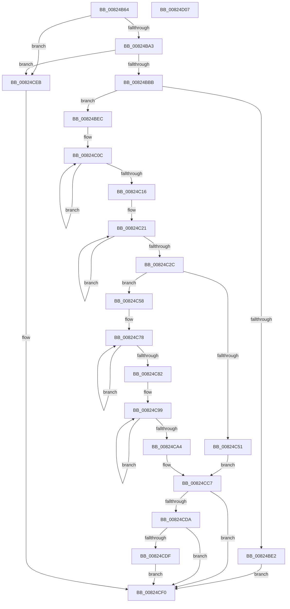

# BiCreateFileDeviceElement

- RVA: `0x00824B64`–`0x00824D08` (길이 `420` bytes)
- VA: `0x0000000140824B64`
- 실행 섹션: `PAGE`
- PDB 이름 있음: `예`; PDB Function 태그: `아니요`
- unwind 정보 RVA: `0x000AF26C`
- 디코드: `121`개 명령, `420/420` bytes 표시
- 미해석 바이트: `0` (있으면 어셈블리에 `.byte`로 보존)

> 이 문서는 커널 이미지의 기계어와 PDB 기호를 분석해 생성했습니다. 4번과 5번은 함수 원형과 자료형을 바이너리 사용 방식에서 추정한 C 해석이며 원본 소스 복구 결과는 아닙니다.

## 1. Dependencies

- 직접 호출 지점: **10**; 고유 호출 대상: **7**
- 직접 호출자로 확인된 함수: **1**
- RIP 상대 이미지 참조: **1**

### Outgoing calls
- `0x00824B96` → [wcsnicmp](../../text/50/wcsnicmp_function_005001C0.md) (function, `0x005001C0`)
- `0x00824BAA` → [wcschr](../../text/50/wcschr_function_00501A60.md) (function, `0x00501A60`)
- `0x00824BD5` → [ExAllocatePool2](../../poolcode/B8/ExAllocatePool2_function_00B820F0.md) (function, `0x00B820F0`)
- `0x00824BFB` → [memcpy](../../text/6C/memcpy_function_006C6840.md) (function, `0x006C6840`)
- `0x00824C44` → [ExAllocatePool2](../../poolcode/B8/ExAllocatePool2_function_00B820F0.md) (function, `0x00B820F0`)
- `0x00824C60` → [memset](../../text/6C/memset_function_006C6C40.md) (function, `0x006C6C40`)
- `0x00824C8C` → [wcscpy_s](../../text/50/wcscpy_s_function_005064B0.md) (function, `0x005064B0`)
- `0x00824CB2` → [wcscpy_s](../../text/50/wcscpy_s_function_005064B0.md) (function, `0x005064B0`)
- `0x00824CD1` → [ExFreePoolWithTag](../../poolcode/B8/ExFreePoolWithTag_function_00B82870.md) (function, `0x00B82870`)
- `0x00824CE4` → [ExFreePoolWithTag](../../poolcode/B8/ExFreePoolWithTag_function_00B82870.md) (function, `0x00B82870`)

### Direct callers
- [BiCreatePartitionDevice](BiCreatePartitionDevice_function_00824D10.md) at `0x00824EE2`

### Static image references
- `0x00824B85` → RVA `0x00B0BD00` (` ?? ::NNGAKEGL::`string'`; read)

## 2. Other-region calls and transfers

- 다른 실행 섹션으로 향하는 call: **10**
  - `0x00824B96` → [wcsnicmp](../../text/50/wcsnicmp_function_005001C0.md) (`PAGE` → `.text`)
  - `0x00824BAA` → [wcschr](../../text/50/wcschr_function_00501A60.md) (`PAGE` → `.text`)
  - `0x00824BD5` → [ExAllocatePool2](../../poolcode/B8/ExAllocatePool2_function_00B820F0.md) (`PAGE` → `POOLCODE`)
  - `0x00824BFB` → [memcpy](../../text/6C/memcpy_function_006C6840.md) (`PAGE` → `.text`)
  - `0x00824C44` → [ExAllocatePool2](../../poolcode/B8/ExAllocatePool2_function_00B820F0.md) (`PAGE` → `POOLCODE`)
  - `0x00824C60` → [memset](../../text/6C/memset_function_006C6C40.md) (`PAGE` → `.text`)
  - `0x00824C8C` → [wcscpy_s](../../text/50/wcscpy_s_function_005064B0.md) (`PAGE` → `.text`)
  - `0x00824CB2` → [wcscpy_s](../../text/50/wcscpy_s_function_005064B0.md) (`PAGE` → `.text`)
  - `0x00824CD1` → [ExFreePoolWithTag](../../poolcode/B8/ExFreePoolWithTag_function_00B82870.md) (`PAGE` → `POOLCODE`)
  - `0x00824CE4` → [ExFreePoolWithTag](../../poolcode/B8/ExFreePoolWithTag_function_00B82870.md) (`PAGE` → `POOLCODE`)
- 별도 외부 분기/꼬리 이동을 확인하지 못했습니다.

## 3. Assembly (complete function range)

```asm
00824B64  48 89 5C 24 08                  mov qword ptr [rsp + 8], rbx
00824B69  4C 89 44 24 18                  mov qword ptr [rsp + 0x18], r8
00824B6E  48 89 54 24 10                  mov qword ptr [rsp + 0x10], rdx
00824B73  55                              push rbp
00824B74  56                              push rsi
00824B75  57                              push rdi
00824B76  41 54                           push r12
00824B78  41 55                           push r13
00824B7A  41 56                           push r14
00824B7C  41 57                           push r15
00824B7E  48 83 EC 20                     sub rsp, 0x20
00824B82  45 33 FF                        xor r15d, r15d
00824B85  48 8D 15 74 71 2E 00            lea rdx, [rip + 0x2e7174]
00824B8C  48 8B F1                        mov rsi, rcx
00824B8F  41 8B FF                        mov edi, r15d
00824B92  45 8D 47 16                     lea r8d, [r15 + 0x16]
00824B96  E8 25 B6 CD FF                  call 0x1405001c0
00824B9B  85 C0                           test eax, eax
00824B9D  0F 85 48 01 00 00               jne 0x140824ceb
00824BA3  8D 50 5C                        lea edx, [rax + 0x5c]
00824BA6  48 8D 4E 2C                     lea rcx, [rsi + 0x2c]
00824BAA  E8 B1 CE CD FF                  call 0x140501a60
00824BAF  4C 8B F0                        mov r14, rax
00824BB2  48 85 C0                        test rax, rax
00824BB5  0F 84 30 01 00 00               je 0x140824ceb
00824BBB  48 8B D8                        mov rbx, rax
00824BBE  B9 02 01 00 00                  mov ecx, 0x102
00824BC3  48 2B DE                        sub rbx, rsi
00824BC6  41 B8 42 43 44 4B               mov r8d, 0x4b444342
00824BCC  48 D1 FB                        sar rbx, 1
00824BCF  8D 53 01                        lea edx, [rbx + 1]
00824BD2  48 03 D2                        add rdx, rdx
00824BD5  E8 16 D5 35 00                  call 0x140b820f0
00824BDA  48 8B E8                        mov rbp, rax
00824BDD  48 85 C0                        test rax, rax
00824BE0  75 0A                           jne 0x140824bec
00824BE2  BF 9A 00 00 C0                  mov edi, 0xc000009a
00824BE7  E9 04 01 00 00                  jmp 0x140824cf0
00824BEC  8B C3                           mov eax, ebx
00824BEE  48 8B D6                        mov rdx, rsi
00824BF1  48 8B CD                        mov rcx, rbp
00824BF4  48 8D 1C 00                     lea rbx, [rax + rax]
00824BF8  4C 8B C3                        mov r8, rbx
00824BFB  E8 40 1C EA FF                  call 0x1406c6840
00824C00  48 83 CE FF                     or rsi, 0xffffffffffffffff
00824C04  66 44 89 3C 2B                  mov word ptr [rbx + rbp], r15w
00824C09  48 8B C6                        mov rax, rsi
00824C0C  48 FF C0                        inc rax
00824C0F  66 45 39 3C 46                  cmp word ptr [r14 + rax*2], r15w
00824C14  75 F6                           jne 0x140824c0c
00824C16  44 8D 24 45 2E 00 00 00         lea r12d, [rax*2 + 0x2e]
00824C1E  48 8B C6                        mov rax, rsi
00824C21  48 FF C0                        inc rax
00824C24  66 44 39 7C 45 00               cmp word ptr [rbp + rax*2], r15w
00824C2A  75 F5                           jne 0x140824c21
00824C2C  8D 40 0B                        lea eax, [rax + 0xb]
00824C2F  41 B8 42 43 44 4B               mov r8d, 0x4b444342
00824C35  45 8D 2C 44                     lea r13d, [r12 + rax*2]
00824C39  B9 02 01 00 00                  mov ecx, 0x102
00824C3E  41 8B D5                        mov edx, r13d
00824C41  45 8B FD                        mov r15d, r13d
00824C44  E8 A7 D4 35 00                  call 0x140b820f0
00824C49  48 8B D8                        mov rbx, rax
00824C4C  48 85 C0                        test rax, rax
00824C4F  75 07                           jne 0x140824c58
00824C51  BF 9A 00 00 C0                  mov edi, 0xc000009a
00824C56  EB 6F                           jmp 0x140824cc7
00824C58  4D 8B C7                        mov r8, r15
00824C5B  33 D2                           xor edx, edx
00824C5D  48 8B CB                        mov rcx, rbx
00824C60  E8 DB 1F EA FF                  call 0x1406c6c40
00824C65  45 8B FC                        mov r15d, r12d
00824C68  48 8B D6                        mov rdx, rsi
00824C6B  44 89 63 14                     mov dword ptr [rbx + 0x14], r12d
00824C6F  45 33 E4                        xor r12d, r12d
00824C72  C7 03 03 00 00 00               mov dword ptr [rbx], 3
00824C78  48 FF C2                        inc rdx
00824C7B  66 45 39 24 56                  cmp word ptr [r14 + rdx*2], r12w
00824C80  75 F6                           jne 0x140824c78
00824C82  48 FF C2                        inc rdx
00824C85  48 8D 4B 18                     lea rcx, [rbx + 0x18]
00824C89  4D 8B C6                        mov r8, r14
00824C8C  E8 1F 18 CE FF                  call 0x1405064b0
00824C91  41 C7 04 1F 02 00 00 00         mov dword ptr [r15 + rbx], 2
00824C99  48 FF C6                        inc rsi
00824C9C  66 44 39 64 75 00               cmp word ptr [rbp + rsi*2], r12w
00824CA2  75 F5                           jne 0x140824c99
00824CA4  48 8D 4B 14                     lea rcx, [rbx + 0x14]
00824CA8  4C 8B C5                        mov r8, rbp
00824CAB  49 03 CF                        add rcx, r15
00824CAE  48 8D 56 01                     lea rdx, [rsi + 1]
00824CB2  E8 F9 17 CE FF                  call 0x1405064b0
00824CB7  48 8B 44 24 68                  mov rax, qword ptr [rsp + 0x68]
00824CBC  48 89 18                        mov qword ptr [rax], rbx
00824CBF  48 8B 44 24 70                  mov rax, qword ptr [rsp + 0x70]
00824CC4  44 89 28                        mov dword ptr [rax], r13d
00824CC7  BE 42 43 44 4B                  mov esi, 0x4b444342
00824CCC  48 8B CD                        mov rcx, rbp
00824CCF  8B D6                           mov edx, esi
00824CD1  E8 9A DB 35 00                  call 0x140b82870
00824CD6  85 FF                           test edi, edi
00824CD8  79 16                           jns 0x140824cf0
00824CDA  48 85 DB                        test rbx, rbx
00824CDD  74 11                           je 0x140824cf0
00824CDF  8B D6                           mov edx, esi
00824CE1  48 8B CB                        mov rcx, rbx
00824CE4  E8 87 DB 35 00                  call 0x140b82870
00824CE9  EB 05                           jmp 0x140824cf0
00824CEB  BF 0D 00 00 C0                  mov edi, 0xc000000d
00824CF0  48 8B 5C 24 60                  mov rbx, qword ptr [rsp + 0x60]
00824CF5  8B C7                           mov eax, edi
00824CF7  48 83 C4 20                     add rsp, 0x20
00824CFB  41 5F                           pop r15
00824CFD  41 5E                           pop r14
00824CFF  41 5D                           pop r13
00824D01  41 5C                           pop r12
00824D03  5F                              pop rdi
00824D04  5E                              pop rsi
00824D05  5D                              pop rbp
00824D06  C3                              ret
00824D07  CC                              int3
```

## 4. C-style interpretation (structured pseudocode)

```c
__int64 __fastcall BiCreateFileDeviceElement(__int64 a1, __int64 a2, __int64 a3)
{
    __int64 result;
    __int64 v_r12;
    __int64 v_r15;
    __int64 v_rbx;
    __int64 v_rsi;
    __int64 v_rsp;
    unsigned __int64 v_stack_p10;
    unsigned __int64 v_stack_p18;
    unsigned __int64 v_stack_p8;

    v_stack_p8 = v_rbx;
    v_stack_p18 = a3;
    v_stack_p10 = a2;
    v_rsp = (v_rsp) - (32);
    v_r15 = 0;
    result = wcsnicmp(a1, v_rip + 3043700, v_r15 + 22, a4);
    if ((unsigned int)(result) != 0) goto loc_00824CEB;
    result = wcschr(a1 + 44, result + 92, v_r15 + 22, a4);
    if (result == 0) goto loc_00824CEB;
    v_rbx = (result) - (a1);
    v_rbx = (v_rbx) >> (1);
    a2 = (v_rbx + 1) + (v_rbx + 1);
    result = ExAllocatePool2(258, a2, (unsigned int)(0x4B444342ULL), a4);
    if (result != 0) goto loc_00824BEC;
    goto loc_00824CF0;
loc_00824BEC:
    result = memcpy(result, a1, (unsigned int)((unsigned int)(v_rbx)) + (unsigned int)((unsigned int)(v_rbx)) * 1, a4);
    v_rsi = (a1) | (-1);
    *(unsigned __int16 *)((unsigned int)((unsigned int)(v_rbx)) + (unsigned int)((unsigned int)(v_rbx)) * 1 + result * 1) = 0;
loc_00824C0C:
    result = (v_rsi) + 1;
    if ((*(unsigned __int16 *)(result + result * 2)) != 0) goto loc_00824C0C;
loc_00824C21:
    result = (v_rsi) + 1;
    if ((*(unsigned __int16 *)(result + result * 2)) != 0) goto loc_00824C21;
    result = ExAllocatePool2(258, (unsigned int)((unsigned int)(result * 2 + 46 + result + 11 * 2)), (unsigned int)(0x4B444342ULL), a4);
    if (result != 0) goto loc_00824C58;
    goto loc_00824CC7;
loc_00824C58:
    a2 = 0;
    result = memset(result, a2, (unsigned int)((unsigned int)(result * 2 + 46 + result + 11 * 2)), a4);
    *(unsigned int *)(result + 20) = (unsigned int)(result * 2 + 46);
    v_r12 = 0;
    *(unsigned int *)(result) = 3;
loc_00824C78:
    a2 = (v_rsi) + 1;
    if ((*(unsigned __int16 *)(result + a2 * 2)) != 0) goto loc_00824C78;
    a2 = (a2) + 1;
    result = wcscpy_s(result + 24, a2, result, a4);
    *(unsigned int *)((unsigned int)((unsigned int)(result * 2 + 46)) + result * 1) = 2;
loc_00824C99:
    v_rsi = (v_rsi) + 1;
    if ((*(unsigned __int16 *)(result + v_rsi * 2)) != 0) goto loc_00824C99;
    a1 = (result + 20) + ((unsigned int)((unsigned int)(result * 2 + 46)));
    result = wcscpy_s(a1, v_rsi + 1, result, a4);
    *(unsigned __int64 *)(v_stack_p10) = result;
    *(unsigned int *)(v_stack_p18) = (unsigned int)(result * 2 + 46 + result + 11 * 2);
loc_00824CC7:
    result = ExFreePoolWithTag(result, (unsigned int)((unsigned int)((unsigned int)(0x4B444342ULL))), result, a4);
    if (!sign_flag) goto loc_00824CF0;
    if (result == 0) goto loc_00824CF0;
    result = ExFreePoolWithTag(result, (unsigned int)((unsigned int)((unsigned int)(0x4B444342ULL))), result, a4);
    goto loc_00824CF0;
loc_00824CEB:
loc_00824CF0:
    v_rsp = (v_rsp) + (32);
    return (unsigned int)((unsigned int)((unsigned int)(0xC000000DULL)));
}
```

## 5. (Beta) C Style

```c
int64_t BiCreateFileDeviceElement(void *Arg1, int64_t Arg2, int64_t Arg3)
{
    uint8_t *arg1 = (uint8_t *)Arg1;

    int64_t result;
    int64_t local_r12;
    int64_t local_r15;
    int64_t local_rbx;
    int64_t local_rsi;
    int64_t local_rsp;
    uint64_t v_stack_p10;
    uint64_t v_stack_p18;
    uint64_t v_stack_p8;

    v_stack_p8 = local_rbx;
    v_stack_p18 = Arg3;
    v_stack_p10 = Arg2;
    local_rsp = (local_rsp) - (32);
    local_r15 = 0;
    result = wcsnicmp(Arg1, v_rip + 3043700, local_r15 + 22, a4);
    if ((uint32_t)(result) != 0) goto loc_00824CEB;
    result = wcschr(Arg1 + 44, result + 92, local_r15 + 22, a4);
    if (result == 0) goto loc_00824CEB;
    local_rbx = (result) - (Arg1);
    local_rbx = (local_rbx) >> (1);
    Arg2 = (local_rbx + 1) + (local_rbx + 1);
    result = ExAllocatePool2(258, Arg2, (uint32_t)(0x4B444342ULL), a4);
    if (result != 0) goto loc_00824BEC;
    goto loc_00824CF0;
loc_00824BEC:
    result = memcpy(result, Arg1, (uint32_t)((uint32_t)(local_rbx)) + (uint32_t)((uint32_t)(local_rbx)) * 1, a4);
    local_rsi = (Arg1) | (-1);
    *(uint16_t *)((uint32_t)((uint32_t)(local_rbx)) + (uint32_t)((uint32_t)(local_rbx)) * 1 + result * 1) = 0;
loc_00824C0C:
    result = (local_rsi) + 1;
    if ((*(uint16_t *)(result + result * 2)) != 0) goto loc_00824C0C;
loc_00824C21:
    result = (local_rsi) + 1;
    if ((*(uint16_t *)(result + result * 2)) != 0) goto loc_00824C21;
    result = ExAllocatePool2(258, (uint32_t)((uint32_t)(result * 2 + 46 + result + 11 * 2)), (uint32_t)(0x4B444342ULL), a4);
    if (result != 0) goto loc_00824C58;
    goto loc_00824CC7;
loc_00824C58:
    Arg2 = 0;
    result = memset(result, Arg2, (uint32_t)((uint32_t)(result * 2 + 46 + result + 11 * 2)), a4);
    *(uint32_t *)(result + 0x14) = (uint32_t)(result * 2 + 46);
    local_r12 = 0;
    *(uint32_t *)(result) = 3;
loc_00824C78:
    Arg2 = (local_rsi) + 1;
    if ((*(uint16_t *)(result + Arg2 * 2)) != 0) goto loc_00824C78;
    Arg2 = (Arg2) + 1;
    result = wcscpy_s(result + 24, Arg2, result, a4);
    *(uint32_t *)((uint32_t)((uint32_t)(result * 2 + 0x2E)) + result * 1) = 2;
loc_00824C99:
    local_rsi = (local_rsi) + 1;
    if ((*(uint16_t *)(result + local_rsi * 2)) != 0) goto loc_00824C99;
    Arg1 = (result + 20) + ((uint32_t)((uint32_t)(result * 2 + 46)));
    result = wcscpy_s(Arg1, local_rsi + 1, result, a4);
    *(uint64_t *)(v_stack_p10) = result;
    *(uint32_t *)(v_stack_p18) = (uint32_t)(result * 2 + 46 + result + 11 * 2);
loc_00824CC7:
    result = ExFreePoolWithTag(result, (uint32_t)((uint32_t)((uint32_t)(0x4B444342ULL))), result, a4);
    if (!sign_flag) goto loc_00824CF0;
    if (result == 0) goto loc_00824CF0;
    result = ExFreePoolWithTag(result, (uint32_t)((uint32_t)((uint32_t)(0x4B444342ULL))), result, a4);
    goto loc_00824CF0;
loc_00824CEB:
loc_00824CF0:
    local_rsp = (local_rsp) + (32);
    return (uint32_t)((uint32_t)((uint32_t)(0xC000000DULL)));
}
```

### 관측된 메모리 오프셋

구조체 형식이 확인되지 않은 접근은 인자 기준의 오프셋으로만 기록했습니다.

| 기준 인자 | 오프셋 표현 | 폭 (bit) | 접근 |
|---|---:|---:|---|
| `Arg1` | `+ 0x2C` | `64` | `R` |

## 6. Execution-region graph

[열기: 2D/3D 그래프와 함수 탐색 컨트롤 패널](../../../control-panel.html?section=page&rva=0x00824B64&view=graph)

- 2D 그래프는 위에서 아래로 흐르고, 3D 그래프는 빈 공간을 드래그해 회전합니다. Shift+드래그는 이동, 휠은 확대·축소, 함수 노드 선택은 대상 보고서 이동입니다.

### Static fallback


