# BiCreatePartitionDevice

- RVA: `0x00824D10`–`0x00825185` (길이 `1,141` bytes)
- VA: `0x0000000140824D10`
- 실행 섹션: `PAGE`
- PDB 이름 있음: `예`; PDB Function 태그: `아니요`
- unwind 정보 RVA: `0x000DA318`
- 디코드: `285`개 명령, `1,141/1,141` bytes 표시
- 미해석 바이트: `0` (있으면 어셈블리에 `.byte`로 보존)

> 이 문서는 커널 이미지의 기계어와 PDB 기호를 분석해 생성했습니다. 4번과 5번은 함수 원형과 자료형을 바이너리 사용 방식에서 추정한 C 해석이며 원본 소스 복구 결과는 아닙니다.

## 1. Dependencies

- 직접 호출 지점: **27**; 고유 호출 대상: **17**
- 직접 호출자로 확인된 함수: **1**
- RIP 상대 이미지 참조: **3**

### Outgoing calls
- `0x00824D81` → [memset](../../text/6C/memset_function_006C6C40.md) (function, `0x006C6C40`)
- `0x00824DCD` → [memset](../../text/6C/memset_function_006C6C40.md) (function, `0x006C6C40`)
- `0x00824DDA` → [BiGetDriveLayoutInformation](../AA/BiGetDriveLayoutInformation_function_00AA1174.md) (function, `0x00AA1174`)
- `0x00824DEB` → [BiGetPhysicalDriveName](../AC/BiGetPhysicalDriveName_function_00ACD5BC.md) (function, `0x00ACD5BC`)
- `0x00824E07` → [BiGetDriveLayoutInformation](../AA/BiGetDriveLayoutInformation_function_00AA1174.md) (function, `0x00AA1174`)
- `0x00824E2D` → [BiGetPartitionVhdFilePath](../A9/BiGetPartitionVhdFilePath_function_00A9E5F4.md) (function, `0x00A9E5F4`)
- `0x00824E4F` → [wcsnicmp](../../text/50/wcsnicmp_function_005001C0.md) (function, `0x005001C0`)
- `0x00824E63` → [wcschr](../../text/50/wcschr_function_00501A60.md) (function, `0x00501A60`)
- `0x00824E77` → [BiGetPartitionVhdFilePath](../A9/BiGetPartitionVhdFilePath_function_00A9E5F4.md) (function, `0x00A9E5F4`)
- `0x00824E8D` → [ExFreePoolWithTag](../../poolcode/B8/ExFreePoolWithTag_function_00B82870.md) (function, `0x00B82870`)
- `0x00824EB1` → [wcsnicmp](../../text/50/wcsnicmp_function_005001C0.md) (function, `0x005001C0`)
- `0x00824EC2` → [BiCreateVhdRamdiskBootDevice](BiCreateVhdRamdiskBootDevice_function_0082518C.md) (function, `0x0082518C`)
- `0x00824EE2` → [BiCreateFileDeviceElement](BiCreateFileDeviceElement_function_00824B64.md) (function, `0x00824B64`)
- `0x00824F05` → [BiConvertNtDeviceToBootEnvironment](../A4/BiConvertNtDeviceToBootEnvironment_function_00A41760.md) (function, `0x00A41760`)
- `0x00824F6F` → [RtlInitUnicodeString](../../text/42/RtlInitUnicodeString_function_0042A780.md) (function, `0x0042A780`)
- `0x00824FB9` → [ZwOpenFile](../../text/6A/ZwOpenFile_function_006AD730.md) (function, `0x006AD730`)
- `0x00824FD3` → [BiGetPartitionInformation](../AC/BiGetPartitionInformation_function_00ACE1C8.md) (function, `0x00ACE1C8`)
- `0x00825026` → [ExAllocatePool2](../../poolcode/B8/ExAllocatePool2_function_00B820F0.md) (function, `0x00B820F0`)
- `0x00825057` → [memset](../../text/6C/memset_function_006C6C40.md) (function, `0x006C6C40`)
- `0x008250BC` → [memcpy](../../text/6C/memcpy_function_006C6840.md) (function, `0x006C6840`)
- `0x008250F5` → [ExFreePoolWithTag](../../poolcode/B8/ExFreePoolWithTag_function_00B82870.md) (function, `0x00B82870`)
- `0x00825109` → [ExFreePoolWithTag](../../poolcode/B8/ExFreePoolWithTag_function_00B82870.md) (function, `0x00B82870`)
- `0x0082511B` → [ExFreePoolWithTag](../../poolcode/B8/ExFreePoolWithTag_function_00B82870.md) (function, `0x00B82870`)
- `0x0082512D` → [ExFreePoolWithTag](../../poolcode/B8/ExFreePoolWithTag_function_00B82870.md) (function, `0x00B82870`)
- `0x0082513C` → [ZwClose](../../text/6A/ZwClose_function_006AD2B0.md) (function, `0x006AD2B0`)
- `0x0082514E` → [ExFreePoolWithTag](../../poolcode/B8/ExFreePoolWithTag_function_00B82870.md) (function, `0x00B82870`)
- `0x0082515F` → [_security_check_cookie](../../text/6A/_security_check_cookie_function_006AC640.md) (function, `0x006AC640`)

### Direct callers
- [BiConvertNtDeviceToBootEnvironment](../A4/BiConvertNtDeviceToBootEnvironment_function_00A41760.md) at `0x00A4199A`

### Static image references
- `0x00824D34` → RVA `0x00E0A740` (`.data`; read)
- `0x00824E48` → RVA `0x00B0BD00` (` ?? ::NNGAKEGL::`string'`; read)
- `0x00824EA7` → RVA `0x00B0BC90` (` ?? ::NNGAKEGL::`string'`; read)

## 2. Other-region calls and transfers

- 다른 실행 섹션으로 향하는 call: **18**
  - `0x00824D81` → [memset](../../text/6C/memset_function_006C6C40.md) (`PAGE` → `.text`)
  - `0x00824DCD` → [memset](../../text/6C/memset_function_006C6C40.md) (`PAGE` → `.text`)
  - `0x00824E4F` → [wcsnicmp](../../text/50/wcsnicmp_function_005001C0.md) (`PAGE` → `.text`)
  - `0x00824E63` → [wcschr](../../text/50/wcschr_function_00501A60.md) (`PAGE` → `.text`)
  - `0x00824E8D` → [ExFreePoolWithTag](../../poolcode/B8/ExFreePoolWithTag_function_00B82870.md) (`PAGE` → `POOLCODE`)
  - `0x00824EB1` → [wcsnicmp](../../text/50/wcsnicmp_function_005001C0.md) (`PAGE` → `.text`)
  - `0x00824F6F` → [RtlInitUnicodeString](../../text/42/RtlInitUnicodeString_function_0042A780.md) (`PAGE` → `.text`)
  - `0x00824FB9` → [ZwOpenFile](../../text/6A/ZwOpenFile_function_006AD730.md) (`PAGE` → `.text`)
  - `0x00825026` → [ExAllocatePool2](../../poolcode/B8/ExAllocatePool2_function_00B820F0.md) (`PAGE` → `POOLCODE`)
  - `0x00825057` → [memset](../../text/6C/memset_function_006C6C40.md) (`PAGE` → `.text`)
  - `0x008250BC` → [memcpy](../../text/6C/memcpy_function_006C6840.md) (`PAGE` → `.text`)
  - `0x008250F5` → [ExFreePoolWithTag](../../poolcode/B8/ExFreePoolWithTag_function_00B82870.md) (`PAGE` → `POOLCODE`)
  - `0x00825109` → [ExFreePoolWithTag](../../poolcode/B8/ExFreePoolWithTag_function_00B82870.md) (`PAGE` → `POOLCODE`)
  - `0x0082511B` → [ExFreePoolWithTag](../../poolcode/B8/ExFreePoolWithTag_function_00B82870.md) (`PAGE` → `POOLCODE`)
  - `0x0082512D` → [ExFreePoolWithTag](../../poolcode/B8/ExFreePoolWithTag_function_00B82870.md) (`PAGE` → `POOLCODE`)
  - `0x0082513C` → [ZwClose](../../text/6A/ZwClose_function_006AD2B0.md) (`PAGE` → `.text`)
  - `0x0082514E` → [ExFreePoolWithTag](../../poolcode/B8/ExFreePoolWithTag_function_00B82870.md) (`PAGE` → `POOLCODE`)
  - `0x0082515F` → [_security_check_cookie](../../text/6A/_security_check_cookie_function_006AC640.md) (`PAGE` → `.text`)
- 별도 외부 분기/꼬리 이동을 확인하지 못했습니다.

## 3. Assembly (complete function range)

```asm
00824D10  48 8B C4                        mov rax, rsp
00824D13  48 89 58 10                     mov qword ptr [rax + 0x10], rbx
00824D17  55                              push rbp
00824D18  56                              push rsi
00824D19  57                              push rdi
00824D1A  41 54                           push r12
00824D1C  41 55                           push r13
00824D1E  41 56                           push r14
00824D20  41 57                           push r15
00824D22  48 8D A8 D8 FE FF FF            lea rbp, [rax - 0x128]
00824D29  48 81 EC F0 01 00 00            sub rsp, 0x1f0
00824D30  0F 29 70 B8                     movaps xmmword ptr [rax - 0x48], xmm6
00824D34  48 8B 05 05 5A 5E 00            mov rax, qword ptr [rip + 0x5e5a05]
00824D3B  48 33 C4                        xor rax, rsp
00824D3E  48 89 85 D0 00 00 00            mov qword ptr [rbp + 0xd0], rax
00824D45  33 C0                           xor eax, eax
00824D47  4C 89 44 24 70                  mov qword ptr [rsp + 0x70], r8
00824D4C  0F 57 C0                        xorps xmm0, xmm0
00824D4F  48 89 4C 24 68                  mov qword ptr [rsp + 0x68], rcx
00824D54  44 8B F2                        mov r14d, edx
00824D57  48 89 45 A0                     mov qword ptr [rbp - 0x60], rax
00824D5B  48 8B D9                        mov rbx, rcx
00824D5E  89 45 A8                        mov dword ptr [rbp - 0x58], eax
00824D61  33 D2                           xor edx, edx
00824D63  89 45 F4                        mov dword ptr [rbp - 0xc], eax
00824D66  41 B8 8C 00 00 00               mov r8d, 0x8c
00824D6C  4C 89 4C 24 78                  mov qword ptr [rsp + 0x78], r9
00824D71  48 8D 4D F0                     lea rcx, [rbp - 0x10]
00824D75  0F 11 45 80                     movups xmmword ptr [rbp - 0x80], xmm0
00824D79  0F 11 45 90                     movups xmmword ptr [rbp - 0x70], xmm0
00824D7D  0F 11 45 C0                     movups xmmword ptr [rbp - 0x40], xmm0
00824D81  E8 BA 1E EA FF                  call 0x1406c6c40
00824D86  33 F6                           xor esi, esi
00824D88  48 8D 8D 80 00 00 00            lea rcx, [rbp + 0x80]
00824D8F  0F 57 C0                        xorps xmm0, xmm0
00824D92  48 89 74 24 38                  mov qword ptr [rsp + 0x38], rsi
00824D97  33 D2                           xor edx, edx
00824D99  48 89 74 24 60                  mov qword ptr [rsp + 0x60], rsi
00824D9E  0F 11 45 B0                     movups xmmword ptr [rbp - 0x50], xmm0
00824DA2  44 8D 46 48                     lea r8d, [rsi + 0x48]
00824DA6  48 89 74 24 48                  mov qword ptr [rsp + 0x48], rsi
00824DAB  44 8B EE                        mov r13d, esi
00824DAE  48 89 74 24 58                  mov qword ptr [rsp + 0x58], rsi
00824DB3  8B FE                           mov edi, esi
00824DB5  89 74 24 44                     mov dword ptr [rsp + 0x44], esi
00824DB9  44 8B FE                        mov r15d, esi
00824DBC  89 74 24 40                     mov dword ptr [rsp + 0x40], esi
00824DC0  44 8B E6                        mov r12d, esi
00824DC3  48 89 74 24 50                  mov qword ptr [rsp + 0x50], rsi
00824DC8  40 88 74 24 30                  mov byte ptr [rsp + 0x30], sil
00824DCD  E8 6E 1E EA FF                  call 0x1406c6c40
00824DD2  48 8D 54 24 38                  lea rdx, [rsp + 0x38]
00824DD7  48 8B CB                        mov rcx, rbx
00824DDA  E8 95 C3 27 00                  call 0x140aa1174
00824DDF  85 C0                           test eax, eax
00824DE1  79 38                           jns 0x140824e1b
00824DE3  48 8D 54 24 50                  lea rdx, [rsp + 0x50]
00824DE8  48 8B CB                        mov rcx, rbx
00824DEB  E8 CC 87 2A 00                  call 0x140acd5bc
00824DF0  4C 8B 64 24 50                  mov r12, qword ptr [rsp + 0x50]
00824DF5  8B D8                           mov ebx, eax
00824DF7  85 C0                           test eax, eax
00824DF9  0F 88 98 00 00 00               js 0x140824e97
00824DFF  48 8D 54 24 38                  lea rdx, [rsp + 0x38]
00824E04  49 8B CC                        mov rcx, r12
00824E07  E8 68 C3 27 00                  call 0x140aa1174
00824E0C  8B D8                           mov ebx, eax
00824E0E  85 C0                           test eax, eax
00824E10  0F 88 81 00 00 00               js 0x140824e97
00824E16  48 8B 5C 24 68                  mov rbx, qword ptr [rsp + 0x68]
00824E1B  48 8B 74 24 38                  mov rsi, qword ptr [rsp + 0x38]
00824E20  41 F6 C6 40                     test r14b, 0x40
00824E24  0F 85 02 01 00 00               jne 0x140824f2c
00824E2A  48 8B CB                        mov rcx, rbx
00824E2D  E8 C2 97 27 00                  call 0x140a9e5f4
00824E32  45 33 F6                        xor r14d, r14d
00824E35  48 8B F8                        mov rdi, rax
00824E38  48 85 C0                        test rax, rax
00824E3B  0F 84 EB 00 00 00               je 0x140824f2c
00824E41  45 8D 46 16                     lea r8d, [r14 + 0x16]
00824E45  48 8B C8                        mov rcx, rax
00824E48  48 8D 15 B1 6E 2E 00            lea rdx, [rip + 0x2e6eb1]
00824E4F  E8 6C B3 CD FF                  call 0x1405001c0
00824E54  85 C0                           test eax, eax
00824E56  75 49                           jne 0x140824ea1
00824E58  45 8D 7E 5C                     lea r15d, [r14 + 0x5c]
00824E5C  41 8B D7                        mov edx, r15d
00824E5F  48 8D 4F 2C                     lea rcx, [rdi + 0x2c]
00824E63  E8 F8 CB CD FF                  call 0x140501a60
00824E68  48 8B D8                        mov rbx, rax
00824E6B  48 85 C0                        test rax, rax
00824E6E  74 31                           je 0x140824ea1
00824E70  48 8B CF                        mov rcx, rdi
00824E73  66 44 89 30                     mov word ptr [rax], r14w
00824E77  E8 78 97 27 00                  call 0x140a9e5f4
00824E7C  66 44 89 3B                     mov word ptr [rbx], r15w
00824E80  48 85 C0                        test rax, rax
00824E83  74 1C                           je 0x140824ea1
00824E85  BA 42 43 44 4B                  mov edx, 0x4b444342
00824E8A  48 8B C8                        mov rcx, rax
00824E8D  E8 DE D9 35 00                  call 0x140b82870
00824E92  BB BB 00 00 C0                  mov ebx, 0xc00000bb
00824E97  48 8B 74 24 38                  mov rsi, qword ptr [rsp + 0x38]
00824E9C  E9 59 02 00 00                  jmp 0x1408250fa
00824EA1  41 B8 35 00 00 00               mov r8d, 0x35
00824EA7  48 8D 15 E2 6D 2E 00            lea rdx, [rip + 0x2e6de2]
00824EAE  48 8B CF                        mov rcx, rdi
00824EB1  E8 0A B3 CD FF                  call 0x1405001c0
00824EB6  48 8B CF                        mov rcx, rdi
00824EB9  85 C0                           test eax, eax
00824EBB  75 1B                           jne 0x140824ed8
00824EBD  48 8D 54 24 48                  lea rdx, [rsp + 0x48]
00824EC2  E8 C5 02 00 00                  call 0x14082518c
00824EC7  8B D8                           mov ebx, eax
00824EC9  85 C0                           test eax, eax
00824ECB  0F 88 29 02 00 00               js 0x1408250fa
00824ED1  C6 44 24 30 01                  mov byte ptr [rsp + 0x30], 1
00824ED6  EB 3C                           jmp 0x140824f14
00824ED8  4C 8D 44 24 40                  lea r8, [rsp + 0x40]
00824EDD  48 8D 54 24 58                  lea rdx, [rsp + 0x58]
00824EE2  E8 7D FC FF FF                  call 0x140824b64
00824EE7  4C 8B 6C 24 58                  mov r13, qword ptr [rsp + 0x58]
00824EEC  8B D8                           mov ebx, eax
00824EEE  85 C0                           test eax, eax
00824EF0  0F 88 F2 01 00 00               js 0x1408250e8
00824EF6  8B 54 24 40                     mov edx, dword ptr [rsp + 0x40]
00824EFA  4C 8D 4C 24 48                  lea r9, [rsp + 0x48]
00824EFF  45 33 C0                        xor r8d, r8d
00824F02  49 8B CD                        mov rcx, r13
00824F05  E8 56 C8 21 00                  call 0x140a41760
00824F0A  8B D8                           mov ebx, eax
00824F0C  85 C0                           test eax, eax
00824F0E  0F 88 D4 01 00 00               js 0x1408250e8
00824F14  48 8B 44 24 48                  mov rax, qword ptr [rsp + 0x48]
00824F19  C7 85 A0 00 00 00 06 00 00 00   mov dword ptr [rbp + 0xa0], 6
00824F23  44 8B 78 08                     mov r15d, dword ptr [rax + 8]
00824F27  44 89 7C 24 44                  mov dword ptr [rsp + 0x44], r15d
00824F2C  8B 06                           mov eax, dword ptr [rsi]
00824F2E  4C 8B F7                        mov r14, rdi
00824F31  85 C0                           test eax, eax
00824F33  75 15                           jne 0x140824f4a
00824F35  8B 46 08                        mov eax, dword ptr [rsi + 8]
00824F38  89 85 A8 00 00 00               mov dword ptr [rbp + 0xa8], eax
00824F3E  C7 85 A4 00 00 00 01 00 00 00   mov dword ptr [rbp + 0xa4], 1
00824F48  EB 1C                           jmp 0x140824f66
00824F4A  83 F8 01                        cmp eax, 1
00824F4D  0F 85 90 01 00 00               jne 0x1408250e3
00824F53  0F 10 46 08                     movups xmm0, xmmword ptr [rsi + 8]
00824F57  83 A5 A4 00 00 00 00            and dword ptr [rbp + 0xa4], 0
00824F5E  F3 0F 7F 85 A8 00 00 00         movdqu xmmword ptr [rbp + 0xa8], xmm0
00824F66  48 8B 54 24 68                  mov rdx, qword ptr [rsp + 0x68]
00824F6B  48 8D 4D B0                     lea rcx, [rbp - 0x50]
00824F6F  E8 0C 58 C0 FF                  call 0x14042a780
00824F74  48 83 65 88 00                  and qword ptr [rbp - 0x78], 0
00824F79  48 8D 45 B0                     lea rax, [rbp - 0x50]
00824F7D  0F 57 C0                        xorps xmm0, xmm0
00824F80  C7 44 24 28 20 00 00 00         mov dword ptr [rsp + 0x28], 0x20
00824F88  4C 8D 4D C0                     lea r9, [rbp - 0x40]
00824F8C  48 89 45 90                     mov qword ptr [rbp - 0x70], rax
00824F90  4C 8D 45 80                     lea r8, [rbp - 0x80]
00824F94  C7 45 80 30 00 00 00            mov dword ptr [rbp - 0x80], 0x30
00824F9B  BA 00 00 10 80                  mov edx, 0x80100000
00824FA0  C7 45 98 40 02 00 00            mov dword ptr [rbp - 0x68], 0x240
00824FA7  48 8D 4C 24 60                  lea rcx, [rsp + 0x60]
00824FAC  C7 44 24 20 03 00 00 00         mov dword ptr [rsp + 0x20], 3
00824FB4  F3 0F 7F 45 A0                  movdqu xmmword ptr [rbp - 0x60], xmm0
00824FB9  E8 72 87 E8 FF                  call 0x1406ad730
00824FBE  8B D8                           mov ebx, eax
00824FC0  85 C0                           test eax, eax
00824FC2  0F 88 20 01 00 00               js 0x1408250e8
00824FC8  8B 16                           mov edx, dword ptr [rsi]
00824FCA  4C 8D 45 F0                     lea r8, [rbp - 0x10]
00824FCE  48 8B 4C 24 60                  mov rcx, qword ptr [rsp + 0x60]
00824FD3  E8 F0 91 2A 00                  call 0x140ace1c8
00824FD8  8B D8                           mov ebx, eax
00824FDA  85 C0                           test eax, eax
00824FDC  0F 88 06 01 00 00               js 0x1408250e8
00824FE2  8B 45 F0                        mov eax, dword ptr [rbp - 0x10]
00824FE5  85 C0                           test eax, eax
00824FE7  75 14                           jne 0x140824ffd
00824FE9  48 8B 45 F8                     mov rax, qword ptr [rbp - 8]
00824FED  48 89 85 90 00 00 00            mov qword ptr [rbp + 0x90], rax
00824FF4  0F 28 B5 90 00 00 00            movaps xmm6, xmmword ptr [rbp + 0x90]
00824FFB  EB 0D                           jmp 0x14082500a
00824FFD  83 F8 01                        cmp eax, 1
00825000  0F 85 DD 00 00 00               jne 0x1408250e3
00825006  0F 28 75 20                     movaps xmm6, xmmword ptr [rbp + 0x20]
0082500A  41 83 C7 38                     add r15d, 0x38
0082500E  BA 48 00 00 00                  mov edx, 0x48
00825013  44 3B FA                        cmp r15d, edx
00825016  76 03                           jbe 0x14082501b
00825018  41 8B D7                        mov edx, r15d
0082501B  B9 02 01 00 00                  mov ecx, 0x102
00825020  41 B8 42 43 44 4B               mov r8d, 0x4b444342
00825026  E8 C5 D0 35 00                  call 0x140b820f0
0082502B  48 8B F8                        mov rdi, rax
0082502E  48 85 C0                        test rax, rax
00825031  75 0D                           jne 0x140825040
00825033  BB 9A 00 00 C0                  mov ebx, 0xc000009a
00825038  49 8B FE                        mov rdi, r14
0082503B  E9 A8 00 00 00                  jmp 0x1408250e8
00825040  B8 48 00 00 00                  mov eax, 0x48
00825045  48 8B CF                        mov rcx, rdi
00825048  44 8B C0                        mov r8d, eax
0082504B  44 3B F8                        cmp r15d, eax
0082504E  41 8B C7                        mov eax, r15d
00825051  44 0F 47 C0                     cmova r8d, eax
00825055  33 D2                           xor edx, edx
00825057  E8 E4 1B EA FF                  call 0x1406c6c40
0082505C  0F 28 8D B0 00 00 00            movaps xmm1, xmmword ptr [rbp + 0xb0]
00825063  B8 48 00 00 00                  mov eax, 0x48
00825068  44 3B F8                        cmp r15d, eax
0082506B  C7 85 80 00 00 00 06 00 00 00   mov dword ptr [rbp + 0x80], 6
00825075  41 0F 47 C7                     cmova eax, r15d
00825079  89 85 88 00 00 00               mov dword ptr [rbp + 0x88], eax
0082507F  0F 28 85 80 00 00 00            movaps xmm0, xmmword ptr [rbp + 0x80]
00825086  0F 11 07                        movups xmmword ptr [rdi], xmm0
00825089  0F 28 85 A0 00 00 00            movaps xmm0, xmmword ptr [rbp + 0xa0]
00825090  0F 11 77 10                     movups xmmword ptr [rdi + 0x10], xmm6
00825094  0F 11 47 20                     movups xmmword ptr [rdi + 0x20], xmm0
00825098  F2 0F 10 85 C0 00 00 00         movsd xmm0, qword ptr [rbp + 0xc0]
008250A0  0F 11 4F 30                     movups xmmword ptr [rdi + 0x30], xmm1
008250A4  F2 0F 11 47 40                  movsd qword ptr [rdi + 0x40], xmm0
008250A9  4D 85 F6                        test r14, r14
008250AC  74 13                           je 0x1408250c1
008250AE  44 8B 44 24 44                  mov r8d, dword ptr [rsp + 0x44]
008250B3  48 8D 4F 38                     lea rcx, [rdi + 0x38]
008250B7  48 8B 54 24 48                  mov rdx, qword ptr [rsp + 0x48]
008250BC  E8 7F 17 EA FF                  call 0x1406c6840
008250C1  80 7C 24 30 00                  cmp byte ptr [rsp + 0x30], 0
008250C6  74 04                           je 0x1408250cc
008250C8  83 4F 04 08                     or dword ptr [rdi + 4], 8
008250CC  48 8B 44 24 70                  mov rax, qword ptr [rsp + 0x70]
008250D1  48 8B 4C 24 78                  mov rcx, qword ptr [rsp + 0x78]
008250D6  48 89 38                        mov qword ptr [rax], rdi
008250D9  8B 46 04                        mov eax, dword ptr [rsi + 4]
008250DC  89 01                           mov dword ptr [rcx], eax
008250DE  E9 55 FF FF FF                  jmp 0x140825038
008250E3  BB 0D 00 00 C0                  mov ebx, 0xc000000d
008250E8  4D 85 ED                        test r13, r13
008250EB  74 0D                           je 0x1408250fa
008250ED  BA 42 43 44 4B                  mov edx, 0x4b444342
008250F2  49 8B CD                        mov rcx, r13
008250F5  E8 76 D7 35 00                  call 0x140b82870
008250FA  48 8B 4C 24 48                  mov rcx, qword ptr [rsp + 0x48]
008250FF  48 85 C9                        test rcx, rcx
00825102  74 0A                           je 0x14082510e
00825104  BA 42 43 44 4B                  mov edx, 0x4b444342
00825109  E8 62 D7 35 00                  call 0x140b82870
0082510E  48 85 FF                        test rdi, rdi
00825111  74 0D                           je 0x140825120
00825113  BA 42 43 44 4B                  mov edx, 0x4b444342
00825118  48 8B CF                        mov rcx, rdi
0082511B  E8 50 D7 35 00                  call 0x140b82870
00825120  4D 85 E4                        test r12, r12
00825123  74 0D                           je 0x140825132
00825125  BA 42 43 44 4B                  mov edx, 0x4b444342
0082512A  49 8B CC                        mov rcx, r12
0082512D  E8 3E D7 35 00                  call 0x140b82870
00825132  48 8B 4C 24 60                  mov rcx, qword ptr [rsp + 0x60]
00825137  48 85 C9                        test rcx, rcx
0082513A  74 05                           je 0x140825141
0082513C  E8 6F 81 E8 FF                  call 0x1406ad2b0
00825141  48 85 F6                        test rsi, rsi
00825144  74 0D                           je 0x140825153
00825146  BA 42 43 44 4B                  mov edx, 0x4b444342
0082514B  48 8B CE                        mov rcx, rsi
0082514E  E8 1D D7 35 00                  call 0x140b82870
00825153  8B C3                           mov eax, ebx
00825155  48 8B 8D D0 00 00 00            mov rcx, qword ptr [rbp + 0xd0]
0082515C  48 33 CC                        xor rcx, rsp
0082515F  E8 DC 74 E8 FF                  call 0x1406ac640
00825164  4C 8D 9C 24 F0 01 00 00         lea r11, [rsp + 0x1f0]
0082516C  49 8B 5B 48                     mov rbx, qword ptr [r11 + 0x48]
00825170  41 0F 28 73 F0                  movaps xmm6, xmmword ptr [r11 - 0x10]
00825175  49 8B E3                        mov rsp, r11
00825178  41 5F                           pop r15
0082517A  41 5E                           pop r14
0082517C  41 5D                           pop r13
0082517E  41 5C                           pop r12
00825180  5F                              pop rdi
00825181  5E                              pop rsi
00825182  5D                              pop rbp
00825183  C3                              ret
00825184  CC                              int3
```

## 4. C-style interpretation (structured pseudocode)

```c
__int64 __fastcall BiCreatePartitionDevice(__int64 a1, int a2, __int64 a3, __int64 a4)
{
    __int64 result;
    __int64 v_r14;
    __int64 v_r15;
    __int64 v_rsi;
    __int64 v_rsp;
    unsigned __int64 v_stack_m1B0;
    unsigned __int64 v_stack_m1B8;
    unsigned __int64 v_stack_m1C0;
    unsigned __int64 v_stack_m1C8;
    unsigned __int64 v_stack_m1D0;
    unsigned __int64 v_stack_m1D8;
    unsigned __int64 v_stack_m1E0;
    unsigned int v_stack_m1E4;
    unsigned int v_stack_m1E8;
    unsigned __int64 v_stack_m1F0;
    unsigned __int8 v_stack_m1F8;
    unsigned int v_stack_m200;
    unsigned int v_stack_m208;
    unsigned __int64 v_stack_m38;

    *(unsigned __int64 *)(v_rsp + 16) = v_rbx;
    v_rsp = (v_rsp) - (496);
    *(unsigned __int64 *)(v_rsp - 72) = v_xmm6;
    result = (*(unsigned __int64 *)(v_rip + 6183429)) ^ (v_rsp);
    *(unsigned __int64 *)(v_rsp - 296 + 208) = result;
    result = 0;
    v_stack_m1B8 = a3;
    v_stack_m1C0 = a1;
    *(unsigned __int64 *)(v_rsp - 296 - 96) = 0;
    *(unsigned int *)(v_rsp - 296 - 88) = 0;
    a2 = 0;
    *(unsigned int *)(v_rsp - 296 - 12) = 0;
    v_stack_m1B0 = a4;
    *(unsigned __int64 *)(v_rsp - 296 - 128) = v_xmm0;
    *(unsigned __int64 *)(v_rsp - 296 - 112) = v_xmm0;
    *(unsigned __int64 *)(v_rsp - 296 - 64) = v_xmm0;
    result = memset(v_rsp - 296 - 16, a2, 140, a4);
    v_rsi = 0;
    v_stack_m1F0 = 0;
    a2 = 0;
    v_stack_m1C8 = 0;
    *(unsigned __int64 *)(v_rsp - 296 - 80) = v_xmm0;
    v_stack_m1E0 = 0;
    v_stack_m1D0 = 0;
    v_stack_m1E4 = 0;
    v_stack_m1E8 = 0;
    v_stack_m1D8 = 0;
    v_stack_m1F8 = 0;
    result = memset(v_rsp - 296 + 128, a2, v_rsi + 72, a4);
    result = BiGetDriveLayoutInformation(a1, v_stack_m1F0, v_rsi + 72, a4);
    if (!sign_flag) goto loc_00824E1B;
    result = BiGetPhysicalDriveName(a1, v_stack_m1D8, v_rsi + 72, a4);
    if (sign_flag) goto loc_00824E97;
    result = BiGetDriveLayoutInformation(v_stack_m1D8, v_stack_m1F0, v_rsi + 72, a4);
    if (sign_flag) goto loc_00824E97;
loc_00824E1B:
    if ((((unsigned __int8)((unsigned int)(a2))) & (64)) != 0) goto loc_00824F2C;
    result = BiGetPartitionVhdFilePath(v_stack_m1C0, v_stack_m1F0, v_rsi + 72, a4);
    v_r14 = 0;
    if (result == 0) goto loc_00824F2C;
    result = wcsnicmp(result, v_rip + 3042993, v_r14 + 22, a4);
    if ((unsigned int)(result) != 0) goto loc_00824EA1;
    result = wcschr(result + 44, (unsigned int)((unsigned int)(v_r14 + 92)), v_r14 + 22, a4);
    if (result == 0) goto loc_00824EA1;
    *(unsigned __int16 *)(result) = 0;
    result = BiGetPartitionVhdFilePath(result, (unsigned int)((unsigned int)(v_r14 + 92)), v_r14 + 22, a4);
    *(unsigned __int16 *)(result) = (unsigned __int16)(v_r14 + 92);
    if (result == 0) goto loc_00824EA1;
    result = ExFreePoolWithTag(result, (unsigned int)(0x4B444342ULL), v_r14 + 22, a4);
loc_00824E97:
    goto loc_008250FA;
loc_00824EA1:
    result = wcsnicmp(result, v_rip + 3042786, 53, a4);
    if ((unsigned int)(result) != 0) goto loc_00824ED8;
    result = BiCreateVhdRamdiskBootDevice(result, v_stack_m1E0, 53, a4);
    if (sign_flag) goto loc_008250FA;
    v_stack_m1F8 = 1;
    goto loc_00824F14;
loc_00824ED8:
    result = BiCreateFileDeviceElement(result, v_stack_m1D0, v_stack_m1E8, a4);
    if (sign_flag) goto loc_008250E8;
    a3 = 0;
    result = BiConvertNtDeviceToBootEnvironment(v_stack_m1D0, (unsigned int)(v_stack_m1E8), a3, v_stack_m1E0);
    if (sign_flag) goto loc_008250E8;
loc_00824F14:
    *(unsigned int *)(v_rsp - 296 + 160) = 6;
    v_stack_m1E4 = (unsigned int)((unsigned int)(*(unsigned int *)(v_stack_m1E0 + 8)));
loc_00824F2C:
    if ((unsigned int)((unsigned int)(*(unsigned int *)(v_stack_m1F0))) != 0) goto loc_00824F4A;
    *(unsigned int *)(v_rsp - 296 + 168) = (unsigned int)((unsigned int)(*(unsigned int *)(v_stack_m1F0 + 8)));
    *(unsigned int *)(v_rsp - 296 + 164) = 1;
    goto loc_00824F66;
loc_00824F4A:
    if (((unsigned int)((unsigned int)(*(unsigned int *)(v_stack_m1F0 + 8)))) != 1) goto loc_008250E3;
    *(unsigned __int64 *)(v_rsp - 296 + 168) = v_xmm0;
loc_00824F66:
    result = RtlInitUnicodeString(v_rsp - 296 - 80, v_stack_m1C0, a3, v_stack_m1E0);
    v_stack_m200 = 32;
    *(unsigned __int64 *)(v_rsp - 296 - 112) = v_rsp - 296 - 80;
    *(unsigned int *)(v_rsp - 296 - 128) = 48;
    *(unsigned int *)(v_rsp - 296 - 104) = 576;
    v_stack_m208 = 3;
    *(unsigned __int64 *)(v_rsp - 296 - 96) = v_xmm0;
    result = ZwOpenFile(v_stack_m1C8, (unsigned int)(0x80100000ULL), v_rsp - 296 - 128, v_rsp - 296 - 64);
    if (sign_flag) goto loc_008250E8;
    result = BiGetPartitionInformation(v_stack_m1C8, (unsigned int)(*(unsigned int *)(v_stack_m1F0)), v_rsp - 296 - 16, v_rsp - 296 - 64);
    if (sign_flag) goto loc_008250E8;
    if ((unsigned int)((unsigned int)(*(unsigned int *)(v_rsp - 296 - 16))) != 0) goto loc_00824FFD;
    *(unsigned __int64 *)(v_rsp - 296 + 144) = *(unsigned __int64 *)(v_rsp - 296 - 8);
    goto loc_0082500A;
loc_00824FFD:
    if (((unsigned int)(*(unsigned __int64 *)(v_rsp - 296 - 8))) != 1) goto loc_008250E3;
loc_0082500A:
    v_r15 = (unsigned int)(((unsigned int)(*(unsigned int *)(v_stack_m1E0 + 8))) + (56));
    if (((unsigned int)(v_r15)) >= = 72) {
        a2 = (unsigned int)(v_r15);
    }
    result = ExAllocatePool2(258, a2, (unsigned int)(0x4B444342ULL), v_rsp - 296 - 64);
    if (result != 0) goto loc_00825040;
loc_00825038:
    goto loc_008250E8;
loc_00825040:
    a3 = 72;
    if (((unsigned int)(v_r15)) > 72) { a3 = (unsigned int)((unsigned int)((unsigned int)(v_r15))); }
    a2 = 0;
    result = memset(result, a2, a3, v_rsp - 296 - 64);
    *(unsigned int *)(v_rsp - 296 + 128) = 6;
    result = 72;
    if (((unsigned int)(v_r15)) > 72) { result = (unsigned int)(v_r15); }
    *(unsigned int *)(v_rsp - 296 + 136) = (unsigned int)(result);
    *(unsigned __int64 *)(result) = v_xmm0;
    *(unsigned __int64 *)(result + 16) = v_xmm6;
    *(unsigned __int64 *)(result + 32) = v_xmm0;
    *(unsigned __int64 *)(result + 48) = v_xmm1;
    *(unsigned __int64 *)(result + 64) = v_xmm0;
    if (result != 0) {
        a3 = v_stack_m1E4;
        a1 = result + 56;
        a2 = v_stack_m1E0;
        result = memcpy(a1, a2, a3, v_rsp - 296 - 64);
    }
    if (v_stack_m1F8 != 0) {
    }
    *(unsigned __int64 *)(v_stack_m1B8) = result;
    *(unsigned int *)(v_stack_m1B0) = (unsigned int)((unsigned int)(*(unsigned int *)(v_stack_m1F0 + 4)));
    goto loc_00825038;
loc_008250E3:
loc_008250E8:
    result = (unsigned int)(*(unsigned int *)(v_stack_m1F0 + 4));
    if (v_stack_m1D0 != 0) {
        a2 = 0x4B444342ULL;
        a1 = v_stack_m1D0;
        result = ExFreePoolWithTag(a1, a2, a3, v_rsp - 296 - 64);
    }
    if (v_stack_m1E0 != 0) {
        a2 = 0x4B444342ULL;
        result = ExFreePoolWithTag(v_stack_m1E0, a2, a3, v_rsp - 296 - 64);
    }
    if (result != 0) {
        a2 = 0x4B444342ULL;
        a1 = result;
        result = ExFreePoolWithTag(a1, a2, a3, v_rsp - 296 - 64);
    }
    if (v_stack_m1D8 != 0) {
        a2 = 0x4B444342ULL;
        a1 = v_stack_m1D8;
        result = ExFreePoolWithTag(a1, a2, a3, v_rsp - 296 - 64);
    }
    if (v_stack_m1C8 != 0) {
        result = ZwClose(v_stack_m1C8, a2, a3, v_rsp - 296 - 64);
    }
    if (v_stack_m1F0 != 0) {
        a2 = 0x4B444342ULL;
        a1 = v_stack_m1F0;
        result = ExFreePoolWithTag(a1, a2, a3, v_rsp - 296 - 64);
    }
    a1 = (*(unsigned __int64 *)(v_rsp - 296 + 208)) ^ (v_rsp);
    result = _security_check_cookie(a1, a2, a3, v_rsp - 296 - 64);
    return result;
}
```

## 5. (Beta) C Style

```c
int64_t BiCreatePartitionDevice(int64_t Arg1, int32_t Arg2, int64_t Arg3, int64_t Arg4)
{
    int64_t result;
    int64_t local_r14;
    int64_t local_r15;
    int64_t local_rsi;
    int64_t local_rsp;
    uint64_t v_stack_m1B0;
    uint64_t v_stack_m1B8;
    uint64_t v_stack_m1C0;
    uint64_t v_stack_m1C8;
    uint64_t v_stack_m1D0;
    uint64_t v_stack_m1D8;
    uint64_t v_stack_m1E0;
    uint32_t v_stack_m1E4;
    uint32_t v_stack_m1E8;
    uint64_t v_stack_m1F0;
    uint8_t v_stack_m1F8;
    uint32_t v_stack_m200;
    uint32_t v_stack_m208;
    uint64_t v_stack_m38;

    *(uint64_t *)(local_rsp + 0x10) = local_rbx;
    local_rsp = (local_rsp) - (496);
    *(uint64_t *)(local_rsp - 0x48) = v_xmm6;
    result = (*(uint64_t *)(v_rip + 0x5E5A05)) ^ (local_rsp);
    *(uint64_t *)(local_rsp - 0x128 + 0xD0) = result;
    result = 0;
    v_stack_m1B8 = Arg3;
    v_stack_m1C0 = Arg1;
    *(uint64_t *)(local_rsp - 0x128 - 0x60) = 0;
    *(uint32_t *)(local_rsp - 0x128 - 0x58) = 0;
    Arg2 = 0;
    *(uint32_t *)(local_rsp - 0x128 - 0xC) = 0;
    v_stack_m1B0 = Arg4;
    *(uint64_t *)(local_rsp - 0x128 - 0x80) = v_xmm0;
    *(uint64_t *)(local_rsp - 0x128 - 0x70) = v_xmm0;
    *(uint64_t *)(local_rsp - 0x128 - 0x40) = v_xmm0;
    result = memset(local_rsp - 296 - 16, Arg2, 140, Arg4);
    local_rsi = 0;
    v_stack_m1F0 = 0;
    Arg2 = 0;
    v_stack_m1C8 = 0;
    *(uint64_t *)(local_rsp - 0x128 - 0x50) = v_xmm0;
    v_stack_m1E0 = 0;
    v_stack_m1D0 = 0;
    v_stack_m1E4 = 0;
    v_stack_m1E8 = 0;
    v_stack_m1D8 = 0;
    v_stack_m1F8 = 0;
    result = memset(local_rsp - 296 + 128, Arg2, local_rsi + 72, Arg4);
    result = BiGetDriveLayoutInformation(Arg1, v_stack_m1F0, local_rsi + 72, Arg4);
    if (!sign_flag) goto loc_00824E1B;
    result = BiGetPhysicalDriveName(Arg1, v_stack_m1D8, local_rsi + 72, Arg4);
    if (sign_flag) goto loc_00824E97;
    result = BiGetDriveLayoutInformation(v_stack_m1D8, v_stack_m1F0, local_rsi + 72, Arg4);
    if (sign_flag) goto loc_00824E97;
loc_00824E1B:
    if ((((uint8_t)((uint32_t)(Arg2))) & (64)) != 0) goto loc_00824F2C;
    result = BiGetPartitionVhdFilePath(v_stack_m1C0, v_stack_m1F0, local_rsi + 72, Arg4);
    local_r14 = 0;
    if (result == 0) goto loc_00824F2C;
    result = wcsnicmp(result, v_rip + 3042993, local_r14 + 22, Arg4);
    if ((uint32_t)(result) != 0) goto loc_00824EA1;
    result = wcschr(result + 44, (uint32_t)((uint32_t)(local_r14 + 92)), local_r14 + 22, Arg4);
    if (result == 0) goto loc_00824EA1;
    *(uint16_t *)(result) = 0;
    result = BiGetPartitionVhdFilePath(result, (uint32_t)((uint32_t)(local_r14 + 92)), local_r14 + 22, Arg4);
    *(uint16_t *)(result) = (uint16_t)(local_r14 + 92);
    if (result == 0) goto loc_00824EA1;
    result = ExFreePoolWithTag(result, (uint32_t)(0x4B444342ULL), local_r14 + 22, Arg4);
loc_00824E97:
    goto loc_008250FA;
loc_00824EA1:
    result = wcsnicmp(result, v_rip + 3042786, 53, Arg4);
    if ((uint32_t)(result) != 0) goto loc_00824ED8;
    result = BiCreateVhdRamdiskBootDevice(result, v_stack_m1E0, 53, Arg4);
    if (sign_flag) goto loc_008250FA;
    v_stack_m1F8 = 1;
    goto loc_00824F14;
loc_00824ED8:
    result = BiCreateFileDeviceElement(result, v_stack_m1D0, v_stack_m1E8, Arg4);
    if (sign_flag) goto loc_008250E8;
    Arg3 = 0;
    result = BiConvertNtDeviceToBootEnvironment(v_stack_m1D0, (uint32_t)(v_stack_m1E8), Arg3, v_stack_m1E0);
    if (sign_flag) goto loc_008250E8;
loc_00824F14:
    *(uint32_t *)(local_rsp - 0x128 + 0xA0) = 6;
    v_stack_m1E4 = (uint32_t)((uint32_t)(*(uint32_t *)(v_stack_m1E0 + 0x8)));
loc_00824F2C:
    if ((uint32_t)((uint32_t)(*(uint32_t *)(v_stack_m1F0))) != 0) goto loc_00824F4A;
    *(uint32_t *)(local_rsp - 0x128 + 0xA8) = (uint32_t)((uint32_t)(*(uint32_t *)(v_stack_m1F0 + 0x8)));
    *(uint32_t *)(local_rsp - 0x128 + 0xA4) = 1;
    goto loc_00824F66;
loc_00824F4A:
    if (((uint32_t)((uint32_t)(*(uint32_t *)(v_stack_m1F0 + 0x8)))) != 1) goto loc_008250E3;
    *(uint64_t *)(local_rsp - 0x128 + 0xA8) = v_xmm0;
loc_00824F66:
    result = RtlInitUnicodeString(local_rsp - 296 - 80, v_stack_m1C0, Arg3, v_stack_m1E0);
    v_stack_m200 = 32;
    *(uint64_t *)(local_rsp - 0x128 - 0x70) = local_rsp - 296 - 80;
    *(uint32_t *)(local_rsp - 0x128 - 0x80) = 48;
    *(uint32_t *)(local_rsp - 0x128 - 0x68) = 576;
    v_stack_m208 = 3;
    *(uint64_t *)(local_rsp - 0x128 - 0x60) = v_xmm0;
    result = ZwOpenFile(v_stack_m1C8, (uint32_t)(0x80100000ULL), local_rsp - 296 - 128, local_rsp - 296 - 64);
    if (sign_flag) goto loc_008250E8;
    result = BiGetPartitionInformation(v_stack_m1C8, (uint32_t)(*(uint32_t *)(v_stack_m1F0)), local_rsp - 296 - 16, local_rsp - 296 - 64);
    if (sign_flag) goto loc_008250E8;
    if ((uint32_t)((uint32_t)(*(uint32_t *)(local_rsp - 0x128 - 0x10))) != 0) goto loc_00824FFD;
    *(uint64_t *)(local_rsp - 0x128 + 0x90) = *(uint64_t *)(local_rsp - 0x128 - 0x8);
    goto loc_0082500A;
loc_00824FFD:
    if (((uint32_t)(*(uint64_t *)(local_rsp - 0x128 - 0x8))) != 1) goto loc_008250E3;
loc_0082500A:
    local_r15 = (uint32_t)(((uint32_t)(*(uint32_t *)(v_stack_m1E0 + 0x8))) + (56));
    if (((uint32_t)(local_r15)) >= = 72) {
        Arg2 = (uint32_t)(local_r15);
    }
    result = ExAllocatePool2(258, Arg2, (uint32_t)(0x4B444342ULL), local_rsp - 296 - 64);
    if (result != 0) goto loc_00825040;
loc_00825038:
    goto loc_008250E8;
loc_00825040:
    Arg3 = 72;
    if (((uint32_t)(local_r15)) > 72) { Arg3 = (uint32_t)((uint32_t)((uint32_t)(local_r15))); }
    Arg2 = 0;
    result = memset(result, Arg2, Arg3, local_rsp - 296 - 64);
    *(uint32_t *)(local_rsp - 0x128 + 0x80) = 6;
    result = 72;
    if (((uint32_t)(local_r15)) > 72) { result = (uint32_t)(local_r15); }
    *(uint32_t *)(local_rsp - 0x128 + 0x88) = (uint32_t)(result);
    *(uint64_t *)(result) = v_xmm0;
    *(uint64_t *)(result + 0x10) = v_xmm6;
    *(uint64_t *)(result + 0x20) = v_xmm0;
    *(uint64_t *)(result + 0x30) = v_xmm1;
    *(uint64_t *)(result + 0x40) = v_xmm0;
    if (result != 0) {
        Arg3 = v_stack_m1E4;
        Arg1 = result + 56;
        Arg2 = v_stack_m1E0;
        result = memcpy(Arg1, Arg2, Arg3, local_rsp - 296 - 64);
    }
    if (v_stack_m1F8 != 0) {
    }
    *(uint64_t *)(v_stack_m1B8) = result;
    *(uint32_t *)(v_stack_m1B0) = (uint32_t)((uint32_t)(*(uint32_t *)(v_stack_m1F0 + 0x4)));
    goto loc_00825038;
loc_008250E3:
loc_008250E8:
    result = (uint32_t)(*(uint32_t *)(v_stack_m1F0 + 0x4));
    if (v_stack_m1D0 != 0) {
        Arg2 = 0x4B444342ULL;
        Arg1 = v_stack_m1D0;
        result = ExFreePoolWithTag(Arg1, Arg2, Arg3, local_rsp - 296 - 64);
    }
    if (v_stack_m1E0 != 0) {
        Arg2 = 0x4B444342ULL;
        result = ExFreePoolWithTag(v_stack_m1E0, Arg2, Arg3, local_rsp - 296 - 64);
    }
    if (result != 0) {
        Arg2 = 0x4B444342ULL;
        Arg1 = result;
        result = ExFreePoolWithTag(Arg1, Arg2, Arg3, local_rsp - 296 - 64);
    }
    if (v_stack_m1D8 != 0) {
        Arg2 = 0x4B444342ULL;
        Arg1 = v_stack_m1D8;
        result = ExFreePoolWithTag(Arg1, Arg2, Arg3, local_rsp - 296 - 64);
    }
    if (v_stack_m1C8 != 0) {
        result = ZwClose(v_stack_m1C8, Arg2, Arg3, local_rsp - 296 - 64);
    }
    if (v_stack_m1F0 != 0) {
        Arg2 = 0x4B444342ULL;
        Arg1 = v_stack_m1F0;
        result = ExFreePoolWithTag(Arg1, Arg2, Arg3, local_rsp - 296 - 64);
    }
    Arg1 = (*(uint64_t *)(local_rsp - 0x128 + 0xD0)) ^ (local_rsp);
    result = _security_check_cookie(Arg1, Arg2, Arg3, local_rsp - 296 - 64);
    return result;
}
```

## 6. Execution-region graph

[열기: 2D/3D 그래프와 함수 탐색 컨트롤 패널](../../../control-panel.html?section=page&rva=0x00824D10&view=graph)

- 2D 그래프는 위에서 아래로 흐르고, 3D 그래프는 빈 공간을 드래그해 회전합니다. Shift+드래그는 이동, 휠은 확대·축소, 함수 노드 선택은 대상 보고서 이동입니다.

### Static fallback

```mermaid
flowchart TD
  bb_00824D10[BB_00824D10]
  bb_00824DE3[BB_00824DE3]
  bb_00824DFF[BB_00824DFF]
  bb_00824E16[BB_00824E16]
  bb_00824E1B[BB_00824E1B]
  bb_00824E2A[BB_00824E2A]
  bb_00824E41[BB_00824E41]
  bb_00824E58[BB_00824E58]
  bb_00824E70[BB_00824E70]
  bb_00824E85[BB_00824E85]
  bb_00824E97[BB_00824E97]
  bb_00824EA1[BB_00824EA1]
  bb_00824EBD[BB_00824EBD]
  bb_00824ED1[BB_00824ED1]
  bb_00824ED8[BB_00824ED8]
  bb_00824EF6[BB_00824EF6]
  bb_00824F14[BB_00824F14]
  bb_00824F2C[BB_00824F2C]
  bb_00824F35[BB_00824F35]
  bb_00824F4A[BB_00824F4A]
  bb_00824F53[BB_00824F53]
  bb_00824F66[BB_00824F66]
  bb_00824FC8[BB_00824FC8]
  bb_00824FE2[BB_00824FE2]
  bb_00824FE9[BB_00824FE9]
  bb_00824FFD[BB_00824FFD]
  bb_00825006[BB_00825006]
  bb_0082500A[BB_0082500A]
  bb_00825018[BB_00825018]
  bb_0082501B[BB_0082501B]
  bb_00825033[BB_00825033]
  bb_00825038[BB_00825038]
  bb_00825040[BB_00825040]
  bb_008250AE[BB_008250AE]
  bb_008250C1[BB_008250C1]
  bb_008250C8[BB_008250C8]
  bb_008250CC[BB_008250CC]
  bb_008250E3[BB_008250E3]
  bb_008250E8[BB_008250E8]
  bb_008250ED[BB_008250ED]
  bb_008250FA[BB_008250FA]
  bb_00825104[BB_00825104]
  bb_0082510E[BB_0082510E]
  bb_00825113[BB_00825113]
  bb_00825120[BB_00825120]
  bb_00825125[BB_00825125]
  bb_00825132[BB_00825132]
  bb_0082513C[BB_0082513C]
  bb_00825141[BB_00825141]
  bb_00825146[BB_00825146]
  bb_00825153[BB_00825153]
  bb_00825184[BB_00825184]
  bb_00824D10 -->|branch| bb_00824E1B
  bb_00824D10 -->|fallthrough| bb_00824DE3
  bb_00824DE3 -->|branch| bb_00824E97
  bb_00824DE3 -->|fallthrough| bb_00824DFF
  bb_00824DFF -->|branch| bb_00824E97
  bb_00824DFF -->|fallthrough| bb_00824E16
  bb_00824E16 -->|flow| bb_00824E1B
  bb_00824E1B -->|branch| bb_00824F2C
  bb_00824E1B -->|fallthrough| bb_00824E2A
  bb_00824E2A -->|branch| bb_00824F2C
  bb_00824E2A -->|fallthrough| bb_00824E41
  bb_00824E41 -->|branch| bb_00824EA1
  bb_00824E41 -->|fallthrough| bb_00824E58
  bb_00824E58 -->|branch| bb_00824EA1
  bb_00824E58 -->|fallthrough| bb_00824E70
  bb_00824E70 -->|branch| bb_00824EA1
  bb_00824E70 -->|fallthrough| bb_00824E85
  bb_00824E85 -->|flow| bb_00824E97
  bb_00824E97 -->|branch| bb_008250FA
  bb_00824EA1 -->|branch| bb_00824ED8
  bb_00824EA1 -->|fallthrough| bb_00824EBD
  bb_00824EBD -->|branch| bb_008250FA
  bb_00824EBD -->|fallthrough| bb_00824ED1
  bb_00824ED1 -->|branch| bb_00824F14
  bb_00824ED8 -->|branch| bb_008250E8
  bb_00824ED8 -->|fallthrough| bb_00824EF6
  bb_00824EF6 -->|branch| bb_008250E8
  bb_00824EF6 -->|fallthrough| bb_00824F14
  bb_00824F14 -->|flow| bb_00824F2C
  bb_00824F2C -->|branch| bb_00824F4A
  bb_00824F2C -->|fallthrough| bb_00824F35
  bb_00824F35 -->|branch| bb_00824F66
  bb_00824F4A -->|branch| bb_008250E3
  bb_00824F4A -->|fallthrough| bb_00824F53
  bb_00824F53 -->|flow| bb_00824F66
  bb_00824F66 -->|branch| bb_008250E8
  bb_00824F66 -->|fallthrough| bb_00824FC8
  bb_00824FC8 -->|branch| bb_008250E8
  bb_00824FC8 -->|fallthrough| bb_00824FE2
  bb_00824FE2 -->|branch| bb_00824FFD
  bb_00824FE2 -->|fallthrough| bb_00824FE9
  bb_00824FE9 -->|branch| bb_0082500A
  bb_00824FFD -->|branch| bb_008250E3
  bb_00824FFD -->|fallthrough| bb_00825006
  bb_00825006 -->|flow| bb_0082500A
  bb_0082500A -->|branch| bb_0082501B
  bb_0082500A -->|fallthrough| bb_00825018
  bb_00825018 -->|flow| bb_0082501B
  bb_0082501B -->|branch| bb_00825040
  bb_0082501B -->|fallthrough| bb_00825033
  bb_00825033 -->|flow| bb_00825038
  bb_00825038 -->|branch| bb_008250E8
  bb_00825040 -->|branch| bb_008250C1
  bb_00825040 -->|fallthrough| bb_008250AE
  bb_008250AE -->|flow| bb_008250C1
  bb_008250C1 -->|branch| bb_008250CC
  bb_008250C1 -->|fallthrough| bb_008250C8
  bb_008250C8 -->|flow| bb_008250CC
  bb_008250CC -->|branch| bb_00825038
  bb_008250E3 -->|flow| bb_008250E8
  bb_008250E8 -->|branch| bb_008250FA
  bb_008250E8 -->|fallthrough| bb_008250ED
  bb_008250ED -->|flow| bb_008250FA
  bb_008250FA -->|branch| bb_0082510E
  bb_008250FA -->|fallthrough| bb_00825104
  bb_00825104 -->|flow| bb_0082510E
  bb_0082510E -->|branch| bb_00825120
  bb_0082510E -->|fallthrough| bb_00825113
  bb_00825113 -->|flow| bb_00825120
  bb_00825120 -->|branch| bb_00825132
  bb_00825120 -->|fallthrough| bb_00825125
  bb_00825125 -->|flow| bb_00825132
  bb_00825132 -->|branch| bb_00825141
  bb_00825132 -->|fallthrough| bb_0082513C
  bb_0082513C -->|flow| bb_00825141
  bb_00825141 -->|branch| bb_00825153
  bb_00825141 -->|fallthrough| bb_00825146
  bb_00825146 -->|flow| bb_00825153
```


