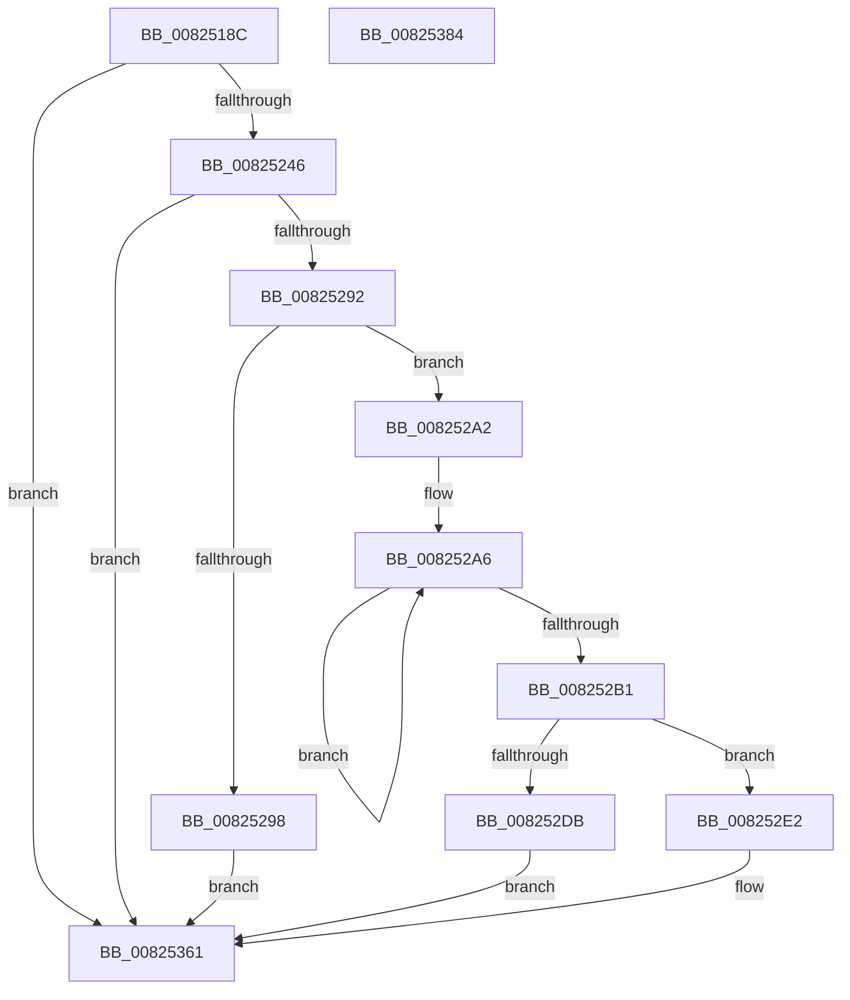

# BiCreateVhdRamdiskBootDevice

- RVA: `0x0082518C`–`0x00825385` (길이 `505` bytes)
- VA: `0x000000014082518C`
- 실행 섹션: `PAGE`
- PDB 이름 있음: `예`; PDB Function 태그: `아니요`
- unwind 정보 RVA: `0x000DA344`
- 디코드: `129`개 명령, `505/505` bytes 표시
- 미해석 바이트: `0` (있으면 어셈블리에 `.byte`로 보존)

> 이 문서는 커널 이미지의 기계어와 PDB 기호를 분석해 생성했습니다. 4번과 5번은 함수 원형과 자료형을 바이너리 사용 방식에서 추정한 C 해석이며 원본 소스 복구 결과는 아닙니다.

## 1. Dependencies

- 직접 호출 지점: **8**; 고유 호출 대상: **7**
- 직접 호출자로 확인된 함수: **1**
- RIP 상대 이미지 참조: **1**

### Outgoing calls
- `0x008251D4` → [memset](../../text/6C/memset_function_006C6C40.md) (function, `0x006C6C40`)
- `0x008251EF` → [RtlInitUnicodeString](../../text/42/RtlInitUnicodeString_function_0042A780.md) (function, `0x0042A780`)
- `0x00825237` → [ZwOpenFile](../../text/6A/ZwOpenFile_function_006AD730.md) (function, `0x006AD730`)
- `0x0082527A` → [ZwDeviceIoControlFile](../../text/6A/ZwDeviceIoControlFile_function_006AD1B0.md) (function, `0x006AD1B0`)
- `0x00825285` → [ZwClose](../../text/6A/ZwClose_function_006AD2B0.md) (function, `0x006AD2B0`)
- `0x008252CE` → [ExAllocatePool2](../../poolcode/B8/ExAllocatePool2_function_00B820F0.md) (function, `0x00B820F0`)
- `0x008252EA` → [memset](../../text/6C/memset_function_006C6C40.md) (function, `0x006C6C40`)
- `0x00825355` → [memcpy](../../text/6C/memcpy_function_006C6840.md) (function, `0x006C6840`)

### Direct callers
- [BiCreatePartitionDevice](BiCreatePartitionDevice_function_00824D10.md) at `0x00824EC2`

### Static image references
- `0x008251E0` → RVA `0x00B0BC90` (` ?? ::NNGAKEGL::`string'`; read)

## 2. Other-region calls and transfers

- 다른 실행 섹션으로 향하는 call: **8**
  - `0x008251D4` → [memset](../../text/6C/memset_function_006C6C40.md) (`PAGE` → `.text`)
  - `0x008251EF` → [RtlInitUnicodeString](../../text/42/RtlInitUnicodeString_function_0042A780.md) (`PAGE` → `.text`)
  - `0x00825237` → [ZwOpenFile](../../text/6A/ZwOpenFile_function_006AD730.md) (`PAGE` → `.text`)
  - `0x0082527A` → [ZwDeviceIoControlFile](../../text/6A/ZwDeviceIoControlFile_function_006AD1B0.md) (`PAGE` → `.text`)
  - `0x00825285` → [ZwClose](../../text/6A/ZwClose_function_006AD2B0.md) (`PAGE` → `.text`)
  - `0x008252CE` → [ExAllocatePool2](../../poolcode/B8/ExAllocatePool2_function_00B820F0.md) (`PAGE` → `POOLCODE`)
  - `0x008252EA` → [memset](../../text/6C/memset_function_006C6C40.md) (`PAGE` → `.text`)
  - `0x00825355` → [memcpy](../../text/6C/memcpy_function_006C6840.md) (`PAGE` → `.text`)
- 별도 외부 분기/꼬리 이동을 확인하지 못했습니다.

## 3. Assembly (complete function range)

```asm
0082518C  48 8B C4                        mov rax, rsp
0082518F  48 89 58 08                     mov qword ptr [rax + 8], rbx
00825193  48 89 70 10                     mov qword ptr [rax + 0x10], rsi
00825197  48 89 78 20                     mov qword ptr [rax + 0x20], rdi
0082519B  55                              push rbp
0082519C  41 54                           push r12
0082519E  41 55                           push r13
008251A0  41 56                           push r14
008251A2  41 57                           push r15
008251A4  48 8D 68 A1                     lea rbp, [rax - 0x5f]
008251A8  48 81 EC E0 00 00 00            sub rsp, 0xe0
008251AF  45 33 ED                        xor r13d, r13d
008251B2  4C 8B E2                        mov r12, rdx
008251B5  48 8B F9                        mov rdi, rcx
008251B8  44 89 6D CB                     mov dword ptr [rbp - 0x35], r13d
008251BC  0F 57 C0                        xorps xmm0, xmm0
008251BF  44 89 6D E3                     mov dword ptr [rbp - 0x1d], r13d
008251C3  33 D2                           xor edx, edx
008251C5  48 8D 4D F7                     lea rcx, [rbp - 9]
008251C9  41 8D 75 40                     lea esi, [r13 + 0x40]
008251CD  44 8B C6                        mov r8d, esi
008251D0  0F 11 45 B7                     movups xmmword ptr [rbp - 0x49], xmm0
008251D4  E8 67 1A EA FF                  call 0x1406c6c40
008251D9  0F 57 C0                        xorps xmm0, xmm0
008251DC  4C 89 6D 77                     mov qword ptr [rbp + 0x77], r13
008251E0  48 8D 15 A9 6A 2E 00            lea rdx, [rip + 0x2e6aa9]
008251E7  48 8D 4D A7                     lea rcx, [rbp - 0x59]
008251EB  0F 11 45 A7                     movups xmmword ptr [rbp - 0x59], xmm0
008251EF  E8 8C 55 C0 FF                  call 0x14042a780
008251F4  48 8D 45 A7                     lea rax, [rbp - 0x59]
008251F8  C7 44 24 28 20 00 00 00         mov dword ptr [rsp + 0x28], 0x20
00825200  0F 57 C0                        xorps xmm0, xmm0
00825203  48 89 45 D7                     mov qword ptr [rbp - 0x29], rax
00825207  4C 8D 4D B7                     lea r9, [rbp - 0x49]
0082520B  C7 45 C7 30 00 00 00            mov dword ptr [rbp - 0x39], 0x30
00825212  4C 8D 45 C7                     lea r8, [rbp - 0x39]
00825216  4C 89 6D CF                     mov qword ptr [rbp - 0x31], r13
0082521A  BA 00 00 00 C0                  mov edx, 0xc0000000
0082521F  C7 45 DF 40 02 00 00            mov dword ptr [rbp - 0x21], 0x240
00825226  48 8D 4D 77                     lea rcx, [rbp + 0x77]
0082522A  C7 44 24 20 03 00 00 00         mov dword ptr [rsp + 0x20], 3
00825232  F3 0F 7F 45 E7                  movdqu xmmword ptr [rbp - 0x19], xmm0
00825237  E8 F4 84 E8 FF                  call 0x1406ad730
0082523C  8B D8                           mov ebx, eax
0082523E  85 C0                           test eax, eax
00825240  0F 88 1B 01 00 00               js 0x140825361
00825246  48 8B 4D 77                     mov rcx, qword ptr [rbp + 0x77]
0082524A  48 8D 45 F7                     lea rax, [rbp - 9]
0082524E  89 74 24 48                     mov dword ptr [rsp + 0x48], esi
00825252  45 33 C9                        xor r9d, r9d
00825255  48 89 44 24 40                  mov qword ptr [rsp + 0x40], rax
0082525A  45 33 C0                        xor r8d, r8d
0082525D  44 89 6C 24 38                  mov dword ptr [rsp + 0x38], r13d
00825262  48 8D 45 B7                     lea rax, [rbp - 0x49]
00825266  4C 89 6C 24 30                  mov qword ptr [rsp + 0x30], r13
0082526B  33 D2                           xor edx, edx
0082526D  C7 44 24 28 08 00 24 00         mov dword ptr [rsp + 0x28], 0x240008
00825275  48 89 44 24 20                  mov qword ptr [rsp + 0x20], rax
0082527A  E8 31 7F E8 FF                  call 0x1406ad1b0
0082527F  48 8B 4D 77                     mov rcx, qword ptr [rbp + 0x77]
00825283  8B D8                           mov ebx, eax
00825285  E8 26 80 E8 FF                  call 0x1406ad2b0
0082528A  85 DB                           test ebx, ebx
0082528C  0F 88 CF 00 00 00               js 0x140825361
00825292  83 7D 0B 03                     cmp dword ptr [rbp + 0xb], 3
00825296  74 0A                           je 0x1408252a2
00825298  BB 10 00 00 C0                  mov ebx, 0xc0000010
0082529D  E9 BF 00 00 00                  jmp 0x140825361
008252A2  48 83 C8 FF                     or rax, 0xffffffffffffffff
008252A6  48 FF C0                        inc rax
008252A9  66 44 39 6C 47 6A               cmp word ptr [rdi + rax*2 + 0x6a], r13w
008252AF  75 F5                           jne 0x1408252a6
008252B1  48 8D 34 45 02 00 00 00         lea rsi, [rax*2 + 2]
008252B9  41 B8 42 43 44 4B               mov r8d, 0x4b444342
008252BF  44 8D 76 68                     lea r14d, [rsi + 0x68]
008252C3  B9 02 01 00 00                  mov ecx, 0x102
008252C8  41 8B D6                        mov edx, r14d
008252CB  45 8B FE                        mov r15d, r14d
008252CE  E8 1D CE 35 00                  call 0x140b820f0
008252D3  48 8B D8                        mov rbx, rax
008252D6  48 85 C0                        test rax, rax
008252D9  75 07                           jne 0x1408252e2
008252DB  BB 9A 00 00 C0                  mov ebx, 0xc000009a
008252E0  EB 7F                           jmp 0x140825361
008252E2  4D 8B C7                        mov r8, r15
008252E5  33 D2                           xor edx, edx
008252E7  48 8B CB                        mov rcx, rbx
008252EA  E8 51 19 EA FF                  call 0x1406c6c40
008252EF  BA 05 00 00 00                  mov edx, 5
008252F4  44 89 2B                        mov dword ptr [rbx], r13d
008252F7  89 53 10                        mov dword ptr [rbx + 0x10], edx
008252FA  8D 46 54                        lea eax, [rsi + 0x54]
008252FD  48 89 53 1C                     mov qword ptr [rbx + 0x1c], rdx
00825301  4C 8B C6                        mov r8, rsi
00825304  89 43 18                        mov dword ptr [rbx + 0x18], eax
00825307  8D 4A FC                        lea ecx, [rdx - 4]
0082530A  44 89 73 08                     mov dword ptr [rbx + 8], r14d
0082530E  89 4B 14                        mov dword ptr [rbx + 0x14], ecx
00825311  C7 43 28 48 00 00 00            mov dword ptr [rbx + 0x28], 0x48
00825318  C7 43 24 10 00 00 00            mov dword ptr [rbx + 0x24], 0x10
0082531F  C7 43 30 03 00 00 00            mov dword ptr [rbx + 0x30], 3
00825326  48 8B 45 27                     mov rax, qword ptr [rbp + 0x27]
0082532A  48 C1 E0 0C                     shl rax, 0xc
0082532E  48 89 43 34                     mov qword ptr [rbx + 0x34], rax
00825332  48 8B 45 17                     mov rax, qword ptr [rbp + 0x17]
00825336  48 89 43 3C                     mov qword ptr [rbx + 0x3c], rax
0082533A  8B 45 1F                        mov eax, dword ptr [rbp + 0x1f]
0082533D  89 4B 48                        mov dword ptr [rbx + 0x48], ecx
00825340  48 8D 4B 68                     lea rcx, [rbx + 0x68]
00825344  89 53 50                        mov dword ptr [rbx + 0x50], edx
00825347  48 8D 57 6A                     lea rdx, [rdi + 0x6a]
0082534B  89 43 44                        mov dword ptr [rbx + 0x44], eax
0082534E  C7 43 4C 0C 00 00 00            mov dword ptr [rbx + 0x4c], 0xc
00825355  E8 E6 14 EA FF                  call 0x1406c6840
0082535A  49 89 1C 24                     mov qword ptr [r12], rbx
0082535E  41 8B DD                        mov ebx, r13d
00825361  4C 8D 9C 24 E0 00 00 00         lea r11, [rsp + 0xe0]
00825369  8B C3                           mov eax, ebx
0082536B  49 8B 5B 30                     mov rbx, qword ptr [r11 + 0x30]
0082536F  49 8B 73 38                     mov rsi, qword ptr [r11 + 0x38]
00825373  49 8B 7B 48                     mov rdi, qword ptr [r11 + 0x48]
00825377  49 8B E3                        mov rsp, r11
0082537A  41 5F                           pop r15
0082537C  41 5E                           pop r14
0082537E  41 5D                           pop r13
00825380  41 5C                           pop r12
00825382  5D                              pop rbp
00825383  C3                              ret
00825384  CC                              int3
```

## 4. C-style interpretation (structured pseudocode)

```c
__int64 __fastcall BiCreateVhdRamdiskBootDevice(__int64 a1, __int64 a2)
{
    __int64 result;
    __int64 v_r13;
    __int64 v_rsp;
    unsigned __int64 v_stack_m28;
    unsigned int v_stack_mC0;
    unsigned __int64 v_stack_mC8;
    unsigned int v_stack_mD0;
    unsigned __int64 v_stack_mD8;
    unsigned int v_stack_mE0;
    unsigned int v_stack_mE8;

    *(unsigned __int64 *)(v_rsp + 8) = v_rbx;
    *(unsigned __int64 *)(v_rsp + 16) = v_rsi;
    *(unsigned __int64 *)(v_rsp + 32) = v_rdi;
    v_rsp = (v_rsp) - (224);
    v_r13 = 0;
    *(unsigned int *)(v_rsp - 95 - 53) = 0;
    *(unsigned int *)(v_rsp - 95 - 29) = 0;
    a2 = 0;
    *(unsigned __int64 *)(v_rsp - 95 - 73) = v_xmm0;
    result = memset(v_rsp - 95 - 9, a2, (unsigned int)((unsigned int)(v_r13 + 64)), a4);
    *(unsigned __int64 *)(v_rsp - 95 + 119) = 0;
    *(unsigned __int64 *)(v_rsp - 95 - 89) = v_xmm0;
    result = RtlInitUnicodeString(v_rsp - 95 - 89, v_rip + 3041961, (unsigned int)((unsigned int)(v_r13 + 64)), a4);
    v_stack_mE0 = 32;
    *(unsigned __int64 *)(v_rsp - 95 - 41) = v_rsp - 95 - 89;
    *(unsigned int *)(v_rsp - 95 - 57) = 48;
    *(unsigned __int64 *)(v_rsp - 95 - 49) = 0;
    *(unsigned int *)(v_rsp - 95 - 33) = 576;
    v_stack_mE8 = 3;
    *(unsigned __int64 *)(v_rsp - 95 - 25) = v_xmm0;
    result = ZwOpenFile(v_rsp - 95 + 119, (unsigned int)(0xC0000000ULL), v_rsp - 95 - 57, v_rsp - 95 - 73);
    if (sign_flag) goto loc_00825361;
    v_stack_mC0 = (unsigned int)(v_r13 + 64);
    a4 = 0;
    v_stack_mC8 = v_rsp - 95 - 9;
    a3 = 0;
    v_stack_mD0 = 0;
    v_stack_mD8 = 0;
    a2 = 0;
    v_stack_mE0 = 0x240008ULL;
    v_stack_mE8 = v_rsp - 95 - 73;
    result = ZwDeviceIoControlFile(*(unsigned __int64 *)(v_rsp - 95 + 119), a2, a3, a4);
    result = ZwClose(*(unsigned __int64 *)(v_rsp - 95 + 119), a2, a3, a4);
    if (sign_flag) goto loc_00825361;
    if ((*(unsigned int *)(v_rsp - 95 + 11)) == 3) goto loc_008252A2;
    goto loc_00825361;
loc_008252A2:
    result = (result) | (-1);
loc_008252A6:
    result = (result) + 1;
    if ((*(unsigned __int16 *)(a1 + result * 2 + 106)) != 0) goto loc_008252A6;
    result = ExAllocatePool2(258, (unsigned int)((unsigned int)(result * 2 + 2 + 104)), (unsigned int)(0x4B444342ULL), a4);
    if (result != 0) goto loc_008252E2;
    goto loc_00825361;
loc_008252E2:
    a2 = 0;
    result = memset((unsigned int)(0xC000009AULL), a2, (unsigned int)((unsigned int)(result * 2 + 2 + 104)), a4);
    *(unsigned int *)((unsigned int)(0xC000009AULL)) = 0;
    *(unsigned int *)((unsigned int)(0xC000009AULL) + 16) = 5;
    *(unsigned __int64 *)((unsigned int)(0xC000009AULL) + 28) = 5;
    *(unsigned int *)((unsigned int)(0xC000009AULL) + 24) = (unsigned int)(result * 2 + 2 + 84);
    *(unsigned int *)((unsigned int)(0xC000009AULL) + 8) = (unsigned int)(result * 2 + 2 + 104);
    *(unsigned int *)((unsigned int)(0xC000009AULL) + 20) = (unsigned int)(5 - 4);
    *(unsigned int *)((unsigned int)(0xC000009AULL) + 40) = 72;
    *(unsigned int *)((unsigned int)(0xC000009AULL) + 36) = 16;
    *(unsigned int *)((unsigned int)(0xC000009AULL) + 48) = 3;
    result = (*(unsigned __int64 *)(v_rsp - 95 + 39)) << (12);
    *(unsigned __int64 *)((unsigned int)(0xC000009AULL) + 52) = result;
    *(unsigned __int64 *)((unsigned int)(0xC000009AULL) + 60) = *(unsigned __int64 *)(v_rsp - 95 + 23);
    *(unsigned int *)((unsigned int)(0xC000009AULL) + 72) = (unsigned int)(5 - 4);
    *(unsigned int *)((unsigned int)(0xC000009AULL) + 80) = 5;
    *(unsigned int *)((unsigned int)(0xC000009AULL) + 68) = (unsigned int)((unsigned int)(*(unsigned int *)(v_rsp - 95 + 31)));
    *(unsigned int *)((unsigned int)(0xC000009AULL) + 76) = 12;
    result = memcpy((unsigned int)(0xC000009AULL) + 104, a1 + 106, result * 2 + 2, a4);
    *(unsigned __int64 *)(a2) = (unsigned int)(0xC000009AULL);
loc_00825361:
    return 0;
}
```

## 5. (Beta) C Style

```c
int64_t BiCreateVhdRamdiskBootDevice(void *Arg1, void *Arg2)
{
    uint8_t *arg1 = (uint8_t *)Arg1;
    uint8_t *arg2 = (uint8_t *)Arg2;

    int64_t result;
    int64_t local_r13;
    int64_t local_rsp;
    uint64_t v_stack_m28;
    uint32_t v_stack_mC0;
    uint64_t v_stack_mC8;
    uint32_t v_stack_mD0;
    uint64_t v_stack_mD8;
    uint32_t v_stack_mE0;
    uint32_t v_stack_mE8;

    *(uint64_t *)(local_rsp + 0x8) = local_rbx;
    *(uint64_t *)(local_rsp + 0x10) = local_rsi;
    *(uint64_t *)(local_rsp + 0x20) = local_rdi;
    local_rsp = (local_rsp) - (224);
    local_r13 = 0;
    *(uint32_t *)(local_rsp - 0x5F - 0x35) = 0;
    *(uint32_t *)(local_rsp - 0x5F - 0x1D) = 0;
    Arg2 = 0;
    *(uint64_t *)(local_rsp - 0x5F - 0x49) = v_xmm0;
    result = memset(local_rsp - 95 - 9, Arg2, (uint32_t)((uint32_t)(local_r13 + 64)), a4);
    *(uint64_t *)(local_rsp - 0x5F + 0x77) = 0;
    *(uint64_t *)(local_rsp - 0x5F - 0x59) = v_xmm0;
    result = RtlInitUnicodeString(local_rsp - 95 - 89, v_rip + 3041961, (uint32_t)((uint32_t)(local_r13 + 64)), a4);
    v_stack_mE0 = 32;
    *(uint64_t *)(local_rsp - 0x5F - 0x29) = local_rsp - 95 - 89;
    *(uint32_t *)(local_rsp - 0x5F - 0x39) = 48;
    *(uint64_t *)(local_rsp - 0x5F - 0x31) = 0;
    *(uint32_t *)(local_rsp - 0x5F - 0x21) = 576;
    v_stack_mE8 = 3;
    *(uint64_t *)(local_rsp - 0x5F - 0x19) = v_xmm0;
    result = ZwOpenFile(local_rsp - 95 + 119, (uint32_t)(0xC0000000ULL), local_rsp - 95 - 57, local_rsp - 95 - 73);
    if (sign_flag) goto loc_00825361;
    v_stack_mC0 = (uint32_t)(local_r13 + 64);
    a4 = 0;
    v_stack_mC8 = local_rsp - 95 - 9;
    a3 = 0;
    v_stack_mD0 = 0;
    v_stack_mD8 = 0;
    Arg2 = 0;
    v_stack_mE0 = 0x240008ULL;
    v_stack_mE8 = local_rsp - 95 - 73;
    result = ZwDeviceIoControlFile(*(uint64_t *)(local_rsp - 0x5F + 0x77), Arg2, a3, a4);
    result = ZwClose(*(uint64_t *)(local_rsp - 0x5F + 0x77), Arg2, a3, a4);
    if (sign_flag) goto loc_00825361;
    if ((*(uint32_t *)(local_rsp - 0x5F + 0xB)) == 3) goto loc_008252A2;
    goto loc_00825361;
loc_008252A2:
    result = (result) | (-1);
loc_008252A6:
    result = (result) + 1;
    if ((*(uint16_t *)(arg1 + result * 2 + 0x6A)) != 0) goto loc_008252A6;
    result = ExAllocatePool2(258, (uint32_t)((uint32_t)(result * 2 + 2 + 104)), (uint32_t)(0x4B444342ULL), a4);
    if (result != 0) goto loc_008252E2;
    goto loc_00825361;
loc_008252E2:
    Arg2 = 0;
    result = memset((uint32_t)(0xC000009AULL), Arg2, (uint32_t)((uint32_t)(result * 2 + 2 + 104)), a4);
    *(uint32_t *)((uint32_t)(0xC000009AULL)) = 0;
    *(uint32_t *)((uint32_t)(0xC000009AULL) + 0x10) = 5;
    *(uint64_t *)((uint32_t)(0xC000009AULL) + 0x1C) = 5;
    *(uint32_t *)((uint32_t)(0xC000009AULL) + 0x18) = (uint32_t)(result * 2 + 2 + 84);
    *(uint32_t *)((uint32_t)(0xC000009AULL) + 0x8) = (uint32_t)(result * 2 + 2 + 104);
    *(uint32_t *)((uint32_t)(0xC000009AULL) + 0x14) = (uint32_t)(5 - 4);
    *(uint32_t *)((uint32_t)(0xC000009AULL) + 0x28) = 72;
    *(uint32_t *)((uint32_t)(0xC000009AULL) + 0x24) = 16;
    *(uint32_t *)((uint32_t)(0xC000009AULL) + 0x30) = 3;
    result = (*(uint64_t *)(local_rsp - 0x5F + 0x27)) << (12);
    *(uint64_t *)((uint32_t)(0xC000009AULL) + 0x34) = result;
    *(uint64_t *)((uint32_t)(0xC000009AULL) + 0x3C) = *(uint64_t *)(local_rsp - 0x5F + 0x17);
    *(uint32_t *)((uint32_t)(0xC000009AULL) + 0x48) = (uint32_t)(5 - 4);
    *(uint32_t *)((uint32_t)(0xC000009AULL) + 0x50) = 5;
    *(uint32_t *)((uint32_t)(0xC000009AULL) + 0x44) = (uint32_t)((uint32_t)(*(uint32_t *)(local_rsp - 0x5F + 0x1F)));
    *(uint32_t *)((uint32_t)(0xC000009AULL) + 0x4C) = 12;
    result = memcpy((uint32_t)(0xC000009AULL) + 104, Arg1 + 106, result * 2 + 2, a4);
    *(uint64_t *)(arg2) = (uint32_t)(0xC000009AULL);
loc_00825361:
    return 0;
}
```

### 관측된 메모리 오프셋

구조체 형식이 확인되지 않은 접근은 인자 기준의 오프셋으로만 기록했습니다.

| 기준 인자 | 오프셋 표현 | 폭 (bit) | 접근 |
|---|---:|---:|---|
| `Arg1` | `+ 0x6A` | `64` | `R` |
| `Arg1` | `+ 0x6A + rax*2` | `16` | `R` |
| `Arg2` | `+ 0x0` | `64` | `W` |

## 6. Execution-region graph

[열기: 2D/3D 그래프와 함수 탐색 컨트롤 패널](../../../control-panel.html?section=page&rva=0x0082518C&view=graph)

- 2D 그래프는 위에서 아래로 흐르고, 3D 그래프는 빈 공간을 드래그해 회전합니다. Shift+드래그는 이동, 휠은 확대·축소, 함수 노드 선택은 대상 보고서 이동입니다.

### Static fallback


