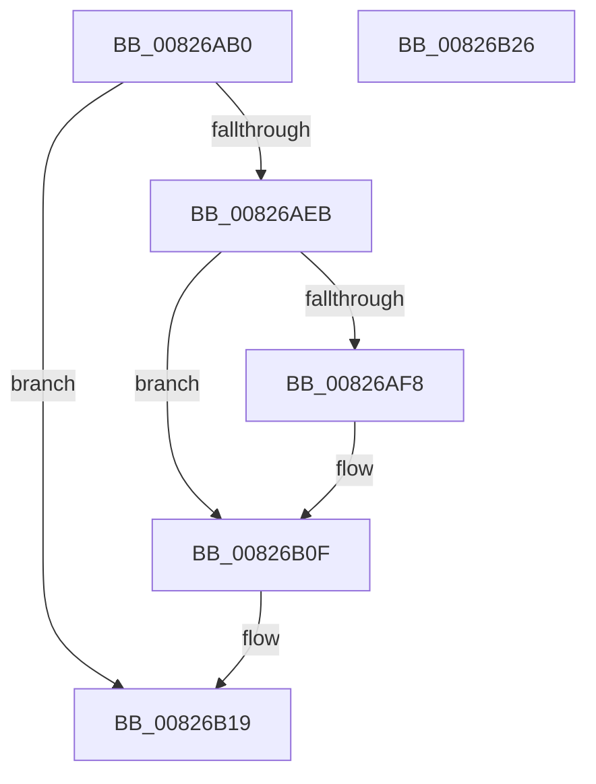

# BiDeleteBootEntry

- RVA: `0x00826AB0`–`0x00826B27` (길이 `119` bytes)
- VA: `0x0000000140826AB0`
- 실행 섹션: `PAGE`
- PDB 이름 있음: `예`; PDB Function 태그: `아니요`
- unwind 정보 RVA: `0x0005CAAC`
- 디코드: `33`개 명령, `119/119` bytes 표시
- 미해석 바이트: `0` (있으면 어셈블리에 `.byte`로 보존)

> 이 문서는 커널 이미지의 기계어와 PDB 기호를 분석해 생성했습니다. 4번과 5번은 함수 원형과 자료형을 바이너리 사용 방식에서 추정한 C 해석이며 원본 소스 복구 결과는 아닙니다.

## 1. Dependencies

- 직접 호출 지점: **5**; 고유 호출 대상: **4**
- 직접 호출자로 확인된 함수: **2**
- RIP 상대 이미지 참조: **2**

### Outgoing calls
- `0x00826AD1` → [BiLogMessage](../A3/BiLogMessage_function_00A3D3A8.md) (function, `0x00A3D3A8`)
- `0x00826AE0` → [BiAcquirePrivilege](../A3/BiAcquirePrivilege_function_00A3D658.md) (function, `0x00A3D658`)
- `0x00826AED` → [ZwDeleteBootEntry](../../text/6A/ZwDeleteBootEntry_function_006AEBF0.md) (function, `0x006AEBF0`)
- `0x00826B0A` → [BiLogMessage](../A3/BiLogMessage_function_00A3D3A8.md) (function, `0x00A3D3A8`)
- `0x00826B14` → [BiReleasePrivilege](../A3/BiReleasePrivilege_function_00A3D600.md) (function, `0x00A3D600`)

### Direct callers
- [BiExportBcdObjects](BiExportBcdObjects_function_00826B30.md) at `0x00826B7B`
- [BiExportBcdObjects](BiExportBcdObjects_function_00826B30.md) at `0x00826B95`
- [BiBindEfiEntries](../AB/BiBindEfiEntries_function_00AB09C4.md) at `0x00AB0A1E`
- [BiBindEfiEntries](../AB/BiBindEfiEntries_function_00AB09C4.md) at `0x00AB0AAB`

### Static image references
- `0x00826AC0` → RVA `0x00B0C880` (` ?? ::NNGAKEGL::`string'`; read)
- `0x00826AFB` → RVA `0x00B0C8C0` (` ?? ::NNGAKEGL::`string'`; read)

## 2. Other-region calls and transfers

- 다른 실행 섹션으로 향하는 call: **1**
  - `0x00826AED` → [ZwDeleteBootEntry](../../text/6A/ZwDeleteBootEntry_function_006AEBF0.md) (`PAGE` → `.text`)
- 별도 외부 분기/꼬리 이동을 확인하지 못했습니다.

## 3. Assembly (complete function range)

```asm
00826AB0  48 89 5C 24 08                  mov qword ptr [rsp + 8], rbx
00826AB5  57                              push rdi
00826AB6  48 83 EC 20                     sub rsp, 0x20
00826ABA  48 83 64 24 38 00               and qword ptr [rsp + 0x38], 0
00826AC0  48 8D 15 B9 5D 2E 00            lea rdx, [rip + 0x2e5db9]
00826AC7  44 8B C1                        mov r8d, ecx
00826ACA  8B F9                           mov edi, ecx
00826ACC  B9 02 00 00 00                  mov ecx, 2
00826AD1  E8 D2 68 21 00                  call 0x140a3d3a8
00826AD6  48 8D 54 24 38                  lea rdx, [rsp + 0x38]
00826ADB  B9 16 00 00 00                  mov ecx, 0x16
00826AE0  E8 73 6B 21 00                  call 0x140a3d658
00826AE5  8B D8                           mov ebx, eax
00826AE7  85 C0                           test eax, eax
00826AE9  78 2E                           js 0x140826b19
00826AEB  8B CF                           mov ecx, edi
00826AED  E8 FE 80 E8 FF                  call 0x1406aebf0
00826AF2  8B D8                           mov ebx, eax
00826AF4  85 C0                           test eax, eax
00826AF6  79 17                           jns 0x140826b0f
00826AF8  44 8B C8                        mov r9d, eax
00826AFB  48 8D 15 BE 5D 2E 00            lea rdx, [rip + 0x2e5dbe]
00826B02  44 8B C7                        mov r8d, edi
00826B05  B9 04 00 00 00                  mov ecx, 4
00826B0A  E8 99 68 21 00                  call 0x140a3d3a8
00826B0F  48 8D 4C 24 38                  lea rcx, [rsp + 0x38]
00826B14  E8 E7 6A 21 00                  call 0x140a3d600
00826B19  8B C3                           mov eax, ebx
00826B1B  48 8B 5C 24 30                  mov rbx, qword ptr [rsp + 0x30]
00826B20  48 83 C4 20                     add rsp, 0x20
00826B24  5F                              pop rdi
00826B25  C3                              ret
00826B26  CC                              int3
```

## 4. C-style interpretation (structured pseudocode)

```c
__int64 __fastcall BiDeleteBootEntry(int a1)
{
    __int64 result;
    __int64 v_rsp;
    unsigned __int64 v_stack_p10;
    unsigned __int64 v_stack_p8;

    v_stack_p8 = v_rbx;
    v_rsp = (v_rsp) - (32);
    result = BiLogMessage(2, v_rip + 3038649, (unsigned int)(a1), a4);
    result = BiAcquirePrivilege(22, v_stack_p10, (unsigned int)(a1), a4);
    if (sign_flag) goto loc_00826B19;
    result = ZwDeleteBootEntry((unsigned int)((unsigned int)((unsigned int)(a1))), v_stack_p10, (unsigned int)(a1), a4);
    if (sign_flag) {
        a4 = (unsigned int)(result);
        a2 = v_rip + 3038654;
        a3 = (unsigned int)((unsigned int)(a1));
        a1 = 4;
        result = BiLogMessage(a1, a2, a3, a4);
    }
    result = BiReleasePrivilege(v_stack_p10, a2, a3, a4);
loc_00826B19:
    v_rsp = (v_rsp) + (32);
    return (unsigned int)((unsigned int)((unsigned int)((unsigned int)(result))));
}
```

## 5. (Beta) C Style

```c
int64_t BiDeleteBootEntry(int32_t Arg1)
{
    int64_t result;
    int64_t local_rsp;
    uint64_t v_stack_p10;
    uint64_t v_stack_p8;

    v_stack_p8 = local_rbx;
    local_rsp = (local_rsp) - (32);
    result = BiLogMessage(2, v_rip + 3038649, (uint32_t)(Arg1), a4);
    result = BiAcquirePrivilege(22, v_stack_p10, (uint32_t)(Arg1), a4);
    if (sign_flag) goto loc_00826B19;
    result = ZwDeleteBootEntry((uint32_t)((uint32_t)((uint32_t)(Arg1))), v_stack_p10, (uint32_t)(Arg1), a4);
    if (sign_flag) {
        a4 = (uint32_t)(result);
        a2 = v_rip + 3038654;
        a3 = (uint32_t)((uint32_t)(Arg1));
        Arg1 = 4;
        result = BiLogMessage(Arg1, a2, a3, a4);
    }
    result = BiReleasePrivilege(v_stack_p10, a2, a3, a4);
loc_00826B19:
    local_rsp = (local_rsp) + (32);
    return (uint32_t)((uint32_t)((uint32_t)((uint32_t)(result))));
}
```

## 6. Execution-region graph

[열기: 2D/3D 그래프와 함수 탐색 컨트롤 패널](../../../control-panel.html?section=page&rva=0x00826AB0&view=graph)

- 2D 그래프는 위에서 아래로 흐르고, 3D 그래프는 빈 공간을 드래그해 회전합니다. Shift+드래그는 이동, 휠은 확대·축소, 함수 노드 선택은 대상 보고서 이동입니다.

### Static fallback


