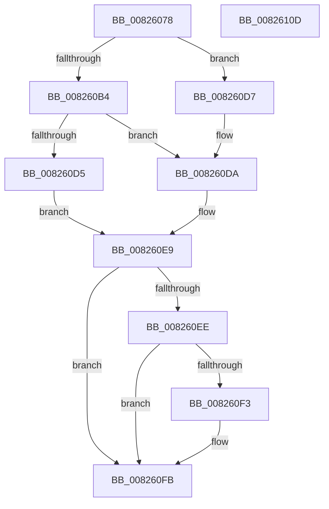

# BiDeleteRegistryValue

- RVA: `0x00826078`–`0x0082610E` (길이 `150` bytes)
- VA: `0x0000000140826078`
- 실행 섹션: `PAGE`
- PDB 이름 있음: `예`; PDB Function 태그: `아니요`
- unwind 정보 RVA: `0x0009E61C`
- 디코드: `45`개 명령, `150/150` bytes 표시
- 미해석 바이트: `0` (있으면 어셈블리에 `.byte`로 보존)

> 이 문서는 커널 이미지의 기계어와 PDB 기호를 분석해 생성했습니다. 4번과 5번은 함수 원형과 자료형을 바이너리 사용 방식에서 추정한 C 해석이며 원본 소스 복구 결과는 아닙니다.

## 1. Dependencies

- 직접 호출 지점: **5**; 고유 호출 대상: **5**
- 직접 호출자로 확인된 함수: **2**
- RIP 상대 이미지 참조: **0**

### Outgoing calls
- `0x00826099` → [RtlInitUnicodeString](../../text/42/RtlInitUnicodeString_function_0042A780.md) (function, `0x0042A780`)
- `0x008260A1` → [BiSanitizeHandle](../../text/4B/BiSanitizeHandle_function_004B0E4C.md) (function, `0x004B0E4C`)
- `0x008260C5` → [BiOpenKey](../A3/BiOpenKey_function_00A3F60C.md) (function, `0x00A3F60C`)
- `0x008260E2` → [BiZwDeleteValueKey](../../text/69/BiZwDeleteValueKey_function_0069E3EC.md) (function, `0x0069E3EC`)
- `0x008260F6` → [BiZwClose](../../text/4A/BiZwClose_function_004A85DC.md) (function, `0x004A85DC`)

### Direct callers
- [BiSetFirmwareModified](../../text/4B/BiSetFirmwareModified_function_004B1DF4.md) at `0x004B1E32`
- [BiMarkTreatAsSystemStore](BiMarkTreatAsSystemStore_function_008234C8.md) at `0x00823572`

### Static image references
- 디코드된 RIP-relative 메모리 참조가 없습니다.

## 2. Other-region calls and transfers

- 다른 실행 섹션으로 향하는 call: **4**
  - `0x00826099` → [RtlInitUnicodeString](../../text/42/RtlInitUnicodeString_function_0042A780.md) (`PAGE` → `.text`)
  - `0x008260A1` → [BiSanitizeHandle](../../text/4B/BiSanitizeHandle_function_004B0E4C.md) (`PAGE` → `.text`)
  - `0x008260E2` → [BiZwDeleteValueKey](../../text/69/BiZwDeleteValueKey_function_0069E3EC.md) (`PAGE` → `.text`)
  - `0x008260F6` → [BiZwClose](../../text/4A/BiZwClose_function_004A85DC.md) (`PAGE` → `.text`)
- 별도 외부 분기/꼬리 이동을 확인하지 못했습니다.

## 3. Assembly (complete function range)

```asm
00826078  48 8B C4                        mov rax, rsp
0082607B  48 89 58 10                     mov qword ptr [rax + 0x10], rbx
0082607F  48 89 70 18                     mov qword ptr [rax + 0x18], rsi
00826083  57                              push rdi
00826084  48 83 EC 30                     sub rsp, 0x30
00826088  48 8B D9                        mov rbx, rcx
0082608B  0F 57 C0                        xorps xmm0, xmm0
0082608E  48 8D 48 E8                     lea rcx, [rax - 0x18]
00826092  49 8B F8                        mov rdi, r8
00826095  0F 11 40 E8                     movups xmmword ptr [rax - 0x18], xmm0
00826099  E8 E2 46 C0 FF                  call 0x14042a780
0082609E  48 8B CB                        mov rcx, rbx
008260A1  E8 A6 AD C8 FF                  call 0x1404b0e4c
008260A6  48 83 64 24 40 00               and qword ptr [rsp + 0x40], 0
008260AC  48 8B F0                        mov rsi, rax
008260AF  48 85 FF                        test rdi, rdi
008260B2  74 23                           je 0x1408260d7
008260B4  4C 8D 4C 24 40                  lea r9, [rsp + 0x40]
008260B9  41 B8 1F 00 02 00               mov r8d, 0x2001f
008260BF  48 8B D7                        mov rdx, rdi
008260C2  48 8B C8                        mov rcx, rax
008260C5  E8 42 95 21 00                  call 0x140a3f60c
008260CA  48 8B 5C 24 40                  mov rbx, qword ptr [rsp + 0x40]
008260CF  8B F8                           mov edi, eax
008260D1  85 C0                           test eax, eax
008260D3  79 05                           jns 0x1408260da
008260D5  EB 12                           jmp 0x1408260e9
008260D7  48 8B DE                        mov rbx, rsi
008260DA  48 8D 54 24 20                  lea rdx, [rsp + 0x20]
008260DF  48 8B CB                        mov rcx, rbx
008260E2  E8 05 83 E7 FF                  call 0x14069e3ec
008260E7  8B F8                           mov edi, eax
008260E9  48 3B DE                        cmp rbx, rsi
008260EC  74 0D                           je 0x1408260fb
008260EE  48 85 DB                        test rbx, rbx
008260F1  74 08                           je 0x1408260fb
008260F3  48 8B CB                        mov rcx, rbx
008260F6  E8 E1 24 C8 FF                  call 0x1404a85dc
008260FB  48 8B 5C 24 48                  mov rbx, qword ptr [rsp + 0x48]
00826100  8B C7                           mov eax, edi
00826102  48 8B 74 24 50                  mov rsi, qword ptr [rsp + 0x50]
00826107  48 83 C4 30                     add rsp, 0x30
0082610B  5F                              pop rdi
0082610C  C3                              ret
0082610D  CC                              int3
```

## 4. C-style interpretation (structured pseudocode)

```c
__int64 __fastcall BiDeleteRegistryValue(__int64 a1, __int64 a2, __int64 a3)
{
    __int64 result;
    __int64 v_rsp;
    unsigned __int64 v_stack_m18;
    unsigned __int64 v_stack_p10;
    unsigned __int64 v_stack_p18;
    unsigned __int64 v_stack_p8;

    *(unsigned __int64 *)(v_rsp + 16) = v_rbx;
    *(unsigned __int64 *)(v_rsp + 24) = v_rsi;
    v_rsp = (v_rsp) - (48);
    *(unsigned __int64 *)(v_rsp - 24) = v_xmm0;
    result = RtlInitUnicodeString(v_rsp - 24, a2, a3, a4);
    result = BiSanitizeHandle(a1, a2, a3, a4);
    if (a3 == 0) goto loc_008260D7;
    result = BiOpenKey(result, a3, (unsigned int)(0x2001FULL), v_stack_p8);
    if (!sign_flag) goto loc_008260DA;
    goto loc_008260E9;
loc_008260D7:
loc_008260DA:
    result = BiZwDeleteValueKey(result, v_stack_m18, (unsigned int)(0x2001FULL), v_stack_p8);
loc_008260E9:
    if (result == result) goto loc_008260FB;
    if (result != 0) {
        a1 = result;
        result = BiZwClose(a1, v_stack_m18, (unsigned int)(0x2001FULL), v_stack_p8);
    }
    v_rsp = (v_rsp) + (48);
    return (unsigned int)((unsigned int)((unsigned int)((unsigned int)(result))));
}
```

## 5. (Beta) C Style

```c
int64_t BiDeleteRegistryValue(int64_t Arg1, int64_t Arg2, int64_t Arg3)
{
    int64_t result;
    int64_t local_rsp;
    uint64_t v_stack_m18;
    uint64_t v_stack_p10;
    uint64_t v_stack_p18;
    uint64_t v_stack_p8;

    *(uint64_t *)(local_rsp + 0x10) = local_rbx;
    *(uint64_t *)(local_rsp + 0x18) = local_rsi;
    local_rsp = (local_rsp) - (48);
    *(uint64_t *)(local_rsp - 0x18) = v_xmm0;
    result = RtlInitUnicodeString(local_rsp - 24, Arg2, Arg3, a4);
    result = BiSanitizeHandle(Arg1, Arg2, Arg3, a4);
    if (Arg3 == 0) goto loc_008260D7;
    result = BiOpenKey(result, Arg3, (uint32_t)(0x2001FULL), v_stack_p8);
    if (!sign_flag) goto loc_008260DA;
    goto loc_008260E9;
loc_008260D7:
loc_008260DA:
    result = BiZwDeleteValueKey(result, v_stack_m18, (uint32_t)(0x2001FULL), v_stack_p8);
loc_008260E9:
    if (result == result) goto loc_008260FB;
    if (result != 0) {
        Arg1 = result;
        result = BiZwClose(Arg1, v_stack_m18, (uint32_t)(0x2001FULL), v_stack_p8);
    }
    local_rsp = (local_rsp) + (48);
    return (uint32_t)((uint32_t)((uint32_t)((uint32_t)(result))));
}
```

## 6. Execution-region graph

[열기: 2D/3D 그래프와 함수 탐색 컨트롤 패널](../../../control-panel.html?section=page&rva=0x00826078&view=graph)

- 2D 그래프는 위에서 아래로 흐르고, 3D 그래프는 빈 공간을 드래그해 회전합니다. Shift+드래그는 이동, 휠은 확대·축소, 함수 노드 선택은 대상 보고서 이동입니다.

### Static fallback


