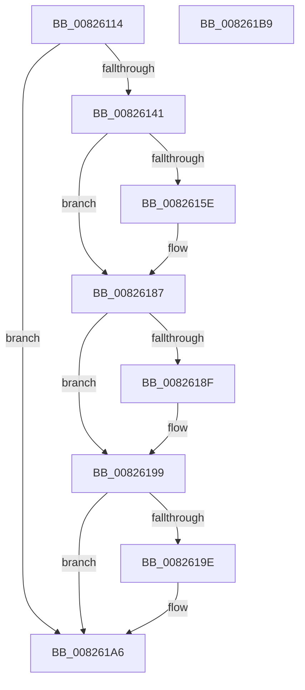

# BiDoesHiveKeyExist

- RVA: `0x00826114`–`0x008261BA` (길이 `166` bytes)
- VA: `0x0000000140826114`
- 실행 섹션: `PAGE`
- PDB 이름 있음: `예`; PDB Function 태그: `아니요`
- unwind 정보 RVA: `0x000DA368`
- 디코드: `46`개 명령, `166/166` bytes 표시
- 미해석 바이트: `0` (있으면 어셈블리에 `.byte`로 보존)

> 이 문서는 커널 이미지의 기계어와 PDB 기호를 분석해 생성했습니다. 4번과 5번은 함수 원형과 자료형을 바이너리 사용 방식에서 추정한 C 해석이며 원본 소스 복구 결과는 아닙니다.

## 1. Dependencies

- 직접 호출 지점: **5**; 고유 호출 대상: **3**
- 직접 호출자로 확인된 함수: **1**
- RIP 상대 이미지 참조: **1**

### Outgoing calls
- `0x00826137` → [wcschr](../../text/50/wcschr_function_00501A60.md) (function, `0x00501A60`)
- `0x00826155` → [BiOpenKeyNonBcd](../A4/BiOpenKeyNonBcd_function_00A40B48.md) (function, `0x00A40B48`)
- `0x00826171` → [BiOpenKeyNonBcd](../A4/BiOpenKeyNonBcd_function_00A40B48.md) (function, `0x00A40B48`)
- `0x00826194` → [ZwClose](../../text/6A/ZwClose_function_006AD2B0.md) (function, `0x006AD2B0`)
- `0x008261A1` → [ZwClose](../../text/6A/ZwClose_function_006AD2B0.md) (function, `0x006AD2B0`)

### Direct callers
- [BiAddStoreFromFile](../A4/BiAddStoreFromFile_function_00A40C54.md) at `0x00A40DC9`

### Static image references
- `0x0082614C` → RVA `0x00B0AC40` (` ?? ::NNGAKEGL::`string'`; read)

## 2. Other-region calls and transfers

- 다른 실행 섹션으로 향하는 call: **3**
  - `0x00826137` → [wcschr](../../text/50/wcschr_function_00501A60.md) (`PAGE` → `.text`)
  - `0x00826194` → [ZwClose](../../text/6A/ZwClose_function_006AD2B0.md) (`PAGE` → `.text`)
  - `0x008261A1` → [ZwClose](../../text/6A/ZwClose_function_006AD2B0.md) (`PAGE` → `.text`)
- 별도 외부 분기/꼬리 이동을 확인하지 못했습니다.

## 3. Assembly (complete function range)

```asm
00826114  48 8B C4                        mov rax, rsp
00826117  48 89 58 08                     mov qword ptr [rax + 8], rbx
0082611B  48 89 68 20                     mov qword ptr [rax + 0x20], rbp
0082611F  57                              push rdi
00826120  48 83 EC 20                     sub rsp, 0x20
00826124  33 DB                           xor ebx, ebx
00826126  48 8B E9                        mov rbp, rcx
00826129  48 21 58 10                     and qword ptr [rax + 0x10], rbx
0082612D  40 32 FF                        xor dil, dil
00826130  48 89 58 18                     mov qword ptr [rax + 0x18], rbx
00826134  8D 53 5C                        lea edx, [rbx + 0x5c]
00826137  E8 24 B9 CD FF                  call 0x140501a60
0082613C  48 85 C0                        test rax, rax
0082613F  75 65                           jne 0x1408261a6
00826141  4C 8D 4C 24 38                  lea r9, [rsp + 0x38]
00826146  41 B8 19 00 02 00               mov r8d, 0x20019
0082614C  48 8D 15 ED 4A 2E 00            lea rdx, [rip + 0x2e4aed]
00826153  33 C9                           xor ecx, ecx
00826155  E8 EE A9 21 00                  call 0x140a40b48
0082615A  85 C0                           test eax, eax
0082615C  78 29                           js 0x140826187
0082615E  48 8B 4C 24 38                  mov rcx, qword ptr [rsp + 0x38]
00826163  4C 8D 4C 24 40                  lea r9, [rsp + 0x40]
00826168  41 B8 19 00 02 00               mov r8d, 0x20019
0082616E  48 8B D5                        mov rdx, rbp
00826171  E8 D2 A9 21 00                  call 0x140a40b48
00826176  8D 4B 01                        lea ecx, [rbx + 1]
00826179  40 0F B6 FF                     movzx edi, dil
0082617D  48 8B 5C 24 40                  mov rbx, qword ptr [rsp + 0x40]
00826182  85 C0                           test eax, eax
00826184  0F 49 F9                        cmovns edi, ecx
00826187  48 83 7C 24 38 00               cmp qword ptr [rsp + 0x38], 0
0082618D  74 0A                           je 0x140826199
0082618F  48 8B 4C 24 38                  mov rcx, qword ptr [rsp + 0x38]
00826194  E8 17 71 E8 FF                  call 0x1406ad2b0
00826199  48 85 DB                        test rbx, rbx
0082619C  74 08                           je 0x1408261a6
0082619E  48 8B CB                        mov rcx, rbx
008261A1  E8 0A 71 E8 FF                  call 0x1406ad2b0
008261A6  48 8B 5C 24 30                  mov rbx, qword ptr [rsp + 0x30]
008261AB  40 8A C7                        mov al, dil
008261AE  48 8B 6C 24 48                  mov rbp, qword ptr [rsp + 0x48]
008261B3  48 83 C4 20                     add rsp, 0x20
008261B7  5F                              pop rdi
008261B8  C3                              ret
008261B9  CC                              int3
```

## 4. C-style interpretation (structured pseudocode)

```c
__int64 __fastcall BiDoesHiveKeyExist(__int64 a1)
{
    __int64 result;
    __int64 v_rbx;
    __int64 v_rdi;
    __int64 v_rsp;
    unsigned __int64 v_stack_p10;
    unsigned __int64 v_stack_p18;
    unsigned __int64 v_stack_p20;
    unsigned __int64 v_stack_p8;

    *(unsigned __int64 *)(v_rsp + 8) = v_rbx;
    *(unsigned __int64 *)(v_rsp + 32) = v_rbp;
    v_rsp = (v_rsp) - (32);
    v_rbx = 0;
    v_rdi = 0;
    *(unsigned __int64 *)(v_rsp + 24) = 0;
    result = wcschr(a1, v_rbx + 92, a3, a4);
    if (result != 0) goto loc_008261A6;
    a1 = 0;
    result = BiOpenKeyNonBcd(a1, v_rip + 3033837, (unsigned int)(0x20019ULL), v_stack_p10);
    if (!(sign_flag)) {
        a1 = v_stack_p10;
        a4 = v_stack_p18;
        a3 = 0x20019ULL;
        a2 = a1;
        result = BiOpenKeyNonBcd(a1, a2, a3, a4);
        a1 = v_rbx + 1;
        v_rdi = 0;
        v_rbx = v_stack_p18;
        if (!sign_flag) { v_rdi = (unsigned int)(a1); }
    }
    if (v_stack_p10 != 0) {
        a1 = v_stack_p10;
        result = ZwClose(a1, a2, a3, a4);
    }
    if (v_rbx != 0) {
        a1 = v_rbx;
        result = ZwClose(a1, a2, a3, a4);
    }
    v_rsp = (v_rsp) + (32);
    return (unsigned __int8)(v_rdi);
}
```

## 5. (Beta) C Style

```c
int64_t BiDoesHiveKeyExist(int64_t Arg1)
{
    int64_t result;
    int64_t local_rbx;
    int64_t local_rdi;
    int64_t local_rsp;
    uint64_t v_stack_p10;
    uint64_t v_stack_p18;
    uint64_t v_stack_p20;
    uint64_t v_stack_p8;

    *(uint64_t *)(local_rsp + 0x8) = local_rbx;
    *(uint64_t *)(local_rsp + 0x20) = local_rbp;
    local_rsp = (local_rsp) - (32);
    local_rbx = 0;
    local_rdi = 0;
    *(uint64_t *)(local_rsp + 0x18) = 0;
    result = wcschr(Arg1, local_rbx + 92, a3, a4);
    if (result != 0) goto loc_008261A6;
    Arg1 = 0;
    result = BiOpenKeyNonBcd(Arg1, v_rip + 3033837, (uint32_t)(0x20019ULL), v_stack_p10);
    if (!(sign_flag)) {
        Arg1 = v_stack_p10;
        a4 = v_stack_p18;
        a3 = 0x20019ULL;
        a2 = Arg1;
        result = BiOpenKeyNonBcd(Arg1, a2, a3, a4);
        Arg1 = local_rbx + 1;
        local_rdi = 0;
        local_rbx = v_stack_p18;
        if (!sign_flag) { local_rdi = (uint32_t)(Arg1); }
    }
    if (v_stack_p10 != 0) {
        Arg1 = v_stack_p10;
        result = ZwClose(Arg1, a2, a3, a4);
    }
    if (local_rbx != 0) {
        Arg1 = local_rbx;
        result = ZwClose(Arg1, a2, a3, a4);
    }
    local_rsp = (local_rsp) + (32);
    return (uint8_t)(local_rdi);
}
```

## 6. Execution-region graph

[열기: 2D/3D 그래프와 함수 탐색 컨트롤 패널](../../../control-panel.html?section=page&rva=0x00826114&view=graph)

- 2D 그래프는 위에서 아래로 흐르고, 3D 그래프는 빈 공간을 드래그해 회전합니다. Shift+드래그는 이동, 휠은 확대·축소, 함수 노드 선택은 대상 보고서 이동입니다.

### Static fallback


