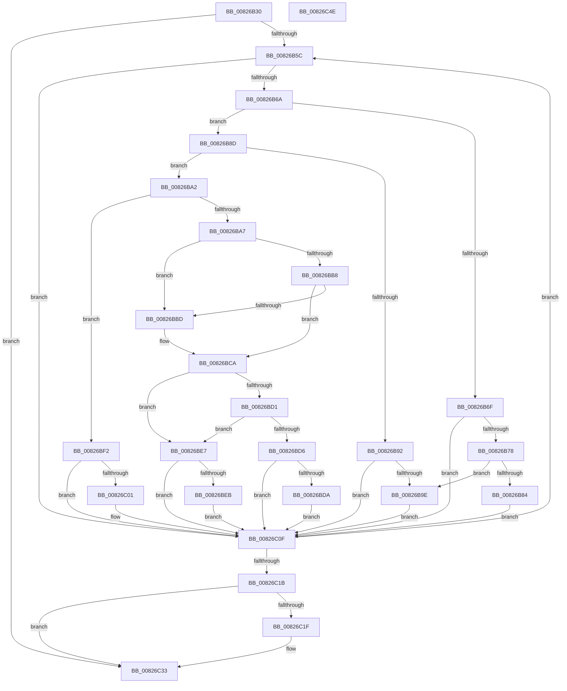

# BiExportBcdObjects

- RVA: `0x00826B30`–`0x00826C4F` (길이 `287` bytes)
- VA: `0x0000000140826B30`
- 실행 섹션: `PAGE`
- PDB 이름 있음: `예`; PDB Function 태그: `아니요`
- unwind 정보 RVA: `0x00060300`
- 디코드: `92`개 명령, `287/287` bytes 표시
- 미해석 바이트: `0` (있으면 어셈블리에 `.byte`로 보존)

> 이 문서는 커널 이미지의 기계어와 PDB 기호를 분석해 생성했습니다. 4번과 5번은 함수 원형과 자료형을 바이너리 사용 방식에서 추정한 C 해석이며 원본 소스 복구 결과는 아닙니다.

## 1. Dependencies

- 직접 호출 지점: **7**; 고유 호출 대상: **6**
- 직접 호출자로 확인된 함수: **1**
- RIP 상대 이미지 참조: **1**

### Outgoing calls
- `0x00826B7B` → [BiDeleteBootEntry](BiDeleteBootEntry_function_00826AB0.md) (function, `0x00826AB0`)
- `0x00826B95` → [BiDeleteBootEntry](BiDeleteBootEntry_function_00826AB0.md) (function, `0x00826AB0`)
- `0x00826BA9` → [BiIsPortableWorkspaceBoot](BiIsPortableWorkspaceBoot_function_008261C0.md) (function, `0x008261C0`)
- `0x00826BC3` → [BiCreateEfiEntry](BiCreateEfiEntry_function_008268C4.md) (function, `0x008268C4`)
- `0x00826BE0` → [BiAddBootEntryToEfiBootManagerDisplayOrder](BiAddBootEntryToEfiBootManagerDisplayOrder_function_008262D8.md) (function, `0x008262D8`)
- `0x00826BF8` → [BiUpdateEfiEntry](../A3/BiUpdateEfiEntry_function_00A3CCC0.md) (function, `0x00A3CCC0`)
- `0x00826C2E` → [BiLogMessage](../A3/BiLogMessage_function_00A3D3A8.md) (function, `0x00A3D3A8`)

### Direct callers
- [BiExportStoreAlterationsToEfi](BiExportStoreAlterationsToEfi_function_00826C58.md) at `0x00826CAA`

### Static image references
- `0x00826C22` → RVA `0x00B0CC10` (` ?? ::NNGAKEGL::`string'`; read)

## 2. Other-region calls and transfers

- 다른 실행 섹션으로 향하는 call: **0**
- 별도 외부 분기/꼬리 이동을 확인하지 못했습니다.

## 3. Assembly (complete function range)

```asm
00826B30  48 89 5C 24 08                  mov qword ptr [rsp + 8], rbx
00826B35  48 89 6C 24 10                  mov qword ptr [rsp + 0x10], rbp
00826B3A  48 89 74 24 18                  mov qword ptr [rsp + 0x18], rsi
00826B3F  57                              push rdi
00826B40  41 56                           push r14
00826B42  41 57                           push r15
00826B44  48 83 EC 20                     sub rsp, 0x20
00826B48  48 8B 1A                        mov rbx, qword ptr [rdx]
00826B4B  33 FF                           xor edi, edi
00826B4D  4C 8B F2                        mov r14, rdx
00826B50  4C 8B F9                        mov r15, rcx
00826B53  48 3B DA                        cmp rbx, rdx
00826B56  0F 84 D7 00 00 00               je 0x140826c33
00826B5C  8B 4B 30                        mov ecx, dword ptr [rbx + 0x30]
00826B5F  8B C1                           mov eax, ecx
00826B61  83 E0 05                        and eax, 5
00826B64  0F 84 A5 00 00 00               je 0x140826c0f
00826B6A  F6 C1 10                        test cl, 0x10
00826B6D  74 1E                           je 0x140826b8d
00826B6F  F6 C1 01                        test cl, 1
00826B72  0F 84 97 00 00 00               je 0x140826c0f
00826B78  8B 4B 20                        mov ecx, dword ptr [rbx + 0x20]
00826B7B  E8 30 FF FF FF                  call 0x140826ab0
00826B80  85 C0                           test eax, eax
00826B82  78 1A                           js 0x140826b9e
00826B84  83 63 30 FE                     and dword ptr [rbx + 0x30], 0xfffffffe
00826B88  E9 82 00 00 00                  jmp 0x140826c0f
00826B8D  83 F8 01                        cmp eax, 1
00826B90  75 10                           jne 0x140826ba2
00826B92  8B 4B 20                        mov ecx, dword ptr [rbx + 0x20]
00826B95  E8 16 FF FF FF                  call 0x140826ab0
00826B9A  85 C0                           test eax, eax
00826B9C  79 71                           jns 0x140826c0f
00826B9E  8B F8                           mov edi, eax
00826BA0  EB 6D                           jmp 0x140826c0f
00826BA2  83 F8 04                        cmp eax, 4
00826BA5  75 4B                           jne 0x140826bf2
00826BA7  33 F6                           xor esi, esi
00826BA9  E8 12 F6 FF FF                  call 0x1408261c0
00826BAE  40 8A E8                        mov bpl, al
00826BB1  8B 43 30                        mov eax, dword ptr [rbx + 0x30]
00826BB4  A8 08                           test al, 8
00826BB6  75 05                           jne 0x140826bbd
00826BB8  40 84 ED                        test bpl, bpl
00826BBB  75 0D                           jne 0x140826bca
00826BBD  48 8B D3                        mov rdx, rbx
00826BC0  49 8B CF                        mov rcx, r15
00826BC3  E8 FC FC FF FF                  call 0x1408268c4
00826BC8  8B F0                           mov esi, eax
00826BCA  8B 43 30                        mov eax, dword ptr [rbx + 0x30]
00826BCD  A8 08                           test al, 8
00826BCF  75 16                           jne 0x140826be7
00826BD1  40 84 ED                        test bpl, bpl
00826BD4  75 11                           jne 0x140826be7
00826BD6  85 F6                           test esi, esi
00826BD8  78 35                           js 0x140826c0f
00826BDA  48 8B D3                        mov rdx, rbx
00826BDD  49 8B CF                        mov rcx, r15
00826BE0  E8 F3 F6 FF FF                  call 0x1408262d8
00826BE5  EB 28                           jmp 0x140826c0f
00826BE7  85 F6                           test esi, esi
00826BE9  79 24                           jns 0x140826c0f
00826BEB  BF 01 00 39 80                  mov edi, 0x80390001
00826BF0  EB 1D                           jmp 0x140826c0f
00826BF2  48 8B D3                        mov rdx, rbx
00826BF5  49 8B CF                        mov rcx, r15
00826BF8  E8 C3 60 21 00                  call 0x140a3ccc0
00826BFD  85 C0                           test eax, eax
00826BFF  79 0E                           jns 0x140826c0f
00826C01  F6 43 30 08                     test byte ptr [rbx + 0x30], 8
00826C05  8B F8                           mov edi, eax
00826C07  B8 03 00 39 80                  mov eax, 0x80390003
00826C0C  0F 45 F8                        cmovne edi, eax
00826C0F  48 8B 1B                        mov rbx, qword ptr [rbx]
00826C12  49 3B DE                        cmp rbx, r14
00826C15  0F 85 41 FF FF FF               jne 0x140826b5c
00826C1B  85 FF                           test edi, edi
00826C1D  79 14                           jns 0x140826c33
00826C1F  44 8B C7                        mov r8d, edi
00826C22  48 8D 15 E7 5F 2E 00            lea rdx, [rip + 0x2e5fe7]
00826C29  B9 04 00 00 00                  mov ecx, 4
00826C2E  E8 75 67 21 00                  call 0x140a3d3a8
00826C33  48 8B 5C 24 40                  mov rbx, qword ptr [rsp + 0x40]
00826C38  8B C7                           mov eax, edi
00826C3A  48 8B 6C 24 48                  mov rbp, qword ptr [rsp + 0x48]
00826C3F  48 8B 74 24 50                  mov rsi, qword ptr [rsp + 0x50]
00826C44  48 83 C4 20                     add rsp, 0x20
00826C48  41 5F                           pop r15
00826C4A  41 5E                           pop r14
00826C4C  5F                              pop rdi
00826C4D  C3                              ret
00826C4E  CC                              int3
```

## 4. C-style interpretation (structured pseudocode)

```c
__int64 __fastcall BiExportBcdObjects(__int64 a1, __int64 a2)
{
    __int64 result;
    __int64 v_rdi;
    __int64 v_rsi;
    __int64 v_rsp;
    unsigned __int64 v_stack_p10;
    unsigned __int64 v_stack_p18;
    unsigned __int64 v_stack_p8;

    v_stack_p8 = v_rbx;
    v_stack_p10 = v_rbp;
    v_stack_p18 = v_rsi;
    v_rsp = (v_rsp) - (32);
    v_rdi = 0;
    if ((*(unsigned __int64 *)(a2)) == a2) goto loc_00826C33;
loc_00826B5C:
    result = (unsigned int)(((unsigned int)((unsigned int)((unsigned int)(*(unsigned int *)(*(unsigned __int64 *)(a2) + 48))))) & (5));
    if (condition_is_equal) goto loc_00826C0F;
    if ((((unsigned __int8)((unsigned int)(*(unsigned int *)(*(unsigned __int64 *)(a2) + 48)))) & (16)) == 0) goto loc_00826B8D;
    if ((((unsigned __int8)((unsigned int)(*(unsigned int *)(*(unsigned __int64 *)(a2) + 48)))) & (1)) == 0) goto loc_00826C0F;
    result = BiDeleteBootEntry((unsigned int)(*(unsigned int *)(*(unsigned __int64 *)(a2) + 32)), a2, a3, a4);
    if (sign_flag) goto loc_00826B9E;
    goto loc_00826C0F;
loc_00826B8D:
    if (((unsigned int)(result)) != 1) goto loc_00826BA2;
    result = BiDeleteBootEntry((unsigned int)(*(unsigned int *)(*(unsigned __int64 *)(a2) + 32)), a2, a3, a4);
    if (!sign_flag) goto loc_00826C0F;
loc_00826B9E:
    goto loc_00826C0F;
loc_00826BA2:
    if (((unsigned int)(result)) != 4) goto loc_00826BF2;
    v_rsi = 0;
    result = BiIsPortableWorkspaceBoot((unsigned int)(*(unsigned int *)(*(unsigned __int64 *)(a2) + 32)), a2, a3, a4);
    if ((((unsigned __int8)((unsigned int)(*(unsigned int *)(*(unsigned __int64 *)(a2) + 48)))) & (8)) != 0) goto loc_00826BBD;
    result = (unsigned int)(*(unsigned int *)(*(unsigned __int64 *)(a2) + 48));
    if ((unsigned __int8)((unsigned __int8)(result)) == 0) {
        a2 = *(unsigned __int64 *)(a2);
        a1 = a1;
        result = BiCreateEfiEntry(a1, a2, a3, a4);
        v_rsi = (unsigned int)(result);
    }
    if ((((unsigned __int8)((unsigned int)(*(unsigned int *)(*(unsigned __int64 *)(a2) + 48)))) & (8)) != 0) goto loc_00826BE7;
    if ((unsigned __int8)((unsigned __int8)(result)) != 0) goto loc_00826BE7;
    if (sign_flag) goto loc_00826C0F;
    result = BiAddBootEntryToEfiBootManagerDisplayOrder(a1, *(unsigned __int64 *)(a2), a3, a4);
    goto loc_00826C0F;
loc_00826BE7:
    if (!sign_flag) goto loc_00826C0F;
    goto loc_00826C0F;
loc_00826BF2:
    result = BiUpdateEfiEntry(a1, *(unsigned __int64 *)(a2), a3, a4);
    v_rdi = (unsigned int)(0x80390001ULL);
    if (sign_flag) {
        v_rdi = (unsigned int)(result);
        result = 0x80390003ULL;
        if (((*(unsigned __int8 *)(*(unsigned __int64 *)(a2) + 48)) & (8)) != 0) { v_rdi = (unsigned int)(result); }
    }
    if ((*(unsigned __int64 *)(*(unsigned __int64 *)(a2))) != a2) goto loc_00826B5C;
    if (sign_flag) {
        a3 = (unsigned int)(v_rdi);
        a2 = v_rip + 3039207;
        a1 = 4;
        result = BiLogMessage(a1, a2, a3, a4);
    }
    v_rsp = (v_rsp) + (32);
    return (unsigned int)((unsigned int)(v_rdi));
}
```

## 5. (Beta) C Style

```c
int64_t BiExportBcdObjects(int64_t Arg1, void *Arg2)
{
    uint8_t *arg2 = (uint8_t *)Arg2;

    int64_t result;
    int64_t local_rdi;
    int64_t local_rsi;
    int64_t local_rsp;
    uint64_t v_stack_p10;
    uint64_t v_stack_p18;
    uint64_t v_stack_p8;

    v_stack_p8 = local_rbx;
    v_stack_p10 = local_rbp;
    v_stack_p18 = local_rsi;
    local_rsp = (local_rsp) - (32);
    local_rdi = 0;
    if ((*(uint64_t *)(arg2)) == Arg2) goto loc_00826C33;
loc_00826B5C:
    result = (uint32_t)(((uint32_t)((uint32_t)((uint32_t)(*(uint32_t *)(*(uint64_t *)(arg2) + 0x30))))) & (5));
    if (condition_is_equal) goto loc_00826C0F;
    if ((((uint8_t)((uint32_t)(*(uint32_t *)(*(uint64_t *)(arg2) + 0x30)))) & (16)) == 0) goto loc_00826B8D;
    if ((((uint8_t)((uint32_t)(*(uint32_t *)(*(uint64_t *)(arg2) + 0x30)))) & (1)) == 0) goto loc_00826C0F;
    result = BiDeleteBootEntry((uint32_t)(*(uint32_t *)(*(uint64_t *)(arg2) + 0x20)), Arg2, a3, a4);
    if (sign_flag) goto loc_00826B9E;
    goto loc_00826C0F;
loc_00826B8D:
    if (((uint32_t)(result)) != 1) goto loc_00826BA2;
    result = BiDeleteBootEntry((uint32_t)(*(uint32_t *)(*(uint64_t *)(arg2) + 0x20)), Arg2, a3, a4);
    if (!sign_flag) goto loc_00826C0F;
loc_00826B9E:
    goto loc_00826C0F;
loc_00826BA2:
    if (((uint32_t)(result)) != 4) goto loc_00826BF2;
    local_rsi = 0;
    result = BiIsPortableWorkspaceBoot((uint32_t)(*(uint32_t *)(*(uint64_t *)(arg2) + 0x20)), Arg2, a3, a4);
    if ((((uint8_t)((uint32_t)(*(uint32_t *)(*(uint64_t *)(arg2) + 0x30)))) & (8)) != 0) goto loc_00826BBD;
    result = (uint32_t)(*(uint32_t *)(*(uint64_t *)(arg2) + 0x30));
    if ((uint8_t)((uint8_t)(result)) == 0) {
        Arg2 = *(uint64_t *)(arg2);
        Arg1 = Arg1;
        result = BiCreateEfiEntry(Arg1, Arg2, a3, a4);
        local_rsi = (uint32_t)(result);
    }
    if ((((uint8_t)((uint32_t)(*(uint32_t *)(*(uint64_t *)(arg2) + 0x30)))) & (8)) != 0) goto loc_00826BE7;
    if ((uint8_t)((uint8_t)(result)) != 0) goto loc_00826BE7;
    if (sign_flag) goto loc_00826C0F;
    result = BiAddBootEntryToEfiBootManagerDisplayOrder(Arg1, *(uint64_t *)(arg2), a3, a4);
    goto loc_00826C0F;
loc_00826BE7:
    if (!sign_flag) goto loc_00826C0F;
    goto loc_00826C0F;
loc_00826BF2:
    result = BiUpdateEfiEntry(Arg1, *(uint64_t *)(arg2), a3, a4);
    local_rdi = (uint32_t)(0x80390001ULL);
    if (sign_flag) {
        local_rdi = (uint32_t)(result);
        result = 0x80390003ULL;
        if (((*(uint8_t *)(*(uint64_t *)(arg2) + 0x30)) & (8)) != 0) { local_rdi = (uint32_t)(result); }
    }
    if ((*(uint64_t *)(*(uint64_t *)(arg2))) != Arg2) goto loc_00826B5C;
    if (sign_flag) {
        a3 = (uint32_t)(local_rdi);
        Arg2 = v_rip + 3039207;
        Arg1 = 4;
        result = BiLogMessage(Arg1, Arg2, a3, a4);
    }
    local_rsp = (local_rsp) + (32);
    return (uint32_t)((uint32_t)(local_rdi));
}
```

### 관측된 메모리 오프셋

구조체 형식이 확인되지 않은 접근은 인자 기준의 오프셋으로만 기록했습니다.

| 기준 인자 | 오프셋 표현 | 폭 (bit) | 접근 |
|---|---:|---:|---|
| `Arg2` | `+ 0x0` | `64` | `R` |

## 6. Execution-region graph

[열기: 2D/3D 그래프와 함수 탐색 컨트롤 패널](../../../control-panel.html?section=page&rva=0x00826B30&view=graph)

- 2D 그래프는 위에서 아래로 흐르고, 3D 그래프는 빈 공간을 드래그해 회전합니다. Shift+드래그는 이동, 휠은 확대·축소, 함수 노드 선택은 대상 보고서 이동입니다.

### Static fallback


