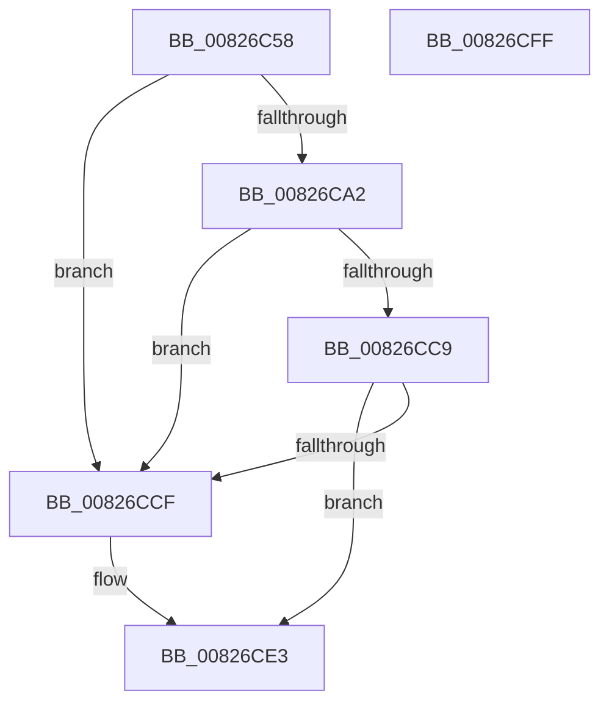

# BiExportStoreAlterationsToEfi

- RVA: `0x00826C58`–`0x00826D00` (길이 `168` bytes)
- VA: `0x0000000140826C58`
- 실행 섹션: `PAGE`
- PDB 이름 있음: `예`; PDB Function 태그: `아니요`
- unwind 정보 RVA: `0x0009A6A8`
- 디코드: `46`개 명령, `168/168` bytes 표시
- 미해석 바이트: `0` (있으면 어셈블리에 `.byte`로 보존)

> 이 문서는 커널 이미지의 기계어와 PDB 기호를 분석해 생성했습니다. 4번과 5번은 함수 원형과 자료형을 바이너리 사용 방식에서 추정한 C 해석이며 원본 소스 복구 결과는 아닙니다.

## 1. Dependencies

- 직접 호출 지점: **6**; 고유 호출 대상: **5**
- 직접 호출자로 확인된 함수: **1**
- RIP 상대 이미지 참조: **2**

### Outgoing calls
- `0x00826C76` → [BiLogMessage](../A3/BiLogMessage_function_00A3D3A8.md) (function, `0x00A3D3A8`)
- `0x00826C97` → [BiBuildIdentifierList](../A3/BiBuildIdentifierList_function_00A3E584.md) (function, `0x00A3E584`)
- `0x00826CAA` → [BiExportBcdObjects](BiExportBcdObjects_function_00826B30.md) (function, `0x00826B30`)
- `0x00826CBE` → [BiExportEfiBootManager](../AC/BiExportEfiBootManager_function_00ACB13C.md) (function, `0x00ACB13C`)
- `0x00826CDE` → [BiLogMessage](../A3/BiLogMessage_function_00A3D3A8.md) (function, `0x00A3D3A8`)
- `0x00826CE8` → [BiFreeIdentifierList](../A4/BiFreeIdentifierList_function_00A40FD8.md) (function, `0x00A40FD8`)

### Direct callers
- [BiExportStoreAlterationsToFirmware](BiExportStoreAlterationsToFirmware_function_00826038.md) at `0x00826061`

### Static image references
- `0x00826C6A` → RVA `0x00B0C390` (` ?? ::NNGAKEGL::`string'`; read)
- `0x00826CD2` → RVA `0x00B0C3E0` (` ?? ::NNGAKEGL::`string'`; read)

## 2. Other-region calls and transfers

- 다른 실행 섹션으로 향하는 call: **0**
- 별도 외부 분기/꼬리 이동을 확인하지 못했습니다.

## 3. Assembly (complete function range)

```asm
00826C58  48 89 5C 24 08                  mov qword ptr [rsp + 8], rbx
00826C5D  48 89 74 24 18                  mov qword ptr [rsp + 0x18], rsi
00826C62  57                              push rdi
00826C63  48 83 EC 30                     sub rsp, 0x30
00826C67  48 8B F1                        mov rsi, rcx
00826C6A  48 8D 15 1F 57 2E 00            lea rdx, [rip + 0x2e571f]
00826C71  B9 02 00 00 00                  mov ecx, 2
00826C76  E8 2D 67 21 00                  call 0x140a3d3a8
00826C7B  48 8D 4C 24 20                  lea rcx, [rsp + 0x20]
00826C80  48 89 4C 24 28                  mov qword ptr [rsp + 0x28], rcx
00826C85  48 8D 44 24 20                  lea rax, [rsp + 0x20]
00826C8A  48 8B CE                        mov rcx, rsi
00826C8D  48 89 44 24 20                  mov qword ptr [rsp + 0x20], rax
00826C92  4C 8D 44 24 20                  lea r8, [rsp + 0x20]
00826C97  E8 E8 78 21 00                  call 0x140a3e584
00826C9C  8B D8                           mov ebx, eax
00826C9E  85 C0                           test eax, eax
00826CA0  78 2D                           js 0x140826ccf
00826CA2  48 8D 54 24 20                  lea rdx, [rsp + 0x20]
00826CA7  48 8B CE                        mov rcx, rsi
00826CAA  E8 81 FE FF FF                  call 0x140826b30
00826CAF  85 C0                           test eax, eax
00826CB1  48 8D 54 24 20                  lea rdx, [rsp + 0x20]
00826CB6  48 8B CE                        mov rcx, rsi
00826CB9  0F 48 D8                        cmovs ebx, eax
00826CBC  8B FB                           mov edi, ebx
00826CBE  E8 79 44 2A 00                  call 0x140acb13c
00826CC3  8B D8                           mov ebx, eax
00826CC5  85 C0                           test eax, eax
00826CC7  78 06                           js 0x140826ccf
00826CC9  8B DF                           mov ebx, edi
00826CCB  85 FF                           test edi, edi
00826CCD  79 14                           jns 0x140826ce3
00826CCF  44 8B C3                        mov r8d, ebx
00826CD2  48 8D 15 07 57 2E 00            lea rdx, [rip + 0x2e5707]
00826CD9  B9 04 00 00 00                  mov ecx, 4
00826CDE  E8 C5 66 21 00                  call 0x140a3d3a8
00826CE3  48 8D 4C 24 20                  lea rcx, [rsp + 0x20]
00826CE8  E8 EB A2 21 00                  call 0x140a40fd8
00826CED  48 8B 74 24 50                  mov rsi, qword ptr [rsp + 0x50]
00826CF2  8B C3                           mov eax, ebx
00826CF4  48 8B 5C 24 40                  mov rbx, qword ptr [rsp + 0x40]
00826CF9  48 83 C4 30                     add rsp, 0x30
00826CFD  5F                              pop rdi
00826CFE  C3                              ret
00826CFF  CC                              int3
```

## 4. C-style interpretation (structured pseudocode)

```c
__int64 __fastcall BiExportStoreAlterationsToEfi(__int64 a1)
{
    __int64 result;
    __int64 v_rbx;
    __int64 v_rsp;
    unsigned __int64 v_stack_m10;
    unsigned __int64 v_stack_m18;
    unsigned __int64 v_stack_p18;
    unsigned __int64 v_stack_p8;

    v_stack_p8 = v_rbx;
    v_stack_p18 = v_rsi;
    v_rsp = (v_rsp) - (48);
    result = BiLogMessage(2, v_rip + 3036959, a3, a4);
    v_stack_m10 = v_stack_m18;
    v_stack_m18 = v_stack_m18;
    result = BiBuildIdentifierList(a1, v_rip + 3036959, v_stack_m18, a4);
    if (sign_flag) goto loc_00826CCF;
    result = BiExportBcdObjects(a1, v_stack_m18, v_stack_m18, a4);
    v_rbx = (unsigned int)((unsigned int)(result));
    if (sign_flag) { v_rbx = (unsigned int)(result); }
    result = BiExportEfiBootManager(a1, v_stack_m18, v_stack_m18, a4);
    if (sign_flag) goto loc_00826CCF;
    if (sign_flag) {
        a3 = (unsigned int)((unsigned int)((unsigned int)((unsigned int)((unsigned int)(v_rbx)))));
        a2 = v_rip + 3036935;
        a1 = 4;
        result = BiLogMessage(a1, a2, a3, a4);
    }
    result = BiFreeIdentifierList(v_stack_m18, a2, a3, a4);
    v_rsp = (v_rsp) + (48);
    return (unsigned int)((unsigned int)((unsigned int)((unsigned int)((unsigned int)((unsigned int)(v_rbx))))));
}
```

## 5. (Beta) C Style

```c
int64_t BiExportStoreAlterationsToEfi(int64_t Arg1)
{
    int64_t result;
    int64_t local_rbx;
    int64_t local_rsp;
    uint64_t v_stack_m10;
    uint64_t v_stack_m18;
    uint64_t v_stack_p18;
    uint64_t v_stack_p8;

    v_stack_p8 = local_rbx;
    v_stack_p18 = local_rsi;
    local_rsp = (local_rsp) - (48);
    result = BiLogMessage(2, v_rip + 3036959, a3, a4);
    v_stack_m10 = v_stack_m18;
    v_stack_m18 = v_stack_m18;
    result = BiBuildIdentifierList(Arg1, v_rip + 3036959, v_stack_m18, a4);
    if (sign_flag) goto loc_00826CCF;
    result = BiExportBcdObjects(Arg1, v_stack_m18, v_stack_m18, a4);
    local_rbx = (uint32_t)((uint32_t)(result));
    if (sign_flag) { local_rbx = (uint32_t)(result); }
    result = BiExportEfiBootManager(Arg1, v_stack_m18, v_stack_m18, a4);
    if (sign_flag) goto loc_00826CCF;
    if (sign_flag) {
        a3 = (uint32_t)((uint32_t)((uint32_t)((uint32_t)((uint32_t)(local_rbx)))));
        a2 = v_rip + 3036935;
        Arg1 = 4;
        result = BiLogMessage(Arg1, a2, a3, a4);
    }
    result = BiFreeIdentifierList(v_stack_m18, a2, a3, a4);
    local_rsp = (local_rsp) + (48);
    return (uint32_t)((uint32_t)((uint32_t)((uint32_t)((uint32_t)((uint32_t)(local_rbx))))));
}
```

## 6. Execution-region graph

[열기: 2D/3D 그래프와 함수 탐색 컨트롤 패널](../../../control-panel.html?section=page&rva=0x00826C58&view=graph)

- 2D 그래프는 위에서 아래로 흐르고, 3D 그래프는 빈 공간을 드래그해 회전합니다. Shift+드래그는 이동, 휠은 확대·축소, 함수 노드 선택은 대상 보고서 이동입니다.

### Static fallback


