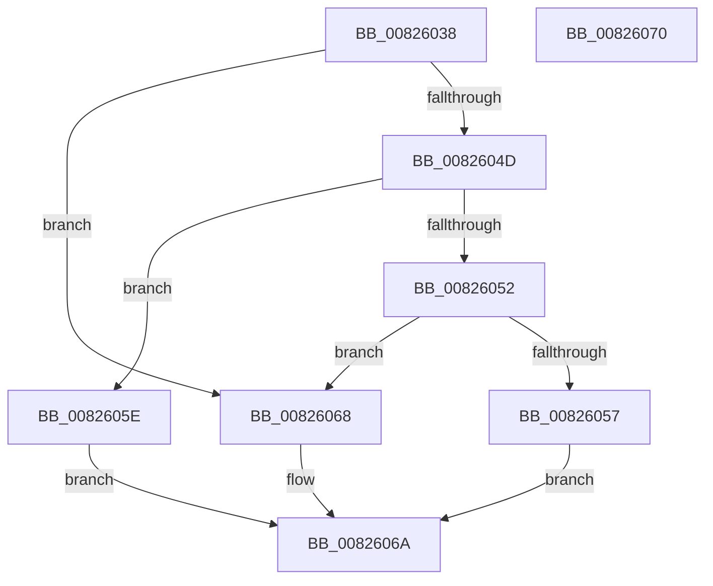

# BiExportStoreAlterationsToFirmware

- RVA: `0x00826038`–`0x00826071` (길이 `57` bytes)
- VA: `0x0000000140826038`
- 실행 섹션: `PAGE`
- PDB 이름 있음: `예`; PDB Function 태그: `아니요`
- unwind 정보 RVA: `0x0005CF00`
- 디코드: `21`개 명령, `57/57` bytes 표시
- 미해석 바이트: `0` (있으면 어셈블리에 `.byte`로 보존)

> 이 문서는 커널 이미지의 기계어와 PDB 기호를 분석해 생성했습니다. 4번과 5번은 함수 원형과 자료형을 바이너리 사용 방식에서 추정한 C 해석이며 원본 소스 복구 결과는 아닙니다.

## 1. Dependencies

- 직접 호출 지점: **2**; 고유 호출 대상: **2**
- 직접 호출자로 확인된 함수: **2**
- RIP 상대 이미지 참조: **0**

### Outgoing calls
- `0x00826043` → [BiGetFirmwareType](../A3/BiGetFirmwareType_function_00A3FA5C.md) (function, `0x00A3FA5C`)
- `0x00826061` → [BiExportStoreAlterationsToEfi](BiExportStoreAlterationsToEfi_function_00826C58.md) (function, `0x00826C58`)

### Direct callers
- [BcdForciblyUnloadStore](BcdForciblyUnloadStore_function_008232FC.md) at `0x00823366`
- [BiCloseStore](../A3/BiCloseStore_function_00A3C5D8.md) at `0x00A3C616`

### Static image references
- 디코드된 RIP-relative 메모리 참조가 없습니다.

## 2. Other-region calls and transfers

- 다른 실행 섹션으로 향하는 call: **0**
- 별도 외부 분기/꼬리 이동을 확인하지 못했습니다.

## 3. Assembly (complete function range)

```asm
00826038  40 53                           push rbx
0082603A  48 83 EC 20                     sub rsp, 0x20
0082603E  48 8B D9                        mov rbx, rcx
00826041  33 C9                           xor ecx, ecx
00826043  E8 14 9A 21 00                  call 0x140a3fa5c
00826048  83 E8 01                        sub eax, 1
0082604B  74 1B                           je 0x140826068
0082604D  83 E8 01                        sub eax, 1
00826050  74 0C                           je 0x14082605e
00826052  83 F8 01                        cmp eax, 1
00826055  74 11                           je 0x140826068
00826057  B8 BB 00 00 C0                  mov eax, 0xc00000bb
0082605C  EB 0C                           jmp 0x14082606a
0082605E  48 8B CB                        mov rcx, rbx
00826061  E8 F2 0B 00 00                  call 0x140826c58
00826066  EB 02                           jmp 0x14082606a
00826068  33 C0                           xor eax, eax
0082606A  48 83 C4 20                     add rsp, 0x20
0082606E  5B                              pop rbx
0082606F  C3                              ret
00826070  CC                              int3
```

## 4. C-style interpretation (structured pseudocode)

```c
__int64 __fastcall BiExportStoreAlterationsToFirmware(__int64 a1)
{
    __int64 result;
    __int64 v_rsp;

    v_rsp = (v_rsp) - (32);
    a1 = 0;
    result = BiGetFirmwareType(a1, a2, a3, a4);
    result = (unsigned int)((result) - (1));
    if (condition_is_equal) goto loc_00826068;
    result = (unsigned int)((result) - (1));
    if (condition_is_equal) goto loc_0082605E;
    if (((unsigned int)(result)) == 1) goto loc_00826068;
    goto loc_0082606A;
loc_0082605E:
    result = BiExportStoreAlterationsToEfi(0, a2, a3, a4);
    goto loc_0082606A;
loc_00826068:
    result = 0;
loc_0082606A:
    v_rsp = (v_rsp) + (32);
    return result;
}
```

## 5. (Beta) C Style

```c
int64_t BiExportStoreAlterationsToFirmware(int64_t Arg1)
{
    int64_t result;
    int64_t local_rsp;

    local_rsp = (local_rsp) - (32);
    Arg1 = 0;
    result = BiGetFirmwareType(Arg1, a2, a3, a4);
    result = (uint32_t)((result) - (1));
    if (condition_is_equal) goto loc_00826068;
    result = (uint32_t)((result) - (1));
    if (condition_is_equal) goto loc_0082605E;
    if (((uint32_t)(result)) == 1) goto loc_00826068;
    goto loc_0082606A;
loc_0082605E:
    result = BiExportStoreAlterationsToEfi(0, a2, a3, a4);
    goto loc_0082606A;
loc_00826068:
    result = 0;
loc_0082606A:
    local_rsp = (local_rsp) + (32);
    return result;
}
```

## 6. Execution-region graph

[열기: 2D/3D 그래프와 함수 탐색 컨트롤 패널](../../../control-panel.html?section=page&rva=0x00826038&view=graph)

- 2D 그래프는 위에서 아래로 흐르고, 3D 그래프는 빈 공간을 드래그해 회전합니다. Shift+드래그는 이동, 휠은 확대·축소, 함수 노드 선택은 대상 보고서 이동입니다.

### Static fallback


