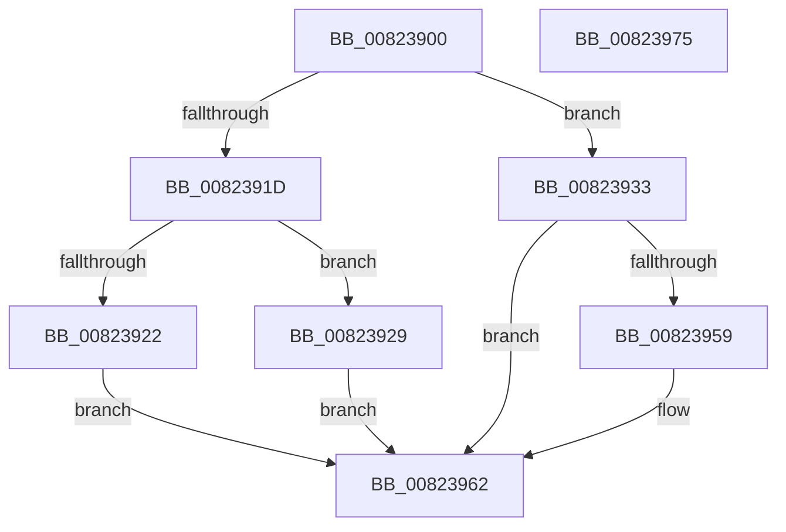

# BiGetAliasedIdentifier

- RVA: `0x00823900`–`0x00823976` (길이 `118` bytes)
- VA: `0x0000000140823900`
- 실행 섹션: `PAGE`
- PDB 이름 있음: `예`; PDB Function 태그: `아니요`
- unwind 정보 RVA: `0x000606C0`
- 디코드: `34`개 명령, `118/118` bytes 표시
- 미해석 바이트: `0` (있으면 어셈블리에 `.byte`로 보존)

> 이 문서는 커널 이미지의 기계어와 PDB 기호를 분석해 생성했습니다. 4번과 5번은 함수 원형과 자료형을 바이너리 사용 방식에서 추정한 C 해석이며 원본 소스 복구 결과는 아닙니다.

## 1. Dependencies

- 직접 호출 지점: **3**; 고유 호출 대상: **3**
- 직접 호출자로 확인된 함수: **1**
- RIP 상대 이미지 참조: **1**

### Outgoing calls
- `0x0082392C` → [BiGetDefaultBootEntryIdentifier](BiGetDefaultBootEntryIdentifier_function_0082397C.md) (function, `0x0082397C`)
- `0x00823950` → [ZwQuerySystemInformation](../../text/6A/ZwQuerySystemInformation_function_006AD790.md) (function, `0x006AD790`)
- `0x0082396A` → [_security_check_cookie](../../text/6A/_security_check_cookie_function_006AC640.md) (function, `0x006AC640`)

### Direct callers
- [BcdOpenObject](../91/BcdOpenObject_function_00916704.md) at `0x00916876`

### Static image references
- `0x00823906` → RVA `0x00E0A740` (`.data`; read)

## 2. Other-region calls and transfers

- 다른 실행 섹션으로 향하는 call: **2**
  - `0x00823950` → [ZwQuerySystemInformation](../../text/6A/ZwQuerySystemInformation_function_006AD790.md) (`PAGE` → `.text`)
  - `0x0082396A` → [_security_check_cookie](../../text/6A/_security_check_cookie_function_006AC640.md) (`PAGE` → `.text`)
- 별도 외부 분기/꼬리 이동을 확인하지 못했습니다.

## 3. Assembly (complete function range)

```asm
00823900  40 53                           push rbx
00823902  48 83 EC 50                     sub rsp, 0x50
00823906  48 8B 05 33 6E 5E 00            mov rax, qword ptr [rip + 0x5e6e33]
0082390D  48 33 C4                        xor rax, rsp
00823910  48 89 44 24 40                  mov qword ptr [rsp + 0x40], rax
00823915  49 8B D8                        mov rbx, r8
00823918  83 EA 01                        sub edx, 1
0082391B  74 16                           je 0x140823933
0082391D  83 FA 01                        cmp edx, 1
00823920  74 07                           je 0x140823929
00823922  B8 0D 00 00 C0                  mov eax, 0xc000000d
00823927  EB 39                           jmp 0x140823962
00823929  48 8B D3                        mov rdx, rbx
0082392C  E8 4B 00 00 00                  call 0x14082397c
00823931  EB 2F                           jmp 0x140823962
00823933  45 33 C9                        xor r9d, r9d
00823936  48 8D 54 24 20                  lea rdx, [rsp + 0x20]
0082393B  0F 57 C0                        xorps xmm0, xmm0
0082393E  0F 11 44 24 20                  movups xmmword ptr [rsp + 0x20], xmm0
00823943  45 8D 41 20                     lea r8d, [r9 + 0x20]
00823947  41 8D 49 5A                     lea ecx, [r9 + 0x5a]
0082394B  0F 11 44 24 30                  movups xmmword ptr [rsp + 0x30], xmm0
00823950  E8 3B 9E E8 FF                  call 0x1406ad790
00823955  85 C0                           test eax, eax
00823957  78 09                           js 0x140823962
00823959  0F 10 44 24 20                  movups xmm0, xmmword ptr [rsp + 0x20]
0082395E  F3 0F 7F 03                     movdqu xmmword ptr [rbx], xmm0
00823962  48 8B 4C 24 40                  mov rcx, qword ptr [rsp + 0x40]
00823967  48 33 CC                        xor rcx, rsp
0082396A  E8 D1 8C E8 FF                  call 0x1406ac640
0082396F  48 83 C4 50                     add rsp, 0x50
00823973  5B                              pop rbx
00823974  C3                              ret
00823975  CC                              int3
```

## 4. C-style interpretation (structured pseudocode)

```c
__int64 __fastcall BiGetAliasedIdentifier(__int64 a1, int a2, __int64 a3, int a4)
{
    __int64 result;
    __int64 v_rsp;
    unsigned __int64 v_stack_m18;
    unsigned __int64 v_stack_m28;
    unsigned __int64 v_stack_m38;

    v_rsp = (v_rsp) - (80);
    result = (*(unsigned __int64 *)(v_rip + 6188595)) ^ (v_rsp);
    v_stack_m18 = result;
    a2 = (unsigned int)((a2) - (1));
    if (condition_is_equal) goto loc_00823933;
    if (a2 == 1) goto loc_00823929;
    goto loc_00823962;
loc_00823929:
    result = BiGetDefaultBootEntryIdentifier(a1, a3, a3, a4);
    goto loc_00823962;
loc_00823933:
    a4 = 0;
    v_stack_m38 = v_xmm0;
    v_stack_m28 = v_xmm0;
    result = ZwQuerySystemInformation(a4 + 90, v_stack_m38, a4 + 32, a4);
    if (!(sign_flag)) {
        *(unsigned __int64 *)(a3) = v_xmm0;
    }
    a1 = (v_stack_m18) ^ (v_rsp);
    result = _security_check_cookie(a1, v_stack_m38, a4 + 32, a4);
    v_rsp = (v_rsp) + (80);
    return result;
}
```

## 5. (Beta) C Style

```c
int64_t BiGetAliasedIdentifier(int64_t Arg1, int32_t Arg2, void *Arg3, int32_t Arg4)
{
    uint8_t *arg3 = (uint8_t *)Arg3;

    int64_t result;
    int64_t local_rsp;
    uint64_t v_stack_m18;
    uint64_t v_stack_m28;
    uint64_t v_stack_m38;

    local_rsp = (local_rsp) - (80);
    result = (*(uint64_t *)(v_rip + 0x5E6E33)) ^ (local_rsp);
    v_stack_m18 = result;
    Arg2 = (uint32_t)((Arg2) - (1));
    if (condition_is_equal) goto loc_00823933;
    if (Arg2 == 1) goto loc_00823929;
    goto loc_00823962;
loc_00823929:
    result = BiGetDefaultBootEntryIdentifier(Arg1, Arg3, Arg3, Arg4);
    goto loc_00823962;
loc_00823933:
    Arg4 = 0;
    v_stack_m38 = v_xmm0;
    v_stack_m28 = v_xmm0;
    result = ZwQuerySystemInformation(Arg4 + 90, v_stack_m38, Arg4 + 32, Arg4);
    if (!(sign_flag)) {
        *(uint64_t *)(arg3) = v_xmm0;
    }
    Arg1 = (v_stack_m18) ^ (local_rsp);
    result = _security_check_cookie(Arg1, v_stack_m38, Arg4 + 32, Arg4);
    local_rsp = (local_rsp) + (80);
    return result;
}
```

### 관측된 메모리 오프셋

구조체 형식이 확인되지 않은 접근은 인자 기준의 오프셋으로만 기록했습니다.

| 기준 인자 | 오프셋 표현 | 폭 (bit) | 접근 |
|---|---:|---:|---|
| `Arg3` | `+ 0x0` | `128` | `W` |

## 6. Execution-region graph

[열기: 2D/3D 그래프와 함수 탐색 컨트롤 패널](../../../control-panel.html?section=page&rva=0x00823900&view=graph)

- 2D 그래프는 위에서 아래로 흐르고, 3D 그래프는 빈 공간을 드래그해 회전합니다. Shift+드래그는 이동, 휠은 확대·축소, 함수 노드 선택은 대상 보고서 이동입니다.

### Static fallback


