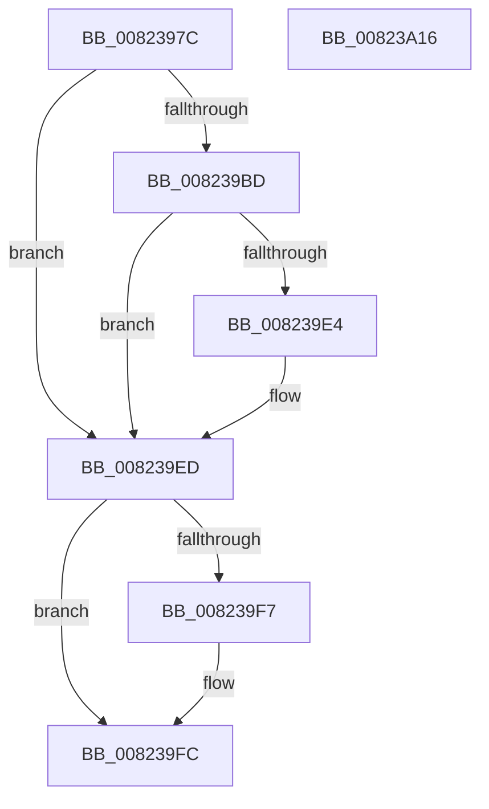

# BiGetDefaultBootEntryIdentifier

- RVA: `0x0082397C`–`0x00823A17` (길이 `155` bytes)
- VA: `0x000000014082397C`
- 실행 섹션: `PAGE`
- PDB 이름 있음: `예`; PDB Function 태그: `아니요`
- unwind 정보 RVA: `0x000BD4D8`
- 디코드: `40`개 명령, `155/155` bytes 표시
- 미해석 바이트: `0` (있으면 어셈블리에 `.byte`로 보존)

> 이 문서는 커널 이미지의 기계어와 PDB 기호를 분석해 생성했습니다. 4번과 5번은 함수 원형과 자료형을 바이너리 사용 방식에서 추정한 C 해석이며 원본 소스 복구 결과는 아닙니다.

## 1. Dependencies

- 직접 호출 지점: **4**; 고유 호출 대상: **4**
- 직접 호출자로 확인된 함수: **1**
- RIP 상대 이미지 참조: **2**

### Outgoing calls
- `0x008239B2` → [BcdOpenObject](../91/BcdOpenObject_function_00916704.md) (function, `0x00916704`)
- `0x008239D9` → [BcdGetElementData](../A3/BcdGetElementData_function_00A3E390.md) (function, `0x00A3E390`)
- `0x008239F7` → [BcdCloseObject](../A3/BcdCloseObject_function_00A3FB08.md) (function, `0x00A3FB08`)
- `0x00823A06` → [_security_check_cookie](../../text/6A/_security_check_cookie_function_006AC640.md) (function, `0x006AC640`)

### Direct callers
- [BiGetAliasedIdentifier](BiGetAliasedIdentifier_function_00823900.md) at `0x0082392C`

### Static image references
- `0x00823986` → RVA `0x00E0A740` (`.data`; read)
- `0x008239A6` → RVA `0x0001A4D0` (`.rdata`; read)

## 2. Other-region calls and transfers

- 다른 실행 섹션으로 향하는 call: **1**
  - `0x00823A06` → [_security_check_cookie](../../text/6A/_security_check_cookie_function_006AC640.md) (`PAGE` → `.text`)
- 별도 외부 분기/꼬리 이동을 확인하지 못했습니다.

## 3. Assembly (complete function range)

```asm
0082397C  48 89 5C 24 18                  mov qword ptr [rsp + 0x18], rbx
00823981  57                              push rdi
00823982  48 83 EC 50                     sub rsp, 0x50
00823986  48 8B 05 B3 6D 5E 00            mov rax, qword ptr [rip + 0x5e6db3]
0082398D  48 33 C4                        xor rax, rsp
00823990  48 89 44 24 40                  mov qword ptr [rsp + 0x40], rax
00823995  48 83 64 24 28 00               and qword ptr [rsp + 0x28], 0
0082399B  4C 8D 44 24 28                  lea r8, [rsp + 0x28]
008239A0  48 8B FA                        mov rdi, rdx
008239A3  0F 57 C0                        xorps xmm0, xmm0
008239A6  48 8D 15 23 6B 7F FF            lea rdx, [rip - 0x8094dd]
008239AD  0F 11 44 24 30                  movups xmmword ptr [rsp + 0x30], xmm0
008239B2  E8 4D 2D 0F 00                  call 0x140916704
008239B7  8B D8                           mov ebx, eax
008239B9  85 C0                           test eax, eax
008239BB  78 30                           js 0x1408239ed
008239BD  48 8B 4C 24 28                  mov rcx, qword ptr [rsp + 0x28]
008239C2  4C 8D 4C 24 20                  lea r9, [rsp + 0x20]
008239C7  4C 8D 44 24 30                  lea r8, [rsp + 0x30]
008239CC  C7 44 24 20 10 00 00 00         mov dword ptr [rsp + 0x20], 0x10
008239D4  BA 03 00 00 23                  mov edx, 0x23000003
008239D9  E8 B2 A9 21 00                  call 0x140a3e390
008239DE  8B D8                           mov ebx, eax
008239E0  85 C0                           test eax, eax
008239E2  78 09                           js 0x1408239ed
008239E4  0F 10 44 24 30                  movups xmm0, xmmword ptr [rsp + 0x30]
008239E9  F3 0F 7F 07                     movdqu xmmword ptr [rdi], xmm0
008239ED  48 8B 4C 24 28                  mov rcx, qword ptr [rsp + 0x28]
008239F2  48 85 C9                        test rcx, rcx
008239F5  74 05                           je 0x1408239fc
008239F7  E8 0C C1 21 00                  call 0x140a3fb08
008239FC  8B C3                           mov eax, ebx
008239FE  48 8B 4C 24 40                  mov rcx, qword ptr [rsp + 0x40]
00823A03  48 33 CC                        xor rcx, rsp
00823A06  E8 35 8C E8 FF                  call 0x1406ac640
00823A0B  48 8B 5C 24 70                  mov rbx, qword ptr [rsp + 0x70]
00823A10  48 83 C4 50                     add rsp, 0x50
00823A14  5F                              pop rdi
00823A15  C3                              ret
00823A16  CC                              int3
```

## 4. C-style interpretation (structured pseudocode)

```c
__int64 __fastcall BiGetDefaultBootEntryIdentifier(__int64 a1, __int64 a2)
{
    __int64 result;
    __int64 v_rsp;
    unsigned __int64 v_stack_m18;
    unsigned __int64 v_stack_m28;
    unsigned __int64 v_stack_m30;
    unsigned __int64 v_stack_m38;
    unsigned __int64 v_stack_p18;

    v_stack_p18 = v_rbx;
    v_rsp = (v_rsp) - (80);
    result = (*(unsigned __int64 *)(v_rip + 6188467)) ^ (v_rsp);
    v_stack_m18 = result;
    v_stack_m28 = v_xmm0;
    result = BcdOpenObject(a1, v_rip - 8426717, v_stack_m30, a4);
    if (sign_flag) goto loc_008239ED;
    v_stack_m38 = 16;
    result = BcdGetElementData(v_stack_m30, (unsigned int)(0x23000003ULL), v_stack_m28, v_stack_m38);
    if (!(sign_flag)) {
        *(unsigned __int64 *)(a2) = v_xmm0;
    }
    if (v_stack_m30 != 0) {
        result = BcdCloseObject(v_stack_m30, (unsigned int)(0x23000003ULL), v_stack_m28, v_stack_m38);
    }
    a1 = (v_stack_m18) ^ (v_rsp);
    result = _security_check_cookie(a1, (unsigned int)(0x23000003ULL), v_stack_m28, v_stack_m38);
    v_rsp = (v_rsp) + (80);
    return result;
}
```

## 5. (Beta) C Style

```c
int64_t BiGetDefaultBootEntryIdentifier(int64_t Arg1, void *Arg2)
{
    uint8_t *arg2 = (uint8_t *)Arg2;

    int64_t result;
    int64_t local_rsp;
    uint64_t v_stack_m18;
    uint64_t v_stack_m28;
    uint64_t v_stack_m30;
    uint64_t v_stack_m38;
    uint64_t v_stack_p18;

    v_stack_p18 = local_rbx;
    local_rsp = (local_rsp) - (80);
    result = (*(uint64_t *)(v_rip + 0x5E6DB3)) ^ (local_rsp);
    v_stack_m18 = result;
    v_stack_m28 = v_xmm0;
    result = BcdOpenObject(Arg1, v_rip - 8426717, v_stack_m30, a4);
    if (sign_flag) goto loc_008239ED;
    v_stack_m38 = 16;
    result = BcdGetElementData(v_stack_m30, (uint32_t)(0x23000003ULL), v_stack_m28, v_stack_m38);
    if (!(sign_flag)) {
        *(uint64_t *)(arg2) = v_xmm0;
    }
    if (v_stack_m30 != 0) {
        result = BcdCloseObject(v_stack_m30, (uint32_t)(0x23000003ULL), v_stack_m28, v_stack_m38);
    }
    Arg1 = (v_stack_m18) ^ (local_rsp);
    result = _security_check_cookie(Arg1, (uint32_t)(0x23000003ULL), v_stack_m28, v_stack_m38);
    local_rsp = (local_rsp) + (80);
    return result;
}
```

### 관측된 메모리 오프셋

구조체 형식이 확인되지 않은 접근은 인자 기준의 오프셋으로만 기록했습니다.

| 기준 인자 | 오프셋 표현 | 폭 (bit) | 접근 |
|---|---:|---:|---|
| `Arg2` | `+ 0x0` | `128` | `W` |

## 6. Execution-region graph

[열기: 2D/3D 그래프와 함수 탐색 컨트롤 패널](../../../control-panel.html?section=page&rva=0x0082397C&view=graph)

- 2D 그래프는 위에서 아래로 흐르고, 3D 그래프는 빈 공간을 드래그해 회전합니다. Shift+드래그는 이동, 휠은 확대·축소, 함수 노드 선택은 대상 보고서 이동입니다.

### Static fallback


