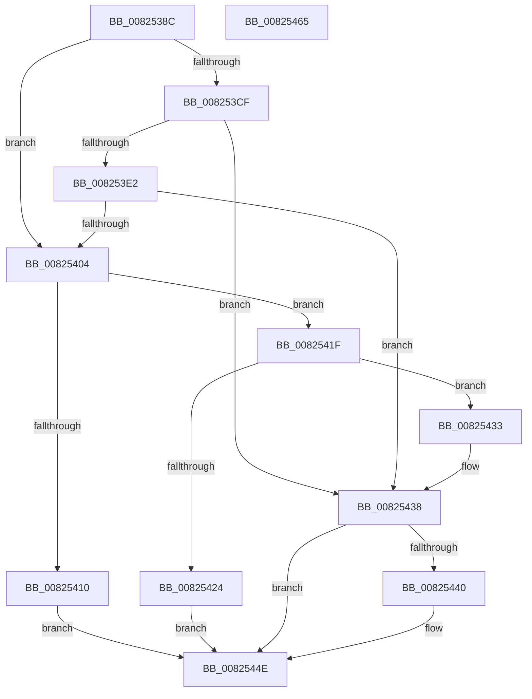

# BiGetDriveLayoutBlock

- RVA: `0x0082538C`–`0x00825466` (길이 `218` bytes)
- VA: `0x000000014082538C`
- 실행 섹션: `PAGE`
- PDB 이름 있음: `예`; PDB Function 태그: `아니요`
- unwind 정보 RVA: `0x000B6A1C`
- 디코드: `65`개 명령, `218/218` bytes 표시
- 미해석 바이트: `0` (있으면 어셈블리에 `.byte`로 보존)

> 이 문서는 커널 이미지의 기계어와 PDB 기호를 분석해 생성했습니다. 4번과 5번은 함수 원형과 자료형을 바이너리 사용 방식에서 추정한 C 해석이며 원본 소스 복구 결과는 아닙니다.

## 1. Dependencies

- 직접 호출 지점: **5**; 고유 호출 대상: **3**
- 직접 호출자로 확인된 함수: **1**
- RIP 상대 이미지 참조: **0**

### Outgoing calls
- `0x008253C4` → [BiGetDriveLayoutInformation](../AA/BiGetDriveLayoutInformation_function_00AA1174.md) (function, `0x00AA1174`)
- `0x008253D7` → [BiGetPhysicalDriveName](../AC/BiGetPhysicalDriveName_function_00ACD5BC.md) (function, `0x00ACD5BC`)
- `0x008253EA` → [BiGetDriveLayoutInformation](../AA/BiGetDriveLayoutInformation_function_00AA1174.md) (function, `0x00AA1174`)
- `0x008253FB` → [ExFreePoolWithTag](../../poolcode/B8/ExFreePoolWithTag_function_00B82870.md) (function, `0x00B82870`)
- `0x00825445` → [ExFreePoolWithTag](../../poolcode/B8/ExFreePoolWithTag_function_00B82870.md) (function, `0x00B82870`)

### Direct callers
- [BiGetNtPartitionPath](BiGetNtPartitionPath_function_0082546C.md) at `0x008256BD`

### Static image references
- 디코드된 RIP-relative 메모리 참조가 없습니다.

## 2. Other-region calls and transfers

- 다른 실행 섹션으로 향하는 call: **2**
  - `0x008253FB` → [ExFreePoolWithTag](../../poolcode/B8/ExFreePoolWithTag_function_00B82870.md) (`PAGE` → `POOLCODE`)
  - `0x00825445` → [ExFreePoolWithTag](../../poolcode/B8/ExFreePoolWithTag_function_00B82870.md) (`PAGE` → `POOLCODE`)
- 별도 외부 분기/꼬리 이동을 확인하지 못했습니다.

## 3. Assembly (complete function range)

```asm
0082538C  48 8B C4                        mov rax, rsp
0082538F  48 89 58 08                     mov qword ptr [rax + 8], rbx
00825393  48 89 68 18                     mov qword ptr [rax + 0x18], rbp
00825397  48 89 70 20                     mov qword ptr [rax + 0x20], rsi
0082539B  57                              push rdi
0082539C  48 83 EC 20                     sub rsp, 0x20
008253A0  48 83 60 10 00                  and qword ptr [rax + 0x10], 0
008253A5  0F 57 C0                        xorps xmm0, xmm0
008253A8  48 83 22 00                     and qword ptr [rdx], 0
008253AC  33 C0                           xor eax, eax
008253AE  41 0F 11 00                     movups xmmword ptr [r8], xmm0
008253B2  49 8B D8                        mov rbx, r8
008253B5  48 8B F2                        mov rsi, rdx
008253B8  41 0F 11 40 10                  movups xmmword ptr [r8 + 0x10], xmm0
008253BD  49 89 40 20                     mov qword ptr [r8 + 0x20], rax
008253C1  48 8B E9                        mov rbp, rcx
008253C4  E8 AB BD 27 00                  call 0x140aa1174
008253C9  8B F8                           mov edi, eax
008253CB  85 C0                           test eax, eax
008253CD  79 35                           jns 0x140825404
008253CF  48 8D 54 24 38                  lea rdx, [rsp + 0x38]
008253D4  48 8B CD                        mov rcx, rbp
008253D7  E8 E0 81 2A 00                  call 0x140acd5bc
008253DC  8B F8                           mov edi, eax
008253DE  85 C0                           test eax, eax
008253E0  78 56                           js 0x140825438
008253E2  48 8B 4C 24 38                  mov rcx, qword ptr [rsp + 0x38]
008253E7  48 8B D6                        mov rdx, rsi
008253EA  E8 85 BD 27 00                  call 0x140aa1174
008253EF  48 8B 4C 24 38                  mov rcx, qword ptr [rsp + 0x38]
008253F4  BA 42 43 44 4B                  mov edx, 0x4b444342
008253F9  8B F8                           mov edi, eax
008253FB  E8 70 D4 35 00                  call 0x140b82870
00825400  85 FF                           test edi, edi
00825402  78 34                           js 0x140825438
00825404  83 23 00                        and dword ptr [rbx], 0
00825407  48 8B 06                        mov rax, qword ptr [rsi]
0082540A  8B 08                           mov ecx, dword ptr [rax]
0082540C  85 C9                           test ecx, ecx
0082540E  75 0F                           jne 0x14082541f
00825410  C7 43 04 01 00 00 00            mov dword ptr [rbx + 4], 1
00825417  8B 40 08                        mov eax, dword ptr [rax + 8]
0082541A  89 43 08                        mov dword ptr [rbx + 8], eax
0082541D  EB 2F                           jmp 0x14082544e
0082541F  83 F9 01                        cmp ecx, 1
00825422  75 0F                           jne 0x140825433
00825424  83 63 04 00                     and dword ptr [rbx + 4], 0
00825428  0F 10 40 08                     movups xmm0, xmmword ptr [rax + 8]
0082542C  F3 0F 7F 43 08                  movdqu xmmword ptr [rbx + 8], xmm0
00825431  EB 1B                           jmp 0x14082544e
00825433  BF 0D 00 00 C0                  mov edi, 0xc000000d
00825438  48 8B 0E                        mov rcx, qword ptr [rsi]
0082543B  48 85 C9                        test rcx, rcx
0082543E  74 0E                           je 0x14082544e
00825440  BA 42 43 44 4B                  mov edx, 0x4b444342
00825445  E8 26 D4 35 00                  call 0x140b82870
0082544A  48 83 26 00                     and qword ptr [rsi], 0
0082544E  48 8B 5C 24 30                  mov rbx, qword ptr [rsp + 0x30]
00825453  8B C7                           mov eax, edi
00825455  48 8B 6C 24 40                  mov rbp, qword ptr [rsp + 0x40]
0082545A  48 8B 74 24 48                  mov rsi, qword ptr [rsp + 0x48]
0082545F  48 83 C4 20                     add rsp, 0x20
00825463  5F                              pop rdi
00825464  C3                              ret
00825465  CC                              int3
```

## 4. C-style interpretation (structured pseudocode)

```c
__int64 __fastcall BiGetDriveLayoutBlock(__int64 a1, __int64 a2, __int64 a3)
{
    __int64 result;
    __int64 v_rsp;
    unsigned __int64 v_stack_p10;
    unsigned __int64 v_stack_p18;
    unsigned __int64 v_stack_p20;
    unsigned __int64 v_stack_p8;

    *(unsigned __int64 *)(v_rsp + 8) = v_rbx;
    *(unsigned __int64 *)(v_rsp + 24) = v_rbp;
    *(unsigned __int64 *)(v_rsp + 32) = v_rsi;
    v_rsp = (v_rsp) - (32);
    result = 0;
    *(unsigned __int64 *)(a3) = v_xmm0;
    *(unsigned __int64 *)(a3 + 16) = v_xmm0;
    *(unsigned __int64 *)(a3 + 32) = 0;
    result = BiGetDriveLayoutInformation(a1, a2, a3, a4);
    if (!sign_flag) goto loc_00825404;
    result = BiGetPhysicalDriveName(a1, v_stack_p10, a3, a4);
    if (sign_flag) goto loc_00825438;
    result = BiGetDriveLayoutInformation(v_stack_p10, a2, a3, a4);
    result = ExFreePoolWithTag(v_stack_p10, (unsigned int)(0x4B444342ULL), a3, a4);
    if (sign_flag) goto loc_00825438;
loc_00825404:
    if ((unsigned int)((unsigned int)(*(unsigned int *)(*(unsigned __int64 *)(a2)))) != 0) goto loc_0082541F;
    *(unsigned int *)(a3 + 4) = 1;
    *(unsigned int *)(a3 + 8) = (unsigned int)((unsigned int)(*(unsigned int *)(*(unsigned __int64 *)(a2) + 8)));
    goto loc_0082544E;
loc_0082541F:
    if (((unsigned int)((unsigned int)(*(unsigned int *)(*(unsigned __int64 *)(a2))))) != 1) goto loc_00825433;
    *(unsigned __int64 *)(a3 + 8) = v_xmm0;
    goto loc_0082544E;
loc_00825433:
loc_00825438:
    result = (unsigned int)(*(unsigned int *)(*(unsigned __int64 *)(a2) + 8));
    if (*(unsigned __int64 *)(a2) != 0) {
        a2 = 0x4B444342ULL;
        result = ExFreePoolWithTag(*(unsigned __int64 *)(a2), a2, a3, a4);
    }
    v_rsp = (v_rsp) + (32);
    return (unsigned int)((unsigned int)((unsigned int)(0xC000000DULL)));
}
```

## 5. (Beta) C Style

```c
int64_t BiGetDriveLayoutBlock(int64_t Arg1, void *Arg2, void *Arg3)
{
    uint8_t *arg2 = (uint8_t *)Arg2;
    uint8_t *arg3 = (uint8_t *)Arg3;

    int64_t result;
    int64_t local_rsp;
    uint64_t v_stack_p10;
    uint64_t v_stack_p18;
    uint64_t v_stack_p20;
    uint64_t v_stack_p8;

    *(uint64_t *)(local_rsp + 0x8) = local_rbx;
    *(uint64_t *)(local_rsp + 0x18) = local_rbp;
    *(uint64_t *)(local_rsp + 0x20) = local_rsi;
    local_rsp = (local_rsp) - (32);
    result = 0;
    *(uint64_t *)(arg3) = v_xmm0;
    *(uint64_t *)(arg3 + 0x10) = v_xmm0;
    *(uint64_t *)(arg3 + 0x20) = 0;
    result = BiGetDriveLayoutInformation(Arg1, Arg2, Arg3, a4);
    if (!sign_flag) goto loc_00825404;
    result = BiGetPhysicalDriveName(Arg1, v_stack_p10, Arg3, a4);
    if (sign_flag) goto loc_00825438;
    result = BiGetDriveLayoutInformation(v_stack_p10, Arg2, Arg3, a4);
    result = ExFreePoolWithTag(v_stack_p10, (uint32_t)(0x4B444342ULL), Arg3, a4);
    if (sign_flag) goto loc_00825438;
loc_00825404:
    if ((uint32_t)((uint32_t)(*(uint32_t *)(*(uint64_t *)(arg2)))) != 0) goto loc_0082541F;
    *(uint32_t *)(arg3 + 0x4) = 1;
    *(uint32_t *)(arg3 + 0x8) = (uint32_t)((uint32_t)(*(uint32_t *)(*(uint64_t *)(arg2) + 0x8)));
    goto loc_0082544E;
loc_0082541F:
    if (((uint32_t)((uint32_t)(*(uint32_t *)(*(uint64_t *)(arg2))))) != 1) goto loc_00825433;
    *(uint64_t *)(arg3 + 0x8) = v_xmm0;
    goto loc_0082544E;
loc_00825433:
loc_00825438:
    result = (uint32_t)(*(uint32_t *)(*(uint64_t *)(arg2) + 0x8));
    if (*(uint64_t *)(arg2) != 0) {
        Arg2 = 0x4B444342ULL;
        result = ExFreePoolWithTag(*(uint64_t *)(arg2), Arg2, Arg3, a4);
    }
    local_rsp = (local_rsp) + (32);
    return (uint32_t)((uint32_t)((uint32_t)(0xC000000DULL)));
}
```

### 관측된 메모리 오프셋

구조체 형식이 확인되지 않은 접근은 인자 기준의 오프셋으로만 기록했습니다.

| 기준 인자 | 오프셋 표현 | 폭 (bit) | 접근 |
|---|---:|---:|---|
| `Arg2` | `+ 0x0` | `64` | `R` |
| `Arg2` | `+ 0x0` | `64` | `R/W` |
| `Arg3` | `+ 0x0` | `32` | `R/W` |
| `Arg3` | `+ 0x0` | `128` | `R` |
| `Arg3` | `+ 0x4` | `32` | `R/W` |
| `Arg3` | `+ 0x4` | `32` | `W` |
| `Arg3` | `+ 0x8` | `32` | `W` |
| `Arg3` | `+ 0x8` | `128` | `W` |
| `Arg3` | `+ 0x10` | `128` | `R` |
| `Arg3` | `+ 0x20` | `64` | `W` |

## 6. Execution-region graph

[열기: 2D/3D 그래프와 함수 탐색 컨트롤 패널](../../../control-panel.html?section=page&rva=0x0082538C&view=graph)

- 2D 그래프는 위에서 아래로 흐르고, 3D 그래프는 빈 공간을 드래그해 회전합니다. Shift+드래그는 이동, 휠은 확대·축소, 함수 노드 선택은 대상 보고서 이동입니다.

### Static fallback


