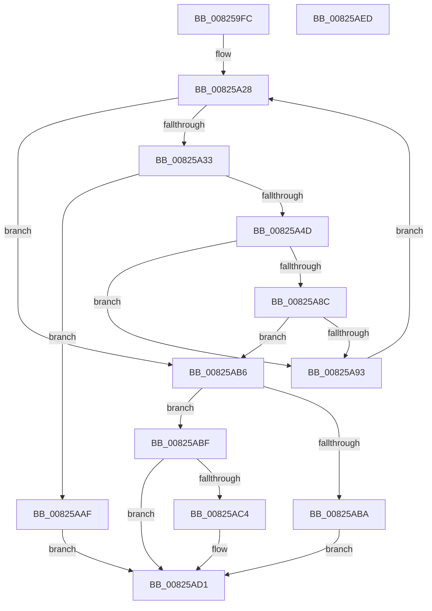

# BiGetVolumeDiskExtentsInformation

- RVA: `0x008259FC`–`0x00825AEE` (길이 `242` bytes)
- VA: `0x00000001408259FC`
- 실행 섹션: `PAGE`
- PDB 이름 있음: `예`; PDB Function 태그: `아니요`
- unwind 정보 RVA: `0x0008CA40`
- 디코드: `72`개 명령, `242/242` bytes 표시
- 미해석 바이트: `0` (있으면 어셈블리에 `.byte`로 보존)

> 이 문서는 커널 이미지의 기계어와 PDB 기호를 분석해 생성했습니다. 4번과 5번은 함수 원형과 자료형을 바이너리 사용 방식에서 추정한 C 해석이며 원본 소스 복구 결과는 아닙니다.

## 1. Dependencies

- 직접 호출 지점: **4**; 고유 호출 대상: **3**
- 직접 호출자로 확인된 함수: **1**
- RIP 상대 이미지 참조: **0**

### Outgoing calls
- `0x00825A40` → [ExAllocatePool2](../../poolcode/B8/ExAllocatePool2_function_00B820F0.md) (function, `0x00B820F0`)
- `0x00825A7E` → [ZwDeviceIoControlFile](../../text/6A/ZwDeviceIoControlFile_function_006AD1B0.md) (function, `0x006AD1B0`)
- `0x00825AA3` → [ExFreePoolWithTag](../../poolcode/B8/ExFreePoolWithTag_function_00B82870.md) (function, `0x00B82870`)
- `0x00825ACC` → [ExFreePoolWithTag](../../poolcode/B8/ExFreePoolWithTag_function_00B82870.md) (function, `0x00B82870`)

### Direct callers
- [BiGetPhysicalDriveName](../AC/BiGetPhysicalDriveName_function_00ACD5BC.md) at `0x00ACD65C`

### Static image references
- 디코드된 RIP-relative 메모리 참조가 없습니다.

## 2. Other-region calls and transfers

- 다른 실행 섹션으로 향하는 call: **4**
  - `0x00825A40` → [ExAllocatePool2](../../poolcode/B8/ExAllocatePool2_function_00B820F0.md) (`PAGE` → `POOLCODE`)
  - `0x00825A7E` → [ZwDeviceIoControlFile](../../text/6A/ZwDeviceIoControlFile_function_006AD1B0.md) (`PAGE` → `.text`)
  - `0x00825AA3` → [ExFreePoolWithTag](../../poolcode/B8/ExFreePoolWithTag_function_00B82870.md) (`PAGE` → `POOLCODE`)
  - `0x00825ACC` → [ExFreePoolWithTag](../../poolcode/B8/ExFreePoolWithTag_function_00B82870.md) (`PAGE` → `POOLCODE`)
- 별도 외부 분기/꼬리 이동을 확인하지 못했습니다.

## 3. Assembly (complete function range)

```asm
008259FC  48 8B C4                        mov rax, rsp
008259FF  48 89 58 08                     mov qword ptr [rax + 8], rbx
00825A03  48 89 68 10                     mov qword ptr [rax + 0x10], rbp
00825A07  48 89 70 18                     mov qword ptr [rax + 0x18], rsi
00825A0B  57                              push rdi
00825A0C  41 56                           push r14
00825A0E  41 57                           push r15
00825A10  48 83 EC 60                     sub rsp, 0x60
00825A14  33 DB                           xor ebx, ebx
00825A16  0F 57 C0                        xorps xmm0, xmm0
00825A19  4C 8B F2                        mov r14, rdx
00825A1C  4C 8B F9                        mov r15, rcx
00825A1F  0F 11 40 D8                     movups xmmword ptr [rax - 0x28], xmm0
00825A23  33 ED                           xor ebp, ebp
00825A25  8D 73 20                        lea esi, [rbx + 0x20]
00825A28  33 FF                           xor edi, edi
00825A2A  83 FD 02                        cmp ebp, 2
00825A2D  0F 83 83 00 00 00               jae 0x140825ab6
00825A33  8B D6                           mov edx, esi
00825A35  B9 02 01 00 00                  mov ecx, 0x102
00825A3A  41 B8 42 43 44 4B               mov r8d, 0x4b444342
00825A40  E8 AB C6 35 00                  call 0x140b820f0
00825A45  48 8B F8                        mov rdi, rax
00825A48  48 85 C0                        test rax, rax
00825A4B  74 62                           je 0x140825aaf
00825A4D  89 74 24 48                     mov dword ptr [rsp + 0x48], esi
00825A51  45 33 C9                        xor r9d, r9d
00825A54  48 89 44 24 40                  mov qword ptr [rsp + 0x40], rax
00825A59  45 33 C0                        xor r8d, r8d
00825A5C  83 64 24 38 00                  and dword ptr [rsp + 0x38], 0
00825A61  48 8D 44 24 50                  lea rax, [rsp + 0x50]
00825A66  48 83 64 24 30 00               and qword ptr [rsp + 0x30], 0
00825A6C  33 D2                           xor edx, edx
00825A6E  C7 44 24 28 00 00 56 00         mov dword ptr [rsp + 0x28], 0x560000
00825A76  49 8B CF                        mov rcx, r15
00825A79  48 89 44 24 20                  mov qword ptr [rsp + 0x20], rax
00825A7E  E8 2D 77 E8 FF                  call 0x1406ad1b0
00825A83  8B D8                           mov ebx, eax
00825A85  3D 23 00 00 C0                  cmp eax, 0xc0000023
00825A8A  74 07                           je 0x140825a93
00825A8C  3D 05 00 00 80                  cmp eax, 0x80000005
00825A91  75 23                           jne 0x140825ab6
00825A93  8B 0F                           mov ecx, dword ptr [rdi]
00825A95  8D 14 49                        lea edx, [rcx + rcx*2]
00825A98  48 8B CF                        mov rcx, rdi
00825A9B  8D 34 D6                        lea esi, [rsi + rdx*8]
00825A9E  BA 42 43 44 4B                  mov edx, 0x4b444342
00825AA3  E8 C8 CD 35 00                  call 0x140b82870
00825AA8  FF C5                           inc ebp
00825AAA  E9 79 FF FF FF                  jmp 0x140825a28
00825AAF  BB 9A 00 00 C0                  mov ebx, 0xc000009a
00825AB4  EB 1B                           jmp 0x140825ad1
00825AB6  85 DB                           test ebx, ebx
00825AB8  78 05                           js 0x140825abf
00825ABA  49 89 3E                        mov qword ptr [r14], rdi
00825ABD  EB 12                           jmp 0x140825ad1
00825ABF  48 85 FF                        test rdi, rdi
00825AC2  74 0D                           je 0x140825ad1
00825AC4  BA 42 43 44 4B                  mov edx, 0x4b444342
00825AC9  48 8B CF                        mov rcx, rdi
00825ACC  E8 9F CD 35 00                  call 0x140b82870
00825AD1  4C 8D 5C 24 60                  lea r11, [rsp + 0x60]
00825AD6  8B C3                           mov eax, ebx
00825AD8  49 8B 5B 20                     mov rbx, qword ptr [r11 + 0x20]
00825ADC  49 8B 6B 28                     mov rbp, qword ptr [r11 + 0x28]
00825AE0  49 8B 73 30                     mov rsi, qword ptr [r11 + 0x30]
00825AE4  49 8B E3                        mov rsp, r11
00825AE7  41 5F                           pop r15
00825AE9  41 5E                           pop r14
00825AEB  5F                              pop rdi
00825AEC  C3                              ret
00825AED  CC                              int3
```

## 4. C-style interpretation (structured pseudocode)

```c
__int64 __fastcall BiGetVolumeDiskExtentsInformation(__int64 a1, __int64 a2, __int64 a3, int a4)
{
    __int64 result;
    __int64 v_rbp;
    __int64 v_rbx;
    __int64 v_rdi;
    __int64 v_rsp;
    unsigned __int64 v_stack_m18;
    unsigned __int64 v_stack_m28;
    unsigned int v_stack_m30;
    unsigned __int64 v_stack_m38;
    unsigned int v_stack_m40;
    unsigned __int64 v_stack_m48;
    unsigned int v_stack_m50;
    unsigned __int64 v_stack_m58;

    *(unsigned __int64 *)(v_rsp + 8) = v_rbx;
    *(unsigned __int64 *)(v_rsp + 16) = v_rbp;
    *(unsigned __int64 *)(v_rsp + 24) = v_rsi;
    v_rsp = (v_rsp) - (96);
    v_rbx = 0;
    *(unsigned __int64 *)(v_rsp - 40) = v_xmm0;
    v_rbp = 0;
loc_00825A28:
    v_rdi = 0;
    if (0 >= 2) goto loc_00825AB6;
    result = ExAllocatePool2(258, (unsigned int)((unsigned int)(v_rbx + 32)), (unsigned int)(0x4B444342ULL), a4);
    if (result == 0) goto loc_00825AAF;
    v_stack_m30 = (unsigned int)(v_rbx + 32);
    a4 = 0;
    v_stack_m38 = result;
    a3 = 0;
    a2 = 0;
    v_stack_m50 = 0x560000ULL;
    v_stack_m58 = v_stack_m28;
    result = ZwDeviceIoControlFile(a1, a2, a3, a4);
    if (((unsigned int)(result)) == 0xC0000023ULL) goto loc_00825A93;
    if (((unsigned int)(result)) != 0x80000005ULL) goto loc_00825AB6;
loc_00825A93:
    result = ExFreePoolWithTag(result, (unsigned int)(0x4B444342ULL), a3, a4);
    v_rbp = (unsigned int)((v_rbp) + 1);
    goto loc_00825A28;
loc_00825AAF:
    goto loc_00825AD1;
loc_00825AB6:
    if (sign_flag) goto loc_00825ABF;
    *(unsigned __int64 *)(a2) = result;
    goto loc_00825AD1;
loc_00825ABF:
    if (result != 0) {
        a2 = 0x4B444342ULL;
        a1 = result;
        result = ExFreePoolWithTag(a1, a2, a3, a4);
    }
    return (unsigned int)((unsigned int)((unsigned int)(0xC000009AULL)));
}
```

## 5. (Beta) C Style

```c
int64_t BiGetVolumeDiskExtentsInformation(int64_t Arg1, void *Arg2, int64_t Arg3, int32_t Arg4)
{
    uint8_t *arg2 = (uint8_t *)Arg2;

    int64_t result;
    int64_t local_rbp;
    int64_t local_rbx;
    int64_t local_rdi;
    int64_t local_rsp;
    uint64_t v_stack_m18;
    uint64_t v_stack_m28;
    uint32_t v_stack_m30;
    uint64_t v_stack_m38;
    uint32_t v_stack_m40;
    uint64_t v_stack_m48;
    uint32_t v_stack_m50;
    uint64_t v_stack_m58;

    *(uint64_t *)(local_rsp + 0x8) = local_rbx;
    *(uint64_t *)(local_rsp + 0x10) = local_rbp;
    *(uint64_t *)(local_rsp + 0x18) = local_rsi;
    local_rsp = (local_rsp) - (96);
    local_rbx = 0;
    *(uint64_t *)(local_rsp - 0x28) = v_xmm0;
    local_rbp = 0;
loc_00825A28:
    local_rdi = 0;
    if (0 >= 2) goto loc_00825AB6;
    result = ExAllocatePool2(258, (uint32_t)((uint32_t)(local_rbx + 32)), (uint32_t)(0x4B444342ULL), Arg4);
    if (result == 0) goto loc_00825AAF;
    v_stack_m30 = (uint32_t)(local_rbx + 32);
    Arg4 = 0;
    v_stack_m38 = result;
    Arg3 = 0;
    Arg2 = 0;
    v_stack_m50 = 0x560000ULL;
    v_stack_m58 = v_stack_m28;
    result = ZwDeviceIoControlFile(Arg1, Arg2, Arg3, Arg4);
    if (((uint32_t)(result)) == 0xC0000023ULL) goto loc_00825A93;
    if (((uint32_t)(result)) != 0x80000005ULL) goto loc_00825AB6;
loc_00825A93:
    result = ExFreePoolWithTag(result, (uint32_t)(0x4B444342ULL), Arg3, Arg4);
    local_rbp = (uint32_t)((local_rbp) + 1);
    goto loc_00825A28;
loc_00825AAF:
    goto loc_00825AD1;
loc_00825AB6:
    if (sign_flag) goto loc_00825ABF;
    *(uint64_t *)(arg2) = result;
    goto loc_00825AD1;
loc_00825ABF:
    if (result != 0) {
        Arg2 = 0x4B444342ULL;
        Arg1 = result;
        result = ExFreePoolWithTag(Arg1, Arg2, Arg3, Arg4);
    }
    return (uint32_t)((uint32_t)((uint32_t)(0xC000009AULL)));
}
```

### 관측된 메모리 오프셋

구조체 형식이 확인되지 않은 접근은 인자 기준의 오프셋으로만 기록했습니다.

| 기준 인자 | 오프셋 표현 | 폭 (bit) | 접근 |
|---|---:|---:|---|
| `Arg2` | `+ 0x0` | `64` | `W` |

## 6. Execution-region graph

[열기: 2D/3D 그래프와 함수 탐색 컨트롤 패널](../../../control-panel.html?section=page&rva=0x008259FC&view=graph)

- 2D 그래프는 위에서 아래로 흐르고, 3D 그래프는 빈 공간을 드래그해 회전합니다. Shift+드래그는 이동, 휠은 확대·축소, 함수 노드 선택은 대상 보고서 이동입니다.

### Static fallback


