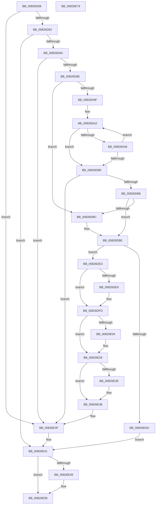

# BiHandleFirmwareDefaultEntry

- RVA: `0x00826D08`–`0x00826E7A` (길이 `370` bytes)
- VA: `0x0000000140826D08`
- 실행 섹션: `PAGE`
- PDB 이름 있음: `예`; PDB Function 태그: `아니요`
- unwind 정보 RVA: `0x000ACFA4`
- 디코드: `107`개 명령, `370/370` bytes 표시
- 미해석 바이트: `0` (있으면 어셈블리에 `.byte`로 보존)

> 이 문서는 커널 이미지의 기계어와 PDB 기호를 분석해 생성했습니다. 4번과 5번은 함수 원형과 자료형을 바이너리 사용 방식에서 추정한 C 해석이며 원본 소스 복구 결과는 아닙니다.

## 1. Dependencies

- 직접 호출 지점: **8**; 고유 호출 대상: **6**
- 직접 호출자로 확인된 함수: **1**
- RIP 상대 이미지 참조: **0**

### Outgoing calls
- `0x00826D50` → [BiGetElement](../A3/BiGetElement_function_00A3E2B4.md) (function, `0x00A3E2B4`)
- `0x00826D6F` → [BiDeleteElement](../A3/BiDeleteElement_function_00A3E0F8.md) (function, `0x00A3E0F8`)
- `0x00826D81` → [BiTranslateObjectIdentifier](BiTranslateObjectIdentifier_function_00827048.md) (function, `0x00827048`)
- `0x00826DCF` → [ExAllocatePool2](../../poolcode/B8/ExAllocatePool2_function_00B820F0.md) (function, `0x00B820F0`)
- `0x00826DF8` → [memcpy](../../text/6C/memcpy_function_006C6840.md) (function, `0x006C6840`)
- `0x00826E21` → [memcpy](../../text/6C/memcpy_function_006C6840.md) (function, `0x006C6840`)
- `0x00826E33` → [ExFreePoolWithTag](../../poolcode/B8/ExFreePoolWithTag_function_00B82870.md) (function, `0x00B82870`)
- `0x00826E53` → [ExFreePoolWithTag](../../poolcode/B8/ExFreePoolWithTag_function_00B82870.md) (function, `0x00B82870`)

### Direct callers
- [BiExportEfiBootManager](../AC/BiExportEfiBootManager_function_00ACB13C.md) at `0x00ACB26E`

### Static image references
- 디코드된 RIP-relative 메모리 참조가 없습니다.

## 2. Other-region calls and transfers

- 다른 실행 섹션으로 향하는 call: **5**
  - `0x00826DCF` → [ExAllocatePool2](../../poolcode/B8/ExAllocatePool2_function_00B820F0.md) (`PAGE` → `POOLCODE`)
  - `0x00826DF8` → [memcpy](../../text/6C/memcpy_function_006C6840.md) (`PAGE` → `.text`)
  - `0x00826E21` → [memcpy](../../text/6C/memcpy_function_006C6840.md) (`PAGE` → `.text`)
  - `0x00826E33` → [ExFreePoolWithTag](../../poolcode/B8/ExFreePoolWithTag_function_00B82870.md) (`PAGE` → `POOLCODE`)
  - `0x00826E53` → [ExFreePoolWithTag](../../poolcode/B8/ExFreePoolWithTag_function_00B82870.md) (`PAGE` → `POOLCODE`)
- 별도 외부 분기/꼬리 이동을 확인하지 못했습니다.

## 3. Assembly (complete function range)

```asm
00826D08  48 8B C4                        mov rax, rsp
00826D0B  48 89 58 08                     mov qword ptr [rax + 8], rbx
00826D0F  48 89 68 10                     mov qword ptr [rax + 0x10], rbp
00826D13  48 89 70 18                     mov qword ptr [rax + 0x18], rsi
00826D17  48 89 78 20                     mov qword ptr [rax + 0x20], rdi
00826D1B  41 55                           push r13
00826D1D  41 56                           push r14
00826D1F  41 57                           push r15
00826D21  48 83 EC 30                     sub rsp, 0x30
00826D25  83 60 D8 00                     and dword ptr [rax - 0x28], 0
00826D29  48 8B FA                        mov rdi, rdx
00826D2C  83 60 DC 00                     and dword ptr [rax - 0x24], 0
00826D30  4D 8B E9                        mov r13, r9
00826D33  48 83 60 E0 00                  and qword ptr [rax - 0x20], 0
00826D38  4C 8D 48 DC                     lea r9, [rax - 0x24]
00826D3C  4D 8B F8                        mov r15, r8
00826D3F  48 8B F1                        mov rsi, rcx
00826D42  BD 03 00 00 23                  mov ebp, 0x23000003
00826D47  4C 8D 40 E0                     lea r8, [rax - 0x20]
00826D4B  8B D5                           mov edx, ebp
00826D4D  48 8B CF                        mov rcx, rdi
00826D50  E8 5F 75 21 00                  call 0x140a3e2b4
00826D55  8B D8                           mov ebx, eax
00826D57  3D 25 02 00 C0                  cmp eax, 0xc0000225
00826D5C  0F 84 DD 00 00 00               je 0x140826e3f
00826D62  85 C0                           test eax, eax
00826D64  0F 88 D7 00 00 00               js 0x140826e41
00826D6A  8B D5                           mov edx, ebp
00826D6C  48 8B CF                        mov rcx, rdi
00826D6F  E8 84 73 21 00                  call 0x140a3e0f8
00826D74  48 8B 54 24 28                  mov rdx, qword ptr [rsp + 0x28]
00826D79  4C 8D 44 24 20                  lea r8, [rsp + 0x20]
00826D7E  48 8B CE                        mov rcx, rsi
00826D81  E8 C2 02 00 00                  call 0x140827048
00826D86  85 C0                           test eax, eax
00826D88  0F 88 B1 00 00 00               js 0x140826e3f
00826D8E  41 8B 5D 00                     mov ebx, dword ptr [r13]
00826D92  33 FF                           xor edi, edi
00826D94  49 8B 2F                        mov rbp, qword ptr [r15]
00826D97  8B 74 24 20                     mov esi, dword ptr [rsp + 0x20]
00826D9B  85 DB                           test ebx, ebx
00826D9D  74 1D                           je 0x140826dbc
00826D9F  48 8B C5                        mov rax, rbp
00826DA2  39 30                           cmp dword ptr [rax], esi
00826DA4  74 0A                           je 0x140826db0
00826DA6  FF C7                           inc edi
00826DA8  48 83 C0 04                     add rax, 4
00826DAC  3B FB                           cmp edi, ebx
00826DAE  72 F2                           jb 0x140826da2
00826DB0  85 FF                           test edi, edi
00826DB2  0F 84 87 00 00 00               je 0x140826e3f
00826DB8  3B FB                           cmp edi, ebx
00826DBA  75 02                           jne 0x140826dbe
00826DBC  FF C3                           inc ebx
00826DBE  8B D3                           mov edx, ebx
00826DC0  B9 02 01 00 00                  mov ecx, 0x102
00826DC5  48 C1 E2 02                     shl rdx, 2
00826DC9  41 B8 42 43 44 4B               mov r8d, 0x4b444342
00826DCF  E8 1C B3 35 00                  call 0x140b820f0
00826DD4  4C 8B F0                        mov r14, rax
00826DD7  48 85 C0                        test rax, rax
00826DDA  75 07                           jne 0x140826de3
00826DDC  BB 9A 00 00 C0                  mov ebx, 0xc000009a
00826DE1  EB 5E                           jmp 0x140826e41
00826DE3  89 30                           mov dword ptr [rax], esi
00826DE5  85 FF                           test edi, edi
00826DE7  74 14                           je 0x140826dfd
00826DE9  4C 8D 04 BD 00 00 00 00         lea r8, [rdi*4]
00826DF1  48 8B D5                        mov rdx, rbp
00826DF4  48 8D 48 04                     lea rcx, [rax + 4]
00826DF8  E8 43 FA E9 FF                  call 0x1406c6840
00826DFD  8D 43 FF                        lea eax, [rbx - 1]
00826E00  3B F8                           cmp edi, eax
00826E02  73 22                           jae 0x140826e26
00826E04  44 8B C3                        mov r8d, ebx
00826E07  48 8D 55 04                     lea rdx, [rbp + 4]
00826E0B  44 2B C7                        sub r8d, edi
00826E0E  48 8D 4F 01                     lea rcx, [rdi + 1]
00826E12  41 FF C8                        dec r8d
00826E15  48 8D 14 BA                     lea rdx, [rdx + rdi*4]
00826E19  49 C1 E0 02                     shl r8, 2
00826E1D  49 8D 0C 8E                     lea rcx, [r14 + rcx*4]
00826E21  E8 1A FA E9 FF                  call 0x1406c6840
00826E26  49 8B 0F                        mov rcx, qword ptr [r15]
00826E29  48 85 C9                        test rcx, rcx
00826E2C  74 0A                           je 0x140826e38
00826E2E  BA 42 43 44 4B                  mov edx, 0x4b444342
00826E33  E8 38 BA 35 00                  call 0x140b82870
00826E38  4D 89 37                        mov qword ptr [r15], r14
00826E3B  41 89 5D 00                     mov dword ptr [r13], ebx
00826E3F  33 DB                           xor ebx, ebx
00826E41  48 83 7C 24 28 00               cmp qword ptr [rsp + 0x28], 0
00826E47  74 0F                           je 0x140826e58
00826E49  48 8B 4C 24 28                  mov rcx, qword ptr [rsp + 0x28]
00826E4E  BA 42 43 44 4B                  mov edx, 0x4b444342
00826E53  E8 18 BA 35 00                  call 0x140b82870
00826E58  48 8B 6C 24 58                  mov rbp, qword ptr [rsp + 0x58]
00826E5D  8B C3                           mov eax, ebx
00826E5F  48 8B 5C 24 50                  mov rbx, qword ptr [rsp + 0x50]
00826E64  48 8B 74 24 60                  mov rsi, qword ptr [rsp + 0x60]
00826E69  48 8B 7C 24 68                  mov rdi, qword ptr [rsp + 0x68]
00826E6E  48 83 C4 30                     add rsp, 0x30
00826E72  41 5F                           pop r15
00826E74  41 5E                           pop r14
00826E76  41 5D                           pop r13
00826E78  C3                              ret
00826E79  CC                              int3
```

## 4. C-style interpretation (structured pseudocode)

```c
__int64 __fastcall BiHandleFirmwareDefaultEntry(__int64 a1, __int64 a2, __int64 a3, __int64 a4)
{
    __int64 result;
    __int64 v_rbx;
    __int64 v_rdi;
    __int64 v_rsp;
    unsigned __int64 v_stack_m20;
    unsigned __int64 v_stack_m28;
    unsigned __int64 v_stack_p10;
    unsigned __int64 v_stack_p18;
    unsigned __int64 v_stack_p20;
    unsigned __int64 v_stack_p8;

    *(unsigned __int64 *)(v_rsp + 8) = v_rbx;
    *(unsigned __int64 *)(v_rsp + 16) = v_rbp;
    *(unsigned __int64 *)(v_rsp + 24) = v_rsi;
    *(unsigned __int64 *)(v_rsp + 32) = v_rdi;
    v_rsp = (v_rsp) - (48);
    result = BiGetElement(a2, (unsigned int)((unsigned int)((unsigned int)(0x23000003ULL))), v_rsp - 32, v_rsp - 36);
    if (((unsigned int)(result)) == 0xC0000225ULL) goto loc_00826E3F;
    if (sign_flag) goto loc_00826E41;
    result = BiDeleteElement(a2, (unsigned int)((unsigned int)((unsigned int)(0x23000003ULL))), v_rsp - 32, v_rsp - 36);
    result = BiTranslateObjectIdentifier(a1, v_stack_m20, v_stack_m28, v_rsp - 36);
    if (sign_flag) goto loc_00826E3F;
    v_rdi = 0;
    if ((unsigned int)((unsigned int)(*(unsigned int *)(a4))) == 0) goto loc_00826DBC;
loc_00826DA2:
    if ((*(unsigned int *)(*(unsigned __int64 *)(a3))) == ((unsigned int)((unsigned int)(v_stack_m28)))) goto loc_00826DB0;
    v_rdi = (unsigned int)((v_rdi) + 1);
    result = (*(unsigned __int64 *)(a3)) + (4);
    if (((unsigned int)(v_rdi)) < ((unsigned int)((unsigned int)(*(unsigned int *)(a4))))) goto loc_00826DA2;
loc_00826DB0:
    if ((unsigned int)(v_rdi) == 0) goto loc_00826E3F;
    v_rbx = (unsigned int)(*(unsigned int *)(a4));
    if (((unsigned int)(v_rdi)) == ((unsigned int)((unsigned int)(*(unsigned int *)(a4))))) {
        v_rbx = (unsigned int)(((unsigned int)(*(unsigned int *)(a4))) + 1);
    }
    a2 = ((unsigned int)((unsigned int)(v_rbx))) << (2);
    result = ExAllocatePool2(258, a2, (unsigned int)(0x4B444342ULL), v_rsp - 36);
    if (result != 0) goto loc_00826DE3;
    goto loc_00826E41;
loc_00826DE3:
    *(unsigned int *)(result) = (unsigned int)((unsigned int)(v_stack_m28));
    if ((unsigned int)(v_rdi) != 0) {
        a3 = v_rdi * 4;
        a2 = *(unsigned __int64 *)(a3);
        a1 = result + 4;
        result = memcpy(a1, a2, a3, v_rsp - 36);
    }
    result = (unsigned int)(0xC000009AULL) - 1;
    if (((unsigned int)(v_rdi)) < ((unsigned int)((unsigned int)(0xC000009AULL) - 1))) {
        a3 = (unsigned int)((unsigned int)(0xC000009AULL));
        a2 = *(unsigned __int64 *)(a3) + 4;
        a3 = (unsigned int)((a3) - ((unsigned int)(v_rdi)));
        a1 = v_rdi + 1;
        a3 = (unsigned int)((a3) - 1);
        a2 = a2 + v_rdi * 4;
        a3 = (a3) << (2);
        a1 = result + a1 * 4;
        result = memcpy(a1, a2, a3, v_rsp - 36);
    }
    if (*(unsigned __int64 *)(a3) != 0) {
        a2 = 0x4B444342ULL;
        result = ExFreePoolWithTag(*(unsigned __int64 *)(a3), a2, a3, v_rsp - 36);
    }
    *(unsigned __int64 *)(a3) = result;
    *(unsigned int *)(a4) = (unsigned int)((unsigned int)(0xC000009AULL));
loc_00826E3F:
    v_rbx = 0;
loc_00826E41:
    if (v_stack_m20 != 0) {
        a1 = v_stack_m20;
        a2 = 0x4B444342ULL;
        result = ExFreePoolWithTag(a1, a2, a3, v_rsp - 36);
    }
    v_rsp = (v_rsp) + (48);
    return 0;
}
```

## 5. (Beta) C Style

```c
int64_t BiHandleFirmwareDefaultEntry(int64_t Arg1, int64_t Arg2, void *Arg3, void *Arg4)
{
    uint8_t *arg3 = (uint8_t *)Arg3;
    uint8_t *arg4 = (uint8_t *)Arg4;

    int64_t result;
    int64_t local_rbx;
    int64_t local_rdi;
    int64_t local_rsp;
    uint64_t v_stack_m20;
    uint64_t v_stack_m28;
    uint64_t v_stack_p10;
    uint64_t v_stack_p18;
    uint64_t v_stack_p20;
    uint64_t v_stack_p8;

    *(uint64_t *)(local_rsp + 0x8) = local_rbx;
    *(uint64_t *)(local_rsp + 0x10) = local_rbp;
    *(uint64_t *)(local_rsp + 0x18) = local_rsi;
    *(uint64_t *)(local_rsp + 0x20) = local_rdi;
    local_rsp = (local_rsp) - (48);
    result = BiGetElement(Arg2, (uint32_t)((uint32_t)((uint32_t)(0x23000003ULL))), local_rsp - 32, local_rsp - 36);
    if (((uint32_t)(result)) == 0xC0000225ULL) goto loc_00826E3F;
    if (sign_flag) goto loc_00826E41;
    result = BiDeleteElement(Arg2, (uint32_t)((uint32_t)((uint32_t)(0x23000003ULL))), local_rsp - 32, local_rsp - 36);
    result = BiTranslateObjectIdentifier(Arg1, v_stack_m20, v_stack_m28, local_rsp - 36);
    if (sign_flag) goto loc_00826E3F;
    local_rdi = 0;
    if ((uint32_t)((uint32_t)(*(uint32_t *)(arg4))) == 0) goto loc_00826DBC;
loc_00826DA2:
    if ((*(uint32_t *)(*(uint64_t *)(arg3))) == ((uint32_t)((uint32_t)(v_stack_m28)))) goto loc_00826DB0;
    local_rdi = (uint32_t)((local_rdi) + 1);
    result = (*(uint64_t *)(arg3)) + (4);
    if (((uint32_t)(local_rdi)) < ((uint32_t)((uint32_t)(*(uint32_t *)(arg4))))) goto loc_00826DA2;
loc_00826DB0:
    if ((uint32_t)(local_rdi) == 0) goto loc_00826E3F;
    local_rbx = (uint32_t)(*(uint32_t *)(arg4));
    if (((uint32_t)(local_rdi)) == ((uint32_t)((uint32_t)(*(uint32_t *)(arg4))))) {
        local_rbx = (uint32_t)(((uint32_t)(*(uint32_t *)(arg4))) + 1);
    }
    Arg2 = ((uint32_t)((uint32_t)(local_rbx))) << (2);
    result = ExAllocatePool2(258, Arg2, (uint32_t)(0x4B444342ULL), local_rsp - 36);
    if (result != 0) goto loc_00826DE3;
    goto loc_00826E41;
loc_00826DE3:
    *(uint32_t *)(result) = (uint32_t)((uint32_t)(v_stack_m28));
    if ((uint32_t)(local_rdi) != 0) {
        Arg3 = local_rdi * 4;
        Arg2 = *(uint64_t *)(arg3);
        Arg1 = result + 4;
        result = memcpy(Arg1, Arg2, Arg3, local_rsp - 36);
    }
    result = (uint32_t)(0xC000009AULL) - 1;
    if (((uint32_t)(local_rdi)) < ((uint32_t)((uint32_t)(0xC000009AULL) - 1))) {
        Arg3 = (uint32_t)((uint32_t)(0xC000009AULL));
        Arg2 = *(uint64_t *)(arg3) + 4;
        Arg3 = (uint32_t)((Arg3) - ((uint32_t)(local_rdi)));
        Arg1 = local_rdi + 1;
        Arg3 = (uint32_t)((Arg3) - 1);
        Arg2 = Arg2 + local_rdi * 4;
        Arg3 = (Arg3) << (2);
        Arg1 = result + Arg1 * 4;
        result = memcpy(Arg1, Arg2, Arg3, local_rsp - 36);
    }
    if (*(uint64_t *)(arg3) != 0) {
        Arg2 = 0x4B444342ULL;
        result = ExFreePoolWithTag(*(uint64_t *)(arg3), Arg2, Arg3, local_rsp - 36);
    }
    *(uint64_t *)(arg3) = result;
    *(uint32_t *)(arg4) = (uint32_t)((uint32_t)(0xC000009AULL));
loc_00826E3F:
    local_rbx = 0;
loc_00826E41:
    if (v_stack_m20 != 0) {
        Arg1 = v_stack_m20;
        Arg2 = 0x4B444342ULL;
        result = ExFreePoolWithTag(Arg1, Arg2, Arg3, local_rsp - 36);
    }
    local_rsp = (local_rsp) + (48);
    return 0;
}
```

### 관측된 메모리 오프셋

구조체 형식이 확인되지 않은 접근은 인자 기준의 오프셋으로만 기록했습니다.

| 기준 인자 | 오프셋 표현 | 폭 (bit) | 접근 |
|---|---:|---:|---|
| `Arg3` | `+ 0x0` | `64` | `R` |
| `Arg3` | `+ 0x0` | `64` | `W` |
| `Arg4` | `+ 0x0` | `32` | `R` |
| `Arg4` | `+ 0x0` | `32` | `W` |

## 6. Execution-region graph

[열기: 2D/3D 그래프와 함수 탐색 컨트롤 패널](../../../control-panel.html?section=page&rva=0x00826D08&view=graph)

- 2D 그래프는 위에서 아래로 흐르고, 3D 그래프는 빈 공간을 드래그해 회전합니다. Shift+드래그는 이동, 휠은 확대·축소, 함수 노드 선택은 대상 보고서 이동입니다.

### Static fallback


