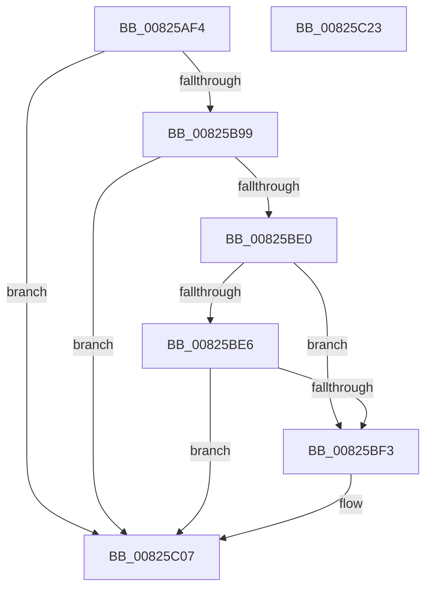

# BiIsBootRamdisk

- RVA: `0x00825AF4`–`0x00825C24` (길이 `304` bytes)
- VA: `0x0000000140825AF4`
- 실행 섹션: `PAGE`
- PDB 이름 있음: `예`; PDB Function 태그: `아니요`
- unwind 정보 RVA: `0x000DA2FC`
- 디코드: `78`개 명령, `304/304` bytes 표시
- 미해석 바이트: `0` (있으면 어셈블리에 `.byte`로 보존)

> 이 문서는 커널 이미지의 기계어와 PDB 기호를 분석해 생성했습니다. 4번과 5번은 함수 원형과 자료형을 바이너리 사용 방식에서 추정한 C 해석이며 원본 소스 복구 결과는 아닙니다.

## 1. Dependencies

- 직접 호출 지점: **5**; 고유 호출 대상: **5**
- 직접 호출자로 확인된 함수: **1**
- RIP 상대 이미지 참조: **1**

### Outgoing calls
- `0x00825B2D` → [memset](../../text/6C/memset_function_006C6C40.md) (function, `0x006C6C40`)
- `0x00825B48` → [RtlInitUnicodeString](../../text/42/RtlInitUnicodeString_function_0042A780.md) (function, `0x0042A780`)
- `0x00825B90` → [ZwOpenFile](../../text/6A/ZwOpenFile_function_006AD730.md) (function, `0x006AD730`)
- `0x00825BCC` → [ZwDeviceIoControlFile](../../text/6A/ZwDeviceIoControlFile_function_006AD1B0.md) (function, `0x006AD1B0`)
- `0x00825BD7` → [ZwClose](../../text/6A/ZwClose_function_006AD2B0.md) (function, `0x006AD2B0`)

### Direct callers
- [BiConvertBootEnvironmentDeviceToNt](BiConvertBootEnvironmentDeviceToNt_function_00823E44.md) at `0x008246C1`

### Static image references
- `0x00825B39` → RVA `0x00B0BC90` (` ?? ::NNGAKEGL::`string'`; read)

## 2. Other-region calls and transfers

- 다른 실행 섹션으로 향하는 call: **5**
  - `0x00825B2D` → [memset](../../text/6C/memset_function_006C6C40.md) (`PAGE` → `.text`)
  - `0x00825B48` → [RtlInitUnicodeString](../../text/42/RtlInitUnicodeString_function_0042A780.md) (`PAGE` → `.text`)
  - `0x00825B90` → [ZwOpenFile](../../text/6A/ZwOpenFile_function_006AD730.md) (`PAGE` → `.text`)
  - `0x00825BCC` → [ZwDeviceIoControlFile](../../text/6A/ZwDeviceIoControlFile_function_006AD1B0.md) (`PAGE` → `.text`)
  - `0x00825BD7` → [ZwClose](../../text/6A/ZwClose_function_006AD2B0.md) (`PAGE` → `.text`)
- 별도 외부 분기/꼬리 이동을 확인하지 못했습니다.

## 3. Assembly (complete function range)

```asm
00825AF4  48 8B C4                        mov rax, rsp
00825AF7  48 89 58 08                     mov qword ptr [rax + 8], rbx
00825AFB  48 89 70 18                     mov qword ptr [rax + 0x18], rsi
00825AFF  48 89 78 20                     mov qword ptr [rax + 0x20], rdi
00825B03  55                              push rbp
00825B04  48 8D 68 A1                     lea rbp, [rax - 0x5f]
00825B08  48 81 EC E0 00 00 00            sub rsp, 0xe0
00825B0F  33 FF                           xor edi, edi
00825B11  48 8B F1                        mov rsi, rcx
00825B14  0F 57 C0                        xorps xmm0, xmm0
00825B17  89 7D EB                        mov dword ptr [rbp - 0x15], edi
00825B1A  33 D2                           xor edx, edx
00825B1C  89 7D 03                        mov dword ptr [rbp + 3], edi
00825B1F  48 8D 4D 17                     lea rcx, [rbp + 0x17]
00825B23  8D 5F 40                        lea ebx, [rdi + 0x40]
00825B26  44 8B C3                        mov r8d, ebx
00825B29  0F 11 45 D7                     movups xmmword ptr [rbp - 0x29], xmm0
00825B2D  E8 0E 11 EA FF                  call 0x1406c6c40
00825B32  0F 57 C0                        xorps xmm0, xmm0
00825B35  48 89 7D 6F                     mov qword ptr [rbp + 0x6f], rdi
00825B39  48 8D 15 50 61 2E 00            lea rdx, [rip + 0x2e6150]
00825B40  48 8D 4D C7                     lea rcx, [rbp - 0x39]
00825B44  0F 11 45 C7                     movups xmmword ptr [rbp - 0x39], xmm0
00825B48  E8 33 4C C0 FF                  call 0x14042a780
00825B4D  48 8D 45 C7                     lea rax, [rbp - 0x39]
00825B51  C7 44 24 28 20 00 00 00         mov dword ptr [rsp + 0x28], 0x20
00825B59  0F 57 C0                        xorps xmm0, xmm0
00825B5C  48 89 45 F7                     mov qword ptr [rbp - 9], rax
00825B60  4C 8D 4D D7                     lea r9, [rbp - 0x29]
00825B64  C7 45 E7 30 00 00 00            mov dword ptr [rbp - 0x19], 0x30
00825B6B  4C 8D 45 E7                     lea r8, [rbp - 0x19]
00825B6F  48 89 7D EF                     mov qword ptr [rbp - 0x11], rdi
00825B73  BA 00 00 00 C0                  mov edx, 0xc0000000
00825B78  C7 45 FF 40 02 00 00            mov dword ptr [rbp - 1], 0x240
00825B7F  48 8D 4D 6F                     lea rcx, [rbp + 0x6f]
00825B83  C7 44 24 20 03 00 00 00         mov dword ptr [rsp + 0x20], 3
00825B8B  F3 0F 7F 45 07                  movdqu xmmword ptr [rbp + 7], xmm0
00825B90  E8 9B 7B E8 FF                  call 0x1406ad730
00825B95  85 C0                           test eax, eax
00825B97  78 6E                           js 0x140825c07
00825B99  48 8B 4D 6F                     mov rcx, qword ptr [rbp + 0x6f]
00825B9D  48 8D 45 17                     lea rax, [rbp + 0x17]
00825BA1  89 5C 24 48                     mov dword ptr [rsp + 0x48], ebx
00825BA5  45 33 C9                        xor r9d, r9d
00825BA8  48 89 44 24 40                  mov qword ptr [rsp + 0x40], rax
00825BAD  45 33 C0                        xor r8d, r8d
00825BB0  89 7C 24 38                     mov dword ptr [rsp + 0x38], edi
00825BB4  48 8D 45 D7                     lea rax, [rbp - 0x29]
00825BB8  48 89 7C 24 30                  mov qword ptr [rsp + 0x30], rdi
00825BBD  33 D2                           xor edx, edx
00825BBF  C7 44 24 28 08 00 24 00         mov dword ptr [rsp + 0x28], 0x240008
00825BC7  48 89 44 24 20                  mov qword ptr [rsp + 0x20], rax
00825BCC  E8 DF 75 E8 FF                  call 0x1406ad1b0
00825BD1  48 8B 4D 6F                     mov rcx, qword ptr [rbp + 0x6f]
00825BD5  8B D8                           mov ebx, eax
00825BD7  E8 D4 76 E8 FF                  call 0x1406ad2b0
00825BDC  85 DB                           test ebx, ebx
00825BDE  78 27                           js 0x140825c07
00825BE0  83 7D 2B 03                     cmp dword ptr [rbp + 0x2b], 3
00825BE4  74 0D                           je 0x140825bf3
00825BE6  48 8B 45 47                     mov rax, qword ptr [rbp + 0x47]
00825BEA  48 C1 E0 0C                     shl rax, 0xc
00825BEE  48 39 06                        cmp qword ptr [rsi], rax
00825BF1  75 14                           jne 0x140825c07
00825BF3  48 8B 45 37                     mov rax, qword ptr [rbp + 0x37]
00825BF7  BA 01 00 00 00                  mov edx, 1
00825BFC  48 39 46 08                     cmp qword ptr [rsi + 8], rax
00825C00  40 0F B6 FF                     movzx edi, dil
00825C04  0F 44 FA                        cmove edi, edx
00825C07  4C 8D 9C 24 E0 00 00 00         lea r11, [rsp + 0xe0]
00825C0F  40 8A C7                        mov al, dil
00825C12  49 8B 5B 10                     mov rbx, qword ptr [r11 + 0x10]
00825C16  49 8B 73 20                     mov rsi, qword ptr [r11 + 0x20]
00825C1A  49 8B 7B 28                     mov rdi, qword ptr [r11 + 0x28]
00825C1E  49 8B E3                        mov rsp, r11
00825C21  5D                              pop rbp
00825C22  C3                              ret
00825C23  CC                              int3
```

## 4. C-style interpretation (structured pseudocode)

```c
__int64 __fastcall BiIsBootRamdisk(__int64 a1, int a2)
{
    __int64 result;
    __int64 v_rdi;
    __int64 v_rsp;
    unsigned __int64 v_stack_m8;
    unsigned int v_stack_mA0;
    unsigned __int64 v_stack_mA8;
    unsigned int v_stack_mB0;
    unsigned __int64 v_stack_mB8;
    unsigned int v_stack_mC0;
    unsigned int v_stack_mC8;

    *(unsigned __int64 *)(v_rsp + 8) = v_rbx;
    *(unsigned __int64 *)(v_rsp + 24) = v_rsi;
    *(unsigned __int64 *)(v_rsp + 32) = v_rdi;
    v_rsp = (v_rsp) - (224);
    v_rdi = 0;
    *(unsigned int *)(v_rsp - 95 - 21) = 0;
    a2 = 0;
    *(unsigned int *)(v_rsp - 95 + 3) = 0;
    *(unsigned __int64 *)(v_rsp - 95 - 41) = v_xmm0;
    result = memset(v_rsp - 95 + 23, a2, (unsigned int)((unsigned int)(v_rdi + 64)), a4);
    *(unsigned __int64 *)(v_rsp - 95 + 111) = 0;
    *(unsigned __int64 *)(v_rsp - 95 - 57) = v_xmm0;
    result = RtlInitUnicodeString(v_rsp - 95 - 57, v_rip + 3039568, (unsigned int)((unsigned int)(v_rdi + 64)), a4);
    v_stack_mC0 = 32;
    *(unsigned __int64 *)(v_rsp - 95 - 9) = v_rsp - 95 - 57;
    *(unsigned int *)(v_rsp - 95 - 25) = 48;
    *(unsigned __int64 *)(v_rsp - 95 - 17) = 0;
    *(unsigned int *)(v_rsp - 95 - 1) = 576;
    v_stack_mC8 = 3;
    *(unsigned __int64 *)(v_rsp - 95 + 7) = v_xmm0;
    result = ZwOpenFile(v_rsp - 95 + 111, (unsigned int)(0xC0000000ULL), v_rsp - 95 - 25, v_rsp - 95 - 41);
    if (sign_flag) goto loc_00825C07;
    v_stack_mA0 = (unsigned int)(v_rdi + 64);
    a4 = 0;
    v_stack_mA8 = v_rsp - 95 + 23;
    a3 = 0;
    v_stack_mB0 = 0;
    v_stack_mB8 = 0;
    a2 = 0;
    v_stack_mC0 = 0x240008ULL;
    v_stack_mC8 = v_rsp - 95 - 41;
    result = ZwDeviceIoControlFile(*(unsigned __int64 *)(v_rsp - 95 + 111), a2, a3, a4);
    result = ZwClose(*(unsigned __int64 *)(v_rsp - 95 + 111), a2, a3, a4);
    if (sign_flag) goto loc_00825C07;
    if ((*(unsigned int *)(v_rsp - 95 + 43)) == 3) goto loc_00825BF3;
    result = (*(unsigned __int64 *)(v_rsp - 95 + 71)) << (12);
    if ((*(unsigned __int64 *)(a1)) == result) {
        result = *(unsigned __int64 *)(v_rsp - 95 + 55);
        a2 = 1;
        v_rdi = 0;
        if ((*(unsigned __int64 *)(a1 + 8)) == result) { v_rdi = a2; }
    }
    return (unsigned __int8)(v_rdi);
}
```

## 5. (Beta) C Style

```c
int64_t BiIsBootRamdisk(void *Arg1, int32_t Arg2)
{
    uint8_t *arg1 = (uint8_t *)Arg1;

    int64_t result;
    int64_t local_rdi;
    int64_t local_rsp;
    uint64_t v_stack_m8;
    uint32_t v_stack_mA0;
    uint64_t v_stack_mA8;
    uint32_t v_stack_mB0;
    uint64_t v_stack_mB8;
    uint32_t v_stack_mC0;
    uint32_t v_stack_mC8;

    *(uint64_t *)(local_rsp + 0x8) = local_rbx;
    *(uint64_t *)(local_rsp + 0x18) = local_rsi;
    *(uint64_t *)(local_rsp + 0x20) = local_rdi;
    local_rsp = (local_rsp) - (224);
    local_rdi = 0;
    *(uint32_t *)(local_rsp - 0x5F - 0x15) = 0;
    Arg2 = 0;
    *(uint32_t *)(local_rsp - 0x5F + 0x3) = 0;
    *(uint64_t *)(local_rsp - 0x5F - 0x29) = v_xmm0;
    result = memset(local_rsp - 95 + 23, Arg2, (uint32_t)((uint32_t)(local_rdi + 64)), a4);
    *(uint64_t *)(local_rsp - 0x5F + 0x6F) = 0;
    *(uint64_t *)(local_rsp - 0x5F - 0x39) = v_xmm0;
    result = RtlInitUnicodeString(local_rsp - 95 - 57, v_rip + 3039568, (uint32_t)((uint32_t)(local_rdi + 64)), a4);
    v_stack_mC0 = 32;
    *(uint64_t *)(local_rsp - 0x5F - 0x9) = local_rsp - 95 - 57;
    *(uint32_t *)(local_rsp - 0x5F - 0x19) = 48;
    *(uint64_t *)(local_rsp - 0x5F - 0x11) = 0;
    *(uint32_t *)(local_rsp - 0x5F - 0x1) = 576;
    v_stack_mC8 = 3;
    *(uint64_t *)(local_rsp - 0x5F + 0x7) = v_xmm0;
    result = ZwOpenFile(local_rsp - 95 + 111, (uint32_t)(0xC0000000ULL), local_rsp - 95 - 25, local_rsp - 95 - 41);
    if (sign_flag) goto loc_00825C07;
    v_stack_mA0 = (uint32_t)(local_rdi + 64);
    a4 = 0;
    v_stack_mA8 = local_rsp - 95 + 23;
    a3 = 0;
    v_stack_mB0 = 0;
    v_stack_mB8 = 0;
    Arg2 = 0;
    v_stack_mC0 = 0x240008ULL;
    v_stack_mC8 = local_rsp - 95 - 41;
    result = ZwDeviceIoControlFile(*(uint64_t *)(local_rsp - 0x5F + 0x6F), Arg2, a3, a4);
    result = ZwClose(*(uint64_t *)(local_rsp - 0x5F + 0x6F), Arg2, a3, a4);
    if (sign_flag) goto loc_00825C07;
    if ((*(uint32_t *)(local_rsp - 0x5F + 0x2B)) == 3) goto loc_00825BF3;
    result = (*(uint64_t *)(local_rsp - 0x5F + 0x47)) << (12);
    if ((*(uint64_t *)(arg1)) == result) {
        result = *(uint64_t *)(local_rsp - 0x5F + 0x37);
        Arg2 = 1;
        local_rdi = 0;
        if ((*(uint64_t *)(arg1 + 0x8)) == result) { local_rdi = Arg2; }
    }
    return (uint8_t)(local_rdi);
}
```

### 관측된 메모리 오프셋

구조체 형식이 확인되지 않은 접근은 인자 기준의 오프셋으로만 기록했습니다.

| 기준 인자 | 오프셋 표현 | 폭 (bit) | 접근 |
|---|---:|---:|---|
| `Arg1` | `+ 0x0` | `64` | `R` |
| `Arg1` | `+ 0x8` | `64` | `R` |

## 6. Execution-region graph

[열기: 2D/3D 그래프와 함수 탐색 컨트롤 패널](../../../control-panel.html?section=page&rva=0x00825AF4&view=graph)

- 2D 그래프는 위에서 아래로 흐르고, 3D 그래프는 빈 공간을 드래그해 회전합니다. Shift+드래그는 이동, 휠은 확대·축소, 함수 노드 선택은 대상 보고서 이동입니다.

### Static fallback


