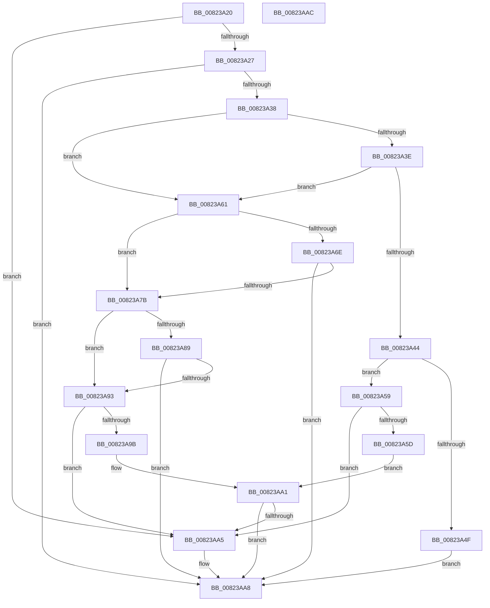

# BiIsEnumerateMatch

- RVA: `0x00823A20`–`0x00823AAD` (길이 `141` bytes)
- VA: `0x0000000140823A20`
- 실행 섹션: `PAGE`
- PDB 이름 있음: `예`; PDB Function 태그: `아니요`
- unwind 정보 RVA: `0x000DB714`
- 디코드: `52`개 명령, `141/141` bytes 표시
- 미해석 바이트: `0` (있으면 어셈블리에 `.byte`로 보존)

> 이 문서는 커널 이미지의 기계어와 PDB 기호를 분석해 생성했습니다. 4번과 5번은 함수 원형과 자료형을 바이너리 사용 방식에서 추정한 C 해석이며 원본 소스 복구 결과는 아닙니다.

## 1. Dependencies

- 직접 호출 지점: **0**; 고유 호출 대상: **0**
- 직접 호출자로 확인된 함수: **1**
- RIP 상대 이미지 참조: **0**

### Outgoing calls
- 직접 디코드된 call 명령이 없습니다.

### Direct callers
- [BcdEnumerateObjects](BcdEnumerateObjects_function_00823594.md) at `0x008236A8`
- [BcdEnumerateObjects](BcdEnumerateObjects_function_00823594.md) at `0x00823796`

### Static image references
- 디코드된 RIP-relative 메모리 참조가 없습니다.

## 2. Other-region calls and transfers

- 다른 실행 섹션으로 향하는 call: **0**
- 별도 외부 분기/꼬리 이동을 확인하지 못했습니다.

## 3. Assembly (complete function range)

```asm
00823A20  45 33 C0                        xor r8d, r8d
00823A23  85 C9                           test ecx, ecx
00823A25  74 7E                           je 0x140823aa5
00823A27  44 8B C9                        mov r9d, ecx
00823A2A  8B C2                           mov eax, edx
00823A2C  41 C1 E9 1C                     shr r9d, 0x1c
00823A30  C1 E8 1C                        shr eax, 0x1c
00823A33  44 3B C8                        cmp r9d, eax
00823A36  75 70                           jne 0x140823aa8
00823A38  41 83 E9 01                     sub r9d, 1
00823A3C  74 23                           je 0x140823a61
00823A3E  41 83 E9 01                     sub r9d, 1
00823A42  74 1D                           je 0x140823a61
00823A44  B8 FF FF FF 0F                  mov eax, 0xfffffff
00823A49  41 83 F9 01                     cmp r9d, 1
00823A4D  74 0A                           je 0x140823a59
00823A4F  33 CA                           xor ecx, edx
00823A51  85 C8                           test eax, ecx
00823A53  41 0F 94 C0                     sete r8b
00823A57  EB 4F                           jmp 0x140823aa8
00823A59  23 C8                           and ecx, eax
00823A5B  74 48                           je 0x140823aa5
00823A5D  23 D0                           and edx, eax
00823A5F  EB 40                           jmp 0x140823aa1
00823A61  44 8B C9                        mov r9d, ecx
00823A64  41 C1 E9 14                     shr r9d, 0x14
00823A68  41 83 E1 0F                     and r9d, 0xf
00823A6C  74 0D                           je 0x140823a7b
00823A6E  8B C2                           mov eax, edx
00823A70  C1 E8 14                        shr eax, 0x14
00823A73  83 E0 0F                        and eax, 0xf
00823A76  44 3B C8                        cmp r9d, eax
00823A79  75 2D                           jne 0x140823aa8
00823A7B  41 B9 FF FF 0F 00               mov r9d, 0xfffff
00823A81  44 8B D1                        mov r10d, ecx
00823A84  45 23 D1                        and r10d, r9d
00823A87  74 0A                           je 0x140823a93
00823A89  8B C2                           mov eax, edx
00823A8B  41 23 C1                        and eax, r9d
00823A8E  44 3B D0                        cmp r10d, eax
00823A91  75 15                           jne 0x140823aa8
00823A93  C1 E9 18                        shr ecx, 0x18
00823A96  83 E1 0F                        and ecx, 0xf
00823A99  74 0A                           je 0x140823aa5
00823A9B  C1 EA 18                        shr edx, 0x18
00823A9E  83 E2 0F                        and edx, 0xf
00823AA1  3B CA                           cmp ecx, edx
00823AA3  75 03                           jne 0x140823aa8
00823AA5  41 B0 01                        mov r8b, 1
00823AA8  41 8A C0                        mov al, r8b
00823AAB  C3                              ret
00823AAC  CC                              int3
```

## 4. C-style interpretation (structured pseudocode)

```c
__int64 __fastcall BiIsEnumerateMatch(int a1, int a2, int a3)
{
    __int64 result;
    __int64 v_r10;

    a3 = 0;
    if (a1 == 0) goto loc_00823AA5;
    a4 = (unsigned int)(((unsigned int)(a1)) >> (28));
    result = (unsigned int)(((unsigned int)(a2)) >> (28));
    if (((unsigned int)(a4)) != ((unsigned int)(result))) goto loc_00823AA8;
    a4 = (unsigned int)((a4) - (1));
    if (condition_is_equal) goto loc_00823A61;
    a4 = (unsigned int)((a4) - (1));
    if (condition_is_equal) goto loc_00823A61;
    if (((unsigned int)(a4)) == 1) goto loc_00823A59;
    a1 = (unsigned int)((a1) ^ (a2));
    a3 = ((((unsigned int)((unsigned int)(0xFFFFFFFULL))) & (a1)) == 0) ? 1 : 0;
    goto loc_00823AA8;
loc_00823A59:
    a1 = (unsigned int)((a1) & ((unsigned int)((unsigned int)(0xFFFFFFFULL))));
    if (condition_is_equal) goto loc_00823AA5;
    a2 = (unsigned int)((a2) & ((unsigned int)((unsigned int)(0xFFFFFFFULL))));
    goto loc_00823AA1;
loc_00823A61:
    a4 = (unsigned int)(((unsigned int)(a1)) >> (20));
    a4 = (unsigned int)((a4) & (15));
    if (condition_is_equal) goto loc_00823A7B;
    result = (unsigned int)(((unsigned int)(a2)) >> (20));
    result = (unsigned int)((result) & (15));
    if (((unsigned int)(a4)) != ((unsigned int)(result))) goto loc_00823AA8;
loc_00823A7B:
    v_r10 = (unsigned int)(((unsigned int)(a1)) & ((unsigned int)((unsigned int)(0xFFFFFULL))));
    if (condition_is_equal) goto loc_00823A93;
    result = (unsigned int)(((unsigned int)(a2)) & ((unsigned int)((unsigned int)(0xFFFFFULL))));
    if (((unsigned int)(v_r10)) != ((unsigned int)(result))) goto loc_00823AA8;
loc_00823A93:
    a1 = (unsigned int)((a1) >> (24));
    a1 = (unsigned int)((a1) & (15));
    if (condition_is_equal) goto loc_00823AA5;
    a2 = (unsigned int)((a2) >> (24));
    a2 = (unsigned int)((a2) & (15));
loc_00823AA1:
    if (a1 == a2) {
        a3 = 1;
    }
    return (unsigned __int8)(a3);
}
```

## 5. (Beta) C Style

```c
int64_t BiIsEnumerateMatch(int32_t Arg1, int32_t Arg2, int32_t Arg3)
{
    int64_t result;
    int64_t local_r10;

    Arg3 = 0;
    if (Arg1 == 0) goto loc_00823AA5;
    a4 = (uint32_t)(((uint32_t)(Arg1)) >> (28));
    result = (uint32_t)(((uint32_t)(Arg2)) >> (28));
    if (((uint32_t)(a4)) != ((uint32_t)(result))) goto loc_00823AA8;
    a4 = (uint32_t)((a4) - (1));
    if (condition_is_equal) goto loc_00823A61;
    a4 = (uint32_t)((a4) - (1));
    if (condition_is_equal) goto loc_00823A61;
    if (((uint32_t)(a4)) == 1) goto loc_00823A59;
    Arg1 = (uint32_t)((Arg1) ^ (Arg2));
    Arg3 = ((((uint32_t)((uint32_t)(0xFFFFFFFULL))) & (Arg1)) == 0) ? 1 : 0;
    goto loc_00823AA8;
loc_00823A59:
    Arg1 = (uint32_t)((Arg1) & ((uint32_t)((uint32_t)(0xFFFFFFFULL))));
    if (condition_is_equal) goto loc_00823AA5;
    Arg2 = (uint32_t)((Arg2) & ((uint32_t)((uint32_t)(0xFFFFFFFULL))));
    goto loc_00823AA1;
loc_00823A61:
    a4 = (uint32_t)(((uint32_t)(Arg1)) >> (20));
    a4 = (uint32_t)((a4) & (15));
    if (condition_is_equal) goto loc_00823A7B;
    result = (uint32_t)(((uint32_t)(Arg2)) >> (20));
    result = (uint32_t)((result) & (15));
    if (((uint32_t)(a4)) != ((uint32_t)(result))) goto loc_00823AA8;
loc_00823A7B:
    local_r10 = (uint32_t)(((uint32_t)(Arg1)) & ((uint32_t)((uint32_t)(0xFFFFFULL))));
    if (condition_is_equal) goto loc_00823A93;
    result = (uint32_t)(((uint32_t)(Arg2)) & ((uint32_t)((uint32_t)(0xFFFFFULL))));
    if (((uint32_t)(local_r10)) != ((uint32_t)(result))) goto loc_00823AA8;
loc_00823A93:
    Arg1 = (uint32_t)((Arg1) >> (24));
    Arg1 = (uint32_t)((Arg1) & (15));
    if (condition_is_equal) goto loc_00823AA5;
    Arg2 = (uint32_t)((Arg2) >> (24));
    Arg2 = (uint32_t)((Arg2) & (15));
loc_00823AA1:
    if (Arg1 == Arg2) {
        Arg3 = 1;
    }
    return (uint8_t)(Arg3);
}
```

## 6. Execution-region graph

[열기: 2D/3D 그래프와 함수 탐색 컨트롤 패널](../../../control-panel.html?section=page&rva=0x00823A20&view=graph)

- 2D 그래프는 위에서 아래로 흐르고, 3D 그래프는 빈 공간을 드래그해 회전합니다. Shift+드래그는 이동, 휠은 확대·축소, 함수 노드 선택은 대상 보고서 이동입니다.

### Static fallback


