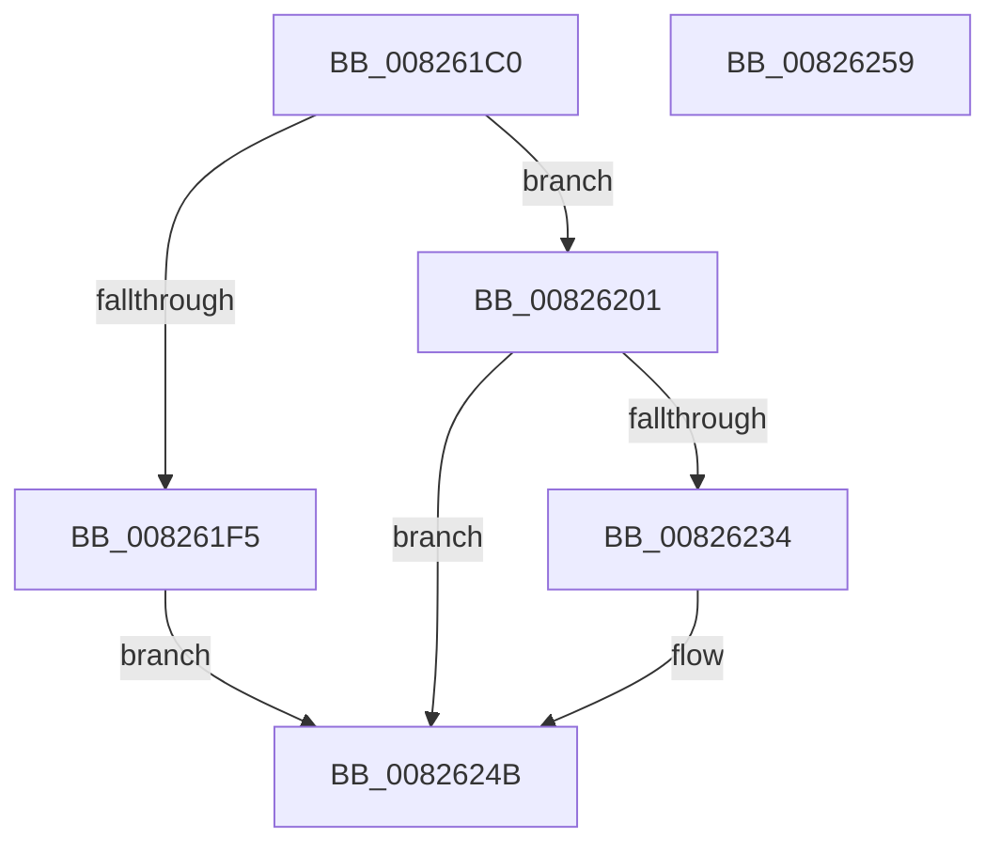

# BiIsPortableWorkspaceBoot

- RVA: `0x008261C0`–`0x0082625A` (길이 `154` bytes)
- VA: `0x00000001408261C0`
- 실행 섹션: `PAGE`
- PDB 이름 있음: `예`; PDB Function 태그: `아니요`
- unwind 정보 RVA: `0x000DA37C`
- 디코드: `41`개 명령, `154/154` bytes 표시
- 미해석 바이트: `0` (있으면 어셈블리에 `.byte`로 보존)

> 이 문서는 커널 이미지의 기계어와 PDB 기호를 분석해 생성했습니다. 4번과 5번은 함수 원형과 자료형을 바이너리 사용 방식에서 추정한 C 해석이며 원본 소스 복구 결과는 아닙니다.

## 1. Dependencies

- 직접 호출 지점: **4**; 고유 호출 대상: **4**
- 직접 호출자로 확인된 함수: **2**
- RIP 상대 이미지 참조: **3**

### Outgoing calls
- `0x008261EC` → [BiOpenKey](../A3/BiOpenKey_function_00A3F60C.md) (function, `0x00A3F60C`)
- `0x008261FA` → [BiCloseKey](../91/BiCloseKey_function_00916A00.md) (function, `0x00916A00`)
- `0x0082622B` → [BiGetRegistryValue](../A3/BiGetRegistryValue_function_00A3F3CC.md) (function, `0x00A3F3CC`)
- `0x00826240` → [ExFreePoolWithTag](../../poolcode/B8/ExFreePoolWithTag_function_00B82870.md) (function, `0x00B82870`)

### Direct callers
- [BiExportBcdObjects](BiExportBcdObjects_function_00826B30.md) at `0x00826BA9`
- [BiBindEfiEntries](../AB/BiBindEfiEntries_function_00AB09C4.md) at `0x00AB0A77`
- [BiBindEfiEntries](../AB/BiBindEfiEntries_function_00AB09C4.md) at `0x00AB0A9F`

### Static image references
- `0x008261DC` → RVA `0x00B0C1E0` (` ?? ::NNGAKEGL::`string'`; read)
- `0x00826211` → RVA `0x00B0C260` (` ?? ::NNGAKEGL::`string'`; read)
- `0x0082621F` → RVA `0x00B0C2D0` (` ?? ::NNGAKEGL::`string'`; read)

## 2. Other-region calls and transfers

- 다른 실행 섹션으로 향하는 call: **1**
  - `0x00826240` → [ExFreePoolWithTag](../../poolcode/B8/ExFreePoolWithTag_function_00B82870.md) (`PAGE` → `POOLCODE`)
- 별도 외부 분기/꼬리 이동을 확인하지 못했습니다.

## 3. Assembly (complete function range)

```asm
008261C0  48 8B C4                        mov rax, rsp
008261C3  48 89 58 20                     mov qword ptr [rax + 0x20], rbx
008261C7  57                              push rdi
008261C8  48 83 EC 30                     sub rsp, 0x30
008261CC  33 FF                           xor edi, edi
008261CE  4C 8D 48 10                     lea r9, [rax + 0x10]
008261D2  41 B8 19 00 02 00               mov r8d, 0x20019
008261D8  48 89 78 18                     mov qword ptr [rax + 0x18], rdi
008261DC  48 8D 15 FD 5F 2E 00            lea rdx, [rip + 0x2e5ffd]
008261E3  48 89 78 10                     mov qword ptr [rax + 0x10], rdi
008261E7  33 C9                           xor ecx, ecx
008261E9  89 78 08                        mov dword ptr [rax + 8], edi
008261EC  E8 1B 94 21 00                  call 0x140a3f60c
008261F1  85 C0                           test eax, eax
008261F3  78 0C                           js 0x140826201
008261F5  48 8B 4C 24 48                  mov rcx, qword ptr [rsp + 0x48]
008261FA  E8 01 08 0F 00                  call 0x140916a00
008261FF  EB 4A                           jmp 0x14082624b
00826201  48 8D 44 24 40                  lea rax, [rsp + 0x40]
00826206  41 B9 04 00 00 00               mov r9d, 4
0082620C  48 89 44 24 28                  mov qword ptr [rsp + 0x28], rax
00826211  4C 8D 05 48 60 2E 00            lea r8, [rip + 0x2e6048]
00826218  48 8D 44 24 50                  lea rax, [rsp + 0x50]
0082621D  33 C9                           xor ecx, ecx
0082621F  48 8D 15 AA 60 2E 00            lea rdx, [rip + 0x2e60aa]
00826226  48 89 44 24 20                  mov qword ptr [rsp + 0x20], rax
0082622B  E8 9C 91 21 00                  call 0x140a3f3cc
00826230  85 C0                           test eax, eax
00826232  78 17                           js 0x14082624b
00826234  48 8B 4C 24 50                  mov rcx, qword ptr [rsp + 0x50]
00826239  BA 42 43 44 4B                  mov edx, 0x4b444342
0082623E  8B 19                           mov ebx, dword ptr [rcx]
00826240  E8 2B C6 35 00                  call 0x140b82870
00826245  85 DB                           test ebx, ebx
00826247  40 0F 95 C7                     setne dil
0082624B  48 8B 5C 24 58                  mov rbx, qword ptr [rsp + 0x58]
00826250  40 8A C7                        mov al, dil
00826253  48 83 C4 30                     add rsp, 0x30
00826257  5F                              pop rdi
00826258  C3                              ret
00826259  CC                              int3
```

## 4. C-style interpretation (structured pseudocode)

```c
__int64 __fastcall BiIsPortableWorkspaceBoot(int a1)
{
    __int64 result;
    __int64 v_rbx;
    __int64 v_rdi;
    __int64 v_rsp;
    unsigned __int64 v_stack_m10;
    unsigned __int64 v_stack_m18;
    unsigned __int64 v_stack_p10;
    unsigned __int64 v_stack_p18;
    unsigned __int64 v_stack_p20;
    unsigned __int64 v_stack_p8;

    *(unsigned __int64 *)(v_rsp + 32) = v_rbx;
    v_rsp = (v_rsp) - (48);
    v_rdi = 0;
    *(unsigned __int64 *)(v_rsp + 24) = 0;
    *(unsigned __int64 *)(v_rsp + 16) = 0;
    a1 = 0;
    *(unsigned int *)(v_rsp + 8) = 0;
    result = BiOpenKey(a1, v_rip + 3039229, (unsigned int)(0x20019ULL), v_rsp + 16);
    if (sign_flag) goto loc_00826201;
    result = BiCloseKey(v_stack_p10, v_rip + 3039229, (unsigned int)(0x20019ULL), v_rsp + 16);
    goto loc_0082624B;
loc_00826201:
    v_stack_m10 = v_stack_p8;
    a1 = 0;
    v_stack_m18 = v_stack_p18;
    result = BiGetRegistryValue(a1, v_rip + 3039402, v_rip + 3039304, 4);
    if (!(sign_flag)) {
        a1 = v_stack_p18;
        a2 = 0x4B444342ULL;
        v_rbx = *(unsigned int *)(a1);
        result = ExFreePoolWithTag(a1, a2, v_rip + 3039304, 4);
        v_rdi = ((unsigned int)(v_rbx) != 0) ? 1 : 0;
    }
    v_rsp = (v_rsp) + (48);
    return (unsigned __int8)(v_rdi);
}
```

## 5. (Beta) C Style

```c
int64_t BiIsPortableWorkspaceBoot(int32_t Arg1)
{
    int64_t result;
    int64_t local_rbx;
    int64_t local_rdi;
    int64_t local_rsp;
    uint64_t v_stack_m10;
    uint64_t v_stack_m18;
    uint64_t v_stack_p10;
    uint64_t v_stack_p18;
    uint64_t v_stack_p20;
    uint64_t v_stack_p8;

    *(uint64_t *)(local_rsp + 0x20) = local_rbx;
    local_rsp = (local_rsp) - (48);
    local_rdi = 0;
    *(uint64_t *)(local_rsp + 0x18) = 0;
    *(uint64_t *)(local_rsp + 0x10) = 0;
    Arg1 = 0;
    *(uint32_t *)(local_rsp + 0x8) = 0;
    result = BiOpenKey(Arg1, v_rip + 3039229, (uint32_t)(0x20019ULL), local_rsp + 16);
    if (sign_flag) goto loc_00826201;
    result = BiCloseKey(v_stack_p10, v_rip + 3039229, (uint32_t)(0x20019ULL), local_rsp + 16);
    goto loc_0082624B;
loc_00826201:
    v_stack_m10 = v_stack_p8;
    Arg1 = 0;
    v_stack_m18 = v_stack_p18;
    result = BiGetRegistryValue(Arg1, v_rip + 3039402, v_rip + 3039304, 4);
    if (!(sign_flag)) {
        Arg1 = v_stack_p18;
        a2 = 0x4B444342ULL;
        local_rbx = *(uint32_t *)(Arg1);
        result = ExFreePoolWithTag(Arg1, a2, v_rip + 3039304, 4);
        local_rdi = ((uint32_t)(local_rbx) != 0) ? 1 : 0;
    }
    local_rsp = (local_rsp) + (48);
    return (uint8_t)(local_rdi);
}
```

## 6. Execution-region graph

[열기: 2D/3D 그래프와 함수 탐색 컨트롤 패널](../../../control-panel.html?section=page&rva=0x008261C0&view=graph)

- 2D 그래프는 위에서 아래로 흐르고, 3D 그래프는 빈 공간을 드래그해 회전합니다. Shift+드래그는 이동, 휠은 확대·축소, 함수 노드 선택은 대상 보고서 이동입니다.

### Static fallback


