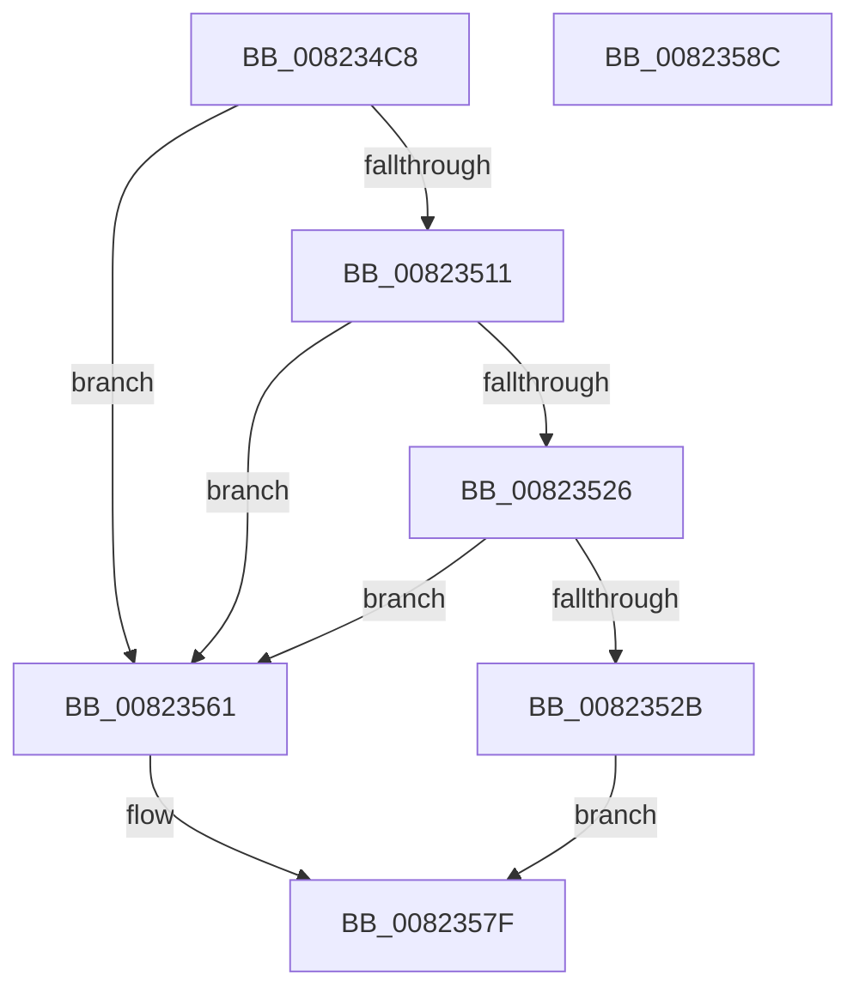

# BiMarkTreatAsSystemStore

- RVA: `0x008234C8`–`0x0082358D` (길이 `197` bytes)
- VA: `0x00000001408234C8`
- 실행 섹션: `PAGE`
- PDB 이름 있음: `예`; PDB Function 태그: `아니요`
- unwind 정보 RVA: `0x000DA2B4`
- 디코드: `52`개 명령, `197/197` bytes 표시
- 미해석 바이트: `0` (있으면 어셈블리에 `.byte`로 보존)

> 이 문서는 커널 이미지의 기계어와 PDB 기호를 분석해 생성했습니다. 4번과 5번은 함수 원형과 자료형을 바이너리 사용 방식에서 추정한 C 해석이며 원본 소스 복구 결과는 아닙니다.

## 1. Dependencies

- 직접 호출 지점: **4**; 고유 호출 대상: **4**
- 직접 호출자로 확인된 함수: **2**
- RIP 상대 이미지 참조: **3**

### Outgoing calls
- `0x00823508` → [BiGetRegistryValue](../A3/BiGetRegistryValue_function_00A3F3CC.md) (function, `0x00A3F3CC`)
- `0x0082351D` → [ExFreePoolWithTag](../../poolcode/B8/ExFreePoolWithTag_function_00B82870.md) (function, `0x00B82870`)
- `0x0082355A` → [BiSetRegistryValue](../A3/BiSetRegistryValue_function_00A3E3B0.md) (function, `0x00A3E3B0`)
- `0x00823572` → [BiDeleteRegistryValue](BiDeleteRegistryValue_function_00826078.md) (function, `0x00826078`)

### Direct callers
- [BcdSetSystemStore](BcdSetSystemStore_function_00823478.md) at `0x0082349B`
- [BiLoadSystemStore](../A3/BiLoadSystemStore_function_00A3C198.md) at `0x00A3C29B`

### Static image references
- `0x008234E0` → RVA `0x00AFF1D0` (` ?? ::NNGAKEGL::`string'`; read)
- `0x008234FE` → RVA `0x00AFC8A0` (` ?? ::NNGAKEGL::`string'`; read)
- `0x00823550` → RVA `0x00B0A380` (` ?? ::NNGAKEGL::`string'`; read)

## 2. Other-region calls and transfers

- 다른 실행 섹션으로 향하는 call: **1**
  - `0x0082351D` → [ExFreePoolWithTag](../../poolcode/B8/ExFreePoolWithTag_function_00B82870.md) (`PAGE` → `POOLCODE`)
- 별도 외부 분기/꼬리 이동을 확인하지 못했습니다.

## 3. Assembly (complete function range)

```asm
008234C8  4C 8B DC                        mov r11, rsp
008234CB  49 89 5B 08                     mov qword ptr [r11 + 8], rbx
008234CF  55                              push rbp
008234D0  56                              push rsi
008234D1  57                              push rdi
008234D2  48 83 EC 40                     sub rsp, 0x40
008234D6  33 ED                           xor ebp, ebp
008234D8  49 8D 43 18                     lea rax, [r11 + 0x18]
008234DC  49 89 43 D0                     mov qword ptr [r11 - 0x30], rax
008234E0  4C 8D 05 E9 BC 2D 00            lea r8, [rip + 0x2dbce9]
008234E7  40 8A F2                        mov sil, dl
008234EA  49 89 6B D8                     mov qword ptr [r11 - 0x28], rbp
008234EE  49 8D 43 D8                     lea rax, [r11 - 0x28]
008234F2  89 6C 24 70                     mov dword ptr [rsp + 0x70], ebp
008234F6  44 8D 4D 04                     lea r9d, [rbp + 4]
008234FA  49 89 43 C8                     mov qword ptr [r11 - 0x38], rax
008234FE  48 8D 15 9B 93 2D 00            lea rdx, [rip + 0x2d939b]
00823505  48 8B F9                        mov rdi, rcx
00823508  E8 BF BE 21 00                  call 0x140a3f3cc
0082350D  85 C0                           test eax, eax
0082350F  78 50                           js 0x140823561
00823511  48 8B 4C 24 30                  mov rcx, qword ptr [rsp + 0x30]
00823516  BA 42 43 44 4B                  mov edx, 0x4b444342
0082351B  8B 19                           mov ebx, dword ptr [rcx]
0082351D  E8 4E F3 35 00                  call 0x140b82870
00823522  85 DB                           test ebx, ebx
00823524  74 3B                           je 0x140823561
00823526  40 84 F6                        test sil, sil
00823529  74 36                           je 0x140823561
0082352B  48 8D 44 24 78                  lea rax, [rsp + 0x78]
00823530  C7 44 24 28 04 00 00 00         mov dword ptr [rsp + 0x28], 4
00823538  44 8D 4D 04                     lea r9d, [rbp + 4]
0082353C  48 89 44 24 20                  mov qword ptr [rsp + 0x20], rax
00823541  4C 8D 05 88 BC 2D 00            lea r8, [rip + 0x2dbc88]
00823548  C7 44 24 78 01 00 00 00         mov dword ptr [rsp + 0x78], 1
00823550  48 8D 15 29 6E 2E 00            lea rdx, [rip + 0x2e6e29]
00823557  48 8B CF                        mov rcx, rdi
0082355A  E8 51 AE 21 00                  call 0x140a3e3b0
0082355F  EB 1E                           jmp 0x14082357f
00823561  4C 8D 05 68 BC 2D 00            lea r8, [rip + 0x2dbc68]
00823568  48 8B CF                        mov rcx, rdi
0082356B  48 8D 15 0E 6E 2E 00            lea rdx, [rip + 0x2e6e0e]
00823572  E8 01 2B 00 00                  call 0x140826078
00823577  3D 34 00 00 C0                  cmp eax, 0xc0000034
0082357C  0F 44 C5                        cmove eax, ebp
0082357F  48 8B 5C 24 60                  mov rbx, qword ptr [rsp + 0x60]
00823584  48 83 C4 40                     add rsp, 0x40
00823588  5F                              pop rdi
00823589  5E                              pop rsi
0082358A  5D                              pop rbp
0082358B  C3                              ret
0082358C  CC                              int3
```

## 4. C-style interpretation (structured pseudocode)

```c
__int64 __fastcall BiMarkTreatAsSystemStore(__int64 a1, unsigned __int8 a2)
{
    __int64 result;
    __int64 v_rbp;
    __int64 v_rsp;
    unsigned __int64 v_stack_m28;
    unsigned int v_stack_m30;
    unsigned __int64 v_stack_m38;
    unsigned int v_stack_p18;
    unsigned __int64 v_stack_p20;
    unsigned __int64 v_stack_p8;

    *(unsigned __int64 *)(v_rsp + 8) = v_rbx;
    v_rsp = (v_rsp) - (64);
    v_rbp = 0;
    *(unsigned __int64 *)(v_rsp - 48) = v_rsp + 24;
    *(unsigned __int64 *)(v_rsp - 40) = 0;
    v_stack_p18 = 0;
    *(unsigned __int64 *)(v_rsp - 56) = v_rsp - 40;
    result = BiGetRegistryValue(a1, v_rip + 2986907, v_rip + 2997481, v_rbp + 4);
    if (sign_flag) goto loc_00823561;
    result = ExFreePoolWithTag(v_stack_m28, (unsigned int)(0x4B444342ULL), v_rip + 2997481, v_rbp + 4);
    if ((unsigned int)((unsigned int)(*(unsigned int *)(v_stack_m28))) == 0) goto loc_00823561;
    if (a2 == 0) goto loc_00823561;
    v_stack_m30 = 4;
    v_stack_m38 = v_stack_p20;
    v_stack_p20 = 1;
    result = BiSetRegistryValue(a1, v_rip + 3042857, v_rip + 2997384, v_rbp + 4);
    goto loc_0082357F;
loc_00823561:
    result = BiDeleteRegistryValue(a1, v_rip + 3042830, v_rip + 2997352, v_rbp + 4);
    if (((unsigned int)(result)) == 0xC0000034ULL) { result = 0; }
loc_0082357F:
    v_rsp = (v_rsp) + (64);
    return result;
}
```

## 5. (Beta) C Style

```c
int64_t BiMarkTreatAsSystemStore(int64_t Arg1, uint8_t Arg2)
{
    int64_t result;
    int64_t local_rbp;
    int64_t local_rsp;
    uint64_t v_stack_m28;
    uint32_t v_stack_m30;
    uint64_t v_stack_m38;
    uint32_t v_stack_p18;
    uint64_t v_stack_p20;
    uint64_t v_stack_p8;

    *(uint64_t *)(local_rsp + 0x8) = local_rbx;
    local_rsp = (local_rsp) - (64);
    local_rbp = 0;
    *(uint64_t *)(local_rsp - 0x30) = local_rsp + 24;
    *(uint64_t *)(local_rsp - 0x28) = 0;
    v_stack_p18 = 0;
    *(uint64_t *)(local_rsp - 0x38) = local_rsp - 40;
    result = BiGetRegistryValue(Arg1, v_rip + 2986907, v_rip + 2997481, local_rbp + 4);
    if (sign_flag) goto loc_00823561;
    result = ExFreePoolWithTag(v_stack_m28, (uint32_t)(0x4B444342ULL), v_rip + 2997481, local_rbp + 4);
    if ((uint32_t)((uint32_t)(*(uint32_t *)(v_stack_m28))) == 0) goto loc_00823561;
    if (Arg2 == 0) goto loc_00823561;
    v_stack_m30 = 4;
    v_stack_m38 = v_stack_p20;
    v_stack_p20 = 1;
    result = BiSetRegistryValue(Arg1, v_rip + 3042857, v_rip + 2997384, local_rbp + 4);
    goto loc_0082357F;
loc_00823561:
    result = BiDeleteRegistryValue(Arg1, v_rip + 3042830, v_rip + 2997352, local_rbp + 4);
    if (((uint32_t)(result)) == 0xC0000034ULL) { result = 0; }
loc_0082357F:
    local_rsp = (local_rsp) + (64);
    return result;
}
```

## 6. Execution-region graph

[열기: 2D/3D 그래프와 함수 탐색 컨트롤 패널](../../../control-panel.html?section=page&rva=0x008234C8&view=graph)

- 2D 그래프는 위에서 아래로 흐르고, 3D 그래프는 빈 공간을 드래그해 회전합니다. Shift+드래그는 이동, 휠은 확대·축소, 함수 노드 선택은 대상 보고서 이동입니다.

### Static fallback


