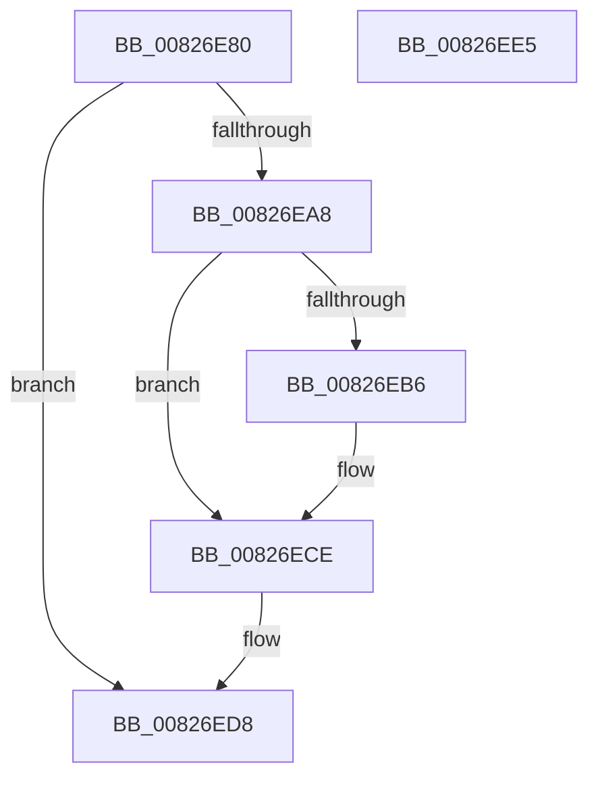

# BiModifyBootEntry

- RVA: `0x00826E80`–`0x00826EE6` (길이 `102` bytes)
- VA: `0x0000000140826E80`
- 실행 섹션: `PAGE`
- PDB 이름 있음: `예`; PDB Function 태그: `아니요`
- unwind 정보 RVA: `0x0005CAAC`
- 디코드: `29`개 명령, `102/102` bytes 표시
- 미해석 바이트: `0` (있으면 어셈블리에 `.byte`로 보존)

> 이 문서는 커널 이미지의 기계어와 PDB 기호를 분석해 생성했습니다. 4번과 5번은 함수 원형과 자료형을 바이너리 사용 방식에서 추정한 C 해석이며 원본 소스 복구 결과는 아닙니다.

## 1. Dependencies

- 직접 호출 지점: **4**; 고유 호출 대상: **4**
- 직접 호출자로 확인된 함수: **2**
- RIP 상대 이미지 참조: **1**

### Outgoing calls
- `0x00826E9D` → [BiAcquirePrivilege](../A3/BiAcquirePrivilege_function_00A3D658.md) (function, `0x00A3D658`)
- `0x00826EAB` → [ZwModifyBootEntry](../../text/6A/ZwModifyBootEntry_function_006AF4D0.md) (function, `0x006AF4D0`)
- `0x00826EC9` → [BiLogMessage](../A3/BiLogMessage_function_00A3D3A8.md) (function, `0x00A3D3A8`)
- `0x00826ED3` → [BiReleasePrivilege](../A3/BiReleasePrivilege_function_00A3D600.md) (function, `0x00A3D600`)

### Direct callers
- [BiUpdateBcdObject](BiUpdateBcdObject_function_008270D0.md) at `0x00827377`
- [BiUpdateEfiEntry](../A3/BiUpdateEfiEntry_function_00A3CCC0.md) at `0x00A3CE0C`

### Static image references
- `0x00826EBA` → RVA `0x00B0CCA0` (` ?? ::NNGAKEGL::`string'`; read)

## 2. Other-region calls and transfers

- 다른 실행 섹션으로 향하는 call: **1**
  - `0x00826EAB` → [ZwModifyBootEntry](../../text/6A/ZwModifyBootEntry_function_006AF4D0.md) (`PAGE` → `.text`)
- 별도 외부 분기/꼬리 이동을 확인하지 못했습니다.

## 3. Assembly (complete function range)

```asm
00826E80  48 89 5C 24 08                  mov qword ptr [rsp + 8], rbx
00826E85  57                              push rdi
00826E86  48 83 EC 20                     sub rsp, 0x20
00826E8A  48 83 64 24 38 00               and qword ptr [rsp + 0x38], 0
00826E90  48 8D 54 24 38                  lea rdx, [rsp + 0x38]
00826E95  48 8B F9                        mov rdi, rcx
00826E98  B9 16 00 00 00                  mov ecx, 0x16
00826E9D  E8 B6 67 21 00                  call 0x140a3d658
00826EA2  8B D8                           mov ebx, eax
00826EA4  85 C0                           test eax, eax
00826EA6  78 30                           js 0x140826ed8
00826EA8  48 8B CF                        mov rcx, rdi
00826EAB  E8 20 86 E8 FF                  call 0x1406af4d0
00826EB0  8B D8                           mov ebx, eax
00826EB2  85 C0                           test eax, eax
00826EB4  79 18                           jns 0x140826ece
00826EB6  44 8B 47 08                     mov r8d, dword ptr [rdi + 8]
00826EBA  48 8D 15 DF 5D 2E 00            lea rdx, [rip + 0x2e5ddf]
00826EC1  44 8B C8                        mov r9d, eax
00826EC4  B9 04 00 00 00                  mov ecx, 4
00826EC9  E8 DA 64 21 00                  call 0x140a3d3a8
00826ECE  48 8D 4C 24 38                  lea rcx, [rsp + 0x38]
00826ED3  E8 28 67 21 00                  call 0x140a3d600
00826ED8  8B C3                           mov eax, ebx
00826EDA  48 8B 5C 24 30                  mov rbx, qword ptr [rsp + 0x30]
00826EDF  48 83 C4 20                     add rsp, 0x20
00826EE3  5F                              pop rdi
00826EE4  C3                              ret
00826EE5  CC                              int3
```

## 4. C-style interpretation (structured pseudocode)

```c
__int64 __fastcall BiModifyBootEntry(__int64 a1)
{
    __int64 result;
    __int64 v_rsp;
    unsigned __int64 v_stack_p10;
    unsigned __int64 v_stack_p8;

    v_stack_p8 = v_rbx;
    v_rsp = (v_rsp) - (32);
    result = BiAcquirePrivilege(22, v_stack_p10, a3, a4);
    if (sign_flag) goto loc_00826ED8;
    result = ZwModifyBootEntry(a1, v_stack_p10, a3, a4);
    if (sign_flag) {
        a3 = *(unsigned int *)(a1 + 8);
        a2 = v_rip + 3038687;
        a4 = (unsigned int)(result);
        a1 = 4;
        result = BiLogMessage(a1, a2, a3, a4);
    }
    result = BiReleasePrivilege(v_stack_p10, a2, a3, a4);
loc_00826ED8:
    v_rsp = (v_rsp) + (32);
    return (unsigned int)((unsigned int)((unsigned int)((unsigned int)(result))));
}
```

## 5. (Beta) C Style

```c
int64_t BiModifyBootEntry(void *Arg1)
{
    uint8_t *arg1 = (uint8_t *)Arg1;

    int64_t result;
    int64_t local_rsp;
    uint64_t v_stack_p10;
    uint64_t v_stack_p8;

    v_stack_p8 = local_rbx;
    local_rsp = (local_rsp) - (32);
    result = BiAcquirePrivilege(22, v_stack_p10, a3, a4);
    if (sign_flag) goto loc_00826ED8;
    result = ZwModifyBootEntry(Arg1, v_stack_p10, a3, a4);
    if (sign_flag) {
        a3 = *(uint32_t *)(arg1 + 0x8);
        a2 = v_rip + 3038687;
        a4 = (uint32_t)(result);
        Arg1 = 4;
        result = BiLogMessage(Arg1, a2, a3, a4);
    }
    result = BiReleasePrivilege(v_stack_p10, a2, a3, a4);
loc_00826ED8:
    local_rsp = (local_rsp) + (32);
    return (uint32_t)((uint32_t)((uint32_t)((uint32_t)(result))));
}
```

### 관측된 메모리 오프셋

구조체 형식이 확인되지 않은 접근은 인자 기준의 오프셋으로만 기록했습니다.

| 기준 인자 | 오프셋 표현 | 폭 (bit) | 접근 |
|---|---:|---:|---|
| `Arg1` | `+ 0x8` | `32` | `R` |

## 6. Execution-region graph

[열기: 2D/3D 그래프와 함수 탐색 컨트롤 패널](../../../control-panel.html?section=page&rva=0x00826E80&view=graph)

- 2D 그래프는 위에서 아래로 흐르고, 3D 그래프는 빈 공간을 드래그해 회전합니다. Shift+드래그는 이동, 휠은 확대·축소, 함수 노드 선택은 대상 보고서 이동입니다.

### Static fallback


