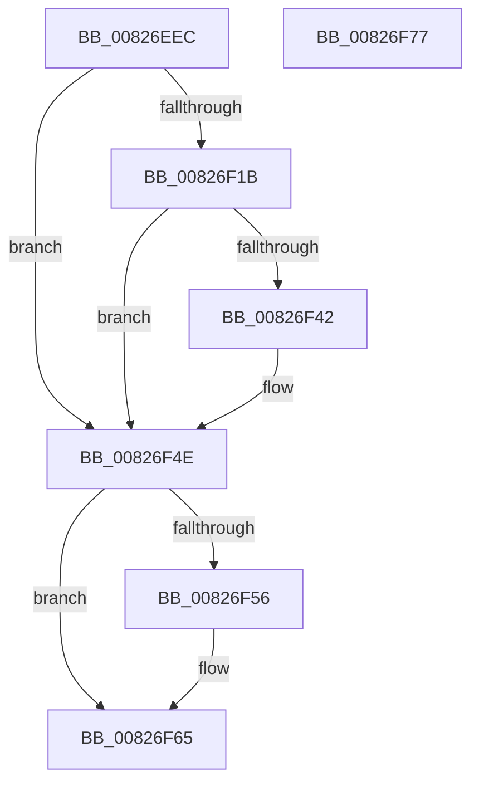

# BiRemoveBootEntryFromNvramDisplayOrder

- RVA: `0x00826EEC`–`0x00826F78` (길이 `140` bytes)
- VA: `0x0000000140826EEC`
- 실행 섹션: `PAGE`
- PDB 이름 있음: `예`; PDB Function 태그: `아니요`
- unwind 정보 RVA: `0x000DA3A8`
- 디코드: `39`개 명령, `140/140` bytes 표시
- 미해석 바이트: `0` (있으면 어셈블리에 `.byte`로 보존)

> 이 문서는 커널 이미지의 기계어와 PDB 기호를 분석해 생성했습니다. 4번과 5번은 함수 원형과 자료형을 바이너리 사용 방식에서 추정한 C 해석이며 원본 소스 복구 결과는 아닙니다.

## 1. Dependencies

- 직접 호출 지점: **4**; 고유 호출 대상: **4**
- 직접 호출자로 확인된 함수: **1**
- RIP 상대 이미지 참조: **0**

### Outgoing calls
- `0x00826F10` → [BiQueryBootEntryOrder](../A3/BiQueryBootEntryOrder_function_00A3DBD4.md) (function, `0x00A3DBD4`)
- `0x00826F35` → [BiRemoveEntryFromBootOrder](BiRemoveEntryFromBootOrder_function_00826F80.md) (function, `0x00826F80`)
- `0x00826F47` → [BiSetBootEntryOrder](../A3/BiSetBootEntryOrder_function_00A3CC48.md) (function, `0x00A3CC48`)
- `0x00826F60` → [ExFreePoolWithTag](../../poolcode/B8/ExFreePoolWithTag_function_00B82870.md) (function, `0x00B82870`)

### Direct callers
- [BiBindEfiEntries](../AB/BiBindEfiEntries_function_00AB09C4.md) at `0x00AB0A32`

### Static image references
- 디코드된 RIP-relative 메모리 참조가 없습니다.

## 2. Other-region calls and transfers

- 다른 실행 섹션으로 향하는 call: **1**
  - `0x00826F60` → [ExFreePoolWithTag](../../poolcode/B8/ExFreePoolWithTag_function_00B82870.md) (`PAGE` → `POOLCODE`)
- 별도 외부 분기/꼬리 이동을 확인하지 못했습니다.

## 3. Assembly (complete function range)

```asm
00826EEC  48 8B C4                        mov rax, rsp
00826EEF  48 89 58 08                     mov qword ptr [rax + 8], rbx
00826EF3  48 89 68 20                     mov qword ptr [rax + 0x20], rbp
00826EF7  56                              push rsi
00826EF8  48 83 EC 20                     sub rsp, 0x20
00826EFC  83 60 10 00                     and dword ptr [rax + 0x10], 0
00826F00  48 8D 50 10                     lea rdx, [rax + 0x10]
00826F04  48 83 60 18 00                  and qword ptr [rax + 0x18], 0
00826F09  48 8B E9                        mov rbp, rcx
00826F0C  48 8D 48 18                     lea rcx, [rax + 0x18]
00826F10  E8 BF 6C 21 00                  call 0x140a3dbd4
00826F15  8B F0                           mov esi, eax
00826F17  85 C0                           test eax, eax
00826F19  78 33                           js 0x140826f4e
00826F1B  4C 8B 45 28                     mov r8, qword ptr [rbp + 0x28]
00826F1F  48 8D 54 24 38                  lea rdx, [rsp + 0x38]
00826F24  8B 5C 24 38                     mov ebx, dword ptr [rsp + 0x38]
00826F28  48 8B 4C 24 40                  mov rcx, qword ptr [rsp + 0x40]
00826F2D  89 5C 24 38                     mov dword ptr [rsp + 0x38], ebx
00826F31  45 8B 40 08                     mov r8d, dword ptr [r8 + 8]
00826F35  E8 46 00 00 00                  call 0x140826f80
00826F3A  8B 54 24 38                     mov edx, dword ptr [rsp + 0x38]
00826F3E  3B DA                           cmp ebx, edx
00826F40  74 0C                           je 0x140826f4e
00826F42  48 8B 4C 24 40                  mov rcx, qword ptr [rsp + 0x40]
00826F47  E8 FC 5C 21 00                  call 0x140a3cc48
00826F4C  8B F0                           mov esi, eax
00826F4E  48 83 7C 24 40 00               cmp qword ptr [rsp + 0x40], 0
00826F54  74 0F                           je 0x140826f65
00826F56  48 8B 4C 24 40                  mov rcx, qword ptr [rsp + 0x40]
00826F5B  BA 42 43 44 4B                  mov edx, 0x4b444342
00826F60  E8 0B B9 35 00                  call 0x140b82870
00826F65  48 8B 5C 24 30                  mov rbx, qword ptr [rsp + 0x30]
00826F6A  8B C6                           mov eax, esi
00826F6C  48 8B 6C 24 48                  mov rbp, qword ptr [rsp + 0x48]
00826F71  48 83 C4 20                     add rsp, 0x20
00826F75  5E                              pop rsi
00826F76  C3                              ret
00826F77  CC                              int3
```

## 4. C-style interpretation (structured pseudocode)

```c
__int64 __fastcall BiRemoveBootEntryFromNvramDisplayOrder(__int64 a1)
{
    __int64 result;
    __int64 v_rsi;
    __int64 v_rsp;
    unsigned __int64 v_stack_p10;
    unsigned __int64 v_stack_p18;
    unsigned __int64 v_stack_p20;
    unsigned __int64 v_stack_p8;

    *(unsigned __int64 *)(v_rsp + 8) = v_rbx;
    *(unsigned __int64 *)(v_rsp + 32) = v_rbp;
    v_rsp = (v_rsp) - (32);
    result = BiQueryBootEntryOrder(v_rsp + 24, v_rsp + 16, a3, a4);
    if (sign_flag) goto loc_00826F4E;
    v_stack_p10 = (unsigned int)((unsigned int)(v_stack_p10));
    result = BiRemoveEntryFromBootOrder(v_stack_p18, v_stack_p10, (unsigned int)(*(unsigned int *)(*(unsigned __int64 *)(a1 + 40) + 8)), a4);
    v_rsi = (unsigned int)((unsigned int)(result));
    if (((unsigned int)((unsigned int)(v_stack_p10))) != ((unsigned int)((unsigned int)(v_stack_p10)))) {
        a1 = v_stack_p18;
        result = BiSetBootEntryOrder(a1, (unsigned int)(v_stack_p10), (unsigned int)(*(unsigned int *)(*(unsigned __int64 *)(a1 + 40) + 8)), a4);
        v_rsi = (unsigned int)(result);
    }
    if (v_stack_p18 != 0) {
        a1 = v_stack_p18;
        a2 = 0x4B444342ULL;
        result = ExFreePoolWithTag(a1, a2, (unsigned int)(*(unsigned int *)(*(unsigned __int64 *)(a1 + 40) + 8)), a4);
    }
    v_rsp = (v_rsp) + (32);
    return (unsigned int)((unsigned int)(v_rsi));
}
```

## 5. (Beta) C Style

```c
int64_t BiRemoveBootEntryFromNvramDisplayOrder(void *Arg1)
{
    uint8_t *arg1 = (uint8_t *)Arg1;

    int64_t result;
    int64_t local_rsi;
    int64_t local_rsp;
    uint64_t v_stack_p10;
    uint64_t v_stack_p18;
    uint64_t v_stack_p20;
    uint64_t v_stack_p8;

    *(uint64_t *)(local_rsp + 0x8) = local_rbx;
    *(uint64_t *)(local_rsp + 0x20) = local_rbp;
    local_rsp = (local_rsp) - (32);
    result = BiQueryBootEntryOrder(local_rsp + 24, local_rsp + 16, a3, a4);
    if (sign_flag) goto loc_00826F4E;
    v_stack_p10 = (uint32_t)((uint32_t)(v_stack_p10));
    result = BiRemoveEntryFromBootOrder(v_stack_p18, v_stack_p10, (uint32_t)(*(uint32_t *)(*(uint64_t *)(arg1 + 0x28) + 0x8)), a4);
    local_rsi = (uint32_t)((uint32_t)(result));
    if (((uint32_t)((uint32_t)(v_stack_p10))) != ((uint32_t)((uint32_t)(v_stack_p10)))) {
        Arg1 = v_stack_p18;
        result = BiSetBootEntryOrder(Arg1, (uint32_t)(v_stack_p10), (uint32_t)(*(uint32_t *)(*(uint64_t *)(arg1 + 0x28) + 0x8)), a4);
        local_rsi = (uint32_t)(result);
    }
    if (v_stack_p18 != 0) {
        Arg1 = v_stack_p18;
        a2 = 0x4B444342ULL;
        result = ExFreePoolWithTag(Arg1, a2, (uint32_t)(*(uint32_t *)(*(uint64_t *)(arg1 + 0x28) + 0x8)), a4);
    }
    local_rsp = (local_rsp) + (32);
    return (uint32_t)((uint32_t)(local_rsi));
}
```

### 관측된 메모리 오프셋

구조체 형식이 확인되지 않은 접근은 인자 기준의 오프셋으로만 기록했습니다.

| 기준 인자 | 오프셋 표현 | 폭 (bit) | 접근 |
|---|---:|---:|---|
| `Arg1` | `+ 0x28` | `64` | `R` |

## 6. Execution-region graph

[열기: 2D/3D 그래프와 함수 탐색 컨트롤 패널](../../../control-panel.html?section=page&rva=0x00826EEC&view=graph)

- 2D 그래프는 위에서 아래로 흐르고, 3D 그래프는 빈 공간을 드래그해 회전합니다. Shift+드래그는 이동, 휠은 확대·축소, 함수 노드 선택은 대상 보고서 이동입니다.

### Static fallback


