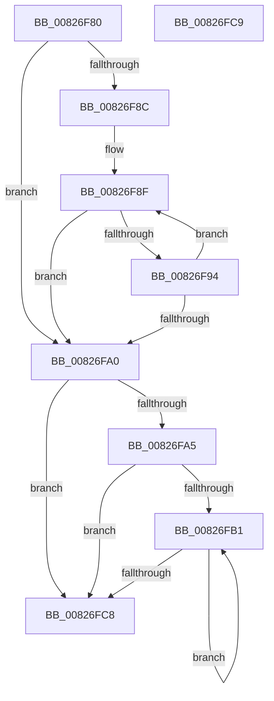

# BiRemoveEntryFromBootOrder

- RVA: `0x00826F80`–`0x00826FCA` (길이 `74` bytes)
- VA: `0x0000000140826F80`
- 실행 섹션: `PAGE`
- PDB 이름 있음: `예`; PDB Function 태그: `아니요`
- unwind 정보 RVA: `0x000DB714`
- 디코드: `27`개 명령, `74/74` bytes 표시
- 미해석 바이트: `0` (있으면 어셈블리에 `.byte`로 보존)

> 이 문서는 커널 이미지의 기계어와 PDB 기호를 분석해 생성했습니다. 4번과 5번은 함수 원형과 자료형을 바이너리 사용 방식에서 추정한 C 해석이며 원본 소스 복구 결과는 아닙니다.

## 1. Dependencies

- 직접 호출 지점: **0**; 고유 호출 대상: **0**
- 직접 호출자로 확인된 함수: **1**
- RIP 상대 이미지 참조: **0**

### Outgoing calls
- 직접 디코드된 call 명령이 없습니다.

### Direct callers
- [BiRemoveBootEntryFromNvramDisplayOrder](BiRemoveBootEntryFromNvramDisplayOrder_function_00826EEC.md) at `0x00826F35`

### Static image references
- 디코드된 RIP-relative 메모리 참조가 없습니다.

## 2. Other-region calls and transfers

- 다른 실행 섹션으로 향하는 call: **0**
- 별도 외부 분기/꼬리 이동을 확인하지 못했습니다.

## 3. Assembly (complete function range)

```asm
00826F80  8B 02                           mov eax, dword ptr [rdx]
00826F82  45 33 C9                        xor r9d, r9d
00826F85  4C 8B D9                        mov r11, rcx
00826F88  85 C0                           test eax, eax
00826F8A  74 14                           je 0x140826fa0
00826F8C  4C 8B D1                        mov r10, rcx
00826F8F  45 39 02                        cmp dword ptr [r10], r8d
00826F92  74 0C                           je 0x140826fa0
00826F94  41 FF C1                        inc r9d
00826F97  49 83 C2 04                     add r10, 4
00826F9B  44 3B C8                        cmp r9d, eax
00826F9E  72 EF                           jb 0x140826f8f
00826FA0  44 3B C8                        cmp r9d, eax
00826FA3  74 23                           je 0x140826fc8
00826FA5  44 8D 40 FF                     lea r8d, [rax - 1]
00826FA9  44 89 02                        mov dword ptr [rdx], r8d
00826FAC  45 3B C8                        cmp r9d, r8d
00826FAF  73 17                           jae 0x140826fc8
00826FB1  41 8D 51 01                     lea edx, [r9 + 1]
00826FB5  41 8B C9                        mov ecx, r9d
00826FB8  41 8B 04 93                     mov eax, dword ptr [r11 + rdx*4]
00826FBC  44 8B CA                        mov r9d, edx
00826FBF  41 89 04 8B                     mov dword ptr [r11 + rcx*4], eax
00826FC3  41 3B D0                        cmp edx, r8d
00826FC6  72 E9                           jb 0x140826fb1
00826FC8  C3                              ret
00826FC9  CC                              int3
```

## 4. C-style interpretation (structured pseudocode)

```c
__int64 __fastcall BiRemoveEntryFromBootOrder(__int64 a1, __int64 a2, int a3, int a4)
{
    __int64 v_r10;

    a4 = 0;
    if ((unsigned int)((unsigned int)(*(unsigned int *)(a2))) == 0) goto loc_00826FA0;
loc_00826F8F:
    if ((*(unsigned int *)(a1)) == a3) goto loc_00826FA0;
    a4 = (unsigned int)((a4) + 1);
    v_r10 = (a1) + (4);
    if (a4 < ((unsigned int)((unsigned int)(*(unsigned int *)(a2))))) goto loc_00826F8F;
loc_00826FA0:
    if (a4 == ((unsigned int)((unsigned int)(*(unsigned int *)(a2))))) goto loc_00826FC8;
    *(unsigned int *)(a2) = (unsigned int)((unsigned int)(*(unsigned int *)(a2)) - 1);
    if (a4 >= ((unsigned int)((unsigned int)(*(unsigned int *)(a2)) - 1))) goto loc_00826FC8;
loc_00826FB1:
    *(unsigned int *)(a1 + (unsigned int)(a4) * 4) = (unsigned int)((unsigned int)(*(unsigned int *)(a1 + a4 + 1 * 4)));
    if (((unsigned int)(a4 + 1)) < ((unsigned int)((unsigned int)(*(unsigned int *)(a2)) - 1))) goto loc_00826FB1;
loc_00826FC8:
    return (unsigned int)(*(unsigned int *)(a1 + a4 + 1 * 4));
}
```

## 5. (Beta) C Style

```c
int64_t BiRemoveEntryFromBootOrder(void *Arg1, void *Arg2, int32_t Arg3, int32_t Arg4)
{
    uint8_t *arg1 = (uint8_t *)Arg1;
    uint8_t *arg2 = (uint8_t *)Arg2;

    int64_t local_r10;

    Arg4 = 0;
    if ((uint32_t)((uint32_t)(*(uint32_t *)(arg2))) == 0) goto loc_00826FA0;
loc_00826F8F:
    if ((*(uint32_t *)(arg1)) == Arg3) goto loc_00826FA0;
    Arg4 = (uint32_t)((Arg4) + 1);
    local_r10 = (Arg1) + (4);
    if (Arg4 < ((uint32_t)((uint32_t)(*(uint32_t *)(arg2))))) goto loc_00826F8F;
loc_00826FA0:
    if (Arg4 == ((uint32_t)((uint32_t)(*(uint32_t *)(arg2))))) goto loc_00826FC8;
    *(uint32_t *)(arg2) = (uint32_t)((uint32_t)(*(uint32_t *)(arg2)) - 1);
    if (Arg4 >= ((uint32_t)((uint32_t)(*(uint32_t *)(arg2)) - 1))) goto loc_00826FC8;
loc_00826FB1:
    *(uint32_t *)(arg1 + (uint32_t)(Arg4) * 4) = (uint32_t)((uint32_t)(*(uint32_t *)(arg1 + Arg4 + 0x1 * 4)));
    if (((uint32_t)(Arg4 + 1)) < ((uint32_t)((uint32_t)(*(uint32_t *)(arg2)) - 1))) goto loc_00826FB1;
loc_00826FC8:
    return (uint32_t)(*(uint32_t *)(arg1 + Arg4 + 0x1 * 4));
}
```

### 관측된 메모리 오프셋

구조체 형식이 확인되지 않은 접근은 인자 기준의 오프셋으로만 기록했습니다.

| 기준 인자 | 오프셋 표현 | 폭 (bit) | 접근 |
|---|---:|---:|---|
| `Arg1` | `+ 0x0` | `32` | `R` |
| `Arg1` | `+ 0x0 + rcx*4` | `32` | `W` |
| `Arg1` | `+ 0x0 + rdx*4` | `32` | `R` |
| `Arg2` | `+ 0x0` | `32` | `R` |
| `Arg2` | `+ 0x0` | `32` | `W` |

## 6. Execution-region graph

[열기: 2D/3D 그래프와 함수 탐색 컨트롤 패널](../../../control-panel.html?section=page&rva=0x00826F80&view=graph)

- 2D 그래프는 위에서 아래로 흐르고, 3D 그래프는 빈 공간을 드래그해 회전합니다. Shift+드래그는 이동, 휠은 확대·축소, 함수 노드 선택은 대상 보고서 이동입니다.

### Static fallback


