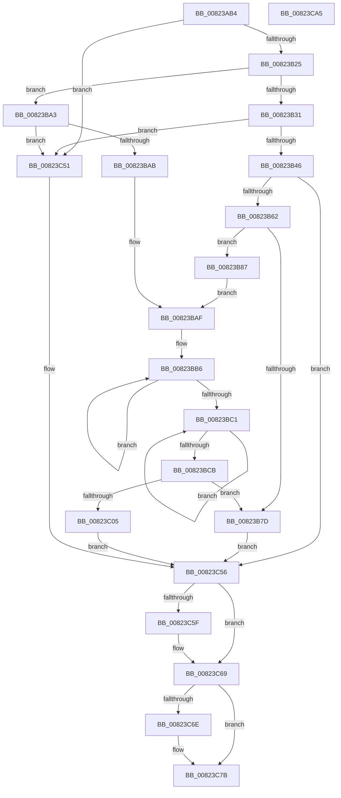

# BiResolveLocateDevice

- RVA: `0x00823AB4`–`0x00823CA6` (길이 `498` bytes)
- VA: `0x0000000140823AB4`
- 실행 섹션: `PAGE`
- PDB 이름 있음: `예`; PDB Function 태그: `아니요`
- unwind 정보 RVA: `0x000C9EA4`
- 디코드: `132`개 명령, `498/498` bytes 표시
- 미해석 바이트: `0` (있으면 어셈블리에 `.byte`로 보존)

> 이 문서는 커널 이미지의 기계어와 PDB 기호를 분석해 생성했습니다. 4번과 5번은 함수 원형과 자료형을 바이너리 사용 방식에서 추정한 C 해석이며 원본 소스 복구 결과는 아닙니다.

## 1. Dependencies

- 직접 호출 지점: **10**; 고유 호출 대상: **6**
- 직접 호출자로 확인된 함수: **1**
- RIP 상대 이미지 참조: **1**

### Outgoing calls
- `0x00823B50` → [BcdGetElementData](../A3/BcdGetElementData_function_00A3E390.md) (function, `0x00A3E390`)
- `0x00823B70` → [ExAllocatePool2](../../poolcode/B8/ExAllocatePool2_function_00B820F0.md) (function, `0x00B820F0`)
- `0x00823B94` → [BcdGetElementData](../A3/BcdGetElementData_function_00A3E390.md) (function, `0x00A3E390`)
- `0x00823BF3` → [ExAllocatePool2](../../poolcode/B8/ExAllocatePool2_function_00B820F0.md) (function, `0x00B820F0`)
- `0x00823C0D` → [RtlAppendUnicodeToString](../../text/40/RtlAppendUnicodeToString_function_0040F990.md) (function, `0x0040F990`)
- `0x00823C19` → [RtlAppendUnicodeToString](../../text/40/RtlAppendUnicodeToString_function_0040F990.md) (function, `0x0040F990`)
- `0x00823C48` → [ZwQueryAttributesFile](../../text/6A/ZwQueryAttributesFile_function_006AD870.md) (function, `0x006AD870`)
- `0x00823C64` → [ExFreePoolWithTag](../../poolcode/B8/ExFreePoolWithTag_function_00B82870.md) (function, `0x00B82870`)
- `0x00823C76` → [ExFreePoolWithTag](../../poolcode/B8/ExFreePoolWithTag_function_00B82870.md) (function, `0x00B82870`)
- `0x00823C84` → [_security_check_cookie](../../text/6A/_security_check_cookie_function_006AC640.md) (function, `0x006AC640`)

### Direct callers
- [sub_00B3A622](../B3/Unknown_function_00B3A622.md) at `0x00B3A781`

### Static image references
- `0x00823AD2` → RVA `0x00E0A740` (`.data`; read)

## 2. Other-region calls and transfers

- 다른 실행 섹션으로 향하는 call: **8**
  - `0x00823B70` → [ExAllocatePool2](../../poolcode/B8/ExAllocatePool2_function_00B820F0.md) (`PAGE` → `POOLCODE`)
  - `0x00823BF3` → [ExAllocatePool2](../../poolcode/B8/ExAllocatePool2_function_00B820F0.md) (`PAGE` → `POOLCODE`)
  - `0x00823C0D` → [RtlAppendUnicodeToString](../../text/40/RtlAppendUnicodeToString_function_0040F990.md) (`PAGE` → `.text`)
  - `0x00823C19` → [RtlAppendUnicodeToString](../../text/40/RtlAppendUnicodeToString_function_0040F990.md) (`PAGE` → `.text`)
  - `0x00823C48` → [ZwQueryAttributesFile](../../text/6A/ZwQueryAttributesFile_function_006AD870.md) (`PAGE` → `.text`)
  - `0x00823C64` → [ExFreePoolWithTag](../../poolcode/B8/ExFreePoolWithTag_function_00B82870.md) (`PAGE` → `POOLCODE`)
  - `0x00823C76` → [ExFreePoolWithTag](../../poolcode/B8/ExFreePoolWithTag_function_00B82870.md) (`PAGE` → `POOLCODE`)
  - `0x00823C84` → [_security_check_cookie](../../text/6A/_security_check_cookie_function_006AC640.md) (`PAGE` → `.text`)
- 별도 외부 분기/꼬리 이동을 확인하지 못했습니다.

## 3. Assembly (complete function range)

```asm
00823AB4  48 89 5C 24 18                  mov qword ptr [rsp + 0x18], rbx
00823AB9  48 89 74 24 20                  mov qword ptr [rsp + 0x20], rsi
00823ABE  55                              push rbp
00823ABF  57                              push rdi
00823AC0  41 54                           push r12
00823AC2  41 56                           push r14
00823AC4  41 57                           push r15
00823AC6  48 8D 6C 24 C9                  lea rbp, [rsp - 0x37]
00823ACB  48 81 EC A0 00 00 00            sub rsp, 0xa0
00823AD2  48 8B 05 67 6C 5E 00            mov rax, qword ptr [rip + 0x5e6c67]
00823AD9  48 33 C4                        xor rax, rsp
00823ADC  48 89 45 27                     mov qword ptr [rbp + 0x27], rax
00823AE0  44 8B 72 18                     mov r14d, dword ptr [rdx + 0x18]
00823AE4  0F 57 C0                        xorps xmm0, xmm0
00823AE7  33 C0                           xor eax, eax
00823AE9  45 33 E4                        xor r12d, r12d
00823AEC  4C 03 F2                        add r14, rdx
00823AEF  44 89 65 B7                     mov dword ptr [rbp - 0x49], r12d
00823AF3  0F 11 45 FF                     movups xmmword ptr [rbp - 1], xmm0
00823AF7  48 89 45 1F                     mov qword ptr [rbp + 0x1f], rax
00823AFB  48 8B FA                        mov rdi, rdx
00823AFE  0F 11 45 0F                     movups xmmword ptr [rbp + 0xf], xmm0
00823B02  48 89 45 EF                     mov qword ptr [rbp - 0x11], rax
00823B06  4C 8B F9                        mov r15, rcx
00823B09  0F 11 45 CF                     movups xmmword ptr [rbp - 0x31], xmm0
00823B0D  89 45 F7                        mov dword ptr [rbp - 9], eax
00823B10  41 8B F4                        mov esi, r12d
00823B13  0F 11 45 DF                     movups xmmword ptr [rbp - 0x21], xmm0
00823B17  0F 11 45 BF                     movups xmmword ptr [rbp - 0x41], xmm0
00823B1B  41 83 3E 02                     cmp dword ptr [r14], 2
00823B1F  0F 85 2C 01 00 00               jne 0x140823c51
00823B25  8B 42 14                        mov eax, dword ptr [rdx + 0x14]
00823B28  41 8D 4C 24 01                  lea ecx, [r12 + 1]
00823B2D  85 C0                           test eax, eax
00823B2F  75 72                           jne 0x140823ba3
00823B31  8B 52 1C                        mov edx, dword ptr [rdx + 0x1c]
00823B34  8B C2                           mov eax, edx
00823B36  25 00 00 00 0F                  and eax, 0xf000000
00823B3B  3D 00 00 00 02                  cmp eax, 0x2000000
00823B40  0F 85 0B 01 00 00               jne 0x140823c51
00823B46  4C 8D 4D B7                     lea r9, [rbp - 0x49]
00823B4A  45 33 C0                        xor r8d, r8d
00823B4D  49 8B CF                        mov rcx, r15
00823B50  E8 3B A8 21 00                  call 0x140a3e390
00823B55  8B D8                           mov ebx, eax
00823B57  3D 23 00 00 C0                  cmp eax, 0xc0000023
00823B5C  0F 85 F4 00 00 00               jne 0x140823c56
00823B62  8B 55 B7                        mov edx, dword ptr [rbp - 0x49]
00823B65  B9 02 01 00 00                  mov ecx, 0x102
00823B6A  41 B8 42 43 44 4B               mov r8d, 0x4b444342
00823B70  E8 7B E5 35 00                  call 0x140b820f0
00823B75  48 8B F0                        mov rsi, rax
00823B78  48 85 C0                        test rax, rax
00823B7B  75 0A                           jne 0x140823b87
00823B7D  BB 9A 00 00 C0                  mov ebx, 0xc000009a
00823B82  E9 CF 00 00 00                  jmp 0x140823c56
00823B87  8B 57 1C                        mov edx, dword ptr [rdi + 0x1c]
00823B8A  4C 8D 4D B7                     lea r9, [rbp - 0x49]
00823B8E  4C 8B C6                        mov r8, rsi
00823B91  49 8B CF                        mov rcx, r15
00823B94  E8 F7 A7 21 00                  call 0x140a3e390
00823B99  B9 01 00 00 00                  mov ecx, 1
00823B9E  48 8B FE                        mov rdi, rsi
00823BA1  EB 0C                           jmp 0x140823baf
00823BA3  3B C1                           cmp eax, ecx
00823BA5  0F 85 A6 00 00 00               jne 0x140823c51
00823BAB  48 83 C7 20                     add rdi, 0x20
00823BAF  48 83 CA FF                     or rdx, 0xffffffffffffffff
00823BB3  4C 8B C2                        mov r8, rdx
00823BB6  49 FF C0                        inc r8
00823BB9  66 47 39 64 46 14               cmp word ptr [r14 + r8*2 + 0x14], r12w
00823BBF  75 F5                           jne 0x140823bb6
00823BC1  48 FF C2                        inc rdx
00823BC4  66 44 39 24 57                  cmp word ptr [rdi + rdx*2], r12w
00823BC9  75 F6                           jne 0x140823bc1
00823BCB  42 8D 04 02                     lea eax, [rdx + r8]
00823BCF  66 03 C1                        add ax, cx
00823BD2  B9 02 01 00 00                  mov ecx, 0x102
00823BD7  66 03 C0                        add ax, ax
00823BDA  66 89 45 C1                     mov word ptr [rbp - 0x3f], ax
00823BDE  49 8D 04 10                     lea rax, [r8 + rdx]
00823BE2  48 8D 04 45 02 00 00 00         lea rax, [rax*2 + 2]
00823BEA  41 B8 42 43 44 4B               mov r8d, 0x4b444342
00823BF0  0F B7 D0                        movzx edx, ax
00823BF3  E8 F8 E4 35 00                  call 0x140b820f0
00823BF8  48 89 45 C7                     mov qword ptr [rbp - 0x39], rax
00823BFC  48 85 C0                        test rax, rax
00823BFF  0F 84 78 FF FF FF               je 0x140823b7d
00823C05  49 8D 56 14                     lea rdx, [r14 + 0x14]
00823C09  48 8D 4D BF                     lea rcx, [rbp - 0x41]
00823C0D  E8 7E BD BE FF                  call 0x14040f990
00823C12  48 8B D7                        mov rdx, rdi
00823C15  48 8D 4D BF                     lea rcx, [rbp - 0x41]
00823C19  E8 72 BD BE FF                  call 0x14040f990
00823C1E  48 8D 45 BF                     lea rax, [rbp - 0x41]
00823C22  C7 45 CF 30 00 00 00            mov dword ptr [rbp - 0x31], 0x30
00823C29  0F 57 C0                        xorps xmm0, xmm0
00823C2C  48 89 45 DF                     mov qword ptr [rbp - 0x21], rax
00823C30  48 8D 55 FF                     lea rdx, [rbp - 1]
00823C34  4C 89 65 D7                     mov qword ptr [rbp - 0x29], r12
00823C38  48 8D 4D CF                     lea rcx, [rbp - 0x31]
00823C3C  C7 45 E7 40 02 00 00            mov dword ptr [rbp - 0x19], 0x240
00823C43  F3 0F 7F 45 EF                  movdqu xmmword ptr [rbp - 0x11], xmm0
00823C48  E8 23 9C E8 FF                  call 0x1406ad870
00823C4D  8B D8                           mov ebx, eax
00823C4F  EB 05                           jmp 0x140823c56
00823C51  BB BB 00 00 C0                  mov ebx, 0xc00000bb
00823C56  48 8B 4D C7                     mov rcx, qword ptr [rbp - 0x39]
00823C5A  48 85 C9                        test rcx, rcx
00823C5D  74 0A                           je 0x140823c69
00823C5F  BA 42 43 44 4B                  mov edx, 0x4b444342
00823C64  E8 07 EC 35 00                  call 0x140b82870
00823C69  48 85 F6                        test rsi, rsi
00823C6C  74 0D                           je 0x140823c7b
00823C6E  BA 42 43 44 4B                  mov edx, 0x4b444342
00823C73  48 8B CE                        mov rcx, rsi
00823C76  E8 F5 EB 35 00                  call 0x140b82870
00823C7B  8B C3                           mov eax, ebx
00823C7D  48 8B 4D 27                     mov rcx, qword ptr [rbp + 0x27]
00823C81  48 33 CC                        xor rcx, rsp
00823C84  E8 B7 89 E8 FF                  call 0x1406ac640
00823C89  4C 8D 9C 24 A0 00 00 00         lea r11, [rsp + 0xa0]
00823C91  49 8B 5B 40                     mov rbx, qword ptr [r11 + 0x40]
00823C95  49 8B 73 48                     mov rsi, qword ptr [r11 + 0x48]
00823C99  49 8B E3                        mov rsp, r11
00823C9C  41 5F                           pop r15
00823C9E  41 5E                           pop r14
00823CA0  41 5C                           pop r12
00823CA2  5F                              pop rdi
00823CA3  5D                              pop rbp
00823CA4  C3                              ret
00823CA5  CC                              int3
```

## 4. C-style interpretation (structured pseudocode)

```c
__int64 __fastcall BiResolveLocateDevice(__int64 a1, __int64 a2, int a3)
{
    __int64 result;
    __int64 v_r12;
    __int64 v_r14;
    __int64 v_rdi;
    __int64 v_rsp;
    unsigned __int64 v_stack_m28;
    unsigned __int64 v_stack_m38;
    unsigned __int64 v_stack_m40;
    unsigned __int64 v_stack_m50;
    unsigned __int64 v_stack_m5F;
    unsigned __int64 v_stack_m60;
    unsigned int v_stack_m68;
    unsigned __int64 v_stack_m70;
    unsigned int v_stack_m78;
    unsigned __int64 v_stack_m80;
    unsigned __int64 v_stack_m88;
    unsigned __int64 v_stack_m90;
    unsigned __int64 v_stack_m98;
    unsigned __int16 v_stack_m9E;
    unsigned __int64 v_stack_mA0;
    unsigned int v_stack_mA8;
    unsigned __int64 v_stack_p18;
    unsigned __int64 v_stack_p20;

    v_stack_p18 = v_rbx;
    v_stack_p20 = v_rsi;
    v_rsp = (v_rsp) - (160);
    result = (*(unsigned __int64 *)(v_rip + 6188135)) ^ (v_rsp);
    v_stack_m38 = result;
    result = 0;
    v_r12 = 0;
    v_r14 = ((unsigned int)(*(unsigned int *)(a2 + 24))) + (a2);
    v_stack_mA8 = 0;
    v_stack_m60 = v_xmm0;
    v_stack_m40 = 0;
    v_stack_m50 = v_xmm0;
    v_stack_m70 = 0;
    v_stack_m90 = v_xmm0;
    v_stack_m68 = 0;
    v_stack_m80 = v_xmm0;
    v_stack_mA0 = v_xmm0;
    if ((*(unsigned int *)(v_r14)) != 2) goto loc_00823C51;
    if ((unsigned int)((unsigned int)(*(unsigned int *)(a2 + 20))) != 0) goto loc_00823BA3;
    result = (unsigned int)(((unsigned int)((unsigned int)((unsigned int)(*(unsigned int *)(a2 + 28))))) & (0xF000000ULL));
    if (((unsigned int)(result)) != 0x2000000ULL) goto loc_00823C51;
    a3 = 0;
    result = BcdGetElementData(a1, (unsigned int)(*(unsigned int *)(a2 + 28)), a3, v_stack_mA8);
    if (((unsigned int)(result)) != 0xC0000023ULL) goto loc_00823C56;
    result = ExAllocatePool2(258, (unsigned int)(v_stack_mA8), (unsigned int)(0x4B444342ULL), v_stack_mA8);
    if (result != 0) goto loc_00823B87;
loc_00823B7D:
    goto loc_00823C56;
loc_00823B87:
    result = BcdGetElementData(a1, (unsigned int)(*(unsigned int *)(a2 + 28)), result, v_stack_mA8);
    goto loc_00823BAF;
loc_00823BA3:
    if (((unsigned int)(result)) != 1) goto loc_00823C51;
    v_rdi = (result) + (32);
loc_00823BAF:
    a2 = ((unsigned int)(*(unsigned int *)(a2 + 28))) | (-1);
loc_00823BB6:
    a3 = (a2) + 1;
    if ((*(unsigned __int16 *)(v_r14 + a3 * 2 + 20)) != 0) goto loc_00823BB6;
loc_00823BC1:
    a2 = (a2) + 1;
    if ((*(unsigned __int16 *)(v_rdi + a2 * 2)) != 0) goto loc_00823BC1;
    result = (unsigned __int16)((a2 + a3 * 1) + (1));
    result = (unsigned __int16)((result) + ((unsigned __int16)(result)));
    v_stack_m9E = (unsigned __int16)(result);
    result = ExAllocatePool2(258, (unsigned __int16)(a3 + a2 * 1 * 2 + 2), (unsigned int)(0x4B444342ULL), v_stack_mA8);
    v_stack_m98 = result;
    if (result == 0) goto loc_00823B7D;
    result = RtlAppendUnicodeToString(v_stack_mA0, v_r14 + 20, (unsigned int)(0x4B444342ULL), v_stack_mA8);
    result = RtlAppendUnicodeToString(v_stack_mA0, v_rdi, (unsigned int)(0x4B444342ULL), v_stack_mA8);
    v_stack_m90 = 48;
    v_stack_m80 = v_stack_mA0;
    v_stack_m88 = 0;
    v_stack_m78 = 576;
    v_stack_m70 = v_xmm0;
    result = ZwQueryAttributesFile(v_stack_m90, v_stack_m60, (unsigned int)(0x4B444342ULL), v_stack_mA8);
    goto loc_00823C56;
loc_00823C51:
loc_00823C56:
    if (v_stack_m98 != 0) {
        a2 = 0x4B444342ULL;
        result = ExFreePoolWithTag(v_stack_m98, a2, (unsigned int)(0x4B444342ULL), v_stack_mA8);
    }
    if (result != 0) {
        a2 = 0x4B444342ULL;
        a1 = result;
        result = ExFreePoolWithTag(a1, a2, (unsigned int)(0x4B444342ULL), v_stack_mA8);
    }
    a1 = (v_stack_m38) ^ (v_rsp);
    result = _security_check_cookie(a1, a2, (unsigned int)(0x4B444342ULL), v_stack_mA8);
    return result;
}
```

## 5. (Beta) C Style

```c
int64_t BiResolveLocateDevice(int64_t Arg1, void *Arg2, int32_t Arg3)
{
    uint8_t *arg2 = (uint8_t *)Arg2;

    int64_t result;
    int64_t local_r12;
    int64_t local_r14;
    int64_t local_rdi;
    int64_t local_rsp;
    uint64_t v_stack_m28;
    uint64_t v_stack_m38;
    uint64_t v_stack_m40;
    uint64_t v_stack_m50;
    uint64_t v_stack_m5F;
    uint64_t v_stack_m60;
    uint32_t v_stack_m68;
    uint64_t v_stack_m70;
    uint32_t v_stack_m78;
    uint64_t v_stack_m80;
    uint64_t v_stack_m88;
    uint64_t v_stack_m90;
    uint64_t v_stack_m98;
    uint16_t v_stack_m9E;
    uint64_t v_stack_mA0;
    uint32_t v_stack_mA8;
    uint64_t v_stack_p18;
    uint64_t v_stack_p20;

    v_stack_p18 = local_rbx;
    v_stack_p20 = local_rsi;
    local_rsp = (local_rsp) - (160);
    result = (*(uint64_t *)(v_rip + 0x5E6C67)) ^ (local_rsp);
    v_stack_m38 = result;
    result = 0;
    local_r12 = 0;
    local_r14 = ((uint32_t)(*(uint32_t *)(arg2 + 0x18))) + (Arg2);
    v_stack_mA8 = 0;
    v_stack_m60 = v_xmm0;
    v_stack_m40 = 0;
    v_stack_m50 = v_xmm0;
    v_stack_m70 = 0;
    v_stack_m90 = v_xmm0;
    v_stack_m68 = 0;
    v_stack_m80 = v_xmm0;
    v_stack_mA0 = v_xmm0;
    if ((*(uint32_t *)(local_r14)) != 2) goto loc_00823C51;
    if ((uint32_t)((uint32_t)(*(uint32_t *)(arg2 + 0x14))) != 0) goto loc_00823BA3;
    result = (uint32_t)(((uint32_t)((uint32_t)((uint32_t)(*(uint32_t *)(arg2 + 0x1C))))) & (0xF000000ULL));
    if (((uint32_t)(result)) != 0x2000000ULL) goto loc_00823C51;
    Arg3 = 0;
    result = BcdGetElementData(Arg1, (uint32_t)(*(uint32_t *)(arg2 + 0x1C)), Arg3, v_stack_mA8);
    if (((uint32_t)(result)) != 0xC0000023ULL) goto loc_00823C56;
    result = ExAllocatePool2(258, (uint32_t)(v_stack_mA8), (uint32_t)(0x4B444342ULL), v_stack_mA8);
    if (result != 0) goto loc_00823B87;
loc_00823B7D:
    goto loc_00823C56;
loc_00823B87:
    result = BcdGetElementData(Arg1, (uint32_t)(*(uint32_t *)(arg2 + 0x1C)), result, v_stack_mA8);
    goto loc_00823BAF;
loc_00823BA3:
    if (((uint32_t)(result)) != 1) goto loc_00823C51;
    local_rdi = (result) + (32);
loc_00823BAF:
    Arg2 = ((uint32_t)(*(uint32_t *)(arg2 + 0x1C))) | (-1);
loc_00823BB6:
    Arg3 = (Arg2) + 1;
    if ((*(uint16_t *)(local_r14 + Arg3 * 2 + 0x14)) != 0) goto loc_00823BB6;
loc_00823BC1:
    Arg2 = (Arg2) + 1;
    if ((*(uint16_t *)(local_rdi + arg2 * 2)) != 0) goto loc_00823BC1;
    result = (uint16_t)((Arg2 + Arg3 * 1) + (1));
    result = (uint16_t)((result) + ((uint16_t)(result)));
    v_stack_m9E = (uint16_t)(result);
    result = ExAllocatePool2(258, (uint16_t)(Arg3 + Arg2 * 1 * 2 + 2), (uint32_t)(0x4B444342ULL), v_stack_mA8);
    v_stack_m98 = result;
    if (result == 0) goto loc_00823B7D;
    result = RtlAppendUnicodeToString(v_stack_mA0, local_r14 + 20, (uint32_t)(0x4B444342ULL), v_stack_mA8);
    result = RtlAppendUnicodeToString(v_stack_mA0, local_rdi, (uint32_t)(0x4B444342ULL), v_stack_mA8);
    v_stack_m90 = 48;
    v_stack_m80 = v_stack_mA0;
    v_stack_m88 = 0;
    v_stack_m78 = 576;
    v_stack_m70 = v_xmm0;
    result = ZwQueryAttributesFile(v_stack_m90, v_stack_m60, (uint32_t)(0x4B444342ULL), v_stack_mA8);
    goto loc_00823C56;
loc_00823C51:
loc_00823C56:
    if (v_stack_m98 != 0) {
        Arg2 = 0x4B444342ULL;
        result = ExFreePoolWithTag(v_stack_m98, Arg2, (uint32_t)(0x4B444342ULL), v_stack_mA8);
    }
    if (result != 0) {
        Arg2 = 0x4B444342ULL;
        Arg1 = result;
        result = ExFreePoolWithTag(Arg1, Arg2, (uint32_t)(0x4B444342ULL), v_stack_mA8);
    }
    Arg1 = (v_stack_m38) ^ (local_rsp);
    result = _security_check_cookie(Arg1, Arg2, (uint32_t)(0x4B444342ULL), v_stack_mA8);
    return result;
}
```

### 관측된 메모리 오프셋

구조체 형식이 확인되지 않은 접근은 인자 기준의 오프셋으로만 기록했습니다.

| 기준 인자 | 오프셋 표현 | 폭 (bit) | 접근 |
|---|---:|---:|---|
| `Arg2` | `+ 0x14` | `32` | `R` |
| `Arg2` | `+ 0x18` | `32` | `R` |
| `Arg2` | `+ 0x1C` | `32` | `R` |

## 6. Execution-region graph

[열기: 2D/3D 그래프와 함수 탐색 컨트롤 패널](../../../control-panel.html?section=page&rva=0x00823AB4&view=graph)

- 2D 그래프는 위에서 아래로 흐르고, 3D 그래프는 빈 공간을 드래그해 회전합니다. Shift+드래그는 이동, 휠은 확대·축소, 함수 노드 선택은 대상 보고서 이동입니다.

### Static fallback


