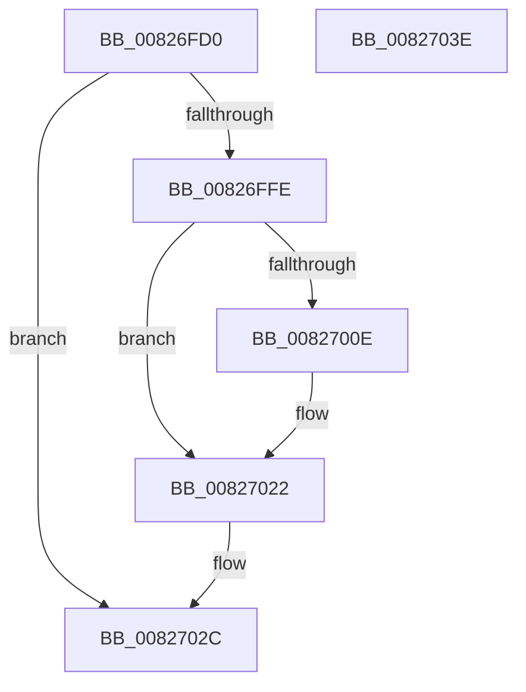

# BiSetBootOptions

- RVA: `0x00826FD0`–`0x0082703F` (길이 `111` bytes)
- VA: `0x0000000140826FD0`
- 실행 섹션: `PAGE`
- PDB 이름 있음: `예`; PDB Function 태그: `아니요`
- unwind 정보 RVA: `0x000BC3A0`
- 디코드: `33`개 명령, `111/111` bytes 표시
- 미해석 바이트: `0` (있으면 어셈블리에 `.byte`로 보존)

> 이 문서는 커널 이미지의 기계어와 PDB 기호를 분석해 생성했습니다. 4번과 5번은 함수 원형과 자료형을 바이너리 사용 방식에서 추정한 C 해석이며 원본 소스 복구 결과는 아닙니다.

## 1. Dependencies

- 직접 호출 지점: **4**; 고유 호출 대상: **4**
- 직접 호출자로 확인된 함수: **1**
- RIP 상대 이미지 참조: **1**

### Outgoing calls
- `0x00826FF3` → [BiAcquirePrivilege](../A3/BiAcquirePrivilege_function_00A3D658.md) (function, `0x00A3D658`)
- `0x00827003` → [ZwSetBootOptions](../../text/6B/ZwSetBootOptions_function_006B03D0.md) (function, `0x006B03D0`)
- `0x0082701D` → [BiLogMessage](../A3/BiLogMessage_function_00A3D3A8.md) (function, `0x00A3D3A8`)
- `0x00827027` → [BiReleasePrivilege](../A3/BiReleasePrivilege_function_00A3D600.md) (function, `0x00A3D600`)

### Direct callers
- [BiExportEfiBootManager](../AC/BiExportEfiBootManager_function_00ACB13C.md) at `0x00ACB3E1`

### Static image references
- `0x00827011` → RVA `0x00B0CD60` (` ?? ::NNGAKEGL::`string'`; read)

## 2. Other-region calls and transfers

- 다른 실행 섹션으로 향하는 call: **1**
  - `0x00827003` → [ZwSetBootOptions](../../text/6B/ZwSetBootOptions_function_006B03D0.md) (`PAGE` → `.text`)
- 별도 외부 분기/꼬리 이동을 확인하지 못했습니다.

## 3. Assembly (complete function range)

```asm
00826FD0  48 8B C4                        mov rax, rsp
00826FD3  48 89 58 08                     mov qword ptr [rax + 8], rbx
00826FD7  48 89 70 10                     mov qword ptr [rax + 0x10], rsi
00826FDB  57                              push rdi
00826FDC  48 83 EC 20                     sub rsp, 0x20
00826FE0  48 83 60 18 00                  and qword ptr [rax + 0x18], 0
00826FE5  8B FA                           mov edi, edx
00826FE7  48 8B F1                        mov rsi, rcx
00826FEA  48 8D 50 18                     lea rdx, [rax + 0x18]
00826FEE  B9 16 00 00 00                  mov ecx, 0x16
00826FF3  E8 60 66 21 00                  call 0x140a3d658
00826FF8  8B D8                           mov ebx, eax
00826FFA  85 C0                           test eax, eax
00826FFC  78 2E                           js 0x14082702c
00826FFE  8B D7                           mov edx, edi
00827000  48 8B CE                        mov rcx, rsi
00827003  E8 C8 93 E8 FF                  call 0x1406b03d0
00827008  8B D8                           mov ebx, eax
0082700A  85 C0                           test eax, eax
0082700C  79 14                           jns 0x140827022
0082700E  44 8B C0                        mov r8d, eax
00827011  48 8D 15 48 5D 2E 00            lea rdx, [rip + 0x2e5d48]
00827018  B9 04 00 00 00                  mov ecx, 4
0082701D  E8 86 63 21 00                  call 0x140a3d3a8
00827022  48 8D 4C 24 40                  lea rcx, [rsp + 0x40]
00827027  E8 D4 65 21 00                  call 0x140a3d600
0082702C  48 8B 74 24 38                  mov rsi, qword ptr [rsp + 0x38]
00827031  8B C3                           mov eax, ebx
00827033  48 8B 5C 24 30                  mov rbx, qword ptr [rsp + 0x30]
00827038  48 83 C4 20                     add rsp, 0x20
0082703C  5F                              pop rdi
0082703D  C3                              ret
0082703E  CC                              int3
```

## 4. C-style interpretation (structured pseudocode)

```c
__int64 __fastcall BiSetBootOptions(__int64 a1, int a2)
{
    __int64 result;
    __int64 v_rsp;
    unsigned __int64 v_stack_p10;
    unsigned __int64 v_stack_p18;
    unsigned __int64 v_stack_p8;

    *(unsigned __int64 *)(v_rsp + 8) = v_rbx;
    *(unsigned __int64 *)(v_rsp + 16) = v_rsi;
    v_rsp = (v_rsp) - (32);
    result = BiAcquirePrivilege(22, v_rsp + 24, a3, a4);
    if (sign_flag) goto loc_0082702C;
    result = ZwSetBootOptions(a1, (unsigned int)((unsigned int)((unsigned int)(a2))), a3, a4);
    if (sign_flag) {
        a3 = (unsigned int)(result);
        a2 = v_rip + 3038536;
        a1 = 4;
        result = BiLogMessage(a1, a2, a3, a4);
    }
    result = BiReleasePrivilege(v_stack_p18, a2, a3, a4);
loc_0082702C:
    v_rsp = (v_rsp) + (32);
    return (unsigned int)((unsigned int)((unsigned int)((unsigned int)(result))));
}
```

## 5. (Beta) C Style

```c
int64_t BiSetBootOptions(int64_t Arg1, int32_t Arg2)
{
    int64_t result;
    int64_t local_rsp;
    uint64_t v_stack_p10;
    uint64_t v_stack_p18;
    uint64_t v_stack_p8;

    *(uint64_t *)(local_rsp + 0x8) = local_rbx;
    *(uint64_t *)(local_rsp + 0x10) = local_rsi;
    local_rsp = (local_rsp) - (32);
    result = BiAcquirePrivilege(22, local_rsp + 24, a3, a4);
    if (sign_flag) goto loc_0082702C;
    result = ZwSetBootOptions(Arg1, (uint32_t)((uint32_t)((uint32_t)(Arg2))), a3, a4);
    if (sign_flag) {
        a3 = (uint32_t)(result);
        Arg2 = v_rip + 3038536;
        Arg1 = 4;
        result = BiLogMessage(Arg1, Arg2, a3, a4);
    }
    result = BiReleasePrivilege(v_stack_p18, Arg2, a3, a4);
loc_0082702C:
    local_rsp = (local_rsp) + (32);
    return (uint32_t)((uint32_t)((uint32_t)((uint32_t)(result))));
}
```

## 6. Execution-region graph

[열기: 2D/3D 그래프와 함수 탐색 컨트롤 패널](../../../control-panel.html?section=page&rva=0x00826FD0&view=graph)

- 2D 그래프는 위에서 아래로 흐르고, 3D 그래프는 빈 공간을 드래그해 회전합니다. Shift+드래그는 이동, 휠은 확대·축소, 함수 노드 선택은 대상 보고서 이동입니다.

### Static fallback


