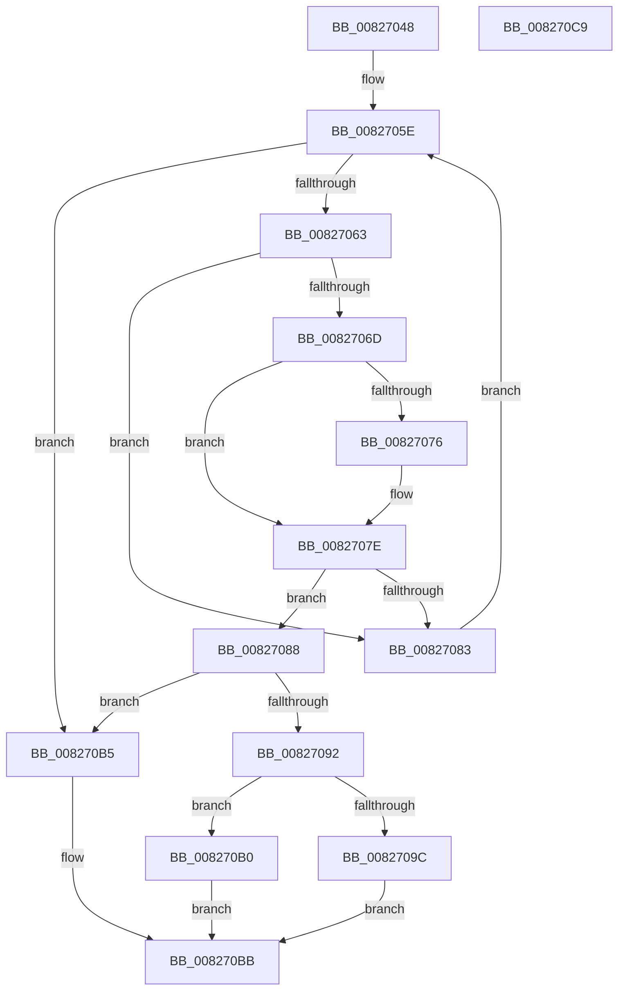

# BiTranslateObjectIdentifier

- RVA: `0x00827048`–`0x008270CA` (길이 `130` bytes)
- VA: `0x0000000140827048`
- 실행 섹션: `PAGE`
- PDB 이름 있음: `예`; PDB Function 태그: `아니요`
- unwind 정보 RVA: `0x0005CAAC`
- 디코드: `40`개 명령, `130/130` bytes 표시
- 미해석 바이트: `0` (있으면 어셈블리에 `.byte`로 보존)

> 이 문서는 커널 이미지의 기계어와 PDB 기호를 분석해 생성했습니다. 4번과 5번은 함수 원형과 자료형을 바이너리 사용 방식에서 추정한 C 해석이며 원본 소스 복구 결과는 아닙니다.

## 1. Dependencies

- 직접 호출 지점: **1**; 고유 호출 대상: **1**
- 직접 호출자로 확인된 함수: **3**
- RIP 상대 이미지 참조: **1**

### Outgoing calls
- `0x008270A3` → [BiLogMessage](../A3/BiLogMessage_function_00A3D3A8.md) (function, `0x00A3D3A8`)

### Direct callers
- [BiHandleFirmwareDefaultEntry](BiHandleFirmwareDefaultEntry_function_00826D08.md) at `0x00826D81`
- [BiTranslateDisplayOrder](../AC/BiTranslateDisplayOrder_function_00AC2144.md) at `0x00AC2185`
- [BiExportEfiBootManager](../AC/BiExportEfiBootManager_function_00ACB13C.md) at `0x00ACB35A`

### Static image references
- `0x0082709C` → RVA `0x00B0C580` (` ?? ::NNGAKEGL::`string'`; read)

## 2. Other-region calls and transfers

- 다른 실행 섹션으로 향하는 call: **0**
- 별도 외부 분기/꼬리 이동을 확인하지 못했습니다.

## 3. Assembly (complete function range)

```asm
00827048  48 89 5C 24 08                  mov qword ptr [rsp + 8], rbx
0082704D  57                              push rdi
0082704E  48 83 EC 20                     sub rsp, 0x20
00827052  4C 8B 09                        mov r9, qword ptr [rcx]
00827055  49 8B F8                        mov rdi, r8
00827058  48 8B D9                        mov rbx, rcx
0082705B  45 33 D2                        xor r10d, r10d
0082705E  4C 3B CB                        cmp r9, rbx
00827061  74 52                           je 0x1408270b5
00827063  45 8B 59 30                     mov r11d, dword ptr [r9 + 0x30]
00827067  41 F6 C3 04                     test r11b, 4
0082706B  74 16                           je 0x140827083
0082706D  48 8B 0A                        mov rcx, qword ptr [rdx]
00827070  49 2B 49 10                     sub rcx, qword ptr [r9 + 0x10]
00827074  75 08                           jne 0x14082707e
00827076  48 8B 4A 08                     mov rcx, qword ptr [rdx + 8]
0082707A  49 2B 49 18                     sub rcx, qword ptr [r9 + 0x18]
0082707E  48 85 C9                        test rcx, rcx
00827081  74 05                           je 0x140827088
00827083  4D 8B 09                        mov r9, qword ptr [r9]
00827086  EB D6                           jmp 0x14082705e
00827088  B9 03 00 00 00                  mov ecx, 3
0082708D  44 84 D9                        test cl, r11b
00827090  74 23                           je 0x1408270b5
00827092  45 8B 41 20                     mov r8d, dword ptr [r9 + 0x20]
00827096  41 F6 C3 10                     test r11b, 0x10
0082709A  74 14                           je 0x1408270b0
0082709C  48 8D 15 DD 54 2E 00            lea rdx, [rip + 0x2e54dd]
008270A3  E8 00 63 21 00                  call 0x140a3d3a8
008270A8  41 BA 24 00 00 C0               mov r10d, 0xc0000024
008270AE  EB 0B                           jmp 0x1408270bb
008270B0  44 89 07                        mov dword ptr [rdi], r8d
008270B3  EB 06                           jmp 0x1408270bb
008270B5  41 BA 25 02 00 C0               mov r10d, 0xc0000225
008270BB  48 8B 5C 24 30                  mov rbx, qword ptr [rsp + 0x30]
008270C0  41 8B C2                        mov eax, r10d
008270C3  48 83 C4 20                     add rsp, 0x20
008270C7  5F                              pop rdi
008270C8  C3                              ret
008270C9  CC                              int3
```

## 4. C-style interpretation (structured pseudocode)

```c
__int64 __fastcall BiTranslateObjectIdentifier(__int64 a1, __int64 a2, __int64 a3)
{
    __int64 result;
    __int64 v_r10;
    __int64 v_rsp;
    unsigned __int64 v_stack_p8;

    v_stack_p8 = v_rbx;
    v_rsp = (v_rsp) - (32);
    v_r10 = 0;
loc_0082705E:
    if ((*(unsigned __int64 *)(a1)) == a1) goto loc_008270B5;
    if ((((unsigned __int8)((unsigned int)(*(unsigned int *)(*(unsigned __int64 *)(a1) + 48)))) & (4)) == 0) goto loc_00827083;
    a1 = (*(unsigned __int64 *)(a2)) - (*(unsigned __int64 *)(*(unsigned __int64 *)(a1) + 16));
    if (!(condition_is_not_equal)) {
        a1 = *(unsigned __int64 *)(a2 + 8);
        a1 = (a1) - (*(unsigned __int64 *)(*(unsigned __int64 *)(a1) + 24));
    }
    if (a1 == 0) goto loc_00827088;
loc_00827083:
    goto loc_0082705E;
loc_00827088:
    if (((3) & ((unsigned __int8)((unsigned int)(*(unsigned int *)(*(unsigned __int64 *)(a1) + 48))))) == 0) goto loc_008270B5;
    if ((((unsigned __int8)((unsigned int)(*(unsigned int *)(*(unsigned __int64 *)(a1) + 48)))) & (16)) == 0) goto loc_008270B0;
    result = BiLogMessage(3, v_rip + 3036381, (unsigned int)(*(unsigned int *)(*(unsigned __int64 *)(*(unsigned __int64 *)(a1)) + 32)), *(unsigned __int64 *)(*(unsigned __int64 *)(a1)));
    goto loc_008270BB;
loc_008270B0:
    *(unsigned int *)(a3) = (unsigned int)((unsigned int)(*(unsigned int *)(*(unsigned __int64 *)(*(unsigned __int64 *)(a1)) + 32)));
    goto loc_008270BB;
loc_008270B5:
loc_008270BB:
    v_rsp = (v_rsp) + (32);
    return (unsigned int)((unsigned int)((unsigned int)(0xC0000225ULL)));
}
```

## 5. (Beta) C Style

```c
int64_t BiTranslateObjectIdentifier(void *Arg1, void *Arg2, void *Arg3)
{
    uint8_t *arg1 = (uint8_t *)Arg1;
    uint8_t *arg2 = (uint8_t *)Arg2;
    uint8_t *arg3 = (uint8_t *)Arg3;

    int64_t result;
    int64_t local_r10;
    int64_t local_rsp;
    uint64_t v_stack_p8;

    v_stack_p8 = local_rbx;
    local_rsp = (local_rsp) - (32);
    local_r10 = 0;
loc_0082705E:
    if ((*(uint64_t *)(arg1)) == Arg1) goto loc_008270B5;
    if ((((uint8_t)((uint32_t)(*(uint32_t *)(*(uint64_t *)(arg1) + 0x30)))) & (4)) == 0) goto loc_00827083;
    Arg1 = (*(uint64_t *)(arg2)) - (*(uint64_t *)(*(uint64_t *)(arg1) + 0x10));
    if (!(condition_is_not_equal)) {
        Arg1 = *(uint64_t *)(arg2 + 0x8);
        Arg1 = (Arg1) - (*(uint64_t *)(*(uint64_t *)(arg1) + 0x18));
    }
    if (Arg1 == NULL) goto loc_00827088;
loc_00827083:
    goto loc_0082705E;
loc_00827088:
    if (((3) & ((uint8_t)((uint32_t)(*(uint32_t *)(*(uint64_t *)(arg1) + 0x30))))) == 0) goto loc_008270B5;
    if ((((uint8_t)((uint32_t)(*(uint32_t *)(*(uint64_t *)(arg1) + 0x30)))) & (16)) == 0) goto loc_008270B0;
    result = BiLogMessage(3, v_rip + 3036381, (uint32_t)(*(uint32_t *)(*(uint64_t *)(*(uint64_t *)(arg1)) + 0x20)), *(uint64_t *)(*(uint64_t *)(arg1)));
    goto loc_008270BB;
loc_008270B0:
    *(uint32_t *)(arg3) = (uint32_t)((uint32_t)(*(uint32_t *)(*(uint64_t *)(*(uint64_t *)(arg1)) + 0x20)));
    goto loc_008270BB;
loc_008270B5:
loc_008270BB:
    local_rsp = (local_rsp) + (32);
    return (uint32_t)((uint32_t)((uint32_t)(0xC0000225ULL)));
}
```

### 관측된 메모리 오프셋

구조체 형식이 확인되지 않은 접근은 인자 기준의 오프셋으로만 기록했습니다.

| 기준 인자 | 오프셋 표현 | 폭 (bit) | 접근 |
|---|---:|---:|---|
| `Arg1` | `+ 0x0` | `64` | `R` |
| `Arg2` | `+ 0x0` | `64` | `R` |
| `Arg2` | `+ 0x8` | `64` | `R` |
| `Arg3` | `+ 0x0` | `32` | `W` |

## 6. Execution-region graph

[열기: 2D/3D 그래프와 함수 탐색 컨트롤 패널](../../../control-panel.html?section=page&rva=0x00827048&view=graph)

- 2D 그래프는 위에서 아래로 흐르고, 3D 그래프는 빈 공간을 드래그해 회전합니다. Shift+드래그는 이동, 휠은 확대·축소, 함수 노드 선택은 대상 보고서 이동입니다.

### Static fallback


