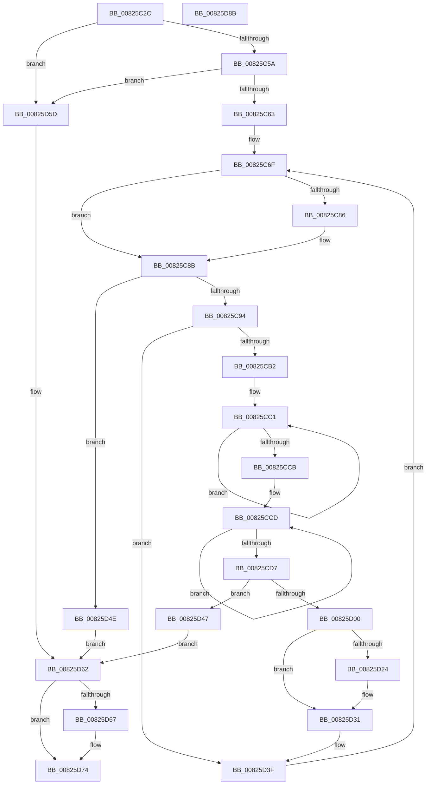

# BiTranslateSymbolicLinkFile

- RVA: `0x00825C2C`–`0x00825D8C` (길이 `352` bytes)
- VA: `0x0000000140825C2C`
- 실행 섹션: `PAGE`
- PDB 이름 있음: `예`; PDB Function 태그: `아니요`
- unwind 정보 RVA: `0x000B384C`
- 디코드: `104`개 명령, `352/352` bytes 표시
- 미해석 바이트: `0` (있으면 어셈블리에 `.byte`로 보존)

> 이 문서는 커널 이미지의 기계어와 PDB 기호를 분석해 생성했습니다. 4번과 5번은 함수 원형과 자료형을 바이너리 사용 방식에서 추정한 C 해석이며 원본 소스 복구 결과는 아닙니다.

## 1. Dependencies

- 직접 호출 지점: **7**; 고유 호출 대상: **5**
- 직접 호출자로 확인된 함수: **1**
- RIP 상대 이미지 참조: **0**

### Outgoing calls
- `0x00825C79` → [wcsrchr](../../text/50/wcsrchr_function_00501E50.md) (function, `0x00501E50`)
- `0x00825CA0` → [BiTranslateSymbolicLink](../A9/BiTranslateSymbolicLink_function_00A9BA0C.md) (function, `0x00A9BA0C`)
- `0x00825CF0` → [ExAllocatePool2](../../poolcode/B8/ExAllocatePool2_function_00B820F0.md) (function, `0x00B820F0`)
- `0x00825D09` → [memcpy](../../text/6C/memcpy_function_006C6840.md) (function, `0x006C6840`)
- `0x00825D1A` → [memcpy](../../text/6C/memcpy_function_006C6840.md) (function, `0x006C6840`)
- `0x00825D2C` → [ExFreePoolWithTag](../../poolcode/B8/ExFreePoolWithTag_function_00B82870.md) (function, `0x00B82870`)
- `0x00825D6F` → [ExFreePoolWithTag](../../poolcode/B8/ExFreePoolWithTag_function_00B82870.md) (function, `0x00B82870`)

### Direct callers
- [BiGetPartitionVhdFilePathFromUnicodeString](../A9/BiGetPartitionVhdFilePathFromUnicodeString_function_00A9E624.md) at `0x00A9E761`

### Static image references
- 디코드된 RIP-relative 메모리 참조가 없습니다.

## 2. Other-region calls and transfers

- 다른 실행 섹션으로 향하는 call: **6**
  - `0x00825C79` → [wcsrchr](../../text/50/wcsrchr_function_00501E50.md) (`PAGE` → `.text`)
  - `0x00825CF0` → [ExAllocatePool2](../../poolcode/B8/ExAllocatePool2_function_00B820F0.md) (`PAGE` → `POOLCODE`)
  - `0x00825D09` → [memcpy](../../text/6C/memcpy_function_006C6840.md) (`PAGE` → `.text`)
  - `0x00825D1A` → [memcpy](../../text/6C/memcpy_function_006C6840.md) (`PAGE` → `.text`)
  - `0x00825D2C` → [ExFreePoolWithTag](../../poolcode/B8/ExFreePoolWithTag_function_00B82870.md) (`PAGE` → `POOLCODE`)
  - `0x00825D6F` → [ExFreePoolWithTag](../../poolcode/B8/ExFreePoolWithTag_function_00B82870.md) (`PAGE` → `POOLCODE`)
- 별도 외부 분기/꼬리 이동을 확인하지 못했습니다.

## 3. Assembly (complete function range)

```asm
00825C2C  48 89 5C 24 10                  mov qword ptr [rsp + 0x10], rbx
00825C31  55                              push rbp
00825C32  56                              push rsi
00825C33  57                              push rdi
00825C34  41 54                           push r12
00825C36  41 55                           push r13
00825C38  41 56                           push r14
00825C3A  41 57                           push r15
00825C3C  48 83 EC 20                     sub rsp, 0x20
00825C40  45 33 ED                        xor r13d, r13d
00825C43  4C 8B F2                        mov r14, rdx
00825C46  4C 89 6C 24 70                  mov qword ptr [rsp + 0x70], r13
00825C4B  4C 8B E1                        mov r12, rcx
00825C4E  41 8B FD                        mov edi, r13d
00825C51  48 85 C9                        test rcx, rcx
00825C54  0F 84 03 01 00 00               je 0x140825d5d
00825C5A  48 85 D2                        test rdx, rdx
00825C5D  0F 84 FA 00 00 00               je 0x140825d5d
00825C63  4C 89 2A                        mov qword ptr [rdx], r13
00825C66  48 8B E9                        mov rbp, rcx
00825C69  41 8B F5                        mov esi, r13d
00825C6C  45 8A FD                        mov r15b, r13b
00825C6F  B8 5C 00 00 00                  mov eax, 0x5c
00825C74  48 8B CD                        mov rcx, rbp
00825C77  8B D0                           mov edx, eax
00825C79  E8 D2 C1 CD FF                  call 0x140501e50
00825C7E  48 8B D8                        mov rbx, rax
00825C81  48 85 F6                        test rsi, rsi
00825C84  74 05                           je 0x140825c8b
00825C86  66 C7 06 5C 00                  mov word ptr [rsi], 0x5c
00825C8B  48 85 DB                        test rbx, rbx
00825C8E  0F 84 BA 00 00 00               je 0x140825d4e
00825C94  48 8D 54 24 70                  lea rdx, [rsp + 0x70]
00825C99  66 44 89 28                     mov word ptr [rax], r13w
00825C9D  48 8B CD                        mov rcx, rbp
00825CA0  E8 67 5D 27 00                  call 0x140a9ba0c
00825CA5  48 8B 7C 24 70                  mov rdi, qword ptr [rsp + 0x70]
00825CAA  85 C0                           test eax, eax
00825CAC  0F 88 8D 00 00 00               js 0x140825d3f
00825CB2  48 83 C8 FF                     or rax, 0xffffffffffffffff
00825CB6  66 C7 03 5C 00                  mov word ptr [rbx], 0x5c
00825CBB  48 8B F0                        mov rsi, rax
00825CBE  41 B7 01                        mov r15b, 1
00825CC1  48 FF C6                        inc rsi
00825CC4  66 44 39 2C 77                  cmp word ptr [rdi + rsi*2], r13w
00825CC9  75 F6                           jne 0x140825cc1
00825CCB  03 F6                           add esi, esi
00825CCD  48 FF C0                        inc rax
00825CD0  66 44 39 2C 43                  cmp word ptr [rbx + rax*2], r13w
00825CD5  75 F6                           jne 0x140825ccd
00825CD7  8D 04 45 02 00 00 00            lea eax, [rax*2 + 2]
00825CDE  B9 02 01 00 00                  mov ecx, 0x102
00825CE3  8D 14 06                        lea edx, [rsi + rax]
00825CE6  89 44 24 60                     mov dword ptr [rsp + 0x60], eax
00825CEA  41 B8 42 43 44 4B               mov r8d, 0x4b444342
00825CF0  E8 FB C3 35 00                  call 0x140b820f0
00825CF5  49 89 06                        mov qword ptr [r14], rax
00825CF8  4C 8B E8                        mov r13, rax
00825CFB  48 85 C0                        test rax, rax
00825CFE  74 47                           je 0x140825d47
00825D00  4C 8B C6                        mov r8, rsi
00825D03  48 8B D7                        mov rdx, rdi
00825D06  48 8B C8                        mov rcx, rax
00825D09  E8 32 0B EA FF                  call 0x1406c6840
00825D0E  44 8B 44 24 60                  mov r8d, dword ptr [rsp + 0x60]
00825D13  4A 8D 0C 2E                     lea rcx, [rsi + r13]
00825D17  48 8B D3                        mov rdx, rbx
00825D1A  E8 21 0B EA FF                  call 0x1406c6840
00825D1F  49 3B EC                        cmp rbp, r12
00825D22  74 0D                           je 0x140825d31
00825D24  BA 42 43 44 4B                  mov edx, 0x4b444342
00825D29  48 8B CD                        mov rcx, rbp
00825D2C  E8 3F CB 35 00                  call 0x140b82870
00825D31  49 8B 2E                        mov rbp, qword ptr [r14]
00825D34  45 33 ED                        xor r13d, r13d
00825D37  48 8D 1C 2E                     lea rbx, [rsi + rbp]
00825D3B  66 44 89 2B                     mov word ptr [rbx], r13w
00825D3F  48 8B F3                        mov rsi, rbx
00825D42  E9 28 FF FF FF                  jmp 0x140825c6f
00825D47  BB 17 00 00 C0                  mov ebx, 0xc0000017
00825D4C  EB 14                           jmp 0x140825d62
00825D4E  41 F6 DF                        neg r15b
00825D51  1B DB                           sbb ebx, ebx
00825D53  F7 D3                           not ebx
00825D55  81 E3 01 00 00 C0               and ebx, 0xc0000001
00825D5B  EB 05                           jmp 0x140825d62
00825D5D  BB 0D 00 00 C0                  mov ebx, 0xc000000d
00825D62  48 85 FF                        test rdi, rdi
00825D65  74 0D                           je 0x140825d74
00825D67  BA 42 43 44 4B                  mov edx, 0x4b444342
00825D6C  48 8B CF                        mov rcx, rdi
00825D6F  E8 FC CA 35 00                  call 0x140b82870
00825D74  8B C3                           mov eax, ebx
00825D76  48 8B 5C 24 68                  mov rbx, qword ptr [rsp + 0x68]
00825D7B  48 83 C4 20                     add rsp, 0x20
00825D7F  41 5F                           pop r15
00825D81  41 5E                           pop r14
00825D83  41 5D                           pop r13
00825D85  41 5C                           pop r12
00825D87  5F                              pop rdi
00825D88  5E                              pop rsi
00825D89  5D                              pop rbp
00825D8A  C3                              ret
00825D8B  CC                              int3
```

## 4. C-style interpretation (structured pseudocode)

```c
__int64 __fastcall BiTranslateSymbolicLinkFile(__int64 a1, __int64 a2)
{
    __int64 result;
    __int64 v_r13;
    __int64 v_r15;
    __int64 v_rbx;
    __int64 v_rsi;
    __int64 v_rsp;
    unsigned __int64 v_stack_p10;
    unsigned __int64 v_stack_p18;
    unsigned int v_stack_p8;

    v_stack_p10 = v_rbx;
    v_rsp = (v_rsp) - (32);
    v_r13 = 0;
    v_stack_p18 = 0;
    if (a1 == 0) goto loc_00825D5D;
    if (a2 == 0) goto loc_00825D5D;
    *(unsigned __int64 *)(a2) = 0;
loc_00825C6F:
    result = wcsrchr(a1, 92, a3, a4);
    if (0 != 0) {
        *(unsigned __int16 *)(0) = 92;
    }
    if (result == 0) goto loc_00825D4E;
    *(unsigned __int16 *)(result) = 0;
    result = BiTranslateSymbolicLink(a1, v_stack_p18, a3, a4);
    if (sign_flag) goto loc_00825D3F;
    result = (result) | (-1);
    *(unsigned __int16 *)(result) = 92;
loc_00825CC1:
    v_rsi = (result) + 1;
    if ((*(unsigned __int16 *)(v_stack_p18 + v_rsi * 2)) != 0) goto loc_00825CC1;
    v_rsi = (unsigned int)((v_rsi) + ((unsigned int)(v_rsi)));
loc_00825CCD:
    result = (result) + 1;
    if ((*(unsigned __int16 *)(result + result * 2)) != 0) goto loc_00825CCD;
    v_stack_p8 = (unsigned int)(result * 2 + 2);
    result = ExAllocatePool2(258, v_rsi + result * 2 + 2 * 1, (unsigned int)(0x4B444342ULL), a4);
    *(unsigned __int64 *)(a2) = result;
    if (result == 0) goto loc_00825D47;
    result = memcpy(result, v_stack_p18, v_rsi, a4);
    result = memcpy(v_rsi + result * 1, result, (unsigned int)(v_stack_p8), a4);
    if (a1 != a1) {
        a2 = 0x4B444342ULL;
        a1 = a1;
        result = ExFreePoolWithTag(a1, a2, (unsigned int)(v_stack_p8), a4);
    }
    v_r13 = 0;
    *(unsigned __int16 *)(v_rsi + *(unsigned __int64 *)(a2) * 1) = 0;
loc_00825D3F:
    goto loc_00825C6F;
loc_00825D47:
    goto loc_00825D62;
loc_00825D4E:
    v_r15 = (unsigned __int8)(-(1));
    v_rbx = (unsigned int)(~((unsigned int)(0xC0000017ULL)));
    v_rbx = (unsigned int)((v_rbx) & (0xC0000001ULL));
    goto loc_00825D62;
loc_00825D5D:
loc_00825D62:
    if (v_stack_p18 != 0) {
        a2 = 0x4B444342ULL;
        a1 = v_stack_p18;
        result = ExFreePoolWithTag(a1, a2, (unsigned int)(v_stack_p8), a4);
    }
    v_rsp = (v_rsp) + (32);
    return (unsigned int)((unsigned int)((unsigned int)(0xC000000DULL)));
}
```

## 5. (Beta) C Style

```c
int64_t BiTranslateSymbolicLinkFile(int64_t Arg1, void *Arg2)
{
    uint8_t *arg2 = (uint8_t *)Arg2;

    int64_t result;
    int64_t local_r13;
    int64_t local_r15;
    int64_t local_rbx;
    int64_t local_rsi;
    int64_t local_rsp;
    uint64_t v_stack_p10;
    uint64_t v_stack_p18;
    uint32_t v_stack_p8;

    v_stack_p10 = local_rbx;
    local_rsp = (local_rsp) - (32);
    local_r13 = 0;
    v_stack_p18 = 0;
    if (Arg1 == 0) goto loc_00825D5D;
    if (Arg2 == NULL) goto loc_00825D5D;
    *(uint64_t *)(arg2) = 0;
loc_00825C6F:
    result = wcsrchr(Arg1, 92, a3, a4);
    if (0 != 0) {
        *(uint16_t *)(0) = 92;
    }
    if (result == 0) goto loc_00825D4E;
    *(uint16_t *)(result) = 0;
    result = BiTranslateSymbolicLink(Arg1, v_stack_p18, a3, a4);
    if (sign_flag) goto loc_00825D3F;
    result = (result) | (-1);
    *(uint16_t *)(result) = 92;
loc_00825CC1:
    local_rsi = (result) + 1;
    if ((*(uint16_t *)(v_stack_p18 + local_rsi * 2)) != 0) goto loc_00825CC1;
    local_rsi = (uint32_t)((local_rsi) + ((uint32_t)(local_rsi)));
loc_00825CCD:
    result = (result) + 1;
    if ((*(uint16_t *)(result + result * 2)) != 0) goto loc_00825CCD;
    v_stack_p8 = (uint32_t)(result * 2 + 2);
    result = ExAllocatePool2(258, local_rsi + result * 2 + 2 * 1, (uint32_t)(0x4B444342ULL), a4);
    *(uint64_t *)(arg2) = result;
    if (result == 0) goto loc_00825D47;
    result = memcpy(result, v_stack_p18, local_rsi, a4);
    result = memcpy(local_rsi + result * 1, result, (uint32_t)(v_stack_p8), a4);
    if (Arg1 != Arg1) {
        Arg2 = 0x4B444342ULL;
        Arg1 = Arg1;
        result = ExFreePoolWithTag(Arg1, Arg2, (uint32_t)(v_stack_p8), a4);
    }
    local_r13 = 0;
    *(uint16_t *)(local_rsi + *(uint64_t *)(arg2) * 1) = 0;
loc_00825D3F:
    goto loc_00825C6F;
loc_00825D47:
    goto loc_00825D62;
loc_00825D4E:
    local_r15 = (uint8_t)(-(1));
    local_rbx = (uint32_t)(~((uint32_t)(0xC0000017ULL)));
    local_rbx = (uint32_t)((local_rbx) & (0xC0000001ULL));
    goto loc_00825D62;
loc_00825D5D:
loc_00825D62:
    if (v_stack_p18 != 0) {
        Arg2 = 0x4B444342ULL;
        Arg1 = v_stack_p18;
        result = ExFreePoolWithTag(Arg1, Arg2, (uint32_t)(v_stack_p8), a4);
    }
    local_rsp = (local_rsp) + (32);
    return (uint32_t)((uint32_t)((uint32_t)(0xC000000DULL)));
}
```

### 관측된 메모리 오프셋

구조체 형식이 확인되지 않은 접근은 인자 기준의 오프셋으로만 기록했습니다.

| 기준 인자 | 오프셋 표현 | 폭 (bit) | 접근 |
|---|---:|---:|---|
| `Arg2` | `+ 0x0` | `64` | `R` |
| `Arg2` | `+ 0x0` | `64` | `W` |

## 6. Execution-region graph

[열기: 2D/3D 그래프와 함수 탐색 컨트롤 패널](../../../control-panel.html?section=page&rva=0x00825C2C&view=graph)

- 2D 그래프는 위에서 아래로 흐르고, 3D 그래프는 빈 공간을 드래그해 회전합니다. Shift+드래그는 이동, 휠은 확대·축소, 함수 노드 선택은 대상 보고서 이동입니다.

### Static fallback


