# BiUpdateBcdObject

- RVA: `0x008270D0`–`0x00827455` (길이 `901` bytes)
- VA: `0x00000001408270D0`
- 실행 섹션: `PAGE`
- PDB 이름 있음: `예`; PDB Function 태그: `아니요`
- unwind 정보 RVA: `0x000C4D9C`
- 디코드: `260`개 명령, `901/901` bytes 표시
- 미해석 바이트: `0` (있으면 어셈블리에 `.byte`로 보존)

> 이 문서는 커널 이미지의 기계어와 PDB 기호를 분석해 생성했습니다. 4번과 5번은 함수 원형과 자료형을 바이너리 사용 방식에서 추정한 C 해석이며 원본 소스 복구 결과는 아닙니다.

## 1. Dependencies

- 직접 호출 지점: **29**; 고유 호출 대상: **17**
- 직접 호출자로 확인된 함수: **1**
- RIP 상대 이미지 참조: **3**

### Outgoing calls
- `0x00827124` → [BcdOpenObject](../91/BcdOpenObject_function_00916704.md) (function, `0x00916704`)
- `0x00827168` → [BiGetRegistryValue](../A3/BiGetRegistryValue_function_00A3F3CC.md) (function, `0x00A3F3CC`)
- `0x00827183` → [RtlCompareMemory](../../text/6B/RtlCompareMemory_function_006BA670.md) (function, `0x006BA670`)
- `0x008271B3` → [BiSetRegistryValue](../A3/BiSetRegistryValue_function_00A3E3B0.md) (function, `0x00A3E3B0`)
- `0x008271FB` → [BcdGetElementData](../A3/BcdGetElementData_function_00A3E390.md) (function, `0x00A3E390`)
- `0x00827215` → [ExAllocatePool2](../../poolcode/B8/ExAllocatePool2_function_00B820F0.md) (function, `0x00B820F0`)
- `0x00827235` → [BcdGetElementData](../A3/BcdGetElementData_function_00A3E390.md) (function, `0x00A3E390`)
- `0x0082725C` → [RtlCompareMemory](../../text/6B/RtlCompareMemory_function_006BA670.md) (function, `0x006BA670`)
- `0x00827270` → [BiDeleteElement](../A3/BiDeleteElement_function_00A3E0F8.md) (function, `0x00A3E0F8`)
- `0x00827284` → [BcdSetElementDataWithFlags](../A3/BcdSetElementDataWithFlags_function_00A3F080.md) (function, `0x00A3F080`)
- `0x008272A7` → [BiGetDeviceFromEfiPath](../A3/BiGetDeviceFromEfiPath_function_00A3D3BC.md) (function, `0x00A3D3BC`)
- `0x008272BA` → [BiDeleteElement](../A3/BiDeleteElement_function_00A3E0F8.md) (function, `0x00A3E0F8`)
- `0x008272CA` → [BiMapEfiDeviceForSpaces](../../text/4C/BiMapEfiDeviceForSpaces_function_004C06F4.md) (function, `0x004C06F4`)
- `0x008272E2` → [BcdSetElementDataWithFlags](../A3/BcdSetElementDataWithFlags_function_00A3F080.md) (function, `0x00A3F080`)
- `0x008272F9` → [BiGetFilePathFromEfiPath](../A9/BiGetFilePathFromEfiPath_function_00A90C1C.md) (function, `0x00A90C1C`)
- `0x0082730C` → [BiDeleteElement](../A3/BiDeleteElement_function_00A3E0F8.md) (function, `0x00A3E0F8`)
- `0x00827324` → [BcdSetElementDataWithFlags](../A3/BcdSetElementDataWithFlags_function_00A3F080.md) (function, `0x00A3F080`)
- `0x00827343` → [BiCreateMergedBootEntry](../A3/BiCreateMergedBootEntry_function_00A3CE7C.md) (function, `0x00A3CE7C`)
- `0x00827356` → [BiAreBootEntriesEqual](../AC/BiAreBootEntriesEqual_function_00ACF1D0.md) (function, `0x00ACF1D0`)
- `0x0082736F` → [BiLogMessage](../A3/BiLogMessage_function_00A3D3A8.md) (function, `0x00A3D3A8`)
- `0x00827377` → [BiModifyBootEntry](BiModifyBootEntry_function_00826E80.md) (function, `0x00826E80`)
- `0x008273A5` → [BiSetRegistryValue](../A3/BiSetRegistryValue_function_00A3E3B0.md) (function, `0x00A3E3B0`)
- `0x008273B8` → [ExFreePoolWithTag](../../poolcode/B8/ExFreePoolWithTag_function_00B82870.md) (function, `0x00B82870`)
- `0x008273D8` → [ExFreePoolWithTag](../../poolcode/B8/ExFreePoolWithTag_function_00B82870.md) (function, `0x00B82870`)
- `0x008273EA` → [ExFreePoolWithTag](../../poolcode/B8/ExFreePoolWithTag_function_00B82870.md) (function, `0x00B82870`)
- `0x00827404` → [ExFreePoolWithTag](../../poolcode/B8/ExFreePoolWithTag_function_00B82870.md) (function, `0x00B82870`)
- `0x00827411` → [BcdCloseObject](../A3/BcdCloseObject_function_00A3FB08.md) (function, `0x00A3FB08`)
- `0x00827423` → [ExFreePoolWithTag](../../poolcode/B8/ExFreePoolWithTag_function_00B82870.md) (function, `0x00B82870`)
- `0x00827435` → [ExFreePoolWithTag](../../poolcode/B8/ExFreePoolWithTag_function_00B82870.md) (function, `0x00B82870`)

### Direct callers
- [BiBindEfiEntries](../AB/BiBindEfiEntries_function_00AB09C4.md) at `0x00AB0AD0`

### Static image references
- `0x0082714E` → RVA `0x00AFF1D0` (` ?? ::NNGAKEGL::`string'`; read)
- `0x0082715C` → RVA `0x00B0BF40` (` ?? ::NNGAKEGL::`string'`; read)
- `0x00827363` → RVA `0x00B0CB00` (` ?? ::NNGAKEGL::`string'`; read)

## 2. Other-region calls and transfers

- 다른 실행 섹션으로 향하는 call: **10**
  - `0x00827183` → [RtlCompareMemory](../../text/6B/RtlCompareMemory_function_006BA670.md) (`PAGE` → `.text`)
  - `0x00827215` → [ExAllocatePool2](../../poolcode/B8/ExAllocatePool2_function_00B820F0.md) (`PAGE` → `POOLCODE`)
  - `0x0082725C` → [RtlCompareMemory](../../text/6B/RtlCompareMemory_function_006BA670.md) (`PAGE` → `.text`)
  - `0x008272CA` → [BiMapEfiDeviceForSpaces](../../text/4C/BiMapEfiDeviceForSpaces_function_004C06F4.md) (`PAGE` → `.text`)
  - `0x008273B8` → [ExFreePoolWithTag](../../poolcode/B8/ExFreePoolWithTag_function_00B82870.md) (`PAGE` → `POOLCODE`)
  - `0x008273D8` → [ExFreePoolWithTag](../../poolcode/B8/ExFreePoolWithTag_function_00B82870.md) (`PAGE` → `POOLCODE`)
  - `0x008273EA` → [ExFreePoolWithTag](../../poolcode/B8/ExFreePoolWithTag_function_00B82870.md) (`PAGE` → `POOLCODE`)
  - `0x00827404` → [ExFreePoolWithTag](../../poolcode/B8/ExFreePoolWithTag_function_00B82870.md) (`PAGE` → `POOLCODE`)
  - `0x00827423` → [ExFreePoolWithTag](../../poolcode/B8/ExFreePoolWithTag_function_00B82870.md) (`PAGE` → `POOLCODE`)
  - `0x00827435` → [ExFreePoolWithTag](../../poolcode/B8/ExFreePoolWithTag_function_00B82870.md) (`PAGE` → `POOLCODE`)
- 별도 외부 분기/꼬리 이동을 확인하지 못했습니다.

## 3. Assembly (complete function range)

```asm
008270D0  48 89 5C 24 08                  mov qword ptr [rsp + 8], rbx
008270D5  55                              push rbp
008270D6  56                              push rsi
008270D7  57                              push rdi
008270D8  41 54                           push r12
008270DA  41 55                           push r13
008270DC  41 56                           push r14
008270DE  41 57                           push r15
008270E0  48 8B EC                        mov rbp, rsp
008270E3  48 83 EC 70                     sub rsp, 0x70
008270E7  48 8B 72 28                     mov rsi, qword ptr [rdx + 0x28]
008270EB  4C 8D 45 F0                     lea r8, [rbp - 0x10]
008270EF  33 C0                           xor eax, eax
008270F1  4C 8B EA                        mov r13, rdx
008270F4  48 83 C2 10                     add rdx, 0x10
008270F8  89 45 50                        mov dword ptr [rbp + 0x50], eax
008270FB  89 45 C0                        mov dword ptr [rbp - 0x40], eax
008270FE  44 8B E0                        mov r12d, eax
00827101  48 89 45 D0                     mov qword ptr [rbp - 0x30], rax
00827105  44 8B F8                        mov r15d, eax
00827108  48 89 45 D8                     mov qword ptr [rbp - 0x28], rax
0082710C  8B F8                           mov edi, eax
0082710E  48 89 45 E8                     mov qword ptr [rbp - 0x18], rax
00827112  89 45 58                        mov dword ptr [rbp + 0x58], eax
00827115  48 89 45 F0                     mov qword ptr [rbp - 0x10], rax
00827119  48 89 45 C8                     mov qword ptr [rbp - 0x38], rax
0082711D  89 45 48                        mov dword ptr [rbp + 0x48], eax
00827120  48 89 45 E0                     mov qword ptr [rbp - 0x20], rax
00827124  E8 DB F5 0E 00                  call 0x140916704
00827129  4C 8B 75 F0                     mov r14, qword ptr [rbp - 0x10]
0082712D  8B D8                           mov ebx, eax
0082712F  85 C0                           test eax, eax
00827131  0F 88 D2 02 00 00               js 0x140827409
00827137  41 8B 45 30                     mov eax, dword ptr [r13 + 0x30]
0082713B  8D 5F 03                        lea ebx, [rdi + 3]
0082713E  A8 02                           test al, 2
00827140  74 51                           je 0x140827193
00827142  48 8D 45 58                     lea rax, [rbp + 0x58]
00827146  44 8B CB                        mov r9d, ebx
00827149  48 89 44 24 28                  mov qword ptr [rsp + 0x28], rax
0082714E  4C 8D 05 7B 80 2D 00            lea r8, [rip + 0x2d807b]
00827155  48 8D 45 E8                     lea rax, [rbp - 0x18]
00827159  49 8B CE                        mov rcx, r14
0082715C  48 8D 15 DD 4D 2E 00            lea rdx, [rip + 0x2e4ddd]
00827163  48 89 44 24 20                  mov qword ptr [rsp + 0x20], rax
00827168  E8 5F 82 21 00                  call 0x140a3f3cc
0082716D  85 C0                           test eax, eax
0082716F  78 22                           js 0x140827193
00827171  8B 46 04                        mov eax, dword ptr [rsi + 4]
00827174  3B 45 58                        cmp eax, dword ptr [rbp + 0x58]
00827177  75 1A                           jne 0x140827193
00827179  48 8B 55 E8                     mov rdx, qword ptr [rbp - 0x18]
0082717D  44 8B C0                        mov r8d, eax
00827180  48 8B CE                        mov rcx, rsi
00827183  E8 E8 34 E9 FF                  call 0x1406ba670
00827188  48 8B C8                        mov rcx, rax
0082718B  8B 46 04                        mov eax, dword ptr [rsi + 4]
0082718E  48 3B C8                        cmp rcx, rax
00827191  74 38                           je 0x1408271cb
00827193  8B 46 04                        mov eax, dword ptr [rsi + 4]
00827196  4C 8D 05 33 80 2D 00            lea r8, [rip + 0x2d8033]
0082719D  89 44 24 28                     mov dword ptr [rsp + 0x28], eax
008271A1  48 8D 15 98 4D 2E 00            lea rdx, [rip + 0x2e4d98]
008271A8  44 8B CB                        mov r9d, ebx
008271AB  48 89 74 24 20                  mov qword ptr [rsp + 0x20], rsi
008271B0  49 8B CE                        mov rcx, r14
008271B3  E8 F8 71 21 00                  call 0x140a3e3b0
008271B8  33 C9                           xor ecx, ecx
008271BA  8B D8                           mov ebx, eax
008271BC  85 C0                           test eax, eax
008271BE  0F 88 2F 02 00 00               js 0x1408273f3
008271C4  41 83 4D 30 02                  or dword ptr [r13 + 0x30], 2
008271C9  EB 02                           jmp 0x1408271cd
008271CB  33 C9                           xor ecx, ecx
008271CD  44 8B 7E 10                     mov r15d, dword ptr [rsi + 0x10]
008271D1  4C 03 FE                        add r15, rsi
008271D4  48 83 C8 FF                     or rax, 0xffffffffffffffff
008271D8  48 FF C0                        inc rax
008271DB  66 41 39 0C 47                  cmp word ptr [r15 + rax*2], cx
008271E0  75 F6                           jne 0x1408271d8
008271E2  8D 04 45 02 00 00 00            lea eax, [rax*2 + 2]
008271E9  45 33 C0                        xor r8d, r8d
008271EC  4C 8D 4D 48                     lea r9, [rbp + 0x48]
008271F0  89 45 58                        mov dword ptr [rbp + 0x58], eax
008271F3  BA 04 00 00 12                  mov edx, 0x12000004
008271F8  49 8B CE                        mov rcx, r14
008271FB  E8 90 71 21 00                  call 0x140a3e390
00827200  3D 23 00 00 C0                  cmp eax, 0xc0000023
00827205  75 35                           jne 0x14082723c
00827207  8B 55 48                        mov edx, dword ptr [rbp + 0x48]
0082720A  B9 02 01 00 00                  mov ecx, 0x102
0082720F  41 B8 42 43 44 4B               mov r8d, 0x4b444342
00827215  E8 D6 AE 35 00                  call 0x140b820f0
0082721A  48 89 45 C8                     mov qword ptr [rbp - 0x38], rax
0082721E  48 8B D8                        mov rbx, rax
00827221  48 85 C0                        test rax, rax
00827224  74 40                           je 0x140827266
00827226  4C 8D 4D 48                     lea r9, [rbp + 0x48]
0082722A  4C 8B C0                        mov r8, rax
0082722D  BA 04 00 00 12                  mov edx, 0x12000004
00827232  49 8B CE                        mov rcx, r14
00827235  E8 56 71 21 00                  call 0x140a3e390
0082723A  EB 03                           jmp 0x14082723f
0082723C  48 8B DF                        mov rbx, rdi
0082723F  85 C0                           test eax, eax
00827241  78 23                           js 0x140827266
00827243  48 85 DB                        test rbx, rbx
00827246  74 1E                           je 0x140827266
00827248  8B 45 58                        mov eax, dword ptr [rbp + 0x58]
0082724B  39 45 48                        cmp dword ptr [rbp + 0x48], eax
0082724E  75 16                           jne 0x140827266
00827250  48 8B 55 C8                     mov rdx, qword ptr [rbp - 0x38]
00827254  44 8B C0                        mov r8d, eax
00827257  49 8B CF                        mov rcx, r15
0082725A  8B D8                           mov ebx, eax
0082725C  E8 0F 34 E9 FF                  call 0x1406ba670
00827261  48 3B C3                        cmp rax, rbx
00827264  74 23                           je 0x140827289
00827266  BB 04 00 00 12                  mov ebx, 0x12000004
0082726B  49 8B CE                        mov rcx, r14
0082726E  8B D3                           mov edx, ebx
00827270  E8 83 6E 21 00                  call 0x140a3e0f8
00827275  8B 45 58                        mov eax, dword ptr [rbp + 0x58]
00827278  4D 8B CF                        mov r9, r15
0082727B  8B D3                           mov edx, ebx
0082727D  89 44 24 20                     mov dword ptr [rsp + 0x20], eax
00827281  49 8B CE                        mov rcx, r14
00827284  E8 F7 7D 21 00                  call 0x140a3f080
00827289  8B 46 14                        mov eax, dword ptr [rsi + 0x14]
0082728C  83 7C 30 08 04                  cmp dword ptr [rax + rsi + 8], 4
00827291  0F 85 2E 01 00 00               jne 0x1408273c5
00827297  48 8D 1C 30                     lea rbx, [rax + rsi]
0082729B  48 8D 4B 0C                     lea rcx, [rbx + 0xc]
0082729F  4C 8D 45 50                     lea r8, [rbp + 0x50]
008272A3  48 8D 55 D0                     lea rdx, [rbp - 0x30]
008272A7  E8 10 61 21 00                  call 0x140a3d3bc
008272AC  85 C0                           test eax, eax
008272AE  78 39                           js 0x1408272e9
008272B0  BF 01 00 00 11                  mov edi, 0x11000001
008272B5  49 8B CE                        mov rcx, r14
008272B8  8B D7                           mov edx, edi
008272BA  E8 39 6E 21 00                  call 0x140a3e0f8
008272BF  4C 8D 45 50                     lea r8, [rbp + 0x50]
008272C3  49 8B CD                        mov rcx, r13
008272C6  48 8D 55 D0                     lea rdx, [rbp - 0x30]
008272CA  E8 25 94 C9 FF                  call 0x1404c06f4
008272CF  8B 45 50                        mov eax, dword ptr [rbp + 0x50]
008272D2  8B D7                           mov edx, edi
008272D4  4C 8B 65 D0                     mov r12, qword ptr [rbp - 0x30]
008272D8  49 8B CE                        mov rcx, r14
008272DB  4D 8B CC                        mov r9, r12
008272DE  89 44 24 20                     mov dword ptr [rsp + 0x20], eax
008272E2  E8 99 7D 21 00                  call 0x140a3f080
008272E7  EB 04                           jmp 0x1408272ed
008272E9  4C 8B 65 D0                     mov r12, qword ptr [rbp - 0x30]
008272ED  4C 8D 45 C0                     lea r8, [rbp - 0x40]
008272F1  48 8D 55 D8                     lea rdx, [rbp - 0x28]
008272F5  48 8D 4B 0C                     lea rcx, [rbx + 0xc]
008272F9  E8 1E 99 26 00                  call 0x140a90c1c
008272FE  85 C0                           test eax, eax
00827300  78 29                           js 0x14082732b
00827302  BB 02 00 00 12                  mov ebx, 0x12000002
00827307  49 8B CE                        mov rcx, r14
0082730A  8B D3                           mov edx, ebx
0082730C  E8 E7 6D 21 00                  call 0x140a3e0f8
00827311  8B 45 C0                        mov eax, dword ptr [rbp - 0x40]
00827314  8B D3                           mov edx, ebx
00827316  4C 8B 7D D8                     mov r15, qword ptr [rbp - 0x28]
0082731A  49 8B CE                        mov rcx, r14
0082731D  4D 8B CF                        mov r9, r15
00827320  89 44 24 20                     mov dword ptr [rsp + 0x20], eax
00827324  E8 57 7D 21 00                  call 0x140a3f080
00827329  EB 04                           jmp 0x14082732f
0082732B  4C 8B 7D D8                     mov r15, qword ptr [rbp - 0x28]
0082732F  48 8D 45 E0                     lea rax, [rbp - 0x20]
00827333  45 33 C9                        xor r9d, r9d
00827336  4D 8B C4                        mov r8, r12
00827339  48 89 44 24 20                  mov qword ptr [rsp + 0x20], rax
0082733E  33 D2                           xor edx, edx
00827340  48 8B CE                        mov rcx, rsi
00827343  E8 34 5B 21 00                  call 0x140a3ce7c
00827348  48 8B 7D E0                     mov rdi, qword ptr [rbp - 0x20]
0082734C  85 C0                           test eax, eax
0082734E  78 79                           js 0x1408273c9
00827350  48 8B D7                        mov rdx, rdi
00827353  48 8B CE                        mov rcx, rsi
00827356  E8 75 7E 2A 00                  call 0x140acf1d0
0082735B  84 C0                           test al, al
0082735D  75 6A                           jne 0x1408273c9
0082735F  44 8B 46 08                     mov r8d, dword ptr [rsi + 8]
00827363  48 8D 15 96 57 2E 00            lea rdx, [rip + 0x2e5796]
0082736A  B9 02 00 00 00                  mov ecx, 2
0082736F  E8 34 60 21 00                  call 0x140a3d3a8
00827374  48 8B CF                        mov rcx, rdi
00827377  E8 04 FB FF FF                  call 0x140826e80
0082737C  8B D8                           mov ebx, eax
0082737E  85 C0                           test eax, eax
00827380  78 49                           js 0x1408273cb
00827382  8B 47 04                        mov eax, dword ptr [rdi + 4]
00827385  4C 8D 05 44 7E 2D 00            lea r8, [rip + 0x2d7e44]
0082738C  89 44 24 28                     mov dword ptr [rsp + 0x28], eax
00827390  48 8D 15 A9 4B 2E 00            lea rdx, [rip + 0x2e4ba9]
00827397  41 B9 03 00 00 00               mov r9d, 3
0082739D  48 89 7C 24 20                  mov qword ptr [rsp + 0x20], rdi
008273A2  49 8B CE                        mov rcx, r14
008273A5  E8 06 70 21 00                  call 0x140a3e3b0
008273AA  8B D8                           mov ebx, eax
008273AC  85 C0                           test eax, eax
008273AE  78 1B                           js 0x1408273cb
008273B0  BA 42 43 44 4B                  mov edx, 0x4b444342
008273B5  48 8B CE                        mov rcx, rsi
008273B8  E8 B3 B4 35 00                  call 0x140b82870
008273BD  49 89 7D 28                     mov qword ptr [r13 + 0x28], rdi
008273C1  33 FF                           xor edi, edi
008273C3  EB 04                           jmp 0x1408273c9
008273C5  4C 8B 7D D8                     mov r15, qword ptr [rbp - 0x28]
008273C9  33 DB                           xor ebx, ebx
008273CB  4D 85 E4                        test r12, r12
008273CE  74 0D                           je 0x1408273dd
008273D0  BA 42 43 44 4B                  mov edx, 0x4b444342
008273D5  49 8B CC                        mov rcx, r12
008273D8  E8 93 B4 35 00                  call 0x140b82870
008273DD  4D 85 FF                        test r15, r15
008273E0  74 0D                           je 0x1408273ef
008273E2  BA 42 43 44 4B                  mov edx, 0x4b444342
008273E7  49 8B CF                        mov rcx, r15
008273EA  E8 81 B4 35 00                  call 0x140b82870
008273EF  4C 8B 7D C8                     mov r15, qword ptr [rbp - 0x38]
008273F3  48 8B 45 E8                     mov rax, qword ptr [rbp - 0x18]
008273F7  48 85 C0                        test rax, rax
008273FA  74 0D                           je 0x140827409
008273FC  BA 42 43 44 4B                  mov edx, 0x4b444342
00827401  48 8B C8                        mov rcx, rax
00827404  E8 67 B4 35 00                  call 0x140b82870
00827409  4D 85 F6                        test r14, r14
0082740C  74 08                           je 0x140827416
0082740E  49 8B CE                        mov rcx, r14
00827411  E8 F2 86 21 00                  call 0x140a3fb08
00827416  4D 85 FF                        test r15, r15
00827419  74 0D                           je 0x140827428
0082741B  BA 42 43 44 4B                  mov edx, 0x4b444342
00827420  49 8B CF                        mov rcx, r15
00827423  E8 48 B4 35 00                  call 0x140b82870
00827428  48 85 FF                        test rdi, rdi
0082742B  74 0D                           je 0x14082743a
0082742D  BA 42 43 44 4B                  mov edx, 0x4b444342
00827432  48 8B CF                        mov rcx, rdi
00827435  E8 36 B4 35 00                  call 0x140b82870
0082743A  8B C3                           mov eax, ebx
0082743C  48 8B 9C 24 B0 00 00 00         mov rbx, qword ptr [rsp + 0xb0]
00827444  48 83 C4 70                     add rsp, 0x70
00827448  41 5F                           pop r15
0082744A  41 5E                           pop r14
0082744C  41 5D                           pop r13
0082744E  41 5C                           pop r12
00827450  5F                              pop rdi
00827451  5E                              pop rsi
00827452  5D                              pop rbp
00827453  C3                              ret
00827454  CC                              int3
```

## 4. C-style interpretation (structured pseudocode)

```c
__int64 __fastcall BiUpdateBcdObject(__int64 a1, __int64 a2)
{
    __int64 result;
    __int64 v_r15;
    __int64 v_rbx;
    __int64 v_rdi;
    __int64 v_rsp;
    unsigned __int64 v_stack_m48;
    unsigned __int64 v_stack_m50;
    unsigned __int64 v_stack_m58;
    unsigned __int64 v_stack_m60;
    unsigned __int64 v_stack_m68;
    unsigned __int64 v_stack_m70;
    unsigned int v_stack_m78;
    unsigned __int64 v_stack_m80;
    unsigned __int64 v_stack_m88;
    unsigned int v_stack_p10;
    unsigned int v_stack_p18;
    unsigned int v_stack_p20;
    unsigned __int64 v_stack_p8;

    v_stack_p8 = v_rbx;
    v_rsp = (v_rsp) - (112);
    result = 0;
    a2 = (a2) + (16);
    v_stack_p18 = 0;
    v_stack_m78 = 0;
    v_stack_m68 = 0;
    v_stack_m60 = 0;
    v_stack_m50 = 0;
    v_stack_p20 = 0;
    v_stack_m48 = 0;
    v_stack_m70 = 0;
    v_stack_p10 = 0;
    v_stack_m58 = 0;
    result = BcdOpenObject(a1, a2, v_stack_m48, a4);
    if (sign_flag) goto loc_00827409;
    if ((((unsigned __int8)((unsigned int)(*(unsigned int *)(a2 + 48)))) & (2)) == 0) goto loc_00827193;
    v_stack_m80 = v_stack_p20;
    v_stack_m88 = v_stack_m50;
    result = BiGetRegistryValue(v_stack_m48, v_rip + 3034589, v_rip + 2982011, (unsigned int)((unsigned int)(0 + 3)));
    if (sign_flag) goto loc_00827193;
    if (((unsigned int)((unsigned int)(*(unsigned int *)(*(unsigned __int64 *)(a2 + 40) + 4)))) != v_stack_p20) goto loc_00827193;
    result = RtlCompareMemory(*(unsigned __int64 *)(a2 + 40), v_stack_m50, (unsigned int)((unsigned int)((unsigned int)(*(unsigned int *)(*(unsigned __int64 *)(a2 + 40) + 4)))), (unsigned int)((unsigned int)(0 + 3)));
    if (result == ((unsigned int)(*(unsigned int *)(*(unsigned __int64 *)(a2 + 40) + 4)))) goto loc_008271CB;
loc_00827193:
    v_stack_m80 = (unsigned int)((unsigned int)(*(unsigned int *)(*(unsigned __int64 *)(a2 + 40) + 4)));
    v_stack_m88 = *(unsigned __int64 *)(a2 + 40);
    result = BiSetRegistryValue(v_stack_m48, v_rip + 3034520, v_rip + 2981939, (unsigned int)((unsigned int)(0 + 3)));
    a1 = 0;
    if (sign_flag) goto loc_008273F3;
    goto loc_008271CD;
loc_008271CB:
    a1 = 0;
loc_008271CD:
    v_r15 = ((unsigned int)(*(unsigned int *)(*(unsigned __int64 *)(a2 + 40) + 16))) + (*(unsigned __int64 *)(a2 + 40));
    result = (result) | (-1);
loc_008271D8:
    result = (result) + 1;
    if ((*(unsigned __int16 *)(v_r15 + result * 2)) != 0) goto loc_008271D8;
    a3 = 0;
    v_stack_p20 = (unsigned int)(result * 2 + 2);
    result = BcdGetElementData(v_stack_m48, (unsigned int)(0x12000004ULL), a3, v_stack_p10);
    if (((unsigned int)(result)) != 0xC0000023ULL) goto loc_0082723C;
    result = ExAllocatePool2(258, (unsigned int)(v_stack_p10), (unsigned int)(0x4B444342ULL), v_stack_p10);
    v_stack_m70 = result;
    if (result == 0) goto loc_00827266;
    result = BcdGetElementData(v_stack_m48, (unsigned int)(0x12000004ULL), result, v_stack_p10);
    goto loc_0082723F;
loc_0082723C:
loc_0082723F:
    if (sign_flag) goto loc_00827266;
    if (0 == 0) goto loc_00827266;
    if (v_stack_p10 != ((unsigned int)((unsigned int)(v_stack_p20)))) goto loc_00827266;
    result = RtlCompareMemory(v_r15, v_stack_m70, (unsigned int)((unsigned int)((unsigned int)(v_stack_p20))), v_stack_p10);
    v_rbx = (unsigned int)((unsigned int)((unsigned int)(v_stack_p20)));
    if (result != ((unsigned int)((unsigned int)((unsigned int)(v_stack_p20))))) {
        v_rbx = 0x12000004ULL;
        a1 = v_stack_m48;
        a2 = (unsigned int)(v_rbx);
        result = BiDeleteElement(a1, a2, (unsigned int)((unsigned int)((unsigned int)(v_stack_p20))), v_stack_p10);
        result = v_stack_p20;
        a4 = v_r15;
        a2 = (unsigned int)(v_rbx);
        v_stack_m88 = (unsigned int)(result);
        a1 = v_stack_m48;
        result = BcdSetElementDataWithFlags(a1, a2, (unsigned int)((unsigned int)((unsigned int)(v_stack_p20))), a4);
    }
    if ((*(unsigned int *)((unsigned int)(*(unsigned int *)(*(unsigned __int64 *)(a2 + 40) + 20)) + *(unsigned __int64 *)(a2 + 40) * 1 + 8)) != 4) goto loc_008273C5;
    result = BiGetDeviceFromEfiPath((unsigned int)(*(unsigned int *)(*(unsigned __int64 *)(a2 + 40) + 20)) + *(unsigned __int64 *)(a2 + 40) * 1 + 12, v_stack_m68, v_stack_p18, a4);
    if (sign_flag) goto loc_008272E9;
    result = BiDeleteElement(v_stack_m48, (unsigned int)((unsigned int)((unsigned int)(0x11000001ULL))), v_stack_p18, a4);
    result = BiMapEfiDeviceForSpaces(a2, v_stack_m68, v_stack_p18, a4);
    v_stack_m88 = (unsigned int)((unsigned int)(v_stack_p18));
    result = BcdSetElementDataWithFlags(v_stack_m48, (unsigned int)((unsigned int)((unsigned int)(0x11000001ULL))), v_stack_p18, v_stack_m68);
    goto loc_008272ED;
loc_008272E9:
loc_008272ED:
    result = BiGetFilePathFromEfiPath((unsigned int)(*(unsigned int *)(*(unsigned __int64 *)(a2 + 40) + 20)) + *(unsigned __int64 *)(a2 + 40) * 1 + 12, v_stack_m60, v_stack_m78, v_stack_m68);
    if (sign_flag) goto loc_0082732B;
    result = BiDeleteElement(v_stack_m48, (unsigned int)((unsigned int)((unsigned int)(0x12000002ULL))), v_stack_m78, v_stack_m68);
    v_stack_m88 = (unsigned int)((unsigned int)(v_stack_m78));
    result = BcdSetElementDataWithFlags(v_stack_m48, (unsigned int)((unsigned int)((unsigned int)(0x12000002ULL))), v_stack_m78, v_stack_m60);
    goto loc_0082732F;
loc_0082732B:
loc_0082732F:
    a4 = 0;
    v_stack_m88 = v_stack_m58;
    a2 = 0;
    result = BiCreateMergedBootEntry(*(unsigned __int64 *)(a2 + 40), a2, v_stack_m68, a4);
    if (sign_flag) goto loc_008273C9;
    result = BiAreBootEntriesEqual(*(unsigned __int64 *)(a2 + 40), v_stack_m58, v_stack_m68, a4);
    if ((unsigned __int8)(result) != 0) goto loc_008273C9;
    result = BiLogMessage(2, v_rip + 3037078, (unsigned int)(*(unsigned int *)(*(unsigned __int64 *)(a2 + 40) + 8)), a4);
    result = BiModifyBootEntry(v_stack_m58, v_rip + 3037078, (unsigned int)(*(unsigned int *)(*(unsigned __int64 *)(a2 + 40) + 8)), a4);
    if (sign_flag) goto loc_008273CB;
    v_stack_m80 = (unsigned int)((unsigned int)(*(unsigned int *)(v_stack_m58 + 4)));
    v_stack_m88 = v_stack_m58;
    result = BiSetRegistryValue(v_stack_m48, v_rip + 3034025, v_rip + 2981444, 3);
    if (sign_flag) goto loc_008273CB;
    result = ExFreePoolWithTag(*(unsigned __int64 *)(a2 + 40), (unsigned int)(0x4B444342ULL), v_rip + 2981444, 3);
    *(unsigned __int64 *)(a2 + 40) = v_stack_m58;
    v_rdi = 0;
    goto loc_008273C9;
loc_008273C5:
loc_008273C9:
    v_rbx = 0;
loc_008273CB:
    if (v_stack_m68 != 0) {
        a2 = 0x4B444342ULL;
        a1 = v_stack_m68;
        result = ExFreePoolWithTag(a1, a2, v_rip + 2981444, 3);
    }
    if (v_stack_m60 != 0) {
        a2 = 0x4B444342ULL;
        a1 = v_stack_m60;
        result = ExFreePoolWithTag(a1, a2, v_rip + 2981444, 3);
    }
loc_008273F3:
    result = v_stack_m50;
    if (v_stack_m50 != 0) {
        a2 = 0x4B444342ULL;
        a1 = v_stack_m50;
        result = ExFreePoolWithTag(a1, a2, v_rip + 2981444, 3);
    }
    if (v_stack_m48 != 0) {
        a1 = v_stack_m48;
        result = BcdCloseObject(a1, a2, v_rip + 2981444, 3);
    }
    if (v_stack_m70 != 0) {
        a2 = 0x4B444342ULL;
        a1 = v_stack_m70;
        result = ExFreePoolWithTag(a1, a2, v_rip + 2981444, 3);
    }
    if (0 != 0) {
        a2 = 0x4B444342ULL;
        a1 = 0;
        result = ExFreePoolWithTag(a1, a2, v_rip + 2981444, 3);
    }
    v_rsp = (v_rsp) + (112);
    return 0;
}
```

## 5. (Beta) C Style

```c
int64_t BiUpdateBcdObject(int64_t Arg1, void *Arg2)
{
    uint8_t *arg2 = (uint8_t *)Arg2;

    int64_t result;
    int64_t local_r15;
    int64_t local_rbx;
    int64_t local_rdi;
    int64_t local_rsp;
    uint64_t v_stack_m48;
    uint64_t v_stack_m50;
    uint64_t v_stack_m58;
    uint64_t v_stack_m60;
    uint64_t v_stack_m68;
    uint64_t v_stack_m70;
    uint32_t v_stack_m78;
    uint64_t v_stack_m80;
    uint64_t v_stack_m88;
    uint32_t v_stack_p10;
    uint32_t v_stack_p18;
    uint32_t v_stack_p20;
    uint64_t v_stack_p8;

    v_stack_p8 = local_rbx;
    local_rsp = (local_rsp) - (112);
    result = 0;
    Arg2 = (Arg2) + (16);
    v_stack_p18 = 0;
    v_stack_m78 = 0;
    v_stack_m68 = 0;
    v_stack_m60 = 0;
    v_stack_m50 = 0;
    v_stack_p20 = 0;
    v_stack_m48 = 0;
    v_stack_m70 = 0;
    v_stack_p10 = 0;
    v_stack_m58 = 0;
    result = BcdOpenObject(Arg1, Arg2, v_stack_m48, a4);
    if (sign_flag) goto loc_00827409;
    if ((((uint8_t)((uint32_t)(*(uint32_t *)(arg2 + 0x30)))) & (2)) == 0) goto loc_00827193;
    v_stack_m80 = v_stack_p20;
    v_stack_m88 = v_stack_m50;
    result = BiGetRegistryValue(v_stack_m48, v_rip + 3034589, v_rip + 2982011, (uint32_t)((uint32_t)(0 + 3)));
    if (sign_flag) goto loc_00827193;
    if (((uint32_t)((uint32_t)(*(uint32_t *)(*(uint64_t *)(arg2 + 0x28) + 0x4)))) != v_stack_p20) goto loc_00827193;
    result = RtlCompareMemory(*(uint64_t *)(arg2 + 0x28), v_stack_m50, (uint32_t)((uint32_t)((uint32_t)(*(uint32_t *)(*(uint64_t *)(arg2 + 0x28) + 0x4)))), (uint32_t)((uint32_t)(0 + 3)));
    if (result == ((uint32_t)(*(uint32_t *)(*(uint64_t *)(arg2 + 0x28) + 0x4)))) goto loc_008271CB;
loc_00827193:
    v_stack_m80 = (uint32_t)((uint32_t)(*(uint32_t *)(*(uint64_t *)(arg2 + 0x28) + 0x4)));
    v_stack_m88 = *(uint64_t *)(arg2 + 0x28);
    result = BiSetRegistryValue(v_stack_m48, v_rip + 3034520, v_rip + 2981939, (uint32_t)((uint32_t)(0 + 3)));
    Arg1 = 0;
    if (sign_flag) goto loc_008273F3;
    goto loc_008271CD;
loc_008271CB:
    Arg1 = 0;
loc_008271CD:
    local_r15 = ((uint32_t)(*(uint32_t *)(*(uint64_t *)(arg2 + 0x28) + 0x10))) + (*(uint64_t *)(arg2 + 0x28));
    result = (result) | (-1);
loc_008271D8:
    result = (result) + 1;
    if ((*(uint16_t *)(local_r15 + result * 2)) != 0) goto loc_008271D8;
    a3 = 0;
    v_stack_p20 = (uint32_t)(result * 2 + 2);
    result = BcdGetElementData(v_stack_m48, (uint32_t)(0x12000004ULL), a3, v_stack_p10);
    if (((uint32_t)(result)) != 0xC0000023ULL) goto loc_0082723C;
    result = ExAllocatePool2(258, (uint32_t)(v_stack_p10), (uint32_t)(0x4B444342ULL), v_stack_p10);
    v_stack_m70 = result;
    if (result == 0) goto loc_00827266;
    result = BcdGetElementData(v_stack_m48, (uint32_t)(0x12000004ULL), result, v_stack_p10);
    goto loc_0082723F;
loc_0082723C:
loc_0082723F:
    if (sign_flag) goto loc_00827266;
    if (0 == 0) goto loc_00827266;
    if (v_stack_p10 != ((uint32_t)((uint32_t)(v_stack_p20)))) goto loc_00827266;
    result = RtlCompareMemory(local_r15, v_stack_m70, (uint32_t)((uint32_t)((uint32_t)(v_stack_p20))), v_stack_p10);
    local_rbx = (uint32_t)((uint32_t)((uint32_t)(v_stack_p20)));
    if (result != ((uint32_t)((uint32_t)((uint32_t)(v_stack_p20))))) {
        local_rbx = 0x12000004ULL;
        Arg1 = v_stack_m48;
        Arg2 = (uint32_t)(local_rbx);
        result = BiDeleteElement(Arg1, Arg2, (uint32_t)((uint32_t)((uint32_t)(v_stack_p20))), v_stack_p10);
        result = v_stack_p20;
        a4 = local_r15;
        Arg2 = (uint32_t)(local_rbx);
        v_stack_m88 = (uint32_t)(result);
        Arg1 = v_stack_m48;
        result = BcdSetElementDataWithFlags(Arg1, Arg2, (uint32_t)((uint32_t)((uint32_t)(v_stack_p20))), a4);
    }
    if ((*(uint32_t *)((uint32_t)(*(uint32_t *)(*(uint64_t *)(arg2 + 0x28) + 0x14)) + *(uint64_t *)(arg2 + 0x28) * 1 + 0x8)) != 4) goto loc_008273C5;
    result = BiGetDeviceFromEfiPath((uint32_t)(*(uint32_t *)(*(uint64_t *)(arg2 + 0x28) + 0x14)) + *(uint64_t *)(arg2 + 0x28) * 1 + 12, v_stack_m68, v_stack_p18, a4);
    if (sign_flag) goto loc_008272E9;
    result = BiDeleteElement(v_stack_m48, (uint32_t)((uint32_t)((uint32_t)(0x11000001ULL))), v_stack_p18, a4);
    result = BiMapEfiDeviceForSpaces(Arg2, v_stack_m68, v_stack_p18, a4);
    v_stack_m88 = (uint32_t)((uint32_t)(v_stack_p18));
    result = BcdSetElementDataWithFlags(v_stack_m48, (uint32_t)((uint32_t)((uint32_t)(0x11000001ULL))), v_stack_p18, v_stack_m68);
    goto loc_008272ED;
loc_008272E9:
loc_008272ED:
    result = BiGetFilePathFromEfiPath((uint32_t)(*(uint32_t *)(*(uint64_t *)(arg2 + 0x28) + 0x14)) + *(uint64_t *)(arg2 + 0x28) * 1 + 12, v_stack_m60, v_stack_m78, v_stack_m68);
    if (sign_flag) goto loc_0082732B;
    result = BiDeleteElement(v_stack_m48, (uint32_t)((uint32_t)((uint32_t)(0x12000002ULL))), v_stack_m78, v_stack_m68);
    v_stack_m88 = (uint32_t)((uint32_t)(v_stack_m78));
    result = BcdSetElementDataWithFlags(v_stack_m48, (uint32_t)((uint32_t)((uint32_t)(0x12000002ULL))), v_stack_m78, v_stack_m60);
    goto loc_0082732F;
loc_0082732B:
loc_0082732F:
    a4 = 0;
    v_stack_m88 = v_stack_m58;
    Arg2 = 0;
    result = BiCreateMergedBootEntry(*(uint64_t *)(arg2 + 0x28), Arg2, v_stack_m68, a4);
    if (sign_flag) goto loc_008273C9;
    result = BiAreBootEntriesEqual(*(uint64_t *)(arg2 + 0x28), v_stack_m58, v_stack_m68, a4);
    if ((uint8_t)(result) != 0) goto loc_008273C9;
    result = BiLogMessage(2, v_rip + 3037078, (uint32_t)(*(uint32_t *)(*(uint64_t *)(arg2 + 0x28) + 0x8)), a4);
    result = BiModifyBootEntry(v_stack_m58, v_rip + 3037078, (uint32_t)(*(uint32_t *)(*(uint64_t *)(arg2 + 0x28) + 0x8)), a4);
    if (sign_flag) goto loc_008273CB;
    v_stack_m80 = (uint32_t)((uint32_t)(*(uint32_t *)(v_stack_m58 + 0x4)));
    v_stack_m88 = v_stack_m58;
    result = BiSetRegistryValue(v_stack_m48, v_rip + 3034025, v_rip + 2981444, 3);
    if (sign_flag) goto loc_008273CB;
    result = ExFreePoolWithTag(*(uint64_t *)(arg2 + 0x28), (uint32_t)(0x4B444342ULL), v_rip + 2981444, 3);
    *(uint64_t *)(arg2 + 0x28) = v_stack_m58;
    local_rdi = 0;
    goto loc_008273C9;
loc_008273C5:
loc_008273C9:
    local_rbx = 0;
loc_008273CB:
    if (v_stack_m68 != 0) {
        Arg2 = 0x4B444342ULL;
        Arg1 = v_stack_m68;
        result = ExFreePoolWithTag(Arg1, Arg2, v_rip + 2981444, 3);
    }
    if (v_stack_m60 != 0) {
        Arg2 = 0x4B444342ULL;
        Arg1 = v_stack_m60;
        result = ExFreePoolWithTag(Arg1, Arg2, v_rip + 2981444, 3);
    }
loc_008273F3:
    result = v_stack_m50;
    if (v_stack_m50 != 0) {
        Arg2 = 0x4B444342ULL;
        Arg1 = v_stack_m50;
        result = ExFreePoolWithTag(Arg1, Arg2, v_rip + 2981444, 3);
    }
    if (v_stack_m48 != 0) {
        Arg1 = v_stack_m48;
        result = BcdCloseObject(Arg1, Arg2, v_rip + 2981444, 3);
    }
    if (v_stack_m70 != 0) {
        Arg2 = 0x4B444342ULL;
        Arg1 = v_stack_m70;
        result = ExFreePoolWithTag(Arg1, Arg2, v_rip + 2981444, 3);
    }
    if (0 != 0) {
        Arg2 = 0x4B444342ULL;
        Arg1 = 0;
        result = ExFreePoolWithTag(Arg1, Arg2, v_rip + 2981444, 3);
    }
    local_rsp = (local_rsp) + (112);
    return 0;
}
```

### 관측된 메모리 오프셋

구조체 형식이 확인되지 않은 접근은 인자 기준의 오프셋으로만 기록했습니다.

| 기준 인자 | 오프셋 표현 | 폭 (bit) | 접근 |
|---|---:|---:|---|
| `Arg2` | `+ 0x28` | `64` | `R` |
| `Arg2` | `+ 0x28` | `64` | `W` |
| `Arg2` | `+ 0x30` | `32` | `R` |
| `Arg2` | `+ 0x30` | `32` | `R/W` |

## 6. Execution-region graph

[열기: 2D/3D 그래프와 함수 탐색 컨트롤 패널](../../../control-panel.html?section=page&rva=0x008270D0&view=graph)

- 2D 그래프는 위에서 아래로 흐르고, 3D 그래프는 빈 공간을 드래그해 회전합니다. Shift+드래그는 이동, 휠은 확대·축소, 함수 노드 선택은 대상 보고서 이동입니다.

### Static fallback

```mermaid
flowchart TD
  bb_008270D0[BB_008270D0]
  bb_00827137[BB_00827137]
  bb_00827142[BB_00827142]
  bb_00827171[BB_00827171]
  bb_00827179[BB_00827179]
  bb_00827193[BB_00827193]
  bb_008271C4[BB_008271C4]
  bb_008271CB[BB_008271CB]
  bb_008271CD[BB_008271CD]
  bb_008271D8[BB_008271D8]
  bb_008271E2[BB_008271E2]
  bb_00827207[BB_00827207]
  bb_00827226[BB_00827226]
  bb_0082723C[BB_0082723C]
  bb_0082723F[BB_0082723F]
  bb_00827243[BB_00827243]
  bb_00827248[BB_00827248]
  bb_00827250[BB_00827250]
  bb_00827266[BB_00827266]
  bb_00827289[BB_00827289]
  bb_00827297[BB_00827297]
  bb_008272B0[BB_008272B0]
  bb_008272E9[BB_008272E9]
  bb_008272ED[BB_008272ED]
  bb_00827302[BB_00827302]
  bb_0082732B[BB_0082732B]
  bb_0082732F[BB_0082732F]
  bb_00827350[BB_00827350]
  bb_0082735F[BB_0082735F]
  bb_00827382[BB_00827382]
  bb_008273B0[BB_008273B0]
  bb_008273C5[BB_008273C5]
  bb_008273C9[BB_008273C9]
  bb_008273CB[BB_008273CB]
  bb_008273D0[BB_008273D0]
  bb_008273DD[BB_008273DD]
  bb_008273E2[BB_008273E2]
  bb_008273EF[BB_008273EF]
  bb_008273F3[BB_008273F3]
  bb_008273FC[BB_008273FC]
  bb_00827409[BB_00827409]
  bb_0082740E[BB_0082740E]
  bb_00827416[BB_00827416]
  bb_0082741B[BB_0082741B]
  bb_00827428[BB_00827428]
  bb_0082742D[BB_0082742D]
  bb_0082743A[BB_0082743A]
  bb_00827454[BB_00827454]
  bb_008270D0 -->|branch| bb_00827409
  bb_008270D0 -->|fallthrough| bb_00827137
  bb_00827137 -->|branch| bb_00827193
  bb_00827137 -->|fallthrough| bb_00827142
  bb_00827142 -->|branch| bb_00827193
  bb_00827142 -->|fallthrough| bb_00827171
  bb_00827171 -->|branch| bb_00827193
  bb_00827171 -->|fallthrough| bb_00827179
  bb_00827179 -->|branch| bb_008271CB
  bb_00827179 -->|fallthrough| bb_00827193
  bb_00827193 -->|branch| bb_008273F3
  bb_00827193 -->|fallthrough| bb_008271C4
  bb_008271C4 -->|branch| bb_008271CD
  bb_008271CB -->|flow| bb_008271CD
  bb_008271CD -->|flow| bb_008271D8
  bb_008271D8 -->|branch| bb_008271D8
  bb_008271D8 -->|fallthrough| bb_008271E2
  bb_008271E2 -->|branch| bb_0082723C
  bb_008271E2 -->|fallthrough| bb_00827207
  bb_00827207 -->|branch| bb_00827266
  bb_00827207 -->|fallthrough| bb_00827226
  bb_00827226 -->|branch| bb_0082723F
  bb_0082723C -->|flow| bb_0082723F
  bb_0082723F -->|branch| bb_00827266
  bb_0082723F -->|fallthrough| bb_00827243
  bb_00827243 -->|branch| bb_00827266
  bb_00827243 -->|fallthrough| bb_00827248
  bb_00827248 -->|branch| bb_00827266
  bb_00827248 -->|fallthrough| bb_00827250
  bb_00827250 -->|branch| bb_00827289
  bb_00827250 -->|fallthrough| bb_00827266
  bb_00827266 -->|flow| bb_00827289
  bb_00827289 -->|branch| bb_008273C5
  bb_00827289 -->|fallthrough| bb_00827297
  bb_00827297 -->|branch| bb_008272E9
  bb_00827297 -->|fallthrough| bb_008272B0
  bb_008272B0 -->|branch| bb_008272ED
  bb_008272E9 -->|flow| bb_008272ED
  bb_008272ED -->|branch| bb_0082732B
  bb_008272ED -->|fallthrough| bb_00827302
  bb_00827302 -->|branch| bb_0082732F
  bb_0082732B -->|flow| bb_0082732F
  bb_0082732F -->|branch| bb_008273C9
  bb_0082732F -->|fallthrough| bb_00827350
  bb_00827350 -->|branch| bb_008273C9
  bb_00827350 -->|fallthrough| bb_0082735F
  bb_0082735F -->|branch| bb_008273CB
  bb_0082735F -->|fallthrough| bb_00827382
  bb_00827382 -->|branch| bb_008273CB
  bb_00827382 -->|fallthrough| bb_008273B0
  bb_008273B0 -->|branch| bb_008273C9
  bb_008273C5 -->|flow| bb_008273C9
  bb_008273C9 -->|flow| bb_008273CB
  bb_008273CB -->|branch| bb_008273DD
  bb_008273CB -->|fallthrough| bb_008273D0
  bb_008273D0 -->|flow| bb_008273DD
  bb_008273DD -->|branch| bb_008273EF
  bb_008273DD -->|fallthrough| bb_008273E2
  bb_008273E2 -->|flow| bb_008273EF
  bb_008273EF -->|flow| bb_008273F3
  bb_008273F3 -->|branch| bb_00827409
  bb_008273F3 -->|fallthrough| bb_008273FC
  bb_008273FC -->|flow| bb_00827409
  bb_00827409 -->|branch| bb_00827416
  bb_00827409 -->|fallthrough| bb_0082740E
  bb_0082740E -->|flow| bb_00827416
  bb_00827416 -->|branch| bb_00827428
  bb_00827416 -->|fallthrough| bb_0082741B
  bb_0082741B -->|flow| bb_00827428
  bb_00827428 -->|branch| bb_0082743A
  bb_00827428 -->|fallthrough| bb_0082742D
  bb_0082742D -->|flow| bb_0082743A
```


