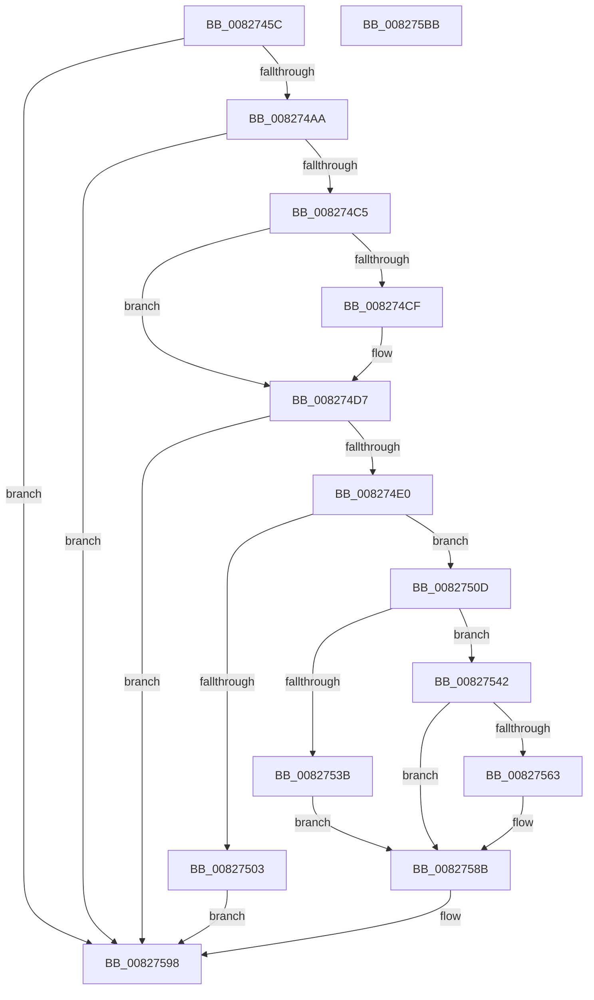

# BiUpdateObjectReferenceInEfiEntry

- RVA: `0x0082745C`–`0x008275BC` (길이 `352` bytes)
- VA: `0x000000014082745C`
- 실행 섹션: `PAGE`
- PDB 이름 있음: `예`; PDB Function 태그: `아니요`
- unwind 정보 RVA: `0x000DA3BC`
- 디코드: `99`개 명령, `352/352` bytes 표시
- 미해석 바이트: `0` (있으면 어셈블리에 `.byte`로 보존)

> 이 문서는 커널 이미지의 기계어와 PDB 기호를 분석해 생성했습니다. 4번과 5번은 함수 원형과 자료형을 바이너리 사용 방식에서 추정한 C 해석이며 원본 소스 복구 결과는 아닙니다.

## 1. Dependencies

- 직접 호출 지점: **12**; 고유 호출 대상: **11**
- 직접 호출자로 확인된 함수: **1**
- RIP 상대 이미지 참조: **2**

### Outgoing calls
- `0x0082749B` → [BiGetObjectReferenceFromEfiEntry](../A3/BiGetObjectReferenceFromEfiEntry_function_00A3FB4C.md) (function, `0x00A3FB4C`)
- `0x008274B6` → [BcdQueryObject](BcdQueryObject_function_0082385C.md) (function, `0x0082385C`)
- `0x008274F6` → [ExAllocatePool2](../../poolcode/B8/ExAllocatePool2_function_00B820F0.md) (function, `0x00B820F0`)
- `0x00827517` → [memcpy](../../text/6C/memcpy_function_006C6840.md) (function, `0x006C6840`)
- `0x0082751F` → [wcsupr](../../text/50/wcsupr_function_005003A0.md) (function, `0x005003A0`)
- `0x0082752E` → [wcsstr](../../text/50/wcsstr_function_00501F80.md) (function, `0x00501F80`)
- `0x00827548` → [RtlInitUnicodeString](../../text/42/RtlInitUnicodeString_function_0042A780.md) (function, `0x0042A780`)
- `0x00827558` → [RtlStringFromGUIDEx](../91/RtlStringFromGUIDEx_function_00915450.md) (function, `0x00915450`)
- `0x0082757D` → [memcpy](../../text/6C/memcpy_function_006C6840.md) (function, `0x006C6840`)
- `0x00827586` → [RtlFreeAnsiString](../9C/RtlFreeAnsiString_function_009C0800.md) (function, `0x009C0800`)
- `0x00827593` → [ExFreePoolWithTag](../../poolcode/B8/ExFreePoolWithTag_function_00B82870.md) (function, `0x00B82870`)
- `0x008275A1` → [_security_check_cookie](../../text/6A/_security_check_cookie_function_006AC640.md) (function, `0x006AC640`)

### Direct callers
- [BiCreateEfiEntry](BiCreateEfiEntry_function_008268C4.md) at `0x00826939`

### Static image references
- `0x00827471` → RVA `0x00E0A740` (`.data`; read)
- `0x00827524` → RVA `0x00B0C500` (` ?? ::NNGAKEGL::`string'`; read)

## 2. Other-region calls and transfers

- 다른 실행 섹션으로 향하는 call: **8**
  - `0x008274F6` → [ExAllocatePool2](../../poolcode/B8/ExAllocatePool2_function_00B820F0.md) (`PAGE` → `POOLCODE`)
  - `0x00827517` → [memcpy](../../text/6C/memcpy_function_006C6840.md) (`PAGE` → `.text`)
  - `0x0082751F` → [wcsupr](../../text/50/wcsupr_function_005003A0.md) (`PAGE` → `.text`)
  - `0x0082752E` → [wcsstr](../../text/50/wcsstr_function_00501F80.md) (`PAGE` → `.text`)
  - `0x00827548` → [RtlInitUnicodeString](../../text/42/RtlInitUnicodeString_function_0042A780.md) (`PAGE` → `.text`)
  - `0x0082757D` → [memcpy](../../text/6C/memcpy_function_006C6840.md) (`PAGE` → `.text`)
  - `0x00827593` → [ExFreePoolWithTag](../../poolcode/B8/ExFreePoolWithTag_function_00B82870.md) (`PAGE` → `POOLCODE`)
  - `0x008275A1` → [_security_check_cookie](../../text/6A/_security_check_cookie_function_006AC640.md) (`PAGE` → `.text`)
- 별도 외부 분기/꼬리 이동을 확인하지 못했습니다.

## 3. Assembly (complete function range)

```asm
0082745C  48 89 5C 24 18                  mov qword ptr [rsp + 0x18], rbx
00827461  48 89 74 24 20                  mov qword ptr [rsp + 0x20], rsi
00827466  55                              push rbp
00827467  57                              push rdi
00827468  41 56                           push r14
0082746A  48 8B EC                        mov rbp, rsp
0082746D  48 83 EC 60                     sub rsp, 0x60
00827471  48 8B 05 C8 32 5E 00            mov rax, qword ptr [rip + 0x5e32c8]
00827478  48 33 C4                        xor rax, rsp
0082747B  48 89 45 F0                     mov qword ptr [rbp - 0x10], rax
0082747F  0F 57 C0                        xorps xmm0, xmm0
00827482  48 8B FA                        mov rdi, rdx
00827485  0F 57 C9                        xorps xmm1, xmm1
00827488  48 8D 55 E0                     lea rdx, [rbp - 0x20]
0082748C  0F 11 45 D0                     movups xmmword ptr [rbp - 0x30], xmm0
00827490  4C 8B F1                        mov r14, rcx
00827493  0F 11 4D E0                     movups xmmword ptr [rbp - 0x20], xmm1
00827497  0F 11 45 C0                     movups xmmword ptr [rbp - 0x40], xmm0
0082749B  E8 AC 86 21 00                  call 0x140a3fb4c
008274A0  8B D8                           mov ebx, eax
008274A2  85 C0                           test eax, eax
008274A4  0F 88 EE 00 00 00               js 0x140827598
008274AA  4C 8D 4D D0                     lea r9, [rbp - 0x30]
008274AE  45 33 C0                        xor r8d, r8d
008274B1  33 D2                           xor edx, edx
008274B3  48 8B CF                        mov rcx, rdi
008274B6  E8 A1 C3 FF FF                  call 0x14082385c
008274BB  8B D8                           mov ebx, eax
008274BD  85 C0                           test eax, eax
008274BF  0F 88 D3 00 00 00               js 0x140827598
008274C5  48 8B 45 E0                     mov rax, qword ptr [rbp - 0x20]
008274C9  48 2B 45 D0                     sub rax, qword ptr [rbp - 0x30]
008274CD  75 08                           jne 0x1408274d7
008274CF  48 8B 45 E8                     mov rax, qword ptr [rbp - 0x18]
008274D3  48 2B 45 D8                     sub rax, qword ptr [rbp - 0x28]
008274D7  48 85 C0                        test rax, rax
008274DA  0F 84 B8 00 00 00               je 0x140827598
008274E0  41 8B 46 28                     mov eax, dword ptr [r14 + 0x28]
008274E4  41 B8 42 43 44 4B               mov r8d, 0x4b444342
008274EA  83 E8 14                        sub eax, 0x14
008274ED  B9 02 01 00 00                  mov ecx, 0x102
008274F2  8B D0                           mov edx, eax
008274F4  8B D8                           mov ebx, eax
008274F6  E8 F5 AB 35 00                  call 0x140b820f0
008274FB  48 8B F0                        mov rsi, rax
008274FE  48 85 C0                        test rax, rax
00827501  75 0A                           jne 0x14082750d
00827503  BB 9A 00 00 C0                  mov ebx, 0xc000009a
00827508  E9 8B 00 00 00                  jmp 0x140827598
0082750D  49 8D 56 30                     lea rdx, [r14 + 0x30]
00827511  4C 8B C3                        mov r8, rbx
00827514  48 8B CE                        mov rcx, rsi
00827517  E8 24 F3 E9 FF                  call 0x1406c6840
0082751C  48 8B CE                        mov rcx, rsi
0082751F  E8 7C 8E CD FF                  call 0x1405003a0
00827524  48 8D 15 D5 4F 2E 00            lea rdx, [rip + 0x2e4fd5]
0082752B  48 8B CE                        mov rcx, rsi
0082752E  E8 4D AA CD FF                  call 0x140501f80
00827533  48 8B F8                        mov rdi, rax
00827536  48 85 C0                        test rax, rax
00827539  75 07                           jne 0x140827542
0082753B  BB 25 02 00 C0                  mov ebx, 0xc0000225
00827540  EB 49                           jmp 0x14082758b
00827542  33 D2                           xor edx, edx
00827544  48 8D 4D C0                     lea rcx, [rbp - 0x40]
00827548  E8 33 32 C0 FF                  call 0x14042a780
0082754D  41 B0 01                        mov r8b, 1
00827550  48 8D 55 C0                     lea rdx, [rbp - 0x40]
00827554  48 8D 4D D0                     lea rcx, [rbp - 0x30]
00827558  E8 F3 DE 0E 00                  call 0x140915450
0082755D  8B D8                           mov ebx, eax
0082755F  85 C0                           test eax, eax
00827561  78 28                           js 0x14082758b
00827563  44 0F B7 45 C0                  movzx r8d, word ptr [rbp - 0x40]
00827568  49 8D 4E 44                     lea rcx, [r14 + 0x44]
0082756C  48 8B 55 C8                     mov rdx, qword ptr [rbp - 0x38]
00827570  48 2B FE                        sub rdi, rsi
00827573  48 D1 FF                        sar rdi, 1
00827576  48 D1 EF                        shr rdi, 1
00827579  48 8D 0C 79                     lea rcx, [rcx + rdi*2]
0082757D  E8 BE F2 E9 FF                  call 0x1406c6840
00827582  48 8D 4D C0                     lea rcx, [rbp - 0x40]
00827586  E8 75 92 19 00                  call 0x1409c0800
0082758B  BA 42 43 44 4B                  mov edx, 0x4b444342
00827590  48 8B CE                        mov rcx, rsi
00827593  E8 D8 B2 35 00                  call 0x140b82870
00827598  8B C3                           mov eax, ebx
0082759A  48 8B 4D F0                     mov rcx, qword ptr [rbp - 0x10]
0082759E  48 33 CC                        xor rcx, rsp
008275A1  E8 9A 50 E8 FF                  call 0x1406ac640
008275A6  4C 8D 5C 24 60                  lea r11, [rsp + 0x60]
008275AB  49 8B 5B 30                     mov rbx, qword ptr [r11 + 0x30]
008275AF  49 8B 73 38                     mov rsi, qword ptr [r11 + 0x38]
008275B3  49 8B E3                        mov rsp, r11
008275B6  41 5E                           pop r14
008275B8  5F                              pop rdi
008275B9  5D                              pop rbp
008275BA  C3                              ret
008275BB  CC                              int3
```

## 4. C-style interpretation (structured pseudocode)

```c
__int64 __fastcall BiUpdateObjectReferenceInEfiEntry(__int64 a1, __int64 a2, int a3)
{
    __int64 result;
    __int64 v_rdi;
    __int64 v_rsp;
    unsigned __int64 v_stack_m18;
    unsigned __int64 v_stack_m28;
    unsigned __int64 v_stack_m30;
    unsigned __int64 v_stack_m38;
    unsigned __int64 v_stack_m40;
    unsigned __int64 v_stack_m48;
    unsigned __int64 v_stack_m50;
    unsigned __int64 v_stack_m58;
    unsigned __int64 v_stack_p18;
    unsigned __int64 v_stack_p20;

    v_stack_p18 = v_rbx;
    v_stack_p20 = v_rsi;
    v_rsp = (v_rsp) - (96);
    result = (*(unsigned __int64 *)(v_rip + 6173384)) ^ (v_rsp);
    v_stack_m28 = result;
    v_stack_m48 = v_xmm0;
    v_stack_m38 = v_xmm1;
    v_stack_m58 = v_xmm0;
    result = BiGetObjectReferenceFromEfiEntry(a1, v_stack_m38, a3, a4);
    if (sign_flag) goto loc_00827598;
    a3 = 0;
    a2 = 0;
    result = BcdQueryObject(0, a2, a3, v_stack_m48);
    if (sign_flag) goto loc_00827598;
    result = (v_stack_m38) - (v_stack_m48);
    if (!(condition_is_not_equal)) {
        result = v_stack_m30;
        result = (result) - (v_stack_m40);
    }
    if (result == 0) goto loc_00827598;
    result = (unsigned int)(((unsigned int)(*(unsigned int *)(a1 + 40))) - (20));
    result = ExAllocatePool2(258, (unsigned int)((unsigned int)(result)), (unsigned int)(0x4B444342ULL), v_stack_m48);
    if (result != 0) goto loc_0082750D;
    goto loc_00827598;
loc_0082750D:
    result = memcpy(result, a1 + 48, (unsigned int)(0xC000009AULL), v_stack_m48);
    result = wcsupr(result, a1 + 48, (unsigned int)(0xC000009AULL), v_stack_m48);
    result = wcsstr(result, v_rip + 3035093, (unsigned int)(0xC000009AULL), v_stack_m48);
    if (result != 0) goto loc_00827542;
    goto loc_0082758B;
loc_00827542:
    a2 = 0;
    result = RtlInitUnicodeString(v_stack_m58, a2, (unsigned int)(0xC000009AULL), v_stack_m48);
    result = RtlStringFromGUIDEx(v_stack_m48, v_stack_m58, 1, v_stack_m48);
    v_rdi = result;
    if (!(sign_flag)) {
        a3 = v_stack_m58;
        a1 = a1 + 68;
        a2 = v_stack_m50;
        v_rdi = (result) - (result);
        v_rdi = (v_rdi) >> (1);
        v_rdi = (v_rdi) >> (1);
        a1 = a1 + v_rdi * 2;
        result = memcpy(a1, a2, a3, v_stack_m48);
        a1 = v_stack_m58;
        result = RtlFreeAnsiString(a1, a2, a3, v_stack_m48);
    }
    result = ExFreePoolWithTag(result, (unsigned int)(0x4B444342ULL), a3, v_stack_m48);
loc_00827598:
    a1 = (v_stack_m28) ^ (v_rsp);
    result = _security_check_cookie(a1, (unsigned int)(0x4B444342ULL), a3, v_stack_m48);
    return result;
}
```

## 5. (Beta) C Style

```c
int64_t BiUpdateObjectReferenceInEfiEntry(void *Arg1, int64_t Arg2, int32_t Arg3)
{
    uint8_t *arg1 = (uint8_t *)Arg1;

    int64_t result;
    int64_t local_rdi;
    int64_t local_rsp;
    uint64_t v_stack_m18;
    uint64_t v_stack_m28;
    uint64_t v_stack_m30;
    uint64_t v_stack_m38;
    uint64_t v_stack_m40;
    uint64_t v_stack_m48;
    uint64_t v_stack_m50;
    uint64_t v_stack_m58;
    uint64_t v_stack_p18;
    uint64_t v_stack_p20;

    v_stack_p18 = local_rbx;
    v_stack_p20 = local_rsi;
    local_rsp = (local_rsp) - (96);
    result = (*(uint64_t *)(v_rip + 0x5E32C8)) ^ (local_rsp);
    v_stack_m28 = result;
    v_stack_m48 = v_xmm0;
    v_stack_m38 = v_xmm1;
    v_stack_m58 = v_xmm0;
    result = BiGetObjectReferenceFromEfiEntry(Arg1, v_stack_m38, Arg3, a4);
    if (sign_flag) goto loc_00827598;
    Arg3 = 0;
    Arg2 = 0;
    result = BcdQueryObject(0, Arg2, Arg3, v_stack_m48);
    if (sign_flag) goto loc_00827598;
    result = (v_stack_m38) - (v_stack_m48);
    if (!(condition_is_not_equal)) {
        result = v_stack_m30;
        result = (result) - (v_stack_m40);
    }
    if (result == 0) goto loc_00827598;
    result = (uint32_t)(((uint32_t)(*(uint32_t *)(arg1 + 0x28))) - (20));
    result = ExAllocatePool2(258, (uint32_t)((uint32_t)(result)), (uint32_t)(0x4B444342ULL), v_stack_m48);
    if (result != 0) goto loc_0082750D;
    goto loc_00827598;
loc_0082750D:
    result = memcpy(result, Arg1 + 48, (uint32_t)(0xC000009AULL), v_stack_m48);
    result = wcsupr(result, Arg1 + 48, (uint32_t)(0xC000009AULL), v_stack_m48);
    result = wcsstr(result, v_rip + 3035093, (uint32_t)(0xC000009AULL), v_stack_m48);
    if (result != 0) goto loc_00827542;
    goto loc_0082758B;
loc_00827542:
    Arg2 = 0;
    result = RtlInitUnicodeString(v_stack_m58, Arg2, (uint32_t)(0xC000009AULL), v_stack_m48);
    result = RtlStringFromGUIDEx(v_stack_m48, v_stack_m58, 1, v_stack_m48);
    local_rdi = result;
    if (!(sign_flag)) {
        Arg3 = v_stack_m58;
        Arg1 = Arg1 + 68;
        Arg2 = v_stack_m50;
        local_rdi = (result) - (result);
        local_rdi = (local_rdi) >> (1);
        local_rdi = (local_rdi) >> (1);
        Arg1 = Arg1 + local_rdi * 2;
        result = memcpy(Arg1, Arg2, Arg3, v_stack_m48);
        Arg1 = v_stack_m58;
        result = RtlFreeAnsiString(Arg1, Arg2, Arg3, v_stack_m48);
    }
    result = ExFreePoolWithTag(result, (uint32_t)(0x4B444342ULL), Arg3, v_stack_m48);
loc_00827598:
    Arg1 = (v_stack_m28) ^ (local_rsp);
    result = _security_check_cookie(Arg1, (uint32_t)(0x4B444342ULL), Arg3, v_stack_m48);
    return result;
}
```

### 관측된 메모리 오프셋

구조체 형식이 확인되지 않은 접근은 인자 기준의 오프셋으로만 기록했습니다.

| 기준 인자 | 오프셋 표현 | 폭 (bit) | 접근 |
|---|---:|---:|---|
| `Arg1` | `+ 0x0 + rdi*2` | `64` | `R` |
| `Arg1` | `+ 0x28` | `32` | `R` |
| `Arg1` | `+ 0x30` | `64` | `R` |
| `Arg1` | `+ 0x44` | `64` | `R` |

## 6. Execution-region graph

[열기: 2D/3D 그래프와 함수 탐색 컨트롤 패널](../../../control-panel.html?section=page&rva=0x0082745C&view=graph)

- 2D 그래프는 위에서 아래로 흐르고, 3D 그래프는 빈 공간을 드래그해 회전합니다. Shift+드래그는 이동, 휠은 확대·축소, 함수 노드 선택은 대상 보고서 이동입니다.

### Static fallback


