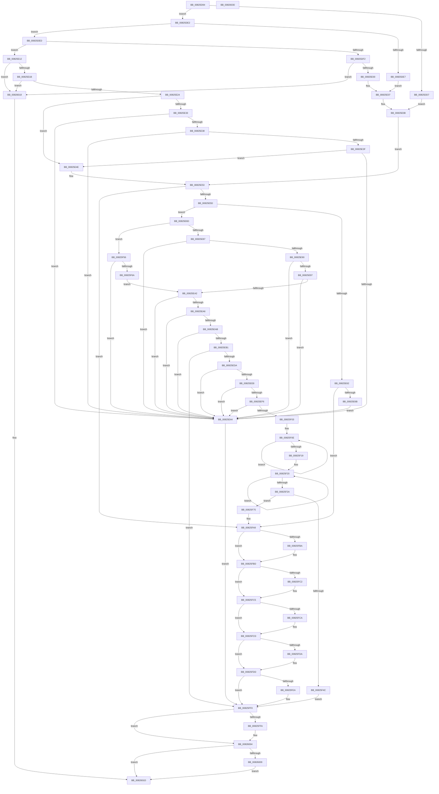

# BiVerifyBootPartition

- RVA: `0x00825D94`–`0x00826031` (길이 `669` bytes)
- VA: `0x0000000140825D94`
- 실행 섹션: `PAGE`
- PDB 이름 있음: `예`; PDB Function 태그: `아니요`
- unwind 정보 RVA: `0x00089D74`
- 디코드: `197`개 명령, `669/669` bytes 표시
- 미해석 바이트: `0` (있으면 어셈블리에 `.byte`로 보존)

> 이 문서는 커널 이미지의 기계어와 PDB 기호를 분석해 생성했습니다. 4번과 5번은 함수 원형과 자료형을 바이너리 사용 방식에서 추정한 C 해석이며 원본 소스 복구 결과는 아닙니다.

## 1. Dependencies

- 직접 호출 지점: **8**; 고유 호출 대상: **6**
- 직접 호출자로 확인된 함수: **2**
- RIP 상대 이미지 참조: **0**

### Outgoing calls
- `0x00825E24` → [Feature_1807454522__private_IsEnabledDeviceUsageNoInline](../../text/69/Feature_1807454522__private_IsEnabledDeviceUsageNoInline_function_0069E1A0.md) (function, `0x0069E1A0`)
- `0x00825E77` → [Feature_3201012024__private_IsEnabledDeviceUsageNoInline](../../text/69/Feature_3201012024__private_IsEnabledDeviceUsageNoInline_function_0069E344.md) (function, `0x0069E344`)
- `0x00825ECB` → [BiConvertBootEnvironmentDeviceToNt](BiConvertBootEnvironmentDeviceToNt_function_00823E44.md) (function, `0x00823E44`)
- `0x00825F3F` → [ExAllocatePool2](../../poolcode/B8/ExAllocatePool2_function_00B820F0.md) (function, `0x00B820F0`)
- `0x00825F7F` → [memcpy](../../text/6C/memcpy_function_006C6840.md) (function, `0x006C6840`)
- `0x00825F94` → [memcpy](../../text/6C/memcpy_function_006C6840.md) (function, `0x006C6840`)
- `0x00825FFF` → [ExFreePoolWithTag](../../poolcode/B8/ExFreePoolWithTag_function_00B82870.md) (function, `0x00B82870`)
- `0x00826011` → [ExFreePoolWithTag](../../poolcode/B8/ExFreePoolWithTag_function_00B82870.md) (function, `0x00B82870`)

### Direct callers
- [BiConvertBootEnvironmentDeviceToNt](BiConvertBootEnvironmentDeviceToNt_function_00823E44.md) at `0x0082442A`
- [BiGetNtPartitionPath](BiGetNtPartitionPath_function_0082546C.md) at `0x00825524`

### Static image references
- 디코드된 RIP-relative 메모리 참조가 없습니다.

## 2. Other-region calls and transfers

- 다른 실행 섹션으로 향하는 call: **7**
  - `0x00825E24` → [Feature_1807454522__private_IsEnabledDeviceUsageNoInline](../../text/69/Feature_1807454522__private_IsEnabledDeviceUsageNoInline_function_0069E1A0.md) (`PAGE` → `.text`)
  - `0x00825E77` → [Feature_3201012024__private_IsEnabledDeviceUsageNoInline](../../text/69/Feature_3201012024__private_IsEnabledDeviceUsageNoInline_function_0069E344.md) (`PAGE` → `.text`)
  - `0x00825F3F` → [ExAllocatePool2](../../poolcode/B8/ExAllocatePool2_function_00B820F0.md) (`PAGE` → `POOLCODE`)
  - `0x00825F7F` → [memcpy](../../text/6C/memcpy_function_006C6840.md) (`PAGE` → `.text`)
  - `0x00825F94` → [memcpy](../../text/6C/memcpy_function_006C6840.md) (`PAGE` → `.text`)
  - `0x00825FFF` → [ExFreePoolWithTag](../../poolcode/B8/ExFreePoolWithTag_function_00B82870.md) (`PAGE` → `POOLCODE`)
  - `0x00826011` → [ExFreePoolWithTag](../../poolcode/B8/ExFreePoolWithTag_function_00B82870.md) (`PAGE` → `POOLCODE`)
- 별도 외부 분기/꼬리 이동을 확인하지 못했습니다.

## 3. Assembly (complete function range)

```asm
00825D94  48 8B C4                        mov rax, rsp
00825D97  4C 89 48 20                     mov qword ptr [rax + 0x20], r9
00825D9B  4C 89 40 18                     mov qword ptr [rax + 0x18], r8
00825D9F  48 89 50 10                     mov qword ptr [rax + 0x10], rdx
00825DA3  53                              push rbx
00825DA4  55                              push rbp
00825DA5  56                              push rsi
00825DA6  57                              push rdi
00825DA7  41 54                           push r12
00825DA9  41 55                           push r13
00825DAB  41 56                           push r14
00825DAD  41 57                           push r15
00825DAF  48 83 EC 48                     sub rsp, 0x48
00825DB3  48 8B D9                        mov rbx, rcx
00825DB6  49 8B F9                        mov rdi, r9
00825DB9  33 C9                           xor ecx, ecx
00825DBB  4D 8B F0                        mov r14, r8
00825DBE  89 48 08                        mov dword ptr [rax + 8], ecx
00825DC1  44 8B E9                        mov r13d, ecx
00825DC4  48 89 48 A8                     mov qword ptr [rax - 0x58], rcx
00825DC8  44 8B F9                        mov r15d, ecx
00825DCB  8B 03                           mov eax, dword ptr [rbx]
00825DCD  44 8B E1                        mov r12d, ecx
00825DD0  8B E9                           mov ebp, ecx
00825DD2  83 F8 02                        cmp eax, 2
00825DD5  75 0B                           jne 0x140825de2
00825DD7  4C 8D 63 10                     lea r12, [rbx + 0x10]
00825DDB  49 8D 74 24 10                  lea rsi, [r12 + 0x10]
00825DE0  EB 29                           jmp 0x140825e0b
00825DE2  83 F8 06                        cmp eax, 6
00825DE5  75 06                           jne 0x140825ded
00825DE7  4C 8D 6B 10                     lea r13, [rbx + 0x10]
00825DEB  EB 1A                           jmp 0x140825e07
00825DED  83 F8 0A                        cmp eax, 0xa
00825DF0  75 20                           jne 0x140825e12
00825DF2  8B 43 24                        mov eax, dword ptr [rbx + 0x24]
00825DF5  83 7C 18 10 06                  cmp dword ptr [rax + rbx + 0x10], 6
00825DFA  0F 85 18 02 00 00               jne 0x140826018
00825E00  4C 8D 6B 20                     lea r13, [rbx + 0x20]
00825E04  4C 03 E8                        add r13, rax
00825E07  49 8D 75 10                     lea rsi, [r13 + 0x10]
00825E0B  B9 20 00 00 00                  mov ecx, 0x20
00825E10  EB 41                           jmp 0x140825e53
00825E12  83 F8 08                        cmp eax, 8
00825E15  0F 85 FD 01 00 00               jne 0x140826018
00825E1B  39 4B 18                        cmp dword ptr [rbx + 0x18], ecx
00825E1E  0F 84 F4 01 00 00               je 0x140826018
00825E24  E8 77 83 E7 FF                  call 0x14069e1a0
00825E29  8B 4B 18                        mov ecx, dword ptr [rbx + 0x18]
00825E2C  83 C1 10                        add ecx, 0x10
00825E2F  85 C0                           test eax, eax
00825E31  74 1B                           je 0x140825e4e
00825E33  83 F9 10                        cmp ecx, 0x10
00825E36  72 0C                           jb 0x140825e44
00825E38  8D 41 04                        lea eax, [rcx + 4]
00825E3B  3B C1                           cmp eax, ecx
00825E3D  72 05                           jb 0x140825e44
00825E3F  39 43 08                        cmp dword ptr [rbx + 8], eax
00825E42  73 0A                           jae 0x140825e4e
00825E44  BB 0D 00 00 C0                  mov ebx, 0xc000000d
00825E49  E9 A2 01 00 00                  jmp 0x140825ff0
00825E4E  8B F1                           mov esi, ecx
00825E50  48 03 F3                        add rsi, rbx
00825E53  8B 06                           mov eax, dword ptr [rsi]
00825E55  85 C0                           test eax, eax
00825E57  0F 84 4C 01 00 00               je 0x140825fa9
00825E5D  83 F8 06                        cmp eax, 6
00825E60  74 0B                           je 0x140825e6d
00825E62  83 F8 07                        cmp eax, 7
00825E65  0F 84 3E 01 00 00               je 0x140825fa9
00825E6B  EB D7                           jmp 0x140825e44
00825E6D  44 8D 79 18                     lea r15d, [rcx + 0x18]
00825E71  41 8B FF                        mov edi, r15d
00825E74  48 03 FB                        add rdi, rbx
00825E77  E8 C8 84 E7 FF                  call 0x14069e344
00825E7C  45 33 F6                        xor r14d, r14d
00825E7F  85 C0                           test eax, eax
00825E81  0F 84 CF 00 00 00               je 0x140825f56
00825E87  41 8D 47 24                     lea eax, [r15 + 0x24]
00825E8B  41 3B C7                        cmp eax, r15d
00825E8E  72 B4                           jb 0x140825e44
00825E90  8B 53 08                        mov edx, dword ptr [rbx + 8]
00825E93  3B D0                           cmp edx, eax
00825E95  72 AD                           jb 0x140825e44
00825E97  8B 47 08                        mov eax, dword ptr [rdi + 8]
00825E9A  42 8D 0C 38                     lea ecx, [rax + r15]
00825E9E  3B C8                           cmp ecx, eax
00825EA0  72 A2                           jb 0x140825e44
00825EA2  3B D1                           cmp edx, ecx
00825EA4  72 9E                           jb 0x140825e44
00825EA6  44 39 37                        cmp dword ptr [rdi], r14d
00825EA9  75 99                           jne 0x140825e44
00825EAB  83 7F 10 05                     cmp dword ptr [rdi + 0x10], 5
00825EAF  75 93                           jne 0x140825e44
00825EB1  48 8D 84 24 90 00 00 00         lea rax, [rsp + 0x90]
00825EB9  45 33 C0                        xor r8d, r8d
00825EBC  4C 8D 4C 24 30                  lea r9, [rsp + 0x30]
00825EC1  48 89 44 24 20                  mov qword ptr [rsp + 0x20], rax
00825EC6  33 D2                           xor edx, edx
00825EC8  48 8B CF                        mov rcx, rdi
00825ECB  E8 74 DF FF FF                  call 0x140823e44
00825ED0  8B D8                           mov ebx, eax
00825ED2  85 C0                           test eax, eax
00825ED4  0F 88 16 01 00 00               js 0x140825ff0
00825EDA  83 BC 24 90 00 00 00 2E         cmp dword ptr [rsp + 0x90], 0x2e
00825EE2  0F 82 5C FF FF FF               jb 0x140825e44
00825EE8  48 8B 4C 24 30                  mov rcx, qword ptr [rsp + 0x30]
00825EED  83 39 03                        cmp dword ptr [rcx], 3
00825EF0  0F 85 4E FF FF FF               jne 0x140825e44
00825EF6  8B 41 14                        mov eax, dword ptr [rcx + 0x14]
00825EF9  83 3C 08 02                     cmp dword ptr [rax + rcx], 2
00825EFD  0F 85 41 FF FF FF               jne 0x140825e44
00825F03  4C 8D 34 08                     lea r14, [rax + rcx]
00825F07  48 83 C8 FF                     or rax, 0xffffffffffffffff
00825F0B  48 8B D8                        mov rbx, rax
00825F0E  48 FF C3                        inc rbx
00825F11  66 41 39 6C 5E 14               cmp word ptr [r14 + rbx*2 + 0x14], bp
00825F17  75 F5                           jne 0x140825f0e
00825F19  48 8B 4C 24 30                  mov rcx, qword ptr [rsp + 0x30]
00825F1E  03 DB                           add ebx, ebx
00825F20  48 FF C0                        inc rax
00825F23  66 39 6C 41 18                  cmp word ptr [rcx + rax*2 + 0x18], bp
00825F28  75 F6                           jne 0x140825f20
00825F2A  8D 3C 45 02 00 00 00            lea edi, [rax*2 + 2]
00825F31  B9 02 01 00 00                  mov ecx, 0x102
00825F36  8D 14 1F                        lea edx, [rdi + rbx]
00825F39  41 B8 42 43 44 4B               mov r8d, 0x4b444342
00825F3F  E8 AC C1 35 00                  call 0x140b820f0
00825F44  48 8B E8                        mov rbp, rax
00825F47  48 85 C0                        test rax, rax
00825F4A  75 29                           jne 0x140825f75
00825F4C  BB 17 00 00 C0                  mov ebx, 0xc0000017
00825F51  E9 9A 00 00 00                  jmp 0x140825ff0
00825F56  8B 53 08                        mov edx, dword ptr [rbx + 8]
00825F59  41 8D 4F 14                     lea ecx, [r15 + 0x14]
00825F5D  48 83 C1 10                     add rcx, 0x10
00825F61  48 3B D1                        cmp rdx, rcx
00825F64  0F 82 DA FE FF FF               jb 0x140825e44
00825F6A  8B 4F 08                        mov ecx, dword ptr [rdi + 8]
00825F6D  41 03 CF                        add ecx, r15d
00825F70  E9 2D FF FF FF                  jmp 0x140825ea2
00825F75  4C 8B C3                        mov r8, rbx
00825F78  49 8D 56 14                     lea rdx, [r14 + 0x14]
00825F7C  48 8B CD                        mov rcx, rbp
00825F7F  E8 BC 08 EA FF                  call 0x1406c6840
00825F84  48 8B 54 24 30                  mov rdx, qword ptr [rsp + 0x30]
00825F89  48 8D 0C 2B                     lea rcx, [rbx + rbp]
00825F8D  48 83 C2 18                     add rdx, 0x18
00825F91  44 8B C7                        mov r8d, edi
00825F94  E8 A7 08 EA FF                  call 0x1406c6840
00825F99  48 8B BC 24 A8 00 00 00         mov rdi, qword ptr [rsp + 0xa8]
00825FA1  4C 8B B4 24 A0 00 00 00         mov r14, qword ptr [rsp + 0xa0]
00825FA9  48 8B 84 24 98 00 00 00         mov rax, qword ptr [rsp + 0x98]
00825FB1  33 C9                           xor ecx, ecx
00825FB3  8B D9                           mov ebx, ecx
00825FB5  48 85 C0                        test rax, rax
00825FB8  74 03                           je 0x140825fbd
00825FBA  4C 89 28                        mov qword ptr [rax], r13
00825FBD  4D 85 F6                        test r14, r14
00825FC0  74 03                           je 0x140825fc5
00825FC2  4D 89 26                        mov qword ptr [r14], r12
00825FC5  48 85 FF                        test rdi, rdi
00825FC8  74 03                           je 0x140825fcd
00825FCA  48 89 37                        mov qword ptr [rdi], rsi
00825FCD  48 8B 84 24 B8 00 00 00         mov rax, qword ptr [rsp + 0xb8]
00825FD5  48 85 C0                        test rax, rax
00825FD8  74 03                           je 0x140825fdd
00825FDA  44 89 38                        mov dword ptr [rax], r15d
00825FDD  48 8B 84 24 B0 00 00 00         mov rax, qword ptr [rsp + 0xb0]
00825FE5  48 85 C0                        test rax, rax
00825FE8  74 06                           je 0x140825ff0
00825FEA  48 89 28                        mov qword ptr [rax], rbp
00825FED  48 8B E9                        mov rbp, rcx
00825FF0  48 8B 4C 24 30                  mov rcx, qword ptr [rsp + 0x30]
00825FF5  48 85 C9                        test rcx, rcx
00825FF8  74 0A                           je 0x140826004
00825FFA  BA 42 43 44 4B                  mov edx, 0x4b444342
00825FFF  E8 6C C8 35 00                  call 0x140b82870
00826004  48 85 ED                        test rbp, rbp
00826007  74 14                           je 0x14082601d
00826009  BA 42 43 44 4B                  mov edx, 0x4b444342
0082600E  48 8B CD                        mov rcx, rbp
00826011  E8 5A C8 35 00                  call 0x140b82870
00826016  EB 05                           jmp 0x14082601d
00826018  BB 0D 00 00 C0                  mov ebx, 0xc000000d
0082601D  8B C3                           mov eax, ebx
0082601F  48 83 C4 48                     add rsp, 0x48
00826023  41 5F                           pop r15
00826025  41 5E                           pop r14
00826027  41 5D                           pop r13
00826029  41 5C                           pop r12
0082602B  5F                              pop rdi
0082602C  5E                              pop rsi
0082602D  5D                              pop rbp
0082602E  5B                              pop rbx
0082602F  C3                              ret
00826030  CC                              int3
```

## 4. C-style interpretation (structured pseudocode)

```c
__int64 __fastcall BiVerifyBootPartition(__int64 a1, __int64 a2, __int64 a3, __int64 a4, __int64 a5, __int64 a6)
{
    __int64 result;
    __int64 v_r13;
    __int64 v_r14;
    __int64 v_rbp;
    __int64 v_rbx;
    __int64 v_rdi;
    __int64 v_rsi;
    __int64 v_rsp;
    unsigned __int64 v_stack_m58;
    unsigned __int64 v_stack_m68;
    unsigned __int64 v_stack_p10;
    unsigned __int64 v_stack_p18;
    unsigned __int64 v_stack_p20;
    unsigned __int64 v_stack_p8;

    *(unsigned __int64 *)(v_rsp + 32) = a4;
    *(unsigned __int64 *)(v_rsp + 24) = a3;
    *(unsigned __int64 *)(v_rsp + 16) = a2;
    v_rsp = (v_rsp) - (72);
    a1 = 0;
    *(unsigned int *)(v_rsp + 8) = 0;
    *(unsigned __int64 *)(v_rsp - 88) = 0;
    if (((unsigned int)((unsigned int)(*(unsigned int *)(a1)))) != 2) goto loc_00825DE2;
    goto loc_00825E0B;
loc_00825DE2:
    if (((unsigned int)((unsigned int)(*(unsigned int *)(a1)))) != 6) goto loc_00825DED;
    goto loc_00825E07;
loc_00825DED:
    if (((unsigned int)((unsigned int)(*(unsigned int *)(a1)))) != 10) goto loc_00825E12;
    if ((*(unsigned int *)((unsigned int)(*(unsigned int *)(a1 + 36)) + a1 * 1 + 16)) != 6) goto loc_00826018;
    v_r13 = (a1 + 32) + ((unsigned int)(*(unsigned int *)(a1 + 36)));
loc_00825E07:
loc_00825E0B:
    goto loc_00825E53;
loc_00825E12:
    if (((unsigned int)((unsigned int)(*(unsigned int *)(a1 + 36)))) != 8) goto loc_00826018;
    if ((*(unsigned int *)(a1 + 24)) == 32) goto loc_00826018;
    result = Feature_1807454522__private_IsEnabledDeviceUsageNoInline(32, a2, a3, a4);
    a1 = (unsigned int)(((unsigned int)(*(unsigned int *)(a1 + 24))) + (16));
    if ((unsigned int)(result) == 0) goto loc_00825E4E;
    if (((unsigned int)(a1)) < 16) goto loc_00825E44;
    if (((unsigned int)(a1 + 4)) < ((unsigned int)(a1))) goto loc_00825E44;
    if ((*(unsigned int *)(a1 + 8)) >= ((unsigned int)(a1 + 4))) goto loc_00825E4E;
loc_00825E44:
    goto loc_00825FF0;
loc_00825E4E:
    v_rsi = ((unsigned int)((unsigned int)(a1))) + ((unsigned int)(0xC000000DULL));
loc_00825E53:
    if ((unsigned int)((unsigned int)(*(unsigned int *)(v_rsi))) == 0) goto loc_00825FA9;
    if (((unsigned int)((unsigned int)(*(unsigned int *)(v_rsi)))) == 6) goto loc_00825E6D;
    if (((unsigned int)((unsigned int)(*(unsigned int *)(v_rsi)))) == 7) goto loc_00825FA9;
    goto loc_00825E44;
loc_00825E6D:
    v_rdi = ((unsigned int)((unsigned int)(a1 + 24))) + ((unsigned int)(0xC000000DULL));
    result = Feature_3201012024__private_IsEnabledDeviceUsageNoInline(a1, a2, a3, a4);
    v_r14 = 0;
    if ((unsigned int)(result) == 0) goto loc_00825F56;
    if (((unsigned int)(a1 + 24 + 36)) < ((unsigned int)(a1 + 24))) goto loc_00825E44;
    if (((unsigned int)((unsigned int)(*(unsigned int *)((unsigned int)(0xC000000DULL) + 8)))) < ((unsigned int)(a1 + 24 + 36))) goto loc_00825E44;
    if (((unsigned int)((unsigned int)(*(unsigned int *)(v_rdi + 8)) + a1 + 24 * 1)) < ((unsigned int)((unsigned int)(*(unsigned int *)(v_rdi + 8))))) goto loc_00825E44;
loc_00825EA2:
    if (((unsigned int)((unsigned int)(*(unsigned int *)((unsigned int)(0xC000000DULL) + 8)))) < ((unsigned int)((unsigned int)(*(unsigned int *)(v_rdi + 8)) + a1 + 24 * 1))) goto loc_00825E44;
    if ((*(unsigned int *)(v_rdi)) != 0) goto loc_00825E44;
    if ((*(unsigned int *)(v_rdi + 16)) != 5) goto loc_00825E44;
    a3 = 0;
    v_stack_m68 = v_stack_p8;
    a2 = 0;
    result = BiConvertBootEnvironmentDeviceToNt(v_rdi, a2, a3, v_stack_m58);
    if (sign_flag) goto loc_00825FF0;
    if (v_stack_p8 < 46) goto loc_00825E44;
    if ((*(unsigned int *)(v_stack_m58)) != 3) goto loc_00825E44;
    if ((*(unsigned int *)((unsigned int)(*(unsigned int *)(v_stack_m58 + 20)) + v_stack_m58 * 1)) != 2) goto loc_00825E44;
    result = ((unsigned int)(*(unsigned int *)(v_stack_m58 + 20))) | (-1);
loc_00825F0E:
    v_rbx = (result) + 1;
    if ((*(unsigned __int16 *)((unsigned int)(*(unsigned int *)(v_stack_m58 + 20)) + v_stack_m58 * 1 + v_rbx * 2 + 20)) != 0) goto loc_00825F0E;
    v_rbx = (unsigned int)((v_rbx) + ((unsigned int)(v_rbx)));
loc_00825F20:
    result = (result) + 1;
    if ((*(unsigned __int16 *)(v_stack_m58 + result * 2 + 24)) != 0) goto loc_00825F20;
    result = ExAllocatePool2(258, result * 2 + 2 + v_rbx * 1, (unsigned int)(0x4B444342ULL), v_stack_m58);
    if (result != 0) goto loc_00825F75;
    goto loc_00825FF0;
loc_00825F56:
    a1 = (a1 + 24 + 20) + (16);
    if (((unsigned int)(*(unsigned int *)((unsigned int)(0xC0000017ULL) + 8))) < a1) goto loc_00825E44;
    a1 = (unsigned int)(((unsigned int)(*(unsigned int *)(result * 2 + 2 + 8))) + ((unsigned int)(a1 + 24)));
    goto loc_00825EA2;
loc_00825F75:
    result = memcpy(result, (unsigned int)(*(unsigned int *)(v_stack_m58 + 20)) + v_stack_m58 * 1 + 20, (unsigned int)(0xC0000017ULL), v_stack_m58);
    a2 = (v_stack_m58) + (24);
    result = memcpy((unsigned int)(0xC0000017ULL) + result * 1, a2, (unsigned int)((unsigned int)(result * 2 + 2)), v_stack_m58);
loc_00825FA9:
    a1 = 0;
    if (v_stack_p10 != 0) {
        *(unsigned __int64 *)(v_stack_p10) = v_r13;
    }
    if (v_stack_p18 != 0) {
        *(unsigned __int64 *)(v_stack_p18) = a1 + 16;
    }
    if (v_stack_p20 != 0) {
        *(unsigned __int64 *)(v_stack_p20) = v_rsi;
    }
    if (a6 != 0) {
        *(unsigned int *)(a6) = (unsigned int)(a1 + 24);
    }
    v_rbp = result;
    if (a5 != 0) {
        *(unsigned __int64 *)(a5) = result;
        v_rbp = 0;
    }
    result = a5;
    if (v_stack_m58 != 0) {
        a2 = 0x4B444342ULL;
        result = ExFreePoolWithTag(v_stack_m58, a2, (unsigned int)((unsigned int)(result * 2 + 2)), v_stack_m58);
    }
    if (v_rbp == 0) goto loc_0082601D;
    result = ExFreePoolWithTag(v_rbp, (unsigned int)(0x4B444342ULL), (unsigned int)((unsigned int)(result * 2 + 2)), v_stack_m58);
    goto loc_0082601D;
loc_00826018:
loc_0082601D:
    v_rsp = (v_rsp) + (72);
    return (unsigned int)((unsigned int)((unsigned int)(0xC000000DULL)));
}
```

## 5. (Beta) C Style

```c
int64_t BiVerifyBootPartition(void *Arg1, int64_t Arg2, int64_t Arg3, int64_t Arg4, int64_t Arg5, int64_t Arg6)
{
    uint8_t *arg1 = (uint8_t *)Arg1;

    int64_t result;
    int64_t local_r13;
    int64_t local_r14;
    int64_t local_rbp;
    int64_t local_rbx;
    int64_t local_rdi;
    int64_t local_rsi;
    int64_t local_rsp;
    uint64_t v_stack_m58;
    uint64_t v_stack_m68;
    uint64_t v_stack_p10;
    uint64_t v_stack_p18;
    uint64_t v_stack_p20;
    uint64_t v_stack_p8;

    *(uint64_t *)(local_rsp + 0x20) = Arg4;
    *(uint64_t *)(local_rsp + 0x18) = Arg3;
    *(uint64_t *)(local_rsp + 0x10) = Arg2;
    local_rsp = (local_rsp) - (72);
    Arg1 = 0;
    *(uint32_t *)(local_rsp + 0x8) = 0;
    *(uint64_t *)(local_rsp - 0x58) = 0;
    if (((uint32_t)((uint32_t)(*(uint32_t *)(arg1)))) != 2) goto loc_00825DE2;
    goto loc_00825E0B;
loc_00825DE2:
    if (((uint32_t)((uint32_t)(*(uint32_t *)(arg1)))) != 6) goto loc_00825DED;
    goto loc_00825E07;
loc_00825DED:
    if (((uint32_t)((uint32_t)(*(uint32_t *)(arg1)))) != 10) goto loc_00825E12;
    if ((*(uint32_t *)((uint32_t)(*(uint32_t *)(arg1 + 0x24)) + arg1 * 1 + 0x10)) != 6) goto loc_00826018;
    local_r13 = (Arg1 + 32) + ((uint32_t)(*(uint32_t *)(arg1 + 0x24)));
loc_00825E07:
loc_00825E0B:
    goto loc_00825E53;
loc_00825E12:
    if (((uint32_t)((uint32_t)(*(uint32_t *)(arg1 + 0x24)))) != 8) goto loc_00826018;
    if ((*(uint32_t *)(arg1 + 0x18)) == 32) goto loc_00826018;
    result = Feature_1807454522__private_IsEnabledDeviceUsageNoInline(32, Arg2, Arg3, Arg4);
    Arg1 = (uint32_t)(((uint32_t)(*(uint32_t *)(arg1 + 0x18))) + (16));
    if ((uint32_t)(result) == 0) goto loc_00825E4E;
    if (((uint32_t)(Arg1)) < 16) goto loc_00825E44;
    if (((uint32_t)(Arg1 + 4)) < ((uint32_t)(Arg1))) goto loc_00825E44;
    if ((*(uint32_t *)(arg1 + 0x8)) >= ((uint32_t)(Arg1 + 4))) goto loc_00825E4E;
loc_00825E44:
    goto loc_00825FF0;
loc_00825E4E:
    local_rsi = ((uint32_t)((uint32_t)(Arg1))) + ((uint32_t)(0xC000000DULL));
loc_00825E53:
    if ((uint32_t)((uint32_t)(*(uint32_t *)(local_rsi))) == 0) goto loc_00825FA9;
    if (((uint32_t)((uint32_t)(*(uint32_t *)(local_rsi)))) == 6) goto loc_00825E6D;
    if (((uint32_t)((uint32_t)(*(uint32_t *)(local_rsi)))) == 7) goto loc_00825FA9;
    goto loc_00825E44;
loc_00825E6D:
    local_rdi = ((uint32_t)((uint32_t)(Arg1 + 24))) + ((uint32_t)(0xC000000DULL));
    result = Feature_3201012024__private_IsEnabledDeviceUsageNoInline(Arg1, Arg2, Arg3, Arg4);
    local_r14 = 0;
    if ((uint32_t)(result) == 0) goto loc_00825F56;
    if (((uint32_t)(Arg1 + 24 + 36)) < ((uint32_t)(Arg1 + 24))) goto loc_00825E44;
    if (((uint32_t)((uint32_t)(*(uint32_t *)((uint32_t)(0xC000000DULL) + 0x8)))) < ((uint32_t)(Arg1 + 24 + 36))) goto loc_00825E44;
    if (((uint32_t)((uint32_t)(*(uint32_t *)(local_rdi + 0x8)) + Arg1 + 24 * 1)) < ((uint32_t)((uint32_t)(*(uint32_t *)(local_rdi + 0x8))))) goto loc_00825E44;
loc_00825EA2:
    if (((uint32_t)((uint32_t)(*(uint32_t *)((uint32_t)(0xC000000DULL) + 0x8)))) < ((uint32_t)((uint32_t)(*(uint32_t *)(local_rdi + 0x8)) + Arg1 + 24 * 1))) goto loc_00825E44;
    if ((*(uint32_t *)(local_rdi)) != 0) goto loc_00825E44;
    if ((*(uint32_t *)(local_rdi + 0x10)) != 5) goto loc_00825E44;
    Arg3 = 0;
    v_stack_m68 = v_stack_p8;
    Arg2 = 0;
    result = BiConvertBootEnvironmentDeviceToNt(local_rdi, Arg2, Arg3, v_stack_m58);
    if (sign_flag) goto loc_00825FF0;
    if (v_stack_p8 < 46) goto loc_00825E44;
    if ((*(uint32_t *)(v_stack_m58)) != 3) goto loc_00825E44;
    if ((*(uint32_t *)((uint32_t)(*(uint32_t *)(v_stack_m58 + 0x14)) + v_stack_m58 * 1)) != 2) goto loc_00825E44;
    result = ((uint32_t)(*(uint32_t *)(v_stack_m58 + 0x14))) | (-1);
loc_00825F0E:
    local_rbx = (result) + 1;
    if ((*(uint16_t *)((uint32_t)(*(uint32_t *)(v_stack_m58 + 0x14)) + v_stack_m58 * 1 + local_rbx * 2 + 0x14)) != 0) goto loc_00825F0E;
    local_rbx = (uint32_t)((local_rbx) + ((uint32_t)(local_rbx)));
loc_00825F20:
    result = (result) + 1;
    if ((*(uint16_t *)(v_stack_m58 + result * 2 + 0x18)) != 0) goto loc_00825F20;
    result = ExAllocatePool2(258, result * 2 + 2 + local_rbx * 1, (uint32_t)(0x4B444342ULL), v_stack_m58);
    if (result != 0) goto loc_00825F75;
    goto loc_00825FF0;
loc_00825F56:
    Arg1 = (Arg1 + 24 + 20) + (16);
    if (((uint32_t)(*(uint32_t *)((uint32_t)(0xC0000017ULL) + 0x8))) < Arg1) goto loc_00825E44;
    Arg1 = (uint32_t)(((uint32_t)(*(uint32_t *)(result * 2 + 0x2 + 0x8))) + ((uint32_t)(Arg1 + 24)));
    goto loc_00825EA2;
loc_00825F75:
    result = memcpy(result, (uint32_t)(*(uint32_t *)(v_stack_m58 + 0x14)) + v_stack_m58 * 1 + 20, (uint32_t)(0xC0000017ULL), v_stack_m58);
    Arg2 = (v_stack_m58) + (24);
    result = memcpy((uint32_t)(0xC0000017ULL) + result * 1, Arg2, (uint32_t)((uint32_t)(result * 2 + 2)), v_stack_m58);
loc_00825FA9:
    Arg1 = 0;
    if (v_stack_p10 != 0) {
        *(uint64_t *)(v_stack_p10) = local_r13;
    }
    if (v_stack_p18 != 0) {
        *(void **)(v_stack_p18) = Arg1 + 16;
    }
    if (v_stack_p20 != 0) {
        *(uint64_t *)(v_stack_p20) = local_rsi;
    }
    if (Arg6 != 0) {
        *(uint32_t *)(Arg6) = (uint32_t)(Arg1 + 24);
    }
    local_rbp = result;
    if (Arg5 != 0) {
        *(uint64_t *)(Arg5) = result;
        local_rbp = 0;
    }
    result = Arg5;
    if (v_stack_m58 != 0) {
        Arg2 = 0x4B444342ULL;
        result = ExFreePoolWithTag(v_stack_m58, Arg2, (uint32_t)((uint32_t)(result * 2 + 2)), v_stack_m58);
    }
    if (local_rbp == 0) goto loc_0082601D;
    result = ExFreePoolWithTag(local_rbp, (uint32_t)(0x4B444342ULL), (uint32_t)((uint32_t)(result * 2 + 2)), v_stack_m58);
    goto loc_0082601D;
loc_00826018:
loc_0082601D:
    local_rsp = (local_rsp) + (72);
    return (uint32_t)((uint32_t)((uint32_t)(0xC000000DULL)));
}
```

### 관측된 메모리 오프셋

구조체 형식이 확인되지 않은 접근은 인자 기준의 오프셋으로만 기록했습니다.

| 기준 인자 | 오프셋 표현 | 폭 (bit) | 접근 |
|---|---:|---:|---|
| `Arg1` | `+ 0x0` | `32` | `R` |
| `Arg1` | `+ 0x8` | `32` | `R` |
| `Arg1` | `+ 0x10` | `64` | `R` |
| `Arg1` | `+ 0x18` | `32` | `R` |
| `Arg1` | `+ 0x20` | `64` | `R` |
| `Arg1` | `+ 0x24` | `32` | `R` |

## 6. Execution-region graph

[열기: 2D/3D 그래프와 함수 탐색 컨트롤 패널](../../../control-panel.html?section=page&rva=0x00825D94&view=graph)

- 2D 그래프는 위에서 아래로 흐르고, 3D 그래프는 빈 공간을 드래그해 회전합니다. Shift+드래그는 이동, 휠은 확대·축소, 함수 노드 선택은 대상 보고서 이동입니다.

### Static fallback


