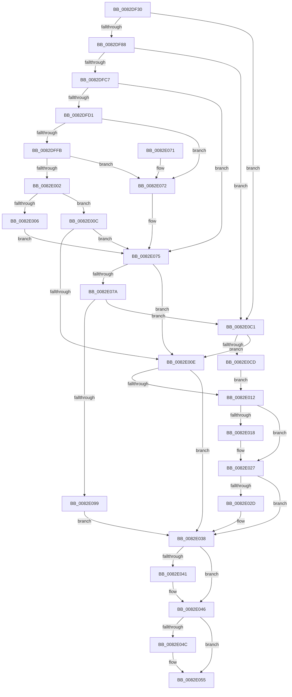

# CmAddPanelDeviceWorker

- RVA: `0x0082DF30`–`0x0082E0D7` (길이 `423` bytes)
- VA: `0x000000014082DF30`
- 실행 섹션: `PAGE`
- PDB 이름 있음: `예`; PDB Function 태그: `아니요`
- unwind 정보 RVA: `0x000DA9EC`
- 디코드: `118`개 명령, `423/423` bytes 표시
- 미해석 바이트: `0` (있으면 어셈블리에 `.byte`로 보존)

> 이 문서는 커널 이미지의 기계어와 PDB 기호를 분석해 생성했습니다. 4번과 5번은 함수 원형과 자료형을 바이너리 사용 방식에서 추정한 C 해석이며 원본 소스 복구 결과는 아닙니다.

## 1. Dependencies

- 직접 호출 지점: **9**; 고유 호출 대상: **8**
- 직접 호출자로 확인된 함수: **1**
- RIP 상대 이미지 참조: **2**

### Outgoing calls
- `0x0082DF79` → [CmCreateDevicePanel](CmCreateDevicePanel_function_0082E0E0.md) (function, `0x0082E0E0`)
- `0x0082DFB8` → [PnpCtxRegCreateKey](../A6/PnpCtxRegCreateKey_function_00A692E4.md) (function, `0x00A692E4`)
- `0x0082DFED` → [PnpCtxRegQueryValue](../99/PnpCtxRegQueryValue_function_009940FC.md) (function, `0x009940FC`)
- `0x0082E022` → [PnpCtxRegDeleteKey](../96/PnpCtxRegDeleteKey_function_00965EC8.md) (function, `0x00965EC8`)
- `0x0082E033` → [CmDeleteDevicePanel](CmDeleteDevicePanel_function_0082E2EC.md) (function, `0x0082E2EC`)
- `0x0082E041` → [ZwClose](../../text/6A/ZwClose_function_006AD2B0.md) (function, `0x006AD2B0`)
- `0x0082E050` → [ZwClose](../../text/6A/ZwClose_function_006AD2B0.md) (function, `0x006AD2B0`)
- `0x0082E08E` → [PnpCtxRegSetValue](../99/PnpCtxRegSetValue_function_00991B8C.md) (function, `0x00991B8C`)
- `0x0082E0B7` → [PnpObjectRaisePropertyChangeEvent](../8F/PnpObjectRaisePropertyChangeEvent_function_008F7E94.md) (function, `0x008F7E94`)

### Direct callers
- [CmAddPanelDevice](CmAddPanelDevice_function_0082DDEC.md) at `0x0082DE83`

### Static image references
- `0x0082DF95` → RVA `0x00AFD740` (` ?? ::NNGAKEGL::`string'`; read)
- `0x0082E09C` → RVA `0x000115A0` (`.rdata`; read)

## 2. Other-region calls and transfers

- 다른 실행 섹션으로 향하는 call: **2**
  - `0x0082E041` → [ZwClose](../../text/6A/ZwClose_function_006AD2B0.md) (`PAGE` → `.text`)
  - `0x0082E050` → [ZwClose](../../text/6A/ZwClose_function_006AD2B0.md) (`PAGE` → `.text`)
- 별도 외부 분기/꼬리 이동을 확인하지 못했습니다.

## 3. Assembly (complete function range)

```asm
0082DF30  48 89 5C 24 08                  mov qword ptr [rsp + 8], rbx
0082DF35  48 89 7C 24 10                  mov qword ptr [rsp + 0x10], rdi
0082DF3A  55                              push rbp
0082DF3B  41 54                           push r12
0082DF3D  41 55                           push r13
0082DF3F  41 56                           push r14
0082DF41  41 57                           push r15
0082DF43  48 8B EC                        mov rbp, rsp
0082DF46  48 83 EC 60                     sub rsp, 0x60
0082DF4A  45 33 ED                        xor r13d, r13d
0082DF4D  48 8D 45 48                     lea rax, [rbp + 0x48]
0082DF51  45 88 29                        mov byte ptr [r9], r13b
0082DF54  4D 8B F1                        mov r14, r9
0082DF57  4C 8D 4D F0                     lea r9, [rbp - 0x10]
0082DF5B  4C 89 6D F0                     mov qword ptr [rbp - 0x10], r13
0082DF5F  4D 8B F8                        mov r15, r8
0082DF62  4C 89 6D E8                     mov qword ptr [rbp - 0x18], r13
0082DF66  4C 8B E2                        mov r12, rdx
0082DF69  44 88 6D 48                     mov byte ptr [rbp + 0x48], r13b
0082DF6D  48 8B F9                        mov rdi, rcx
0082DF70  44 89 6D E0                     mov dword ptr [rbp - 0x20], r13d
0082DF74  48 89 44 24 20                  mov qword ptr [rsp + 0x20], rax
0082DF79  E8 62 01 00 00                  call 0x14082e0e0
0082DF7E  8B D8                           mov ebx, eax
0082DF80  85 C0                           test eax, eax
0082DF82  0F 88 39 01 00 00               js 0x14082e0c1
0082DF88  48 8B 55 F0                     mov rdx, qword ptr [rbp - 0x10]
0082DF8C  48 8D 45 E0                     lea rax, [rbp - 0x20]
0082DF90  48 89 44 24 38                  mov qword ptr [rsp + 0x38], rax
0082DF95  4C 8D 05 A4 F7 2C 00            lea r8, [rip + 0x2cf7a4]
0082DF9C  48 8D 45 E8                     lea rax, [rbp - 0x18]
0082DFA0  45 33 C9                        xor r9d, r9d
0082DFA3  48 89 44 24 30                  mov qword ptr [rsp + 0x30], rax
0082DFA8  48 8B CF                        mov rcx, rdi
0082DFAB  4C 89 6C 24 28                  mov qword ptr [rsp + 0x28], r13
0082DFB0  C7 44 24 20 07 00 00 00         mov dword ptr [rsp + 0x20], 7
0082DFB8  E8 27 B3 23 00                  call 0x140a692e4
0082DFBD  8B D8                           mov ebx, eax
0082DFBF  85 C0                           test eax, eax
0082DFC1  0F 88 FA 00 00 00               js 0x14082e0c1
0082DFC7  83 7D E0 02                     cmp dword ptr [rbp - 0x20], 2
0082DFCB  0F 85 A4 00 00 00               jne 0x14082e075
0082DFD1  48 8B 55 E8                     mov rdx, qword ptr [rbp - 0x18]
0082DFD5  48 8D 45 E4                     lea rax, [rbp - 0x1c]
0082DFD9  48 89 44 24 28                  mov qword ptr [rsp + 0x28], rax
0082DFDE  45 33 C9                        xor r9d, r9d
0082DFE1  4D 8B C7                        mov r8, r15
0082DFE4  4C 89 6C 24 20                  mov qword ptr [rsp + 0x20], r13
0082DFE9  44 89 6D E4                     mov dword ptr [rbp - 0x1c], r13d
0082DFED  E8 0A 61 16 00                  call 0x1409940fc
0082DFF2  8B D8                           mov ebx, eax
0082DFF4  3D 34 00 00 C0                  cmp eax, 0xc0000034
0082DFF9  74 77                           je 0x14082e072
0082DFFB  3D 7C 01 00 C0                  cmp eax, 0xc000017c
0082E000  74 70                           je 0x14082e072
0082E002  85 C0                           test eax, eax
0082E004  75 06                           jne 0x14082e00c
0082E006  41 C6 06 01                     mov byte ptr [r14], 1
0082E00A  EB 69                           jmp 0x14082e075
0082E00C  79 67                           jns 0x14082e075
0082E00E  85 DB                           test ebx, ebx
0082E010  79 26                           jns 0x14082e038
0082E012  83 7D E0 01                     cmp dword ptr [rbp - 0x20], 1
0082E016  75 0F                           jne 0x14082e027
0082E018  48 8B 55 E8                     mov rdx, qword ptr [rbp - 0x18]
0082E01C  45 33 C0                        xor r8d, r8d
0082E01F  48 8B CF                        mov rcx, rdi
0082E022  E8 A1 7E 13 00                  call 0x140965ec8
0082E027  80 7D 48 01                     cmp byte ptr [rbp + 0x48], 1
0082E02B  75 0B                           jne 0x14082e038
0082E02D  49 8B D4                        mov rdx, r12
0082E030  48 8B CF                        mov rcx, rdi
0082E033  E8 B4 02 00 00                  call 0x14082e2ec
0082E038  48 8B 4D E8                     mov rcx, qword ptr [rbp - 0x18]
0082E03C  48 85 C9                        test rcx, rcx
0082E03F  74 05                           je 0x14082e046
0082E041  E8 6A F2 E7 FF                  call 0x1406ad2b0
0082E046  4C 39 6D F0                     cmp qword ptr [rbp - 0x10], r13
0082E04A  74 09                           je 0x14082e055
0082E04C  48 8B 4D F0                     mov rcx, qword ptr [rbp - 0x10]
0082E050  E8 5B F2 E7 FF                  call 0x1406ad2b0
0082E055  4C 8D 5C 24 60                  lea r11, [rsp + 0x60]
0082E05A  8B C3                           mov eax, ebx
0082E05C  49 8B 5B 30                     mov rbx, qword ptr [r11 + 0x30]
0082E060  49 8B 7B 38                     mov rdi, qword ptr [r11 + 0x38]
0082E064  49 8B E3                        mov rsp, r11
0082E067  41 5F                           pop r15
0082E069  41 5E                           pop r14
0082E06B  41 5D                           pop r13
0082E06D  41 5C                           pop r12
0082E06F  5D                              pop rbp
0082E070  C3                              ret
0082E071  CC                              int3
0082E072  41 8B DD                        mov ebx, r13d
0082E075  45 38 2E                        cmp byte ptr [r14], r13b
0082E078  75 94                           jne 0x14082e00e
0082E07A  48 8B 55 E8                     mov rdx, qword ptr [rbp - 0x18]
0082E07E  45 33 C9                        xor r9d, r9d
0082E081  44 89 6C 24 28                  mov dword ptr [rsp + 0x28], r13d
0082E086  4D 8B C7                        mov r8, r15
0082E089  4C 89 6C 24 20                  mov qword ptr [rsp + 0x20], r13
0082E08E  E8 F9 3A 16 00                  call 0x140991b8c
0082E093  8B D8                           mov ebx, eax
0082E095  85 C0                           test eax, eax
0082E097  78 28                           js 0x14082e0c1
0082E099  45 33 C9                        xor r9d, r9d
0082E09C  48 8D 05 FD 34 7E FF            lea rax, [rip - 0x81cb03]
0082E0A3  48 89 44 24 28                  mov qword ptr [rsp + 0x28], rax
0082E0A8  49 8B D7                        mov rdx, r15
0082E0AB  48 8B CF                        mov rcx, rdi
0082E0AE  4C 89 6C 24 20                  mov qword ptr [rsp + 0x20], r13
0082E0B3  45 8D 41 01                     lea r8d, [r9 + 1]
0082E0B7  E8 D8 9D 0C 00                  call 0x1408f7e94
0082E0BC  E9 77 FF FF FF                  jmp 0x14082e038
0082E0C1  81 FB 7C 01 00 C0               cmp ebx, 0xc000017c
0082E0C7  0F 85 41 FF FF FF               jne 0x14082e00e
0082E0CD  BB 34 00 00 C0                  mov ebx, 0xc0000034
0082E0D2  E9 3B FF FF FF                  jmp 0x14082e012
```

## 4. C-style interpretation (structured pseudocode)

```c
__int64 __fastcall CmAddPanelDeviceWorker(__int64 a1, __int64 a2, __int64 a3, __int64 a4)
{
    __int64 result;
    __int64 v_r13;
    __int64 v_rsp;
    unsigned __int64 v_stack_m28;
    unsigned __int64 v_stack_m38;
    unsigned __int64 v_stack_m40;
    unsigned __int64 v_stack_m44;
    unsigned int v_stack_m48;
    unsigned __int64 v_stack_m50;
    unsigned __int64 v_stack_m58;
    unsigned __int64 v_stack_m60;
    unsigned __int64 v_stack_m68;
    unsigned __int64 v_stack_p10;
    unsigned __int64 v_stack_p20;
    unsigned __int64 v_stack_p8;

    v_stack_p8 = v_rbx;
    v_stack_p10 = v_rdi;
    v_rsp = (v_rsp) - (96);
    v_r13 = 0;
    *(unsigned __int8 *)(a4) = 0;
    v_stack_m38 = 0;
    v_stack_m40 = 0;
    v_stack_p20 = 0;
    v_stack_m48 = 0;
    v_stack_m68 = v_stack_p20;
    result = CmCreateDevicePanel(a1, a2, a3, v_stack_m38);
    if (sign_flag) goto loc_0082E0C1;
    v_stack_m50 = v_stack_m48;
    a4 = 0;
    v_stack_m58 = v_stack_m40;
    v_stack_m60 = 0;
    v_stack_m68 = 7;
    result = PnpCtxRegCreateKey(a1, v_stack_m38, v_rip + 2946980, a4);
    if (sign_flag) goto loc_0082E0C1;
    if (v_stack_m48 != 2) goto loc_0082E075;
    v_stack_m60 = v_stack_m44;
    a4 = 0;
    v_stack_m68 = 0;
    v_stack_m44 = 0;
    result = PnpCtxRegQueryValue(a1, v_stack_m40, a3, a4);
    if (((unsigned int)(result)) == 0xC0000034ULL) goto loc_0082E072;
    if (((unsigned int)(result)) == 0xC000017CULL) goto loc_0082E072;
    if ((unsigned int)(result) != 0) goto loc_0082E00C;
    *(unsigned __int8 *)(a4) = 1;
    goto loc_0082E075;
loc_0082E00C:
    if (!sign_flag) goto loc_0082E075;
loc_0082E00E:
    if (!sign_flag) goto loc_0082E038;
loc_0082E012:
    if (v_stack_m48 == 1) {
        a2 = v_stack_m40;
        a3 = 0;
        a1 = a1;
        result = PnpCtxRegDeleteKey(a1, a2, a3, a4);
    }
    if (v_stack_p20 == 1) {
        a2 = a2;
        a1 = a1;
        result = CmDeleteDevicePanel(a1, a2, a3, a4);
    }
    if (v_stack_m40 != 0) {
        result = ZwClose(v_stack_m40, a2, a3, a4);
    }
    if (v_stack_m38 != 0) {
        a1 = v_stack_m38;
        result = ZwClose(a1, a2, a3, a4);
    }
    return (unsigned int)((unsigned int)((unsigned int)((unsigned int)(result))));
loc_0082E072:
loc_0082E075:
    if ((*(unsigned __int8 *)(a4)) != 0) goto loc_0082E00E;
    a4 = 0;
    v_stack_m38 = 0;
    v_stack_m40 = 0;
    result = PnpCtxRegSetValue(a1, v_stack_m40, 0, a4);
    if (sign_flag) goto loc_0082E0C1;
    a4 = 0;
    v_stack_m38 = v_rip - 8506115;
    v_stack_m40 = 0;
    result = PnpObjectRaisePropertyChangeEvent(*(unsigned __int64 *)(v_stack_m28 + 56), 0, a4 + 1, a4);
    goto loc_0082E038;
loc_0082E0C1:
    if (((unsigned int)((unsigned int)((unsigned int)(result)))) != 0xC000017CULL) goto loc_0082E00E;
    goto loc_0082E012;
}
```

## 5. (Beta) C Style

```c
int64_t CmAddPanelDeviceWorker(int64_t Arg1, int64_t Arg2, int64_t Arg3, void *Arg4)
{
    uint8_t *arg4 = (uint8_t *)Arg4;

    int64_t result;
    int64_t local_r13;
    int64_t local_rsp;
    uint64_t v_stack_m28;
    uint64_t v_stack_m38;
    uint64_t v_stack_m40;
    uint64_t v_stack_m44;
    uint32_t v_stack_m48;
    uint64_t v_stack_m50;
    uint64_t v_stack_m58;
    uint64_t v_stack_m60;
    uint64_t v_stack_m68;
    uint64_t v_stack_p10;
    uint64_t v_stack_p20;
    uint64_t v_stack_p8;

    v_stack_p8 = local_rbx;
    v_stack_p10 = local_rdi;
    local_rsp = (local_rsp) - (96);
    local_r13 = 0;
    *(uint8_t *)(arg4) = 0;
    v_stack_m38 = 0;
    v_stack_m40 = 0;
    v_stack_p20 = 0;
    v_stack_m48 = 0;
    v_stack_m68 = v_stack_p20;
    result = CmCreateDevicePanel(Arg1, Arg2, Arg3, v_stack_m38);
    if (sign_flag) goto loc_0082E0C1;
    v_stack_m50 = v_stack_m48;
    Arg4 = 0;
    v_stack_m58 = v_stack_m40;
    v_stack_m60 = 0;
    v_stack_m68 = 7;
    result = PnpCtxRegCreateKey(Arg1, v_stack_m38, v_rip + 2946980, Arg4);
    if (sign_flag) goto loc_0082E0C1;
    if (v_stack_m48 != 2) goto loc_0082E075;
    v_stack_m60 = v_stack_m44;
    Arg4 = 0;
    v_stack_m68 = 0;
    v_stack_m44 = 0;
    result = PnpCtxRegQueryValue(Arg1, v_stack_m40, Arg3, Arg4);
    if (((uint32_t)(result)) == 0xC0000034ULL) goto loc_0082E072;
    if (((uint32_t)(result)) == 0xC000017CULL) goto loc_0082E072;
    if ((uint32_t)(result) != 0) goto loc_0082E00C;
    *(uint8_t *)(arg4) = 1;
    goto loc_0082E075;
loc_0082E00C:
    if (!sign_flag) goto loc_0082E075;
loc_0082E00E:
    if (!sign_flag) goto loc_0082E038;
loc_0082E012:
    if (v_stack_m48 == 1) {
        Arg2 = v_stack_m40;
        Arg3 = 0;
        Arg1 = Arg1;
        result = PnpCtxRegDeleteKey(Arg1, Arg2, Arg3, Arg4);
    }
    if (v_stack_p20 == 1) {
        Arg2 = Arg2;
        Arg1 = Arg1;
        result = CmDeleteDevicePanel(Arg1, Arg2, Arg3, Arg4);
    }
    if (v_stack_m40 != 0) {
        result = ZwClose(v_stack_m40, Arg2, Arg3, Arg4);
    }
    if (v_stack_m38 != 0) {
        Arg1 = v_stack_m38;
        result = ZwClose(Arg1, Arg2, Arg3, Arg4);
    }
    return (uint32_t)((uint32_t)((uint32_t)((uint32_t)(result))));
loc_0082E072:
loc_0082E075:
    if ((*(uint8_t *)(arg4)) != 0) goto loc_0082E00E;
    Arg4 = 0;
    v_stack_m38 = 0;
    v_stack_m40 = 0;
    result = PnpCtxRegSetValue(Arg1, v_stack_m40, 0, Arg4);
    if (sign_flag) goto loc_0082E0C1;
    Arg4 = 0;
    v_stack_m38 = v_rip - 8506115;
    v_stack_m40 = 0;
    result = PnpObjectRaisePropertyChangeEvent(*(uint64_t *)(v_stack_m28 + 0x38), 0, Arg4 + 1, Arg4);
    goto loc_0082E038;
loc_0082E0C1:
    if (((uint32_t)((uint32_t)((uint32_t)(result)))) != 0xC000017CULL) goto loc_0082E00E;
    goto loc_0082E012;
}
```

### 관측된 메모리 오프셋

구조체 형식이 확인되지 않은 접근은 인자 기준의 오프셋으로만 기록했습니다.

| 기준 인자 | 오프셋 표현 | 폭 (bit) | 접근 |
|---|---:|---:|---|
| `Arg4` | `+ 0x0` | `8` | `R` |
| `Arg4` | `+ 0x0` | `8` | `W` |

## 6. Execution-region graph

[열기: 2D/3D 그래프와 함수 탐색 컨트롤 패널](../../../control-panel.html?section=page&rva=0x0082DF30&view=graph)

- 2D 그래프는 위에서 아래로 흐르고, 3D 그래프는 빈 공간을 드래그해 회전합니다. Shift+드래그는 이동, 휠은 확대·축소, 함수 노드 선택은 대상 보고서 이동입니다.

### Static fallback


