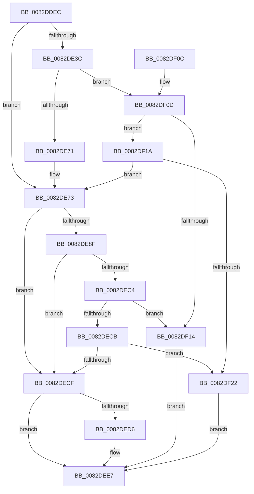

# CmAddPanelDevice

- RVA: `0x0082DDEC`–`0x0082DF29` (길이 `317` bytes)
- VA: `0x000000014082DDEC`
- 실행 섹션: `PAGE`
- PDB 이름 있음: `예`; PDB Function 태그: `아니요`
- unwind 정보 RVA: `0x000A88C0`
- 디코드: `81`개 명령, `317/317` bytes 표시
- 미해석 바이트: `0` (있으면 어셈블리에 `.byte`로 보존)

> 이 문서는 커널 이미지의 기계어와 PDB 기호를 분석해 생성했습니다. 4번과 5번은 함수 원형과 자료형을 바이너리 사용 방식에서 추정한 C 해석이며 원본 소스 복구 결과는 아닙니다.

## 1. Dependencies

- 직접 호출 지점: **6**; 고유 호출 대상: **5**
- 직접 호출자로 확인된 함수: **1**
- RIP 상대 이미지 참조: **1**

### Outgoing calls
- `0x0082DE21` → [memset](../../text/6C/memset_function_006C6C40.md) (function, `0x006C6C40`)
- `0x0082DE61` → [guard_dispatch_icall](../../text/6B/guard_dispatch_icall_function_006BAAD0.md) (function, `0x006BAAD0`)
- `0x0082DE83` → [CmAddPanelDeviceWorker](CmAddPanelDeviceWorker_function_0082DF30.md) (function, `0x0082DF30`)
- `0x0082DEB8` → [guard_dispatch_icall](../../text/6B/guard_dispatch_icall_function_006BAAD0.md) (function, `0x006BAAD0`)
- `0x0082DEE2` → [PnpObjectRaiseDevicesChangeEvent](../AC/PnpObjectRaiseDevicesChangeEvent_function_00AC9888.md) (function, `0x00AC9888`)
- `0x0082DEF4` → [_security_check_cookie](../../text/6A/_security_check_cookie_function_006AC640.md) (function, `0x006AC640`)

### Direct callers
- [_CmUpdateDevicePanel](../A0/_CmUpdateDevicePanel_function_00A0A16C.md) at `0x00A0ACED`

### Static image references
- `0x0082DDFB` → RVA `0x00E0A740` (`.data`; read)

## 2. Other-region calls and transfers

- 다른 실행 섹션으로 향하는 call: **4**
  - `0x0082DE21` → [memset](../../text/6C/memset_function_006C6C40.md) (`PAGE` → `.text`)
  - `0x0082DE61` → [guard_dispatch_icall](../../text/6B/guard_dispatch_icall_function_006BAAD0.md) (`PAGE` → `.text`)
  - `0x0082DEB8` → [guard_dispatch_icall](../../text/6B/guard_dispatch_icall_function_006BAAD0.md) (`PAGE` → `.text`)
  - `0x0082DEF4` → [_security_check_cookie](../../text/6A/_security_check_cookie_function_006AC640.md) (`PAGE` → `.text`)
- 별도 외부 분기/꼬리 이동을 확인하지 못했습니다.

## 3. Assembly (complete function range)

```asm
0082DDEC  48 89 5C 24 20                  mov qword ptr [rsp + 0x20], rbx
0082DDF1  55                              push rbp
0082DDF2  56                              push rsi
0082DDF3  57                              push rdi
0082DDF4  48 81 EC B0 00 00 00            sub rsp, 0xb0
0082DDFB  48 8B 05 3E C9 5D 00            mov rax, qword ptr [rip + 0x5dc93e]
0082DE02  48 33 C4                        xor rax, rsp
0082DE05  48 89 84 24 A0 00 00 00         mov qword ptr [rsp + 0xa0], rax
0082DE0D  48 8B EA                        mov rbp, rdx
0082DE10  49 8B D8                        mov rbx, r8
0082DE13  33 D2                           xor edx, edx
0082DE15  48 8B F1                        mov rsi, rcx
0082DE18  48 8D 4C 24 40                  lea rcx, [rsp + 0x40]
0082DE1D  44 8D 42 58                     lea r8d, [rdx + 0x58]
0082DE21  E8 1A 8E E9 FF                  call 0x1406c6c40
0082DE26  48 8B BE F8 01 00 00            mov rdi, qword ptr [rsi + 0x1f8]
0082DE2D  48 89 6C 24 50                  mov qword ptr [rsp + 0x50], rbp
0082DE32  48 89 5C 24 58                  mov qword ptr [rsp + 0x58], rbx
0082DE37  48 85 FF                        test rdi, rdi
0082DE3A  74 37                           je 0x14082de73
0082DE3C  41 B9 0D 00 00 00               mov r9d, 0xd
0082DE42  48 8D 44 24 40                  lea rax, [rsp + 0x40]
0082DE47  48 89 44 24 28                  mov qword ptr [rsp + 0x28], rax
0082DE4C  48 8B D5                        mov rdx, rbp
0082DE4F  48 8B CE                        mov rcx, rsi
0082DE52  C7 44 24 20 01 00 00 00         mov dword ptr [rsp + 0x20], 1
0082DE5A  48 8B C7                        mov rax, rdi
0082DE5D  45 8D 41 F9                     lea r8d, [r9 - 7]
0082DE61  E8 6A CC E8 FF                  call 0x1406baad0
0082DE66  3D 02 00 00 C0                  cmp eax, 0xc0000002
0082DE6B  0F 85 9C 00 00 00               jne 0x14082df0d
0082DE71  33 FF                           xor edi, edi
0082DE73  4C 8B 44 24 58                  mov r8, qword ptr [rsp + 0x58]
0082DE78  4C 8D 4C 24 60                  lea r9, [rsp + 0x60]
0082DE7D  48 8B D5                        mov rdx, rbp
0082DE80  48 8B CE                        mov rcx, rsi
0082DE83  E8 A8 00 00 00                  call 0x14082df30
0082DE88  8B D8                           mov ebx, eax
0082DE8A  48 85 FF                        test rdi, rdi
0082DE8D  74 40                           je 0x14082decf
0082DE8F  89 44 24 40                     mov dword ptr [rsp + 0x40], eax
0082DE93  41 B9 0D 00 00 00               mov r9d, 0xd
0082DE99  48 8D 44 24 40                  lea rax, [rsp + 0x40]
0082DE9E  48 8B D5                        mov rdx, rbp
0082DEA1  48 89 44 24 28                  mov qword ptr [rsp + 0x28], rax
0082DEA6  48 8B CE                        mov rcx, rsi
0082DEA9  48 8B C7                        mov rax, rdi
0082DEAC  C7 44 24 20 02 00 00 00         mov dword ptr [rsp + 0x20], 2
0082DEB4  45 8D 41 F9                     lea r8d, [r9 - 7]
0082DEB8  E8 13 CC E8 FF                  call 0x1406baad0
0082DEBD  3D 02 00 00 C0                  cmp eax, 0xc0000002
0082DEC2  74 0B                           je 0x14082decf
0082DEC4  3D 20 01 00 C0                  cmp eax, 0xc0000120
0082DEC9  74 49                           je 0x14082df14
0082DECB  85 C0                           test eax, eax
0082DECD  75 53                           jne 0x14082df22
0082DECF  80 7C 24 60 00                  cmp byte ptr [rsp + 0x60], 0
0082DED4  75 11                           jne 0x14082dee7
0082DED6  41 B8 06 00 00 00               mov r8d, 6
0082DEDC  48 8B D5                        mov rdx, rbp
0082DEDF  48 8B CE                        mov rcx, rsi
0082DEE2  E8 A1 B9 29 00                  call 0x140ac9888
0082DEE7  8B C3                           mov eax, ebx
0082DEE9  48 8B 8C 24 A0 00 00 00         mov rcx, qword ptr [rsp + 0xa0]
0082DEF1  48 33 CC                        xor rcx, rsp
0082DEF4  E8 47 E7 E7 FF                  call 0x1406ac640
0082DEF9  48 8B 9C 24 E8 00 00 00         mov rbx, qword ptr [rsp + 0xe8]
0082DF01  48 81 C4 B0 00 00 00            add rsp, 0xb0
0082DF08  5F                              pop rdi
0082DF09  5E                              pop rsi
0082DF0A  5D                              pop rbp
0082DF0B  C3                              ret
0082DF0C  CC                              int3
0082DF0D  3D 20 01 00 C0                  cmp eax, 0xc0000120
0082DF12  75 06                           jne 0x14082df1a
0082DF14  8B 5C 24 40                     mov ebx, dword ptr [rsp + 0x40]
0082DF18  EB CD                           jmp 0x14082dee7
0082DF1A  85 C0                           test eax, eax
0082DF1C  0F 84 51 FF FF FF               je 0x14082de73
0082DF22  BB E5 00 00 C0                  mov ebx, 0xc00000e5
0082DF27  EB BE                           jmp 0x14082dee7
```

## 4. C-style interpretation (structured pseudocode)

```c
__int64 __fastcall CmAddPanelDevice(__int64 a1, __int64 a2, __int64 a3)
{
    __int64 result;
    __int64 v_rdi;
    __int64 v_rsp;
    unsigned __int64 v_stack_m28;
    unsigned __int64 v_stack_m68;
    unsigned __int64 v_stack_m70;
    unsigned __int64 v_stack_m78;
    unsigned __int64 v_stack_m88;
    unsigned __int64 v_stack_mA0;
    unsigned int v_stack_mA8;
    unsigned __int64 v_stack_p20;
    unsigned int v_stack_p40;

    v_stack_p20 = v_rbx;
    v_rsp = (v_rsp) - (176);
    result = (*(unsigned __int64 *)(v_rip + 6146366)) ^ (v_rsp);
    v_stack_m28 = result;
    a2 = 0;
    result = memset(v_stack_m88, a2, a2 + 88, a4);
    v_stack_m78 = 0;
    v_stack_m70 = a3;
    if (*(unsigned __int64 *)(a1 + 504) == 0) goto loc_0082DE73;
    v_stack_mA0 = v_stack_m88;
    v_stack_mA8 = 1;
    result = guard_dispatch_icall(a1, 0, 13 - 7, 13);
    if (((unsigned int)(result)) != 0xC0000002ULL) goto loc_0082DF0D;
    v_rdi = 0;
loc_0082DE73:
    result = CmAddPanelDeviceWorker(a1, 0, v_stack_m70, v_stack_m68);
    if (0 == 0) goto loc_0082DECF;
    v_stack_m88 = (unsigned int)(result);
    v_stack_mA0 = v_stack_m88;
    v_stack_mA8 = 2;
    result = guard_dispatch_icall(a1, 0, 13 - 7, 13);
    if (((unsigned int)(result)) == 0xC0000002ULL) goto loc_0082DECF;
    if (((unsigned int)(result)) == 0xC0000120ULL) goto loc_0082DF14;
    if ((unsigned int)(result) != 0) goto loc_0082DF22;
loc_0082DECF:
    if (v_stack_m68 == 0) {
        a3 = 6;
        a2 = 0;
        a1 = a1;
        result = PnpObjectRaiseDevicesChangeEvent(a1, a2, a3, 13);
    }
    a1 = (v_stack_m28) ^ (v_rsp);
    result = _security_check_cookie(a1, a2, a3, 13);
    v_rsp = (v_rsp) + (176);
    return result;
loc_0082DF0D:
    if (((unsigned int)(result)) != 0xC0000120ULL) goto loc_0082DF1A;
loc_0082DF14:
    goto loc_0082DEE7;
loc_0082DF1A:
    if ((unsigned int)(result) == 0) goto loc_0082DE73;
loc_0082DF22:
    goto loc_0082DEE7;
}
```

## 5. (Beta) C Style

```c
int64_t CmAddPanelDevice(void *Arg1, int64_t Arg2, int64_t Arg3)
{
    uint8_t *arg1 = (uint8_t *)Arg1;

    int64_t result;
    int64_t local_rdi;
    int64_t local_rsp;
    uint64_t v_stack_m28;
    uint64_t v_stack_m68;
    uint64_t v_stack_m70;
    uint64_t v_stack_m78;
    uint64_t v_stack_m88;
    uint64_t v_stack_mA0;
    uint32_t v_stack_mA8;
    uint64_t v_stack_p20;
    uint32_t v_stack_p40;

    v_stack_p20 = local_rbx;
    local_rsp = (local_rsp) - (176);
    result = (*(uint64_t *)(v_rip + 0x5DC93E)) ^ (local_rsp);
    v_stack_m28 = result;
    Arg2 = 0;
    result = memset(v_stack_m88, Arg2, Arg2 + 88, a4);
    v_stack_m78 = 0;
    v_stack_m70 = Arg3;
    if (*(uint64_t *)(arg1 + 0x1F8) == 0) goto loc_0082DE73;
    v_stack_mA0 = v_stack_m88;
    v_stack_mA8 = 1;
    result = guard_dispatch_icall(Arg1, 0, 13 - 7, 13);
    if (((uint32_t)(result)) != 0xC0000002ULL) goto loc_0082DF0D;
    local_rdi = 0;
loc_0082DE73:
    result = CmAddPanelDeviceWorker(Arg1, 0, v_stack_m70, v_stack_m68);
    if (0 == 0) goto loc_0082DECF;
    v_stack_m88 = (uint32_t)(result);
    v_stack_mA0 = v_stack_m88;
    v_stack_mA8 = 2;
    result = guard_dispatch_icall(Arg1, 0, 13 - 7, 13);
    if (((uint32_t)(result)) == 0xC0000002ULL) goto loc_0082DECF;
    if (((uint32_t)(result)) == 0xC0000120ULL) goto loc_0082DF14;
    if ((uint32_t)(result) != 0) goto loc_0082DF22;
loc_0082DECF:
    if (v_stack_m68 == 0) {
        Arg3 = 6;
        Arg2 = 0;
        Arg1 = Arg1;
        result = PnpObjectRaiseDevicesChangeEvent(Arg1, Arg2, Arg3, 13);
    }
    Arg1 = (v_stack_m28) ^ (local_rsp);
    result = _security_check_cookie(Arg1, Arg2, Arg3, 13);
    local_rsp = (local_rsp) + (176);
    return result;
loc_0082DF0D:
    if (((uint32_t)(result)) != 0xC0000120ULL) goto loc_0082DF1A;
loc_0082DF14:
    goto loc_0082DEE7;
loc_0082DF1A:
    if ((uint32_t)(result) == 0) goto loc_0082DE73;
loc_0082DF22:
    goto loc_0082DEE7;
}
```

### 관측된 메모리 오프셋

구조체 형식이 확인되지 않은 접근은 인자 기준의 오프셋으로만 기록했습니다.

| 기준 인자 | 오프셋 표현 | 폭 (bit) | 접근 |
|---|---:|---:|---|
| `Arg1` | `+ 0x1F8` | `64` | `R` |

## 6. Execution-region graph

[열기: 2D/3D 그래프와 함수 탐색 컨트롤 패널](../../../control-panel.html?section=page&rva=0x0082DDEC&view=graph)

- 2D 그래프는 위에서 아래로 흐르고, 3D 그래프는 빈 공간을 드래그해 회전합니다. Shift+드래그는 이동, 휠은 확대·축소, 함수 노드 선택은 대상 보고서 이동입니다.

### Static fallback


