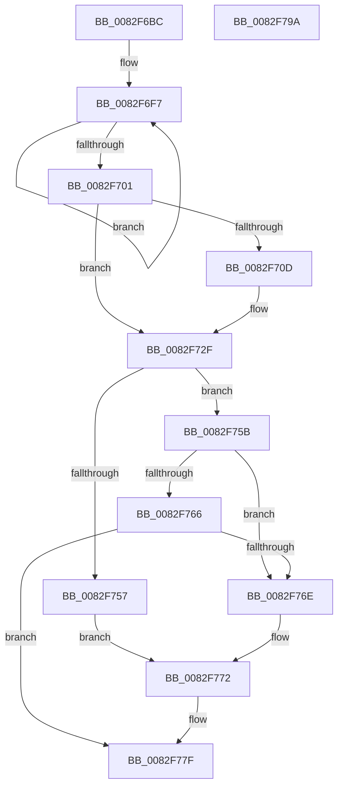

# CmAppendDeclarativeDefaultFilters

- RVA: `0x0082F6BC`–`0x0082F79B` (길이 `223` bytes)
- VA: `0x000000014082F6BC`
- 실행 섹션: `PAGE`
- PDB 이름 있음: `예`; PDB Function 태그: `아니요`
- unwind 정보 RVA: `0x000DAAAC`
- 디코드: `66`개 명령, `223/223` bytes 표시
- 미해석 바이트: `0` (있으면 어셈블리에 `.byte`로 보존)

> 이 문서는 커널 이미지의 기계어와 PDB 기호를 분석해 생성했습니다. 4번과 5번은 함수 원형과 자료형을 바이너리 사용 방식에서 추정한 C 해석이며 원본 소스 복구 결과는 아닙니다.

## 1. Dependencies

- 직접 호출 지점: **2**; 고유 호출 대상: **2**
- 직접 호출자로 확인된 함수: **1**
- RIP 상대 이미지 참조: **0**

### Outgoing calls
- `0x0082F71E` → [PnpMultiSzAppend](../9D/PnpMultiSzAppend_function_009D04D8.md) (function, `0x009D04D8`)
- `0x0082F749` → [CmAppendDeclarativeFilterLevel](CmAppendDeclarativeFilterLevel_function_0082F7A4.md) (function, `0x0082F7A4`)

### Direct callers
- [CmGetDeclarativeFilterList](CmGetDeclarativeFilterList_function_0082FE7C.md) at `0x0082FEFA`
- [CmGetDeclarativeFilterList](CmGetDeclarativeFilterList_function_0082FE7C.md) at `0x0082FF54`

### Static image references
- 디코드된 RIP-relative 메모리 참조가 없습니다.

## 2. Other-region calls and transfers

- 다른 실행 섹션으로 향하는 call: **0**
- 별도 외부 분기/꼬리 이동을 확인하지 못했습니다.

## 3. Assembly (complete function range)

```asm
0082F6BC  48 8B C4                        mov rax, rsp
0082F6BF  48 89 58 08                     mov qword ptr [rax + 8], rbx
0082F6C3  48 89 68 10                     mov qword ptr [rax + 0x10], rbp
0082F6C7  48 89 70 18                     mov qword ptr [rax + 0x18], rsi
0082F6CB  44 89 48 20                     mov dword ptr [rax + 0x20], r9d
0082F6CF  57                              push rdi
0082F6D0  41 56                           push r14
0082F6D2  41 57                           push r15
0082F6D4  48 83 EC 30                     sub rsp, 0x30
0082F6D8  4C 8B 54 24 70                  mov r10, qword ptr [rsp + 0x70]
0082F6DD  33 DB                           xor ebx, ebx
0082F6DF  8B 7C 24 78                     mov edi, dword ptr [rsp + 0x78]
0082F6E3  49 8B E8                        mov rbp, r8
0082F6E6  4C 89 50 28                     mov qword ptr [rax + 0x28], r10
0082F6EA  4C 8B F2                        mov r14, rdx
0082F6ED  89 58 20                        mov dword ptr [rax + 0x20], ebx
0082F6F0  4C 8B F9                        mov r15, rcx
0082F6F3  48 83 C8 FF                     or rax, 0xffffffffffffffff
0082F6F7  48 FF C0                        inc rax
0082F6FA  66 41 39 1C 40                  cmp word ptr [r8 + rax*2], bx
0082F6FF  75 F6                           jne 0x14082f6f7
0082F701  8D 34 45 02 00 00 00            lea esi, [rax*2 + 2]
0082F708  4D 85 D2                        test r10, r10
0082F70B  74 22                           je 0x14082f72f
0082F70D  4C 8D 4C 24 70                  lea r9, [rsp + 0x70]
0082F712  89 7C 24 68                     mov dword ptr [rsp + 0x68], edi
0082F716  48 8D 54 24 68                  lea rdx, [rsp + 0x68]
0082F71B  49 8B CA                        mov rcx, r10
0082F71E  E8 B5 0D 1A 00                  call 0x1409d04d8
0082F723  F6 D8                           neg al
0082F725  4D 1B D2                        sbb r10, r10
0082F728  4C 23 54 24 70                  and r10, qword ptr [rsp + 0x70]
0082F72D  2B FE                           sub edi, esi
0082F72F  48 8D 44 24 68                  lea rax, [rsp + 0x68]
0082F734  4D 8B CA                        mov r9, r10
0082F737  48 89 44 24 28                  mov qword ptr [rsp + 0x28], rax
0082F73C  4C 8B C5                        mov r8, rbp
0082F73F  49 8B D6                        mov rdx, r14
0082F742  89 7C 24 20                     mov dword ptr [rsp + 0x20], edi
0082F746  49 8B CF                        mov rcx, r15
0082F749  E8 56 00 00 00                  call 0x14082f7a4
0082F74E  8B D0                           mov edx, eax
0082F750  3D 34 00 00 C0                  cmp eax, 0xc0000034
0082F755  75 04                           jne 0x14082f75b
0082F757  8B D3                           mov edx, ebx
0082F759  EB 17                           jmp 0x14082f772
0082F75B  B9 00 00 00 80                  mov ecx, 0x80000000
0082F760  03 C1                           add eax, ecx
0082F762  85 C1                           test ecx, eax
0082F764  75 08                           jne 0x14082f76e
0082F766  81 FA 23 00 00 C0               cmp edx, 0xc0000023
0082F76C  75 11                           jne 0x14082f77f
0082F76E  8B 5C 24 68                     mov ebx, dword ptr [rsp + 0x68]
0082F772  48 8B 84 24 80 00 00 00         mov rax, qword ptr [rsp + 0x80]
0082F77A  8D 0C 33                        lea ecx, [rbx + rsi]
0082F77D  89 08                           mov dword ptr [rax], ecx
0082F77F  48 8B 5C 24 50                  mov rbx, qword ptr [rsp + 0x50]
0082F784  8B C2                           mov eax, edx
0082F786  48 8B 6C 24 58                  mov rbp, qword ptr [rsp + 0x58]
0082F78B  48 8B 74 24 60                  mov rsi, qword ptr [rsp + 0x60]
0082F790  48 83 C4 30                     add rsp, 0x30
0082F794  41 5F                           pop r15
0082F796  41 5E                           pop r14
0082F798  5F                              pop rdi
0082F799  C3                              ret
0082F79A  CC                              int3
```

## 4. C-style interpretation (structured pseudocode)

```c
__int64 __fastcall CmAppendDeclarativeDefaultFilters(__int64 a1, __int64 a2, __int64 a3, int a4, __int64 a5, unsigned int a6, __int64 a7)
{
    __int64 result;
    __int64 v_r10;
    __int64 v_rbx;
    __int64 v_rdi;
    __int64 v_rsp;
    unsigned __int64 v_stack_m20;
    unsigned int v_stack_m28;
    unsigned __int64 v_stack_p10;
    unsigned __int64 v_stack_p18;
    unsigned int v_stack_p20;
    unsigned __int64 v_stack_p8;

    *(unsigned __int64 *)(v_rsp + 8) = v_rbx;
    *(unsigned __int64 *)(v_rsp + 16) = v_rbp;
    *(unsigned __int64 *)(v_rsp + 24) = v_rsi;
    *(unsigned int *)(v_rsp + 32) = a4;
    v_rsp = (v_rsp) - (48);
    v_rbx = 0;
    *(unsigned __int64 *)(v_rsp + 40) = a5;
    *(unsigned int *)(v_rsp + 32) = 0;
    result = (v_rsp) | (-1);
loc_0082F6F7:
    result = (result) + 1;
    if ((*(unsigned __int16 *)(a3 + result * 2)) != 0) goto loc_0082F6F7;
    v_rdi = (unsigned int)(a6);
    v_r10 = a5;
    if (a5 != 0) {
        a4 = a5;
        v_stack_p20 = (unsigned int)((unsigned int)(a6));
        a2 = v_stack_p20;
        a1 = a5;
        result = PnpMultiSzAppend(a1, a2, a3, a4);
        result = (unsigned __int8)(-(result));
        v_r10 = (a5) & (a5);
        v_rdi = (unsigned int)(((unsigned int)(a6)) - ((unsigned int)(result * 2 + 2)));
    }
    v_stack_m20 = v_stack_p20;
    v_stack_m28 = (unsigned int)(v_rdi);
    result = CmAppendDeclarativeFilterLevel(a1, a2, a3, v_r10);
    if (((unsigned int)(result)) != 0xC0000034ULL) goto loc_0082F75B;
    goto loc_0082F772;
loc_0082F75B:
    result = (unsigned int)((result) + ((unsigned int)((unsigned int)(0x80000000ULL))));
    if ((((unsigned int)((unsigned int)(0x80000000ULL))) & ((unsigned int)(result))) != 0) goto loc_0082F76E;
    if (0 != 0xC0000023ULL) goto loc_0082F77F;
loc_0082F76E:
loc_0082F772:
    *(unsigned int *)(a7) = (unsigned int)((unsigned int)(v_stack_p20) + result * 2 + 2 * 1);
loc_0082F77F:
    v_rsp = (v_rsp) + (48);
    return 0;
}
```

## 5. (Beta) C Style

```c
int64_t CmAppendDeclarativeDefaultFilters(int64_t Arg1, int64_t Arg2, void *Arg3, int32_t Arg4, int64_t Arg5, uint32_t Arg6, void *Arg7)
{
    uint8_t *arg3 = (uint8_t *)Arg3;
    uint8_t *arg7 = (uint8_t *)Arg7;

    int64_t result;
    int64_t local_r10;
    int64_t local_rbx;
    int64_t local_rdi;
    int64_t local_rsp;
    uint64_t v_stack_m20;
    uint32_t v_stack_m28;
    uint64_t v_stack_p10;
    uint64_t v_stack_p18;
    uint32_t v_stack_p20;
    uint64_t v_stack_p8;

    *(uint64_t *)(local_rsp + 0x8) = local_rbx;
    *(uint64_t *)(local_rsp + 0x10) = local_rbp;
    *(uint64_t *)(local_rsp + 0x18) = local_rsi;
    *(uint32_t *)(local_rsp + 0x20) = Arg4;
    local_rsp = (local_rsp) - (48);
    local_rbx = 0;
    *(uint64_t *)(local_rsp + 0x28) = Arg5;
    *(uint32_t *)(local_rsp + 0x20) = 0;
    result = (local_rsp) | (-1);
loc_0082F6F7:
    result = (result) + 1;
    if ((*(uint16_t *)(arg3 + result * 2)) != 0) goto loc_0082F6F7;
    local_rdi = (uint32_t)(Arg6);
    local_r10 = Arg5;
    if (Arg5 != 0) {
        Arg4 = Arg5;
        v_stack_p20 = (uint32_t)((uint32_t)(Arg6));
        Arg2 = v_stack_p20;
        Arg1 = Arg5;
        result = PnpMultiSzAppend(Arg1, Arg2, Arg3, Arg4);
        result = (uint8_t)(-(result));
        local_r10 = (Arg5) & (Arg5);
        local_rdi = (uint32_t)(((uint32_t)(Arg6)) - ((uint32_t)(result * 2 + 2)));
    }
    v_stack_m20 = v_stack_p20;
    v_stack_m28 = (uint32_t)(local_rdi);
    result = CmAppendDeclarativeFilterLevel(Arg1, Arg2, Arg3, local_r10);
    if (((uint32_t)(result)) != 0xC0000034ULL) goto loc_0082F75B;
    goto loc_0082F772;
loc_0082F75B:
    result = (uint32_t)((result) + ((uint32_t)((uint32_t)(0x80000000ULL))));
    if ((((uint32_t)((uint32_t)(0x80000000ULL))) & ((uint32_t)(result))) != 0) goto loc_0082F76E;
    if (0 != 0xC0000023ULL) goto loc_0082F77F;
loc_0082F76E:
loc_0082F772:
    *(uint32_t *)(arg7) = (uint32_t)((uint32_t)(v_stack_p20) + result * 2 + 2 * 1);
loc_0082F77F:
    local_rsp = (local_rsp) + (48);
    return 0;
}
```

### 관측된 메모리 오프셋

구조체 형식이 확인되지 않은 접근은 인자 기준의 오프셋으로만 기록했습니다.

| 기준 인자 | 오프셋 표현 | 폭 (bit) | 접근 |
|---|---:|---:|---|
| `Arg3` | `+ 0x0 + rax*2` | `16` | `R` |
| `Arg7` | `+ 0x0` | `32` | `W` |

## 6. Execution-region graph

[열기: 2D/3D 그래프와 함수 탐색 컨트롤 패널](../../../control-panel.html?section=page&rva=0x0082F6BC&view=graph)

- 2D 그래프는 위에서 아래로 흐르고, 3D 그래프는 빈 공간을 드래그해 회전합니다. Shift+드래그는 이동, 휠은 확대·축소, 함수 노드 선택은 대상 보고서 이동입니다.

### Static fallback


