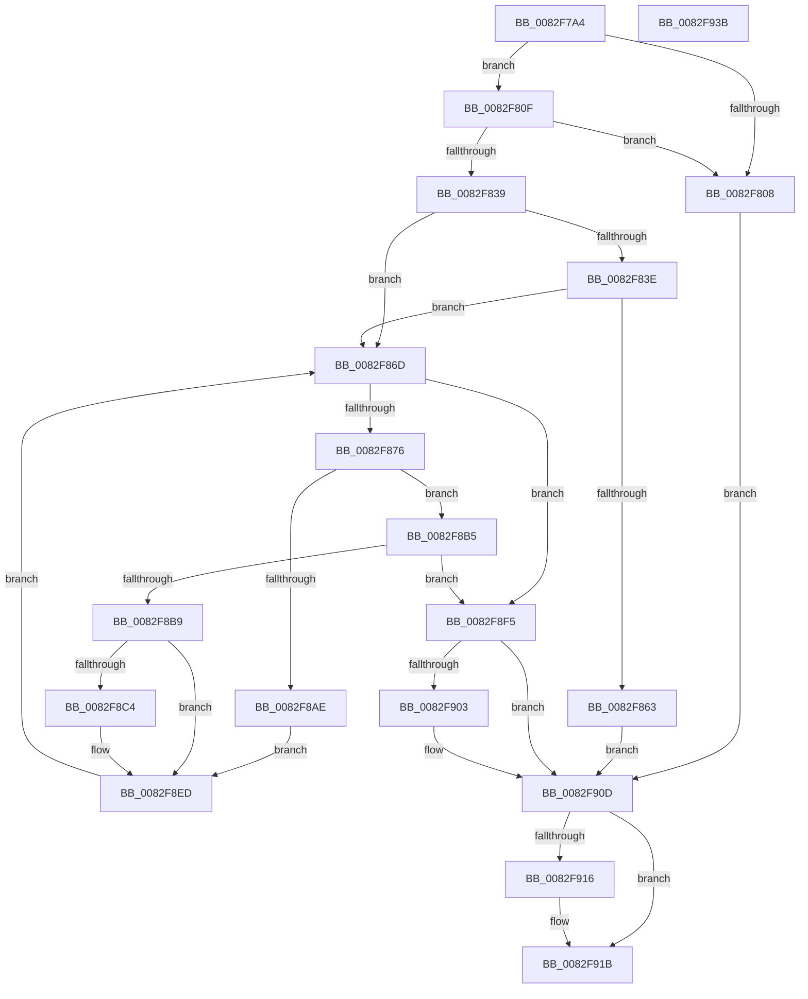

# CmAppendDeclarativeFilterLevel

- RVA: `0x0082F7A4`–`0x0082F93C` (길이 `408` bytes)
- VA: `0x000000014082F7A4`
- 실행 섹션: `PAGE`
- PDB 이름 있음: `예`; PDB Function 태그: `아니요`
- unwind 정보 RVA: `0x000BE68C`
- 디코드: `123`개 명령, `408/408` bytes 표시
- 미해석 바이트: `0` (있으면 어셈블리에 `.byte`로 보존)

> 이 문서는 커널 이미지의 기계어와 PDB 기호를 분석해 생성했습니다. 4번과 5번은 함수 원형과 자료형을 바이너리 사용 방식에서 추정한 C 해석이며 원본 소스 복구 결과는 아닙니다.

## 1. Dependencies

- 직접 호출 지점: **7**; 고유 호출 대상: **7**
- 직접 호출자로 확인된 함수: **2**
- RIP 상대 이미지 참조: **0**

### Outgoing calls
- `0x0082F7FF` → [PnpCtxRegOpenKey](../8E/PnpCtxRegOpenKey_function_008EF7B8.md) (function, `0x008EF7B8`)
- `0x0082F830` → [PnpCtxRegQueryInfoKey](../99/PnpCtxRegQueryInfoKey_function_009945FC.md) (function, `0x009945FC`)
- `0x0082F856` → [ExAllocatePool2](../../poolcode/B8/ExAllocatePool2_function_00B820F0.md) (function, `0x00B820F0`)
- `0x0082F89E` → [PnpCtxRegEnumValue](../99/PnpCtxRegEnumValue_function_0099364C.md) (function, `0x0099364C`)
- `0x0082F8DA` → [PnpMultiSzAppend](../9D/PnpMultiSzAppend_function_009D04D8.md) (function, `0x009D04D8`)
- `0x0082F908` → [ExFreePoolWithTag](../../poolcode/B8/ExFreePoolWithTag_function_00B82870.md) (function, `0x00B82870`)
- `0x0082F916` → [ZwClose](../../text/6A/ZwClose_function_006AD2B0.md) (function, `0x006AD2B0`)

### Direct callers
- [CmAppendDeclarativeDefaultFilters](CmAppendDeclarativeDefaultFilters_function_0082F6BC.md) at `0x0082F749`
- [CmGetDeclarativeFilterList](CmGetDeclarativeFilterList_function_0082FE7C.md) at `0x0082FFB0`

### Static image references
- 디코드된 RIP-relative 메모리 참조가 없습니다.

## 2. Other-region calls and transfers

- 다른 실행 섹션으로 향하는 call: **3**
  - `0x0082F856` → [ExAllocatePool2](../../poolcode/B8/ExAllocatePool2_function_00B820F0.md) (`PAGE` → `POOLCODE`)
  - `0x0082F908` → [ExFreePoolWithTag](../../poolcode/B8/ExFreePoolWithTag_function_00B82870.md) (`PAGE` → `POOLCODE`)
  - `0x0082F916` → [ZwClose](../../text/6A/ZwClose_function_006AD2B0.md) (`PAGE` → `.text`)
- 별도 외부 분기/꼬리 이동을 확인하지 못했습니다.

## 3. Assembly (complete function range)

```asm
0082F7A4  4C 8B DC                        mov r11, rsp
0082F7A7  49 89 5B 08                     mov qword ptr [r11 + 8], rbx
0082F7AB  49 89 73 10                     mov qword ptr [r11 + 0x10], rsi
0082F7AF  49 89 7B 18                     mov qword ptr [r11 + 0x18], rdi
0082F7B3  55                              push rbp
0082F7B4  41 54                           push r12
0082F7B6  41 55                           push r13
0082F7B8  41 56                           push r14
0082F7BA  41 57                           push r15
0082F7BC  48 8B EC                        mov rbp, rsp
0082F7BF  48 83 EC 60                     sub rsp, 0x60
0082F7C3  48 8B 45 58                     mov rax, qword ptr [rbp + 0x58]
0082F7C7  45 33 F6                        xor r14d, r14d
0082F7CA  4D 8B F9                        mov r15, r9
0082F7CD  4C 89 4D F0                     mov qword ptr [rbp - 0x10], r9
0082F7D1  45 33 C9                        xor r9d, r9d
0082F7D4  4C 89 75 E8                     mov qword ptr [rbp - 0x18], r14
0082F7D8  41 8B DE                        mov ebx, r14d
0082F7DB  44 89 75 E0                     mov dword ptr [rbp - 0x20], r14d
0082F7DF  44 89 30                        mov dword ptr [rax], r14d
0082F7E2  41 8B F6                        mov esi, r14d
0082F7E5  48 8D 45 E8                     lea rax, [rbp - 0x18]
0082F7E9  44 89 75 48                     mov dword ptr [rbp + 0x48], r14d
0082F7ED  49 89 43 A0                     mov qword ptr [r11 - 0x60], rax
0082F7F1  41 8B FE                        mov edi, r14d
0082F7F4  C7 44 24 20 00 00 00 80         mov dword ptr [rsp + 0x20], 0x80000000
0082F7FC  45 8B EE                        mov r13d, r14d
0082F7FF  E8 B4 FF 0B 00                  call 0x1408ef7b8
0082F804  85 C0                           test eax, eax
0082F806  79 07                           jns 0x14082f80f
0082F808  8B D8                           mov ebx, eax
0082F80A  E9 FE 00 00 00                  jmp 0x14082f90d
0082F80F  48 8B 55 E8                     mov rdx, qword ptr [rbp - 0x18]
0082F813  48 8D 45 48                     lea rax, [rbp + 0x48]
0082F817  4C 89 74 24 30                  mov qword ptr [rsp + 0x30], r14
0082F81C  45 33 C9                        xor r9d, r9d
0082F81F  48 89 44 24 28                  mov qword ptr [rsp + 0x28], rax
0082F824  45 33 C0                        xor r8d, r8d
0082F827  48 8D 45 E0                     lea rax, [rbp - 0x20]
0082F82B  48 89 44 24 20                  mov qword ptr [rsp + 0x20], rax
0082F830  E8 C7 4D 16 00                  call 0x1409945fc
0082F835  85 C0                           test eax, eax
0082F837  78 CF                           js 0x14082f808
0082F839  4D 85 FF                        test r15, r15
0082F83C  74 2F                           je 0x14082f86d
0082F83E  44 8B 6D 48                     mov r13d, dword ptr [rbp + 0x48]
0082F842  B9 00 01 00 00                  mov ecx, 0x100
0082F847  41 FF C5                        inc r13d
0082F84A  41 B8 50 4E 50 52               mov r8d, 0x52504e50
0082F850  41 8B D5                        mov edx, r13d
0082F853  48 03 D2                        add rdx, rdx
0082F856  E8 95 28 35 00                  call 0x140b820f0
0082F85B  48 8B F8                        mov rdi, rax
0082F85E  48 85 C0                        test rax, rax
0082F861  75 0A                           jne 0x14082f86d
0082F863  BB 17 00 00 C0                  mov ebx, 0xc0000017
0082F868  E9 A0 00 00 00                  jmp 0x14082f90d
0082F86D  44 8B E3                        mov r12d, ebx
0082F870  44 3B 75 E0                     cmp r14d, dword ptr [rbp - 0x20]
0082F874  73 7F                           jae 0x14082f8f5
0082F876  48 8B 55 E8                     mov rdx, qword ptr [rbp - 0x18]
0082F87A  33 C0                           xor eax, eax
0082F87C  48 89 44 24 38                  mov qword ptr [rsp + 0x38], rax
0082F881  4C 8B CF                        mov r9, rdi
0082F884  48 89 44 24 30                  mov qword ptr [rsp + 0x30], rax
0082F889  45 8B C6                        mov r8d, r14d
0082F88C  48 89 44 24 28                  mov qword ptr [rsp + 0x28], rax
0082F891  48 8D 45 48                     lea rax, [rbp + 0x48]
0082F895  48 89 44 24 20                  mov qword ptr [rsp + 0x20], rax
0082F89A  44 89 6D 48                     mov dword ptr [rbp + 0x48], r13d
0082F89E  E8 A9 3D 16 00                  call 0x14099364c
0082F8A3  8B D8                           mov ebx, eax
0082F8A5  B8 23 00 00 C0                  mov eax, 0xc0000023
0082F8AA  3B D8                           cmp ebx, eax
0082F8AC  75 07                           jne 0x14082f8b5
0082F8AE  03 75 48                        add esi, dword ptr [rbp + 0x48]
0082F8B1  8B D8                           mov ebx, eax
0082F8B3  EB 38                           jmp 0x14082f8ed
0082F8B5  85 DB                           test ebx, ebx
0082F8B7  78 3C                           js 0x14082f8f5
0082F8B9  03 75 48                        add esi, dword ptr [rbp + 0x48]
0082F8BC  41 8B DC                        mov ebx, r12d
0082F8BF  4D 85 FF                        test r15, r15
0082F8C2  74 29                           je 0x14082f8ed
0082F8C4  8B 45 50                        mov eax, dword ptr [rbp + 0x50]
0082F8C7  4C 8D 4D F0                     lea r9, [rbp - 0x10]
0082F8CB  4C 8B C7                        mov r8, rdi
0082F8CE  89 45 48                        mov dword ptr [rbp + 0x48], eax
0082F8D1  48 8D 55 48                     lea rdx, [rbp + 0x48]
0082F8D5  49 8B CF                        mov rcx, r15
0082F8D8  FF C6                           inc esi
0082F8DA  E8 F9 0B 1A 00                  call 0x1409d04d8
0082F8DF  4C 8B 7D F0                     mov r15, qword ptr [rbp - 0x10]
0082F8E3  84 C0                           test al, al
0082F8E5  B8 23 00 00 C0                  mov eax, 0xc0000023
0082F8EA  0F 44 D8                        cmove ebx, eax
0082F8ED  41 FF C6                        inc r14d
0082F8F0  E9 78 FF FF FF                  jmp 0x14082f86d
0082F8F5  48 8B 4D 58                     mov rcx, qword ptr [rbp + 0x58]
0082F8F9  8D 04 36                        lea eax, [rsi + rsi]
0082F8FC  89 01                           mov dword ptr [rcx], eax
0082F8FE  48 85 FF                        test rdi, rdi
0082F901  74 0A                           je 0x14082f90d
0082F903  33 D2                           xor edx, edx
0082F905  48 8B CF                        mov rcx, rdi
0082F908  E8 63 2F 35 00                  call 0x140b82870
0082F90D  48 8B 4D E8                     mov rcx, qword ptr [rbp - 0x18]
0082F911  48 85 C9                        test rcx, rcx
0082F914  74 05                           je 0x14082f91b
0082F916  E8 95 D9 E7 FF                  call 0x1406ad2b0
0082F91B  4C 8D 5C 24 60                  lea r11, [rsp + 0x60]
0082F920  8B C3                           mov eax, ebx
0082F922  49 8B 5B 30                     mov rbx, qword ptr [r11 + 0x30]
0082F926  49 8B 73 38                     mov rsi, qword ptr [r11 + 0x38]
0082F92A  49 8B 7B 40                     mov rdi, qword ptr [r11 + 0x40]
0082F92E  49 8B E3                        mov rsp, r11
0082F931  41 5F                           pop r15
0082F933  41 5E                           pop r14
0082F935  41 5D                           pop r13
0082F937  41 5C                           pop r12
0082F939  5D                              pop rbp
0082F93A  C3                              ret
0082F93B  CC                              int3
```

## 4. C-style interpretation (structured pseudocode)

```c
__int64 __fastcall CmAppendDeclarativeFilterLevel(__int64 a1, __int64 a2, int a3, __int64 a4, unsigned int a5, __int64 a6)
{
    __int64 result;
    __int64 v_r13;
    __int64 v_r14;
    __int64 v_r15;
    __int64 v_rbx;
    __int64 v_rsi;
    __int64 v_rsp;
    unsigned __int64 v_stack_m28;
    unsigned __int64 v_stack_m38;
    unsigned __int64 v_stack_m40;
    unsigned int v_stack_m48;
    unsigned __int64 v_stack_m50;
    unsigned __int64 v_stack_m58;
    unsigned __int64 v_stack_m60;
    unsigned int v_stack_m68;
    unsigned int v_stack_p20;

    *(unsigned __int64 *)(v_rsp + 8) = v_rbx;
    *(unsigned __int64 *)(v_rsp + 16) = v_rsi;
    *(unsigned __int64 *)(v_rsp + 24) = v_rdi;
    v_rsp = (v_rsp) - (96);
    v_r14 = 0;
    v_stack_m38 = a4;
    a4 = 0;
    v_stack_m40 = 0;
    v_stack_m48 = 0;
    *(unsigned int *)(a6) = 0;
    v_stack_p20 = 0;
    *(unsigned __int64 *)(v_rsp - 96) = v_stack_m40;
    v_stack_m68 = 0x80000000ULL;
    result = PnpCtxRegOpenKey(a1, a2, a3, a4);
    if (!sign_flag) goto loc_0082F80F;
loc_0082F808:
    goto loc_0082F90D;
loc_0082F80F:
    v_stack_m58 = 0;
    a4 = 0;
    v_stack_m60 = v_stack_p20;
    a3 = 0;
    v_stack_m68 = v_stack_m48;
    result = PnpCtxRegQueryInfoKey(a1, v_stack_m40, a3, a4);
    if (sign_flag) goto loc_0082F808;
    if (0 == 0) goto loc_0082F86D;
    v_r13 = (unsigned int)(((unsigned int)(v_stack_p20)) + 1);
    a2 = ((unsigned int)((unsigned int)(v_r13))) + ((unsigned int)((unsigned int)(v_r13)));
    result = ExAllocatePool2(256, a2, (unsigned int)(0x52504E50ULL), a4);
    if (result != 0) goto loc_0082F86D;
    goto loc_0082F90D;
loc_0082F86D:
    if (0 >= v_stack_m48) goto loc_0082F8F5;
    result = 0;
    v_stack_m50 = 0;
    v_stack_m58 = 0;
    v_stack_m60 = 0;
    v_stack_m68 = v_stack_p20;
    v_stack_p20 = (unsigned int)(v_r13);
    result = PnpCtxRegEnumValue(256, v_stack_m40, 0, 0);
    if (((unsigned int)((unsigned int)((unsigned int)(result)))) != ((unsigned int)((unsigned int)(0xC0000023ULL)))) goto loc_0082F8B5;
    v_rsi = (unsigned int)((0) + (v_stack_p20));
    goto loc_0082F8ED;
loc_0082F8B5:
    if (sign_flag) goto loc_0082F8F5;
    v_rsi = (unsigned int)((v_rsi) + (v_stack_p20));
    result = (unsigned int)(0xC0000023ULL);
    v_rbx = (unsigned int)((unsigned int)((unsigned int)((unsigned int)((unsigned int)(0xC0000017ULL)))));
    v_r15 = a4;
    if (0 != 0) {
        result = a5;
        a4 = v_stack_m38;
        a3 = result;
        v_stack_p20 = (unsigned int)(result);
        a2 = v_stack_p20;
        a1 = a4;
        v_rsi = (unsigned int)((v_rsi) + 1);
        result = PnpMultiSzAppend(a1, a2, a3, a4);
        v_r15 = v_stack_m38;
        result = 0xC0000023ULL;
        v_rbx = (unsigned int)((unsigned int)((unsigned int)((unsigned int)((unsigned int)(0xC0000017ULL)))));
        if ((unsigned __int8)(result) == 0) { v_rbx = (unsigned int)(result); }
    }
    v_r14 = (unsigned int)((v_r14) + 1);
    goto loc_0082F86D;
loc_0082F8F5:
    *(unsigned int *)(a6) = (unsigned int)(v_rsi + v_rsi * 1);
    result = v_rsi + v_rsi * 1;
    if (result != 0) {
        a2 = 0;
        a1 = result;
        result = ExFreePoolWithTag(a1, a2, a3, a4);
    }
    if (v_stack_m40 != 0) {
        result = ZwClose(v_stack_m40, a2, a3, a4);
    }
    return (unsigned int)((unsigned int)(v_rbx));
}
```

## 5. (Beta) C Style

```c
int64_t CmAppendDeclarativeFilterLevel(int64_t Arg1, int64_t Arg2, int32_t Arg3, int64_t Arg4, uint32_t Arg5, void *Arg6)
{
    uint8_t *arg6 = (uint8_t *)Arg6;

    int64_t result;
    int64_t local_r13;
    int64_t local_r14;
    int64_t local_r15;
    int64_t local_rbx;
    int64_t local_rsi;
    int64_t local_rsp;
    uint64_t v_stack_m28;
    uint64_t v_stack_m38;
    uint64_t v_stack_m40;
    uint32_t v_stack_m48;
    uint64_t v_stack_m50;
    uint64_t v_stack_m58;
    uint64_t v_stack_m60;
    uint32_t v_stack_m68;
    uint32_t v_stack_p20;

    *(uint64_t *)(local_rsp + 0x8) = local_rbx;
    *(uint64_t *)(local_rsp + 0x10) = local_rsi;
    *(uint64_t *)(local_rsp + 0x18) = local_rdi;
    local_rsp = (local_rsp) - (96);
    local_r14 = 0;
    v_stack_m38 = Arg4;
    Arg4 = 0;
    v_stack_m40 = 0;
    v_stack_m48 = 0;
    *(uint32_t *)(arg6) = 0;
    v_stack_p20 = 0;
    *(uint64_t *)(local_rsp - 0x60) = v_stack_m40;
    v_stack_m68 = 0x80000000ULL;
    result = PnpCtxRegOpenKey(Arg1, Arg2, Arg3, Arg4);
    if (!sign_flag) goto loc_0082F80F;
loc_0082F808:
    goto loc_0082F90D;
loc_0082F80F:
    v_stack_m58 = 0;
    Arg4 = 0;
    v_stack_m60 = v_stack_p20;
    Arg3 = 0;
    v_stack_m68 = v_stack_m48;
    result = PnpCtxRegQueryInfoKey(Arg1, v_stack_m40, Arg3, Arg4);
    if (sign_flag) goto loc_0082F808;
    if (0 == 0) goto loc_0082F86D;
    local_r13 = (uint32_t)(((uint32_t)(v_stack_p20)) + 1);
    Arg2 = ((uint32_t)((uint32_t)(local_r13))) + ((uint32_t)((uint32_t)(local_r13)));
    result = ExAllocatePool2(256, Arg2, (uint32_t)(0x52504E50ULL), Arg4);
    if (result != 0) goto loc_0082F86D;
    goto loc_0082F90D;
loc_0082F86D:
    if (0 >= v_stack_m48) goto loc_0082F8F5;
    result = 0;
    v_stack_m50 = 0;
    v_stack_m58 = 0;
    v_stack_m60 = 0;
    v_stack_m68 = v_stack_p20;
    v_stack_p20 = (uint32_t)(local_r13);
    result = PnpCtxRegEnumValue(256, v_stack_m40, 0, 0);
    if (((uint32_t)((uint32_t)((uint32_t)(result)))) != ((uint32_t)((uint32_t)(0xC0000023ULL)))) goto loc_0082F8B5;
    local_rsi = (uint32_t)((0) + (v_stack_p20));
    goto loc_0082F8ED;
loc_0082F8B5:
    if (sign_flag) goto loc_0082F8F5;
    local_rsi = (uint32_t)((local_rsi) + (v_stack_p20));
    result = (uint32_t)(0xC0000023ULL);
    local_rbx = (uint32_t)((uint32_t)((uint32_t)((uint32_t)((uint32_t)(0xC0000017ULL)))));
    local_r15 = Arg4;
    if (0 != 0) {
        result = Arg5;
        Arg4 = v_stack_m38;
        Arg3 = result;
        v_stack_p20 = (uint32_t)(result);
        Arg2 = v_stack_p20;
        Arg1 = Arg4;
        local_rsi = (uint32_t)((local_rsi) + 1);
        result = PnpMultiSzAppend(Arg1, Arg2, Arg3, Arg4);
        local_r15 = v_stack_m38;
        result = 0xC0000023ULL;
        local_rbx = (uint32_t)((uint32_t)((uint32_t)((uint32_t)((uint32_t)(0xC0000017ULL)))));
        if ((uint8_t)(result) == 0) { local_rbx = (uint32_t)(result); }
    }
    local_r14 = (uint32_t)((local_r14) + 1);
    goto loc_0082F86D;
loc_0082F8F5:
    *(uint32_t *)(arg6) = (uint32_t)(local_rsi + local_rsi * 1);
    result = local_rsi + local_rsi * 1;
    if (result != 0) {
        Arg2 = 0;
        Arg1 = result;
        result = ExFreePoolWithTag(Arg1, Arg2, Arg3, Arg4);
    }
    if (v_stack_m40 != 0) {
        result = ZwClose(v_stack_m40, Arg2, Arg3, Arg4);
    }
    return (uint32_t)((uint32_t)(local_rbx));
}
```

### 관측된 메모리 오프셋

구조체 형식이 확인되지 않은 접근은 인자 기준의 오프셋으로만 기록했습니다.

| 기준 인자 | 오프셋 표현 | 폭 (bit) | 접근 |
|---|---:|---:|---|
| `Arg6` | `+ 0x0` | `32` | `W` |

## 6. Execution-region graph

[열기: 2D/3D 그래프와 함수 탐색 컨트롤 패널](../../../control-panel.html?section=page&rva=0x0082F7A4&view=graph)

- 2D 그래프는 위에서 아래로 흐르고, 3D 그래프는 빈 공간을 드래그해 회전합니다. Shift+드래그는 이동, 휠은 확대·축소, 함수 노드 선택은 대상 보고서 이동입니다.

### Static fallback


